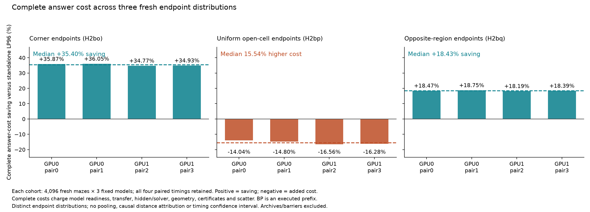
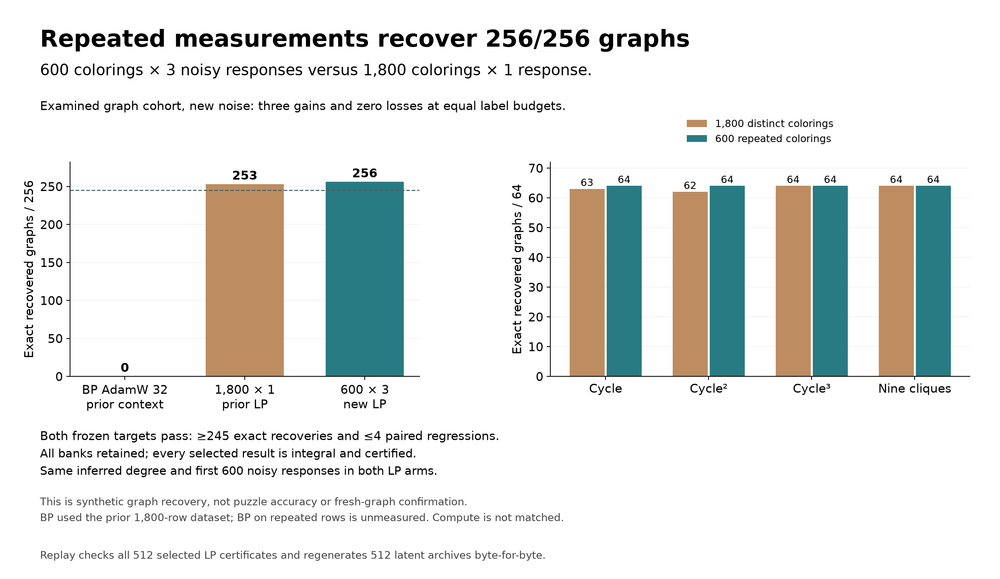
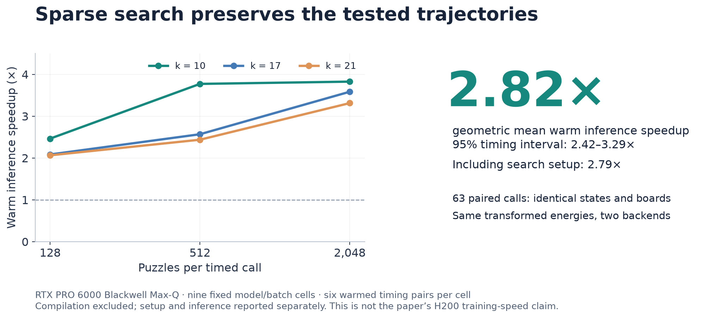

# Hopfield: small energies, better reasoning

**99.9567% Sudoku accuracy with a count-based energy and no optimizer.**

Independent implementation, reproduction and research extensions of [*Classical Energies Learn to Reason 1,000× Faster than Looped Models*](https://arxiv.org/abs/2611.17309v1), by Benjamin Hoover, Hugh Blayney and James C. R. Whittington. CRAM learns an energy function, then searches for low-energy answers. We test what learning, data and search each contribute.

**Fresh dense mazes:** **4,096/4,096** solved across three fixed models. A BP-first cascade cuts complete answer cost **35.40%** with corner endpoints and **18.43%** across opposite corner regions, but costs **15.54% more** with uniformly sampled open-cell endpoints. Each cohort retains every LP96 success. [Speedup](research/20261114/work/REPORT.md#h2bo-fresh-confirmation-supports-999-joint-success-and-saves-3540-complete-answer-cost) · [Endpoint-shift slowdown](research/20261114/work/REPORT.md#h2bp-uniform-endpoints-preserve-joint-success-but-falsify-the-cost-saving-target)

[Reviewed paper](references/2611.17309v1.md) · [All results](results/README.md) · [Reproduction](REPRODUCTION.md) · [Run the code](docs/RERUN_GUIDE.md)

## Sudoku from simple counts


Connect cells that **never share a digit in training solutions**, assign weight one, and search. On 10,000 reserved official puzzles across six search seeds, this solves **59,974/60,000 evaluations (99.9567%)**, with zero wrong stops. The transformed learned energy reaches **99.9417%** at the same budget: four chains, 16,777,216 moves per chain. At the shorter 262,144-move cap, counts reach 81.50%.

This headline uses ten base solutions with 99 stored Sudoku-symmetry variants each. **Augmentation supplies task knowledge.** A separate control recovers the same constraint graph from 100 distinct unaugmented solutions in all six samples. The estimator receives no cell geometry. [Budget, uncertainty and stopping proof](research/20261114/foureyes/REPORT-budget.md) · [Raw-data control](research/20261114/ripper/REPORT-raw-count.md)

## Maze speed depends on endpoint placement



At **180×180 and 80% loop density**, the fixed BP-first cascade solves **4,096/4,096 fresh mazes jointly across all three models**, versus **3,921** for BP AdamW. LP96 alone also solves all 4,096. The cascade accepts BP paths that pass a geometry check and runs LP96 on the remaining inputs.

Across four balanced paired replays, median complete answer cost falls **35.40%**. Model readiness, screening and actual routed computation are charged. All three prespecified targets pass separately: at least 99.9% joint success, accuracy no more than 0.1 percentage point below LP96, and at least 10% cost savings. The one-sided 95% success lower bound is **99.9269%**; the models are fixed conditions, not extra independent trials. [Protocol, every input and measured costs](research/20261114/work/REPORT.md#h2bo-fresh-confirmation-supports-999-joint-success-and-saves-3540-complete-answer-cost)

**Changing endpoint placement reverses the cost result.** On a separate fresh cohort with endpoints sampled uniformly from open cells, BP AdamW solves **4,079/4,096**; LP96 and the cascade each solve **4,096/4,096**. The accuracy targets pass, but the cascade costs **15.54% more**, falsifying the 10% saving target. All four timing pairs show a slowdown. [Endpoint-shift protocol and full audit](research/20261114/work/REPORT.md#h2bp-uniform-endpoints-preserve-joint-success-but-falsify-the-cost-saving-target)

A third fresh cohort draws endpoints from opposite corner regions. LP96 and the cascade again solve **4,096/4,096**; BP AdamW solves **4,003**. Median complete cost falls **18.43%**, passing all three targets. [Far-region confirmation](research/20261114/work/REPORT.md#h2bq-opposite-region-endpoints-preserve-joint-success-and-save-1843-complete-answer-cost)

On a fresh 50:50 mixture of uniform and far-region endpoints, a distance-based dispatcher also solves **4,096/4,096**, but costs **14.04% more than LP96** and **30.41% more than always using the cascade**. Both cost targets fail in every timing block. [Mixed-cohort test and complete costs](research/20261114/work/REPORT.md#h2br-endpoint-dispatch-preserves-accuracy-but-falsifies-both-cost-targets)

Packing those same examined inputs into groups with the same route reduces the dispatcher's complete answer cost **31.34%**, with identical outputs and trajectories across all 147,456 timed copies. This improves the dispatcher; a new matched comparison against LP96 and always-cascade was prepared but **not run** before research stopped. [Measured packing result and unrun follow-up](research/20261114/work/REPORT.md)

The decoder supplies an explicit graph prior. Geometry alone does not prove shortestness, and energy certificates do not prove graph validity. Every reported solve receives independent graph checks. These distinct endpoint distributions are reported separately; the comparison does not isolate a causal effect of path length. [Controls and earlier cohorts](docs/RESEARCH_DETAILS.md#cycle-cuts-solve-fresh-dense-mazes)

## Change the search, keep the learned energy


Keep one queen in each row and column while proposing moves. With identical fitted weights and starting boards, this raises certified success from **5.75% to 99.78%** for queen-plus-zebra and **7.68% to 99.87%** for queen-plus-(2,5)-leaper. Median complete GPU solve times are within **1.2% and 4.2%**, respectively. Both frozen 50-point gain targets pass, with zero wrong stops.

Each family uses a complete N12 training universe and 4,096 fresh N13 inputs, with 20 chains and three search seeds. These are two fixed families with a supplied permutation prior. [Matched-time replication and controls](research/20261114/loki/h3ad/REPORT.md) · [Question-selection experiments and retained failures](docs/RESEARCH_DETAILS.md#a-search-prior-makes-the-same-learned-energy-much-more-useful)

## Spend noisy queries on distinct boards


At the same noisy-label budget, **270 distinct boards queried once recover the exact graph in all 72 fresh source banks**, versus **0/72** from 90 boards queried three times with correlated errors. Both frozen targets pass: at least 60 recoveries and at least 48 net gains. Both methods know their nominal noise channel and infer the graph degree without Sudoku geometry.

Each arm uses **19,440 noisy cell responses per bank**, but the successful policy uses **three times as many source boards**. This tests an acquisition remedy, not correlation alone. A monitoring thread failed near completion; all scientific commands and independent audits passed, and final counters after every child exited establish compliance with the runtime budget. [Fresh protocol, every outcome and disclosed monitoring fault](research/20261114/ripper/REPORT-diversity-after-correlation.md)

The preceding correlated-repeat study recovered **0/72 with both tested estimators**, including the control supplied with the correct joint channel. Those certified failures remain visible. [Correlation boundary](research/20261114/ripper/REPORT-correlated-repeat.md)

**Independent repeats behave differently.** At 7.5% independent noise, retaining posterior uncertainty recovers **61/64 fresh graphs**, versus **51/64** after hard decoding and **64/64** from more distinct boards. Estimating the noise rate also matches supplied-rate controls at **67/72** with rates varying between banks and **70/72** with rates varying across cells. These are separate studies, not pooled evidence. [Posterior confirmation](research/20261114/ripper/REPORT-posterior-fresh-confirm.md) · [Between-bank rates](research/20261114/ripper/REPORT-heterogeneous-channel.md) · [Within-bank rates](research/20261114/ripper/REPORT-cell-channel.md) · [Earlier controls and failures](docs/RESEARCH_DETAILS.md)

## Use all the noisy observations


On **256 fresh synthetic graph banks**, pooling all **1,800 noisy observations** recovers **253/256** exact graphs, versus **239/256** for donor-plus-masking using the same observations. Pooling gains **15 graphs and loses one**; both fixed targets pass. Every graph degree is inferred correctly from the first 600 noisy rows.

This is graph recovery, not puzzle-solving accuracy. A separately reviewed audit corrects one software-version assertion; the original incomplete run and unchanged fits remain public. Three pooled graphs remain wrong, and the donor alone recovers the same 239 banks. [Fresh result, correction and all failures](research/20261114/foureyes/REPORT-fresh-pooled-donor.md) · [Earlier examined-data comparison: 254 versus 229](research/20261114/foureyes/REPORT-pooled-donor.md)

**Repeated measurements recover 256/256 on these examined graphs.** Keeping the first 600 colorings and acquiring three independent noisy responses per coloring recovers all 256, versus the prior 253/256 from 1,800 colorings observed once. Both arms use the same label budget and inferred degrees; there are three gains and no losses. These are new noise responses on an examined source cohort, so fresh-graph confirmation remains unrun. [Protocol, proof replay and scope](research/20261114/foureyes/REPORT-repeat-diversity.md)



Earlier detector controls remain informative: removing every false positive leaves recovery at **130/256**, while randomly selecting the same number of actual corruptions per row reaches **237/256**. Both masks use privileged corruption locations, and both prespecified detector targets fail. [Mask-selection mechanism and retained failures](research/20261114/foureyes/REPORT-purified-detector.md)

## Faster inference



The sparse backend runs transformed Sudoku energies **2.82× faster** in warm inference, or **2.79× including search setup**, on RTX PRO 6000 Blackwell Max-Q. All 63 paired timing calls return identical states and boards. Compilation is excluded from warm timing. [Measurements and parity checks](research/20261114/ripper/REPORT-sparse.md)

## What was reproduced?

The original campaign measured **99.996689% Sudoku accuracy** across three full held-out runs, **100% Maze-Unique**, **99.9% Maze-Hard**, and all graph-coloring quality cells. It completed 84 objective runs, 100 training curves, 102 data-efficiency runs, and the declared controls and supplemental ablations. These original protocols differ from the research experiments above.

Baselines are explicitly **published results**. The paper's H200 **“1,000×” speed claim is not independently established** by our Blackwell experiments. [Reproduction evidence and limits](REPRODUCTION.md) · [Paper coverage](docs/PAPER_COVERAGE.md)

Negative and incomplete results remain public, including failed weighting and rounding refinements, misleading energy certificates, and capped exact-tree searches. [All hypotheses and outcomes](results/README.md) · [Detailed comparisons](docs/RESEARCH_DETAILS.md) · [Development history](docs/RESEARCH_TOUR.md)

## Get started

```sh
git clone --depth 1 --filter=blob:none --sparse https://github.com/catid/hopfield.git
cd hopfield
git sparse-checkout set src tests
git clone https://github.com/Prefrontal-AI/CRAM.git upstream
git -C upstream checkout --detach 62bbe830c7d6f87f2ba18f30a28039258b986454
uv sync --project upstream --frozen --python 3.13.13
uv pip install --python upstream/.venv/bin/python --no-deps -e .
CUDA_VISIBLE_DEVICES= upstream/.venv/bin/python -m pytest -q tests/test_reference.py tests/test_counting.py
```

Build the optimizer-free energy from completed training boards:

```python
from hopfield_cram import fit_never_equal

# Integer tensor (examples, 81), digits 0..8; training data only.
energy, equality_counts = fit_never_equal(training_solutions, n_values=9)
```

The [public API](src/hopfield_cram/counting.py) receives no cell geometry; insufficient data can still create false exclusions. All 38 reference/counting tests pass. The sparse checkout above downloads the code needed for this quickstart. Run `git sparse-checkout disable` to fetch the research evidence, figures and [research runners](research/20261114/); the full proof collection is several gigabytes.

[Setup and rerun guide](docs/RERUN_GUIDE.md) · [Implementation](docs/IMPLEMENTATION.md) · [Figure data and renderers](docs/FIGURES.md) · [Detailed comparisons](docs/RESEARCH_DETAILS.md) · [Original development record](results/reproduction/README.md)

Public JSON/CSV measurements, protocols and audit hashes are included. Large datasets and raw board archives stay outside Git. Research is paused at the user's request; [final results and prepared but unrun studies](docs/RESEARCH_STATUS.md) are recorded separately. Highlights above are audited.

Code: [Apache 2.0](LICENSE). Paper and converted assets: CC BY 4.0. [Attribution](NOTICE.md).
