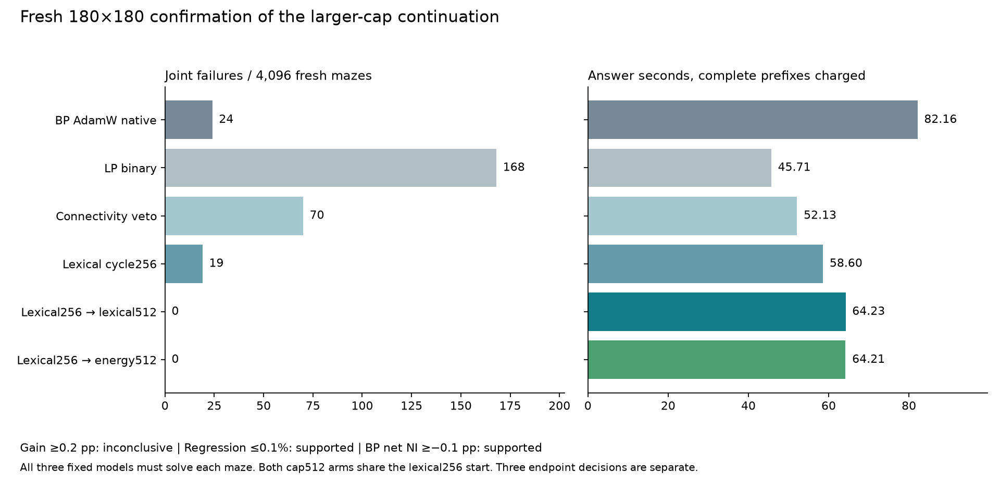
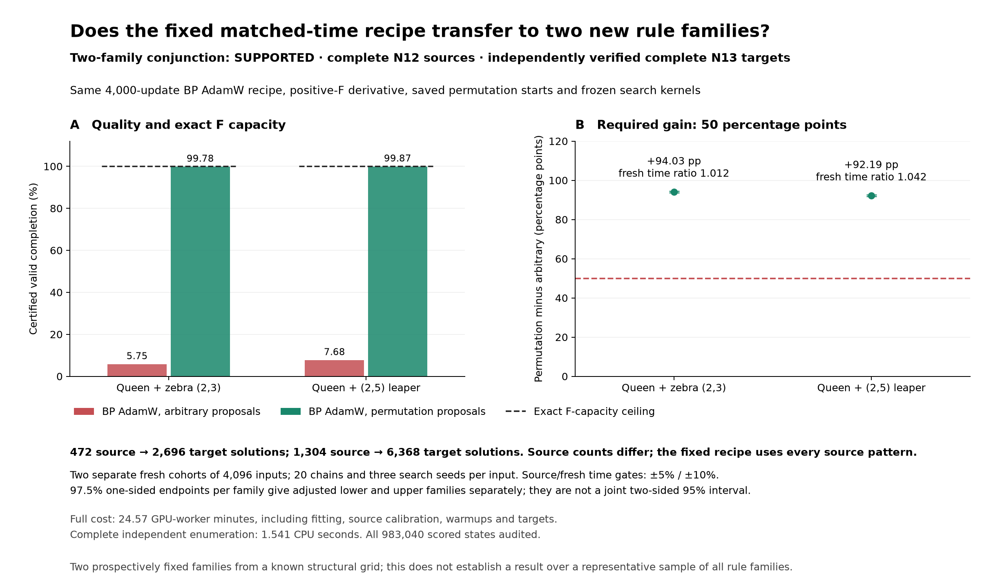

# Hopfield: small energies, better reasoning

**99.9567% Sudoku accuracy with a count-based energy and no optimizer.**

Independent implementation, reproduction and research extensions of [*Classical Energies Learn to Reason 1,000× Faster than Looped Models*](https://arxiv.org/abs/2611.17309v1), by Benjamin Hoover, Hugh Blayney and James C. R. Whittington. CRAM learns an energy function, then searches for low-energy answers. We test what learning, data and search each contribute.

[Reviewed paper](references/2611.17309v1.md) · [All results](results/README.md) · [Reproduction](REPRODUCTION.md) · [Run the code](docs/RERUN_GUIDE.md)

## Sudoku from simple counts


Connect cells that **never share a digit in training solutions**, assign weight one, and search. On 10,000 reserved official puzzles across six search seeds, this solves **59,974/60,000 evaluations (99.9567%)**, with zero wrong stops. The transformed learned energy reaches **99.9417%** at the same budget: four chains, 16,777,216 moves per chain. At the shorter 262,144-move cap, counts reach 81.50%.

This headline uses ten base solutions with 99 stored Sudoku-symmetry variants each. **Augmentation supplies task knowledge.** A separate control recovers the same constraint graph from 100 distinct unaugmented solutions in all six samples. The estimator receives no cell geometry. [Budget, uncertainty and stopping proof](research/20261114/foureyes/REPORT-budget.md) · [Raw-data control](research/20261114/ripper/REPORT-raw-count.md)

With concentrated label corruption, adding an **equal-degree prior** recovers **64/64 exact graphs** on new 2,400-board training banks, versus 26/64 for the earlier count-gap heuristic. The selector receives neither degree twenty nor edge count 810. This measures graph recovery under a fixed noise law; no new puzzle-solving accuracy is claimed. [Fresh-source controls and every candidate threshold](research/20261114/foureyes/REPORT-regularity-fresh.md)

## Cycle cuts solve fresh mazes at two sizes


On **8,192 new 120×120 loopy mazes**, adding cycle cuts solves every input across all three frozen models: **24,576/24,576 model-input solves**. BP AdamW solves 8,177 inputs jointly; the preceding connectivity-veto decoder solves 8,151. Lexicographic cuts gain **15 and 41 inputs**, respectively, with zero paired losses. Both prespecified transfer targets pass.

The intervention supplies an explicit graph prior and permits moves that increase the learned energy. Ranking cuts by learned energy ties with choosing them lexicographically, so these results show **no benefit from learned cut ordering**. All 122,880 final states across five arms were independently audited. This is complete success on one fresh finite cohort, not a universal guarantee. [Frozen comparison, uncertainty and full costs](research/20261114/work/REPORT.md#h2au-fixed-cycle-cut-policies-solve-the-fresh-8192-input-cohort)

At **180×180**, raising the move limit from 256 to 512 cells repairs all 28 failures on an earlier cohort, then solves **4,096/4,096 fresh mazes across all three models**. On the fresh cohort, BP AdamW solves 4,072 and the 256-cell policy solves 4,077. The regression and BP noninferiority targets pass; the prespecified ≥0.2-point gain remains **inconclusive**, with a lower bound of 0.189 points. Choosing cuts by energy again gives the same final success count. [Fresh confirmation, separate endpoint decisions and costs](research/20261114/work/REPORT.md#h2ax-fresh-180180-cap-confirmation-supports-safety-and-bp-noninferiority-the-minimum-gain-target-remains-inconclusive)



The denser **50%-loop** test exposes another limit: the same policy solves **4,024/4,096**, and larger cuts add no solves because the preceding search reaches its round cap. The minimum-gain target fails; net BP noninferiority still passes despite 63 paired losses against BP. [Density boundary and preserved audit timeout](research/20261114/work/REPORT.md#h2ay-the-larger-cap-gain-fails-at-higher-density-the-remaining-barrier-is-the-block-round-limit)

## A search prior makes the same learned energy much more useful



Keep one queen in each row and column while proposing moves. With identical fitted weights and starting boards, this raises certified success from **5.75% to 99.78%** for queen-plus-zebra and **7.68% to 99.87%** for queen-plus-(2,5)-leaper. Median complete GPU solve times are within **1.2% and 4.2%**, respectively. Both frozen ≥50-point gain targets pass, with zero wrong stops.

Each family uses a complete N12 training universe and 4,096 fresh N13 inputs, with 20 chains and three search seeds. These are **two fixed families**, not representative sampling over all rules; preserving a permutation adds a search prior. Learned supports exactly match the target attack graphs here. [Protocol, timing costs and audit](research/20261114/loki/h3ad/REPORT.md)

**A practical CPU control is faster still for these fixed N13 models.** Compile the complete learned zero-energy set once, then answer three batches of 4,096 clue queries: **100% certified success**, with total compile/load/query wall time **32.9× and 16.6× lower** than the GPU permutation solver for the two families. This includes independent completeness verification and cache construction. The complete sets contain only 2,696 and 6,368 boards; this is a reusable fixed-size cache comparison across different hardware, not a general scaling result. [Exact compiler, label-free queries and full cost accounting](research/20261114/loki/h3ae/REPORT.md) · [N15 verification-budget boundary](research/20261114/loki/h3af/REPORT.md)

An earlier queen-plus-camel replication fits **four independent source-bank draws**: permutation search reaches **92.47–94.49%**, versus **19.45–21.06%** for arbitrary-cell proposals at matched measured GPU time. The four fits have two distinct supports; extra exclusions limit their certified accuracy. [Four-bank replication](research/20261114/loki/h3ac/REPORT.md) · [Initialization versus proposal control](research/20261114/loki/h3aa/REPORT.md)

## Confidence weights recover answers under noisy labels


At **5% queried-label noise**, evidence-based weights raise Sudoku exact-match accuracy from **19.87% to 76.57%** on the same learned supports. Shuffling the same weights gives **15.32%**. The evidence-minus-uniform gain is **56.70 points**, with a paired 95% interval of **[51.50, 61.67]**.

This compares 32 shared fits, each costing 57,500 label queries, on 10,000 fresh puzzles. **The gain comes from correct answers returned at the search cap:** 65.98% are correct capped returns and 10.59% are correct certified stops. Positive weights preserve the zero set; they improve search without making more solutions certifiable. Zero invalid certificates were observed. [Frozen targets, controls and full audit](research/20261114/ripper/REPORT-confidence-weight.md)

The budget boundary matters: with half as many training boards and 29,750 total queries, accuracy falls to **23.55%**, falsifying the frozen 70% target. No certificates occur in that study. [Retained negative result](research/20261114/ripper/REPORT-confidence-budget.md)

## Faster inference


The sparse backend runs transformed Sudoku energies **2.82× faster** in warm inference, or **2.79× including search setup**, on RTX PRO 6000 Blackwell Max-Q. All 63 paired timing calls return identical states and boards. Compilation is excluded from warm timing. [Measurements and parity checks](research/20261114/ripper/REPORT-sparse.md)

## What was reproduced?

The original campaign measured **99.996689% Sudoku accuracy** across three full held-out runs, **100% Maze-Unique**, **99.9% Maze-Hard**, and all graph-coloring quality cells. It completed 84 objective runs, 100 training curves, 102 data-efficiency runs, and the declared controls and supplemental ablations. These original protocols differ from the research experiments above.

Baselines are explicitly **published results**. The paper's H200 **“1,000×” speed claim is not independently established** by our Blackwell experiments. [Reproduction evidence and limits](REPRODUCTION.md) · [Paper coverage](docs/PAPER_COVERAGE.md)

Negative results remain public: learned certificates can accept invalid boards, better energy rankings can worsen solving, and more training can damage a fixed transformation pipeline. [All hypotheses and outcomes](results/README.md) · [Expanded research history](docs/RESEARCH_TOUR.md)

## Get started

```sh
git clone https://github.com/catid/hopfield.git
cd hopfield
git clone https://github.com/Prefrontal-AI/CRAM.git upstream
git -C upstream checkout --detach 62bbe830c7d6f87f2ba18f30a28039258b986454
uv sync --project upstream --frozen --python 3.13.13
uv pip install --python upstream/.venv/bin/python --no-deps -e .
CUDA_VISIBLE_DEVICES= upstream/.venv/bin/python -m pytest -q tests/test_reference.py tests/test_counting.py
```

Build the optimizer-free energy from completed training boards:

```python
from hopfield_cram import fit_never_equal

# Integer tensor (examples, 81), digits 0..8; training data only.
energy, equality_counts = fit_never_equal(training_solutions, n_values=9)
```

The [public API](src/hopfield_cram/counting.py) receives no cell geometry; insufficient data can still create false exclusions. All 38 reference/counting tests pass. Full-scale experiments use pinned upstream kernels and [research runners](research/20261114/).

[Setup and rerun guide](docs/RERUN_GUIDE.md) · [Implementation](docs/IMPLEMENTATION.md) · [Figure data and renderers](docs/FIGURES.md) · [Original development record](results/reproduction/README.md)

Public JSON/CSV measurements, protocols and audit hashes are included. Large datasets and raw board archives stay outside Git. Research is ongoing; highlights above are audited.

Code: [Apache 2.0](LICENSE). Paper and converted assets: CC BY 4.0. [Attribution](NOTICE.md).
