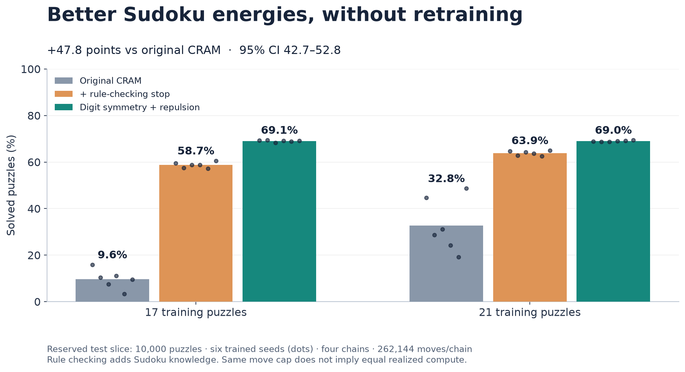
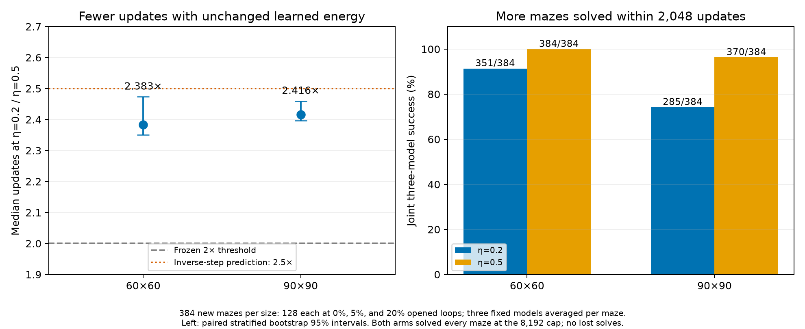
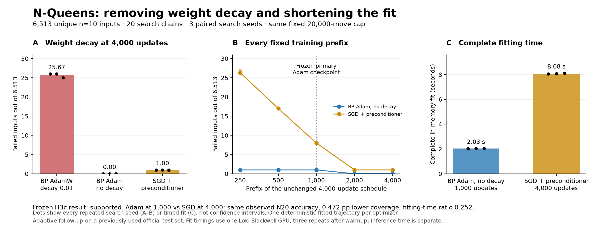

# Hopfield: small energies, better reasoning

**+47.8 points on low-data Sudoku. 2.82× faster sparse search. No retraining for either.**

An independent implementation, reproduction and experimental extension of [*Classical Energies Learn to Reason 1,000× Faster than Looped Models*](https://arxiv.org/abs/2611.17309v1), by Benjamin Hoover, Hugh Blayney and James C. R. Whittington. CRAM learns a classical energy function, then searches for low-energy solutions.

[Paper in reviewed Markdown](references/2611.17309v1.md) · [Research results](results/README.md) · [Reproduction](REPRODUCTION.md) · [Run the code](docs/RERUN_GUIDE.md)

## Better Sudoku energies without another training run



A post-training transformation makes the learned energy invariant to renaming digits and removes attractive equal-digit couplings. It raises average solve accuracy from **21.20% to 69.03%** on a reserved 10,000-puzzle test slice: **+47.83 percentage points**, approximate paired 95% interval **[42.72, 52.85]**. The transformed models made **zero wrong stops** across 120,000 model–puzzle evaluations.

The comparison uses 17 or 21 unique training puzzles, six trained seeds each, four search chains, and **262,144 moves per chain**. That fixed cap is shorter than the original paper-budget evaluation. The transformation uses learned weights and training-only calibration; it receives no Sudoku row/column/box graph. A separate rule-checking stop adds that task knowledge and reaches **61.30%** with the original energies. Same move cap does not mean equal realized work.

The earlier, disjoint development confirmation gained **48.31 points** from digit symmetry alone. These are follow-up cohorts from the official corpus, which was also used in the original reproduction; they are not a new external benchmark. [Protocols, per-seed results and independent board audits →](research/20261114/ripper/REPORT-heldout.md) · [Rule-checking study →](research/20261114/foureyes/REPORT.md)

## The same transformed model, faster inference


A sparse backend runs the same repulsive energies **2.82× faster** in warm inference, or **2.79× including search setup**, on RTX PRO 6000 Blackwell Max-Q. All 63 paired warmup/timing calls produced identical final states and boards. Broader bounded checks covered 18 models, followed by a full 10,000-puzzle integration comparison. Compilation is excluded from warm timing. [Timing data, parity checks and limitations →](research/20261114/ripper/REPORT-sparse.md)

## Larger mazes, fewer inference steps



Changing the inference step size from **0.2 to 0.5**, with the learned 29-parameter maze energy unchanged, reduces median answer updates by **2.38× at 60×60** and **2.42× at 90×90**. Measured hidden-plus-answer runtime improves **2.09× and 2.21×**. Both arms solve all 768 generated mazes at the 8,192-update cap, across three frozen models, with no lost solves.

At a tighter 2,048-update cap, joint success rises from **351/384 to 384/384** at 60×60 and **285/384 to 370/384** at 90×90. These generated tree/loopy mazes differ from the original Maze-Hard distribution. [Frozen protocol, confidence intervals and causal branch-depth experiments →](research/20261114/work/REPORT.md)

## Four times fewer training updates for N-Queens



At a fixed **1,000 updates**, Adam without decay matches the **99.9846%** accuracy of preconditioned SGD at **4,000 updates**, taking **2.03 s versus 8.08 s** in matched complete-fit measurements. Solution coverage is 0.47 points lower. The 1,000-update comparison was frozen before evaluation; the test cohort had been used in earlier follow-ups. [Protocol and audited results →](research/20261114/loki/h3c/REPORT.md)

## Optimizer controls and results that did not work

On all **6,513 unique N-Queens-10 test inputs**, ordinary BP AdamW with weight decay reaches **99.6059%**, Adam without decay reaches **100%**, and preconditioned SGD reaches **99.9846%**. Each is one deterministic full-batch fit with three search seeds, 20 chains and a 20,000-move cap. The learning rate was selected on development data; this is an adaptive follow-up, not a general optimizer ranking. [Full comparison →](research/20261114/loki/h3b/REPORT.md)

Negative results stay visible: digit projection still solves **0%** with one or three training puzzles; clipping attractive couplings fails the proposed ten-point gain; maze mass rescaling gives **no improvement**; AdamW fails the original accuracy noninferiority test; and training-only Sudoku thresholds do not establish a replacement for the rule checker. [All hypotheses, controls and measured outcomes →](results/README.md)

## What was reproduced?

The original campaign reproduced **99.996689% Sudoku accuracy** over three full held-out runs, **100% Maze-Unique**, **99.9% Maze-Hard**, and every graph-coloring quality cell. It also completed all **84 objective runs, 100 training curves, 102 data-efficiency runs**, and the declared controls and supplemental ablations. The independent implementation passed 27 CPU tests; the pinned authors' implementation passed 91 tests.


This curve uses a seeded recreation of unreleased training arrays. Baselines are clearly labeled **published results**. The paper's H200 **“1,000×” training-speed claim is not independently established** by these Blackwell experiments. [Measured reproduction and limits →](REPRODUCTION.md) · [Paper coverage →](docs/PAPER_COVERAGE.md)

## Get started

```sh
git clone https://github.com/catid/hopfield.git
cd hopfield
git clone https://github.com/Prefrontal-AI/CRAM.git upstream
git -C upstream checkout --detach 62bbe830c7d6f87f2ba18f30a28039258b986454
uv sync --project upstream --frozen --python 3.13.13
CUDA_VISIBLE_DEVICES= upstream/.venv/bin/python -m pytest -q tests/test_reference.py
```

The readable implementation is in [src/hopfield_cram](src/hopfield_cram/). Full-scale runs use the pinned upstream kernels and the isolated [research runners](research/20261114/). [Setup, data preparation and rerun instructions](docs/RERUN_GUIDE.md) explain their hardware and dataset requirements; [implementation notes](docs/IMPLEMENTATION.md) explain the algorithms.

Public [JSON/CSV results](results/README.md), [figure sources](docs/FIGURES.md), protocols and audit hashes are included. Large datasets, checkpoints and raw board archives are excluded from Git. The [development history and original completion snapshot](results/reproduction/README.md) are retained separately. Research is ongoing; only audited results appear above.

Code: [Apache 2.0](LICENSE). Paper and its converted assets: CC BY 4.0. [Attribution and scope](NOTICE.md).
