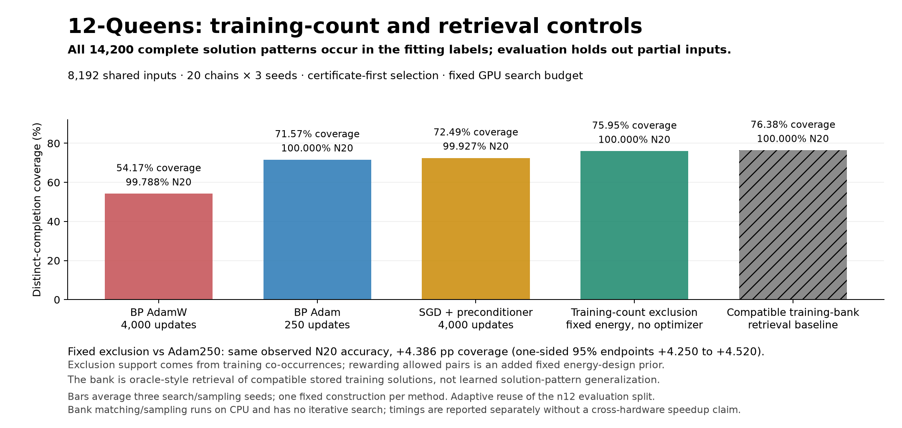
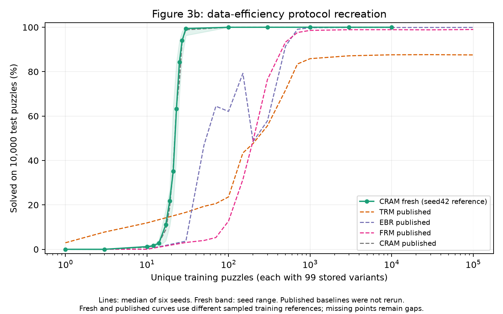

# Hopfield: small energies, better reasoning

**99.9567% Sudoku accuracy with a count-based energy and no optimizer.**

An independent implementation, reproduction and experimental extension of [*Classical Energies Learn to Reason 1,000× Faster than Looped Models*](https://arxiv.org/abs/2611.17309v1), by Benjamin Hoover, Hugh Blayney and James C. R. Whittington. CRAM learns a classical energy function, then searches for low-energy solutions. Our follow-ups test what the optimizer, data augmentation and search each contribute.

[Paper in reviewed Markdown](references/2611.17309v1.md) · [Research results](results/README.md) · [Reproduction](REPRODUCTION.md) · [Run the code](docs/RERUN_GUIDE.md)

## Simple counts match the transformed Sudoku energy


Connect two cells if they **never share a digit in the training solutions**. Give each retained pair weight one, then run the same focused Gibbs search. This simple estimator recovers the same 810-edge constraint graph as our transformed learned energies, without an optimizer or a supplied Sudoku peer graph.

On a reserved **10,000-puzzle official test slice**, the count energy solves **59,974/60,000 evaluations (99.9567%)** across six search seeds, with **zero wrong stops**, using four chains and **16,777,216 moves per chain**. The transformed learned energy reaches 99.9417% under the same budget. The paired difference is +0.015 points; its one-sided 95% lower bound of −0.0151 points passes the frozen 0.1-point noninferiority margin. At the shorter **262,144-move** cap, the count method solves **81.50%**.

**The augmentation prior matters.** These training counts use ten unique base solutions **plus 99 stored Sudoku-symmetry variants per base**. The transformations supply task knowledge. A follow-up finds that one base solution plus 99 such variants already recovers the identical graph in all six tested sets; this is not one unaugmented example learning Sudoku. The count comparison also reuses the official corpus and a follow-up cohort. [Protocols, full budget curve, stopping proof and limitations →](research/20261114/foureyes/REPORT-budget.md) · [Count and augmentation controls →](research/20261114/ripper/REPORT-count.md)

The earlier intervention result remains useful: digit symmetry and repulsion increased low-data accuracy by **47.83 points** on a separate reserved slice. But the count control shows that optimizer training is unnecessary for recovering this graph from these augmented datasets. [Earlier matched results →](research/20261114/ripper/REPORT-heldout.md)

## The same transformed model, faster inference


A sparse backend runs the same repulsive energies **2.82× faster** in warm inference, or **2.79× including search setup**, on RTX PRO 6000 Blackwell Max-Q. All 63 paired warmup/timing calls produced identical final states and boards. Broader bounded checks covered 18 models, followed by a full 10,000-puzzle integration comparison. Compilation is excluded from warm timing. [Timing data, parity checks and limitations →](research/20261114/ripper/REPORT-sparse.md)

## Larger mazes, fewer inference steps


Changing the inference step size from **0.2 to 0.5**, with the learned 29-parameter maze energy unchanged, reduces median answer updates by **2.38× at 60×60** and **2.42× at 90×90**. Measured hidden-plus-answer runtime improves **2.09× and 2.21×**. Both arms solve all 768 generated mazes at the 8,192-update cap, across three frozen models, with no lost solves.

At a tighter 2,048-update cap, joint success rises from **351/384 to 384/384** at 60×60 and **285/384 to 370/384** at 90×90. These generated tree/loopy mazes differ from the original Maze-Hard distribution. [Frozen protocol, confidence intervals and causal branch-depth experiments →](research/20261114/work/REPORT.md)

## N-Queens: stronger controls change the interpretation



On **8,192 N-Queens-12 partial inputs**, a training-count exclusion energy reaches **100% accuracy and 75.95% solution coverage**, versus **100% and 71.57%** for Adam at 250 updates. It uses no optimizer, but combines inferred exclusions with a declared fixed energy design and the supplied offset architecture. Ordinary BP AdamW at 4,000 updates reaches 99.7884% accuracy and 54.17% coverage; preconditioned SGD reaches 99.9268% and 72.49%.

**All 14,200 complete solution patterns occur in the training labels.** Inputs are held out; complete patterns are not. A compatible-training-bank control also reaches 100% accuracy and 76.38% coverage. These controls prevent interpreting the result as generalization to unseen solution patterns. [Exact data split, energy design, counts and controls →](research/20261114/loki/h3f/REPORT.md)

Earlier N-Queens-10 experiments showed faster fitting with Adam and a weight-decay gap. A learned-certificate-first output policy then fixed all 77 failed AdamW input–seed cases without extra search, showing that the gap depends on output selection. [Optimizer experiments →](research/20261114/loki/h3c/REPORT.md) · [Selection control →](research/20261114/loki/h3d/REPORT.md)

## Failures are part of the result

The maze step-size benefit has a limit: a new maze with many tied shortest paths produces certified branched or disconnected answers for two models. Simple tied-cycle controls still solve perfectly, so ties alone do not explain the failure. [Saved graph, boards and causal controls →](research/20261114/work/REPORT.md)

The learned Sudoku pipeline's four-million-move **99% all-seed joint-success hypothesis was inconclusive**, despite 99.635% mean accuracy. The sixteen-million-move secondary endpoint passed. Projection still fails at extremely low data; largest-gap pruning collapses without spatial augmentation; and maze mass rescaling gives no improvement. [All hypotheses, including negative and inconclusive outcomes →](results/README.md)

## What was reproduced?

The original campaign reproduced **99.996689% Sudoku accuracy** over three full held-out runs, **100% Maze-Unique**, **99.9% Maze-Hard**, and every graph-coloring quality cell. It also completed all **84 objective runs, 100 training curves, 102 data-efficiency runs**, and the declared controls and supplemental ablations. The independent implementation passed 27 CPU tests; the pinned authors' implementation passed 91 tests.



This curve uses a seeded recreation of unreleased training arrays. Baselines are clearly labeled **published results**. The paper's H200 **“1,000×” training-speed claim is not independently established** by these Blackwell experiments. [Measured reproduction and limits →](REPRODUCTION.md) · [Paper coverage →](docs/PAPER_COVERAGE.md)

## Get started

```sh
git clone https://github.com/catid/hopfield.git
cd hopfield
git clone https://github.com/Prefrontal-AI/CRAM.git upstream
git -C upstream checkout --detach 62bbe830c7d6f87f2ba18f30a28039258b986454
uv sync --project upstream --frozen --python 3.13.13
uv pip install --python upstream/.venv/bin/python --no-deps -e .
CUDA_VISIBLE_DEVICES= upstream/.venv/bin/python -m pytest -q tests/test_reference.py tests/test_counting.py
```

Build the optimizer-free baseline from your own completed training states:

```python
from hopfield_cram import fit_never_equal

# Integer tensor (examples, 81), digits 0..8; training data only.
energy, equality_counts = fit_never_equal(training_solutions, n_values=9)
```

This [small public API](src/hopfield_cram/counting.py) supplies no cell geometry. With insufficient data, it can infer exclusions that do not hold for unseen valid boards. The [published binary model](results/research/foureyes/count_budget/model.json) retains the training provenance behind the measured Sudoku result. All 33 reference/counting tests pass.

The readable implementation is in [src/hopfield_cram](src/hopfield_cram/). Full-scale runs use the pinned upstream kernels and the isolated [research runners](research/20261114/). [Setup, data preparation and rerun instructions](docs/RERUN_GUIDE.md) explain their hardware and dataset requirements; [implementation notes](docs/IMPLEMENTATION.md) explain the algorithms.

Public [JSON/CSV results](results/README.md), [figure sources](docs/FIGURES.md), protocols and audit hashes are included. Large datasets, checkpoints and raw board archives are excluded from Git. The [development history and original completion snapshot](results/reproduction/README.md) are retained separately. Research is ongoing; only audited results appear above.

Code: [Apache 2.0](LICENSE). Paper and its converted assets: CC BY 4.0. [Attribution and scope](NOTICE.md).
