# Figures and their data

All README graphs show measured results. They are ordinary scientific plots, with downloadable SVG or PDF versions beside the PNGs.

| Figure | Public data | Renderer |
|---|---|---|
| Matched precision and rowwise recall, different graph recovery | [All masks, fits and two-stage seals](../results/research/foureyes/purified_detector/) | [plot_purified_detector.py](../scripts/plot_purified_detector.py) |
| Exact posterior residual gaps and rounding bounds | [All192 selected objective gaps](../results/research/ripper/posterior_residual_gap/) | [plot_posterior_residual_gap.py](../scripts/plot_posterior_residual_gap.py) |
| Observable conflict masks and location precision | [All512 fits, seals and exact certificates](../results/research/foureyes/conflict_mask/) | [plot_conflict_mask.py](../scripts/plot_conflict_mask.py) |
| Fresh posterior-label confirmation at equal query cost | [All three fresh arms and exact certificates](../results/research/ripper/posterior_fresh_confirm/) | [plot_posterior_fresh_confirm.py](../scripts/plot_posterior_fresh_confirm.py) |
| Posterior scoring on examined repeated-query banks | [All posterior scores, refits and proofs](../results/research/ripper/posterior_query_labels/) | [plot_posterior_query_labels.py](../scripts/plot_posterior_query_labels.py) |
| Deeper exact question trees complete within budget | [Full query ledger and compact proof evidence](../results/research/loki/h3bw/) | [plot_public.py](../research/20261114/loki/h3bw/plot_public.py) |
| Actual maze routing and complete answer costs | [All outcomes, paired costs and routed states](../results/research/work/bp-first-geometry-cascade/) | [plot_bp_first_geometry.py](../research/20261114/work/plot_bp_first_geometry.py) |
| Partial corruption masks with supplied perfect precision | [All thinning draws, masks and certificates](../results/research/foureyes/partial_mask_recall/) | [plot_partial_mask_recall.py](../scripts/plot_partial_mask_recall.py) |
| Raw counts versus rounded rates on repeated labels | [Complete refits and paired outcomes](../results/research/ripper/raw_count_quantization/) | [plot_raw_count_quantization.py](../scripts/plot_raw_count_quantization.py) |
| Exact tree pruning still reaches its declared state cap | [Complete status ledger and compact audit evidence](../results/research/loki/h3bv/) | [plot_public.py](../research/20261114/loki/h3bv/plot_public.py) |
| Known-mask censoring recovers every examined graph | [All noisy rows, masks, counts and certificates](../results/research/foureyes/corruption_censor/) | [plot_corruption_censor.py](../scripts/plot_corruption_censor.py) |
| More boards versus repeated labels at equal query cost | [Fresh sources, decoded observations and proofs](../results/research/ripper/repeat_query_tradeoff/) | [plot_repeat_query_tradeoff.py](../scripts/plot_repeat_query_tradeoff.py) |
| Strict exclusions versus cooptimal repeated-query failures | [All 128 exact objective gaps](../results/research/ripper/repeated_objective_gap/) | [plot_repeated_objective_gap.py](../scripts/plot_repeated_objective_gap.py) |
| Deeper question-tree study reaches its declared cap | [Complete status ledger and compact audit evidence](../results/research/loki/h3bu/) | [plot_public.py](../research/20261114/loki/h3bu/plot_public.py) |
| Fresh fixed 270-row graph-recovery confirmation | [All fresh sources, prefixes and certificates](../results/research/ripper/fixed_270_confirm/) | [plot_fixed_270_confirm.py](../scripts/plot_fixed_270_confirm.py) |
| Geometry identifies all archived BP errors | [Complete source partition and fixture checks](../results/research/work/bp-geometry-decomposition/) | [plot_bp_geometry_decomposition.py](../research/20261114/work/plot_bp_geometry_decomposition.py) |
| Privileged-mask attenuation loses graph recoveries | [Every mask, corrected score and certificate](../results/research/foureyes/oracle_attenuation/) | [plot_oracle_attenuation.py](../scripts/plot_oracle_attenuation.py) |
| Repeated-graph stopping accuracy and acquisition budget | [All prefixes, stops and certificates](../results/research/ripper/stability_stopping/) | [plot_stability_stopping.py](../scripts/plot_stability_stopping.py) |
| Additional maze certificate rarely rejects wrong answers | [Every failure and all scalar decisions](../results/research/work/cross-certificate-screen/) | [plot_cross_certificate_screen.py](../research/20261114/work/plot_cross_certificate_screen.py) |
| Exact expected-cost guard misses the realized saving target | [All routes, counterfactuals and charged calls](../results/research/loki/h3bt/) | [plot_public.py](../research/20261114/loki/h3bt/plot_public.py) |
| Fresh dense-maze confirmation with zero fallback calls | [All outcomes, costs and complete failure supplement](../results/research/work/fallback-confirmation/) | [plot_fallback_confirmation.py](../research/20261114/work/plot_fallback_confirmation.py) |
| Conditional-randomization signal detection | [All 4,096 objective grids and exact tests](../results/research/ripper/signal_detection/) | [plot_signal_detection.py](../scripts/plot_signal_detection.py) |
| Per-cell deficit normalization loses graph recoveries | [All normalized costs, scales and proofs](../results/research/foureyes/normalized_deficit/) | [plot_normalized_deficit.py](../scripts/plot_normalized_deficit.py) |
| Exact vote-cost gaps among lost graphs | [Every consensus true-graph gap](../results/research/foureyes/consensus_gap/) | [plot_consensus_gap.py](../scripts/plot_consensus_gap.py) |
| Early question-tree handoff raises total cost | [Every online route, exact proof and paid call](../results/research/loki/h3bs/) | [plot_public.py](../research/20261114/loki/h3bs/plot_public.py) |
| Bootstrap consensus and lost graph recoveries | [Every resample, count and exact proof](../results/research/foureyes/bootstrap_consensus/) | [plot_bootstrap_consensus.py](../scripts/plot_bootstrap_consensus.py) |
| Histogram-preserving shuffle control | [Histograms, shuffled observations and proofs](../results/research/ripper/marginal_shuffle/) | [plot_marginal_shuffle.py](../scripts/plot_marginal_shuffle.py) |
| Independent-label null signal | [Null observations and full degree grids](../results/research/ripper/null_signal/) | [plot_null_signal.py](../scripts/plot_null_signal.py) |
| Numerical fallback and both original energy certificates | [All routes, actual replays and margins](../results/research/work/certificate-fallback/) | [plot_certificate_fallback.py](../research/20261114/work/plot_certificate_fallback.py) |
| Matched-prior question policy | [All prior draws, proofs and paid calls](../results/research/loki/h3br/) | [plot_public.py](../research/20261114/loki/h3br/plot_public.py) |
| Complete research-pipeline archive overlap | [Timings and complete public state snapshots](../results/research/work/artifact-overlap/) | [plot_artifact_overlap.py](../research/20261114/work/plot_artifact_overlap.py) |
| Exact empirical objective gaps | [All 768 exact gaps](../results/research/foureyes/objective_gap/) | [plot_objective_gap.py](../scripts/plot_objective_gap.py) |
| Balanced versus uniform masks | [Masks and certified graph results](../results/research/ripper/balanced_masks/) | [plot_balanced_masks.py](../scripts/plot_balanced_masks.py) |
| Balanced masks under harder noise | [All observations and certificates](../results/research/ripper/higher_noise/) | [plot_higher_noise.py](../scripts/plot_higher_noise.py) |
| Fresh selected-truth question policies | [All banks, proofs and paid calls](../results/research/loki/h3bq/) | [plot_public.py](../research/20261114/loki/h3bq/plot_public.py) |
| Synthetic sample-budget limits | [All prefix counts and proofs](../results/research/foureyes/prefix_budget/) | [plot_prefix_budget.py](../scripts/plot_prefix_budget.py) |
| Fresh 96-round dense-maze confirmation | [All paired outcomes and costs](../results/research/work/confirmation96/) | [plot_confirmation96.py](../research/20261114/work/plot_confirmation96.py) |
| Corruption-law control | [All three laws and exact proofs](../results/research/ripper/corruption_law/) | [plot_corruption_law.py](../scripts/plot_corruption_law.py) |
| Independent-noise row budget | [Full banks and literal prefixes](../results/research/ripper/iid_row_budget/) | [plot_iid_row_budget.py](../scripts/plot_iid_row_budget.py) |
| Selected posterior mismatch | [All checkpoint diagnostics](../results/research/loki/h3bo/) | [plot_public.py](../research/20261114/loki/h3bo/plot_public.py) |
| Uniform question-tree costs | [All proofs and paid calls](../results/research/loki/h3bp/) | [plot_public.py](../research/20261114/loki/h3bp/plot_public.py) |
| Expected versus realized question costs | [Every tree proof and paid call](../results/research/loki/h3bn/) | [plot_public.py](../research/20261114/loki/h3bn/plot_public.py) |
| Connected cycle-power graph recovery | [All source and LP evidence](../results/research/foureyes/cycle_power/) | [plot_cycle_power.py](../scripts/plot_cycle_power.py) |
| Matched pair coquery acquisition | [Masks, rates and exact proofs](../results/research/ripper/matched_coquery/) | [plot_matched_coquery.py](../scripts/plot_matched_coquery.py) |
| Equal-label observation coverage | [Paired masks, labels and proofs](../results/research/ripper/coverage_tradeoff/) | [plot_coverage_tradeoff.py](../scripts/plot_coverage_tradeoff.py) |
| Synthetic degree transfer | [Every source, control and LP proof](../results/research/foureyes/varying_degree/) | [plot_varying_degree.py](../scripts/plot_varying_degree.py) |
| Archived maze continuation | [All caps, moves and outcomes](../results/research/work/continuation/) | [plot_continuation.py](../research/20261114/work/plot_continuation.py) |
| Eight versus sixteen positive examples | [Paired banks and information bounds](../results/research/loki/h3bm/) | [plot_public.py](../research/20261114/loki/h3bm/plot_public.py) |
| Exact posterior-weighted trees | [Weights and full optimality proofs](../results/research/loki/h3bl/) | [plot_public.py](../research/20261114/loki/h3bl/plot_public.py) |
| Fresh uniform versus donor acquisition | [All acquisition and proof evidence](../results/research/ripper/uniform32/) | [plot_uniform32.py](../scripts/plot_uniform32.py) |
| Fresh paired rule-identification policies | [All 1,408 banks, ledgers and proof trees](../results/research/loki/h3bj/) | [plot_public.py](../research/20261114/loki/h3bj/plot_public.py) |
| Exact veto-geometry speed | [All timing pairs and parity evidence](../results/research/work/veto-speed/) | [plot_veto_speed.py](../research/20261114/work/plot_veto_speed.py) |
| Fresh strong-noise degree inference | [Source exclusions, controls and exact proofs](../results/research/foureyes/fresh_curvature/) | [plot_fresh_curvature.py](../scripts/plot_fresh_curvature.py) |
| Additional observation coverage | [All extended masks, query costs and exact proofs](../results/research/ripper/extra_coverage/) | [plot_extra_coverage.py](../scripts/plot_extra_coverage.py) |
| Exact four-question trees | [All checkpoint mappings and tree certificates](../results/research/loki/h3bi/) | [plot_public.py](../research/20261114/loki/h3bi/plot_public.py) |
| Maze density limit at 80% loops | [All paired outcomes and five endpoint decisions](../results/research/work/loop80-transfer/) | [plot_loop80_transfer.py](../research/20261114/work/plot_loop80_transfer.py) |
| Degree inference from partial observations | [All 2,560 grid proofs](../results/research/ripper/partial_degree/) | [plot_partial_degree.py](../scripts/plot_partial_degree.py) |
| Four-to-eight query continuation | [All 1,408 checkpoints and additional decisions](../results/research/loki/h3bh/) | [plot_public.py](../research/20261114/loki/h3bh/plot_public.py) |
| Exact LP curvature selects a bounded common degree | [All degree values and5120proofs](../results/research/foureyes/degree_curvature/) | [plot_degree_curvature.py](../scripts/plot_degree_curvature.py) |
| Additive cell-count correction and remaining overlap | [Every adjusted score and candidate](../results/research/foureyes/centered_regularity/) | [plot_centered_regularity.py](../scripts/plot_centered_regularity.py) |
| Fresh dense-maze decoder confirmation | [Paired outcomes and endpoint statistics](../results/research/work/unified-cycle/) | [plot_unified_cycle.py](../research/20261114/work/plot_unified_cycle.py) |
| Exact bridge-geometry speed | [All timing pairs and parity evidence](../results/research/work/geometry-speed/) | [plot_geometry_speed.py](../research/20261114/work/plot_geometry_speed.py) |
| Transferred static feedback | [Recovery proofs and donor costs](../results/research/ripper/transfer_feedback.json) | [plot_transfer_feedback.py](../scripts/plot_transfer_feedback.py) |
| Permuted transferred feedback control | [Recovery proofs and permutation evidence](../results/research/ripper/permuted_transfer.json) | [plot_permuted_transfer.py](../scripts/plot_permuted_transfer.py) |
| Fresh static-feedback transfer failure | [Fresh IDs and exact proofs](../results/research/ripper/fresh_transfer.json) | [plot_fresh_transfer.py](../scripts/plot_fresh_transfer.py) |
| MAP-guided binary questions | [Every paired query outcome](../results/research/loki/h3bd/) | [plot_public.py](../research/20261114/loki/h3bd/plot_public.py) |
| Full supplied truth-class query study | [All1511 eligible cases and30 ineligible truths](../results/research/loki/h3be/) | [plot_public.py](../research/20261114/loki/h3be/plot_public.py) |
| Hard-tail query replication | [All22 truths and1408 fresh draws](../results/research/loki/h3bf/) | [plot_public.py](../research/20261114/loki/h3bf/plot_public.py) |
| Exact hard-tail identifiability ceiling | [Complete equivalence classes and witnesses](../results/research/loki/h3bg/) | [plot_public.py](../research/20261114/loki/h3bg/plot_public.py) |
| Per-cell degree constraints repair strong-noise graphs | [All128 exact proofs and cardinality controls](../results/research/foureyes/intensity_degree/) | [plot_intensity_degree.py](../scripts/plot_intensity_degree.py) |
| Fixed early acquisition feedback | [All proof results and physical query accounting](../results/research/ripper/frozen_feedback.json) | [plot_frozen_feedback.py](../scripts/plot_frozen_feedback.py) |
| Four binary queries after only sixteen positive queen examples | [All108 cases and422 query outcomes](../results/research/loki/h3bc/) | [plot_public.py](../research/20261114/loki/h3bc/plot_public.py) |
| Paired concentrated-corruption intensity boundary | [All count thresholds and paired fits](../results/research/foureyes/regularity_intensity/) | [plot_regularity_intensity.py](../scripts/plot_regularity_intensity.py) |
| Fresh aligned versus permuted acquisition feedback | [Exact proofs and sealed source identities](../results/research/ripper/fresh_soft_feedback.json) | [plot_fresh_soft_feedback.py](../scripts/plot_fresh_soft_feedback.py) |
| Disjoint maze residual interventions | [Paired source outcomes and audits](../results/research/work/residual-factorial-summary.json) | [plot_residual_factorial.py](../research/20261114/work/plot_residual_factorial.py) |
| Binary membership queries on supplied queen classes | [Every candidate, query and answer](../results/research/loki/h3bb/) | [plot_public.py](../research/20261114/loki/h3bb/plot_public.py) |
| Dense-maze terminal checks versus extra search | [Paired outcomes and full audit](../results/research/work/terminal-cycle-summary.json) | [plot_terminal_cycle.py](../research/20261114/work/plot_terminal_cycle.py) |
| Aligned versus permuted acquisition feedback | [Exact certificates and query accounting](../results/research/ripper/soft_feedback.json) | [plot_soft_feedback.py](../scripts/plot_soft_feedback.py) |
| Resolving all eligible N12 queen aliases at N13 | [Complete populations and witnesses](../results/research/loki/h3ba/) | [plot_public.py](../research/20261114/loki/h3ba/plot_public.py) |
| Complete-source queen model alias prevalence | [Full partition and zero-N14 stage receipt](../results/research/loki/h3az/) | [plot_public.py](../research/20261114/loki/h3az/plot_public.py) |
| Denser-maze transfer and stopping boundary | [Full density outcomes and audit history](../results/research/work/density-transfer-summary.json) | [plot_density_transfer.py](../research/20261114/work/plot_density_transfer.py) |
| Independent verification acceleration | [Paired cost and complete-job timings](../results/research/work/local-factor-audit/) | [plot_local_factor_audit.py](../research/20261114/work/plot_local_factor_audit.py) |
| Label-blind balanced query coverage | [Exact proofs and exposure diagnostics](../results/research/ripper/balanced_mask.json) | [plot_balanced_mask.py](../scripts/plot_balanced_mask.py) |
| Concrete witnesses distinguishing N12-equivalent queen rules at N13 | [Complete populations and exact probabilities](../results/research/loki/h3ay/) | [plot_public.py](../research/20261114/loki/h3ay/plot_public.py) |
| Uniform query masks on fixed noisy Sudoku sources | [Exact proofs and physical query accounting](../results/research/ripper/uniform_mask.json) | [plot_uniform_mask.py](../scripts/plot_uniform_mask.py) |
| Two-rule queen family grid | [All 45 families and 100 eligible banks](../results/research/loki/h3ax/) | [plot_public.py](../research/20261114/loki/h3ax/plot_public.py) |
| Fresh equal-degree Sudoku confirmation | [All 64 banks and source identities](../results/research/foureyes/regularity_fresh/) | [plot_regularity_fresh.py](../scripts/plot_regularity_fresh.py) |
| Fresh noisy acquisition and degree-constrained recovery | [Acquisition, identities and exact certificates](../results/research/ripper/fresh_rate.json) | [plot_fresh_rate.py](../scripts/plot_fresh_rate.py) |
| Conditional additional-positive reliability | [Exact 16-additional-label distributions](../results/research/loki/h3av/) | [plot_public.py](../research/20261114/loki/h3av/plot_public.py) |
| Nonmonotonic conditional rule-recovery curves | [Exact distributions through total 128 labels](../results/research/loki/h3aw/) | [plot_public.py](../research/20261114/loki/h3aw/plot_public.py) |
| Fresh 180×180 confirmation of the compositional maze policy | [All paired outcomes and endpoint decisions](../results/research/work/cap-transfer-summary.json) | [plot_cap_transfer.py](../research/20261114/work/plot_cap_transfer.py) |
| Equal-degree thresholds under concentrated Sudoku corruption | [All thresholds and graph outcomes](../results/research/foureyes/regularity_gap/) | [plot_regularity_gap.py](../scripts/plot_regularity_gap.py) |
| Short-prefix noisy Sudoku recovery failure | [Exact proofs and query accounting](../results/research/ripper/prefix_rate.json) | [plot_prefix_rate.py](../scripts/plot_prefix_rate.py) |
| Intermediate observation-budget recovery | [Nested-prefix outcomes](../results/research/ripper/intermediate_rate.json) | [plot_intermediate_rate.py](../scripts/plot_intermediate_rate.py) |
| Fixed queen-rule complexity prior | [Posterior weights and target capacities](../results/research/loki/h3au/) | [plot_public.py](../research/20261114/loki/h3au/plot_public.py) |
| Larger maze move limit repairs source failures | [Full source intervention](../results/research/work/large-cycle-cut-summary.json) | [plot_large_cycle_cut.py](../research/20261114/work/plot_large_cycle_cut.py) |
| Smoothed-rate recovery with supplied degree | [Certified recovery exports](../results/research/ripper/laplace_rate.json) | [plot_laplace_rate.py](../scripts/plot_laplace_rate.py) |
| Exact finite-population rule-recovery reliability | [Exact fractions and distributions](../results/research/loki/h3as/) | [plot_public.py](../research/20261114/loki/h3as/plot_public.py) |
| Expanded queen vocabulary and capacity loss | [All candidate scores and target supports](../results/research/loki/h3at/) | [plot_public.py](../research/20261114/loki/h3at/plot_public.py) |
| Concentrated Sudoku noise and count-threshold failure | [Paired profile exports](../results/research/foureyes/heterogeneous_noise/) | [plot_heterogeneous_noise.py](../scripts/plot_heterogeneous_noise.py) |
| Supplied-degree Sudoku recovery | [Certified LP exports](../results/research/ripper/degree_prior.json) | [plot_degree_prior.py](../scripts/plot_degree_prior.py) |
| Repairing premature exclusions with a supplied degree prior | [Exclusion-repair exports](../results/research/ripper/exclusion_repair.json) | [plot_exclusion_repair.py](../scripts/plot_exclusion_repair.py) |
| Sixteen-label safety/capacity tradeoff | [Unfiltered count exports](../results/research/loki/h3aq/) | [plot_public.py](../research/20261114/loki/h3aq/plot_public.py) |
| Finite rule-family likelihood and consistency control | [Rule-selection exports](../results/research/loki/h3ar/) | [plot_public.py](../research/20261114/loki/h3ar/plot_public.py) |
| Fresh 180×180 maze transfer boundary | [Larger-maze exports](../results/research/work/cycle-transfer-180-summary.json) | [plot_cycle_transfer_180.py](../research/20261114/work/plot_cycle_transfer_180.py) |
| Fresh maze cycle-cut transfer and full prefix costs | [8,192-input paired outcomes](../results/research/work/cycle-transfer-summary.json) | [plot_cycle_transfer.py](../research/20261114/work/plot_cycle_transfer.py) |
| Nested queen source budgets and invalid-state boundary | [Eight primary fits and 24 count controls](../results/research/loki/h3ao/) | [plot_public.py](../research/20261114/loki/h3ao/plot_public.py) |
| Maze cycle cuts and learned-versus-lexical ordering | [Paired source controls](../results/research/work/lexical-cycle-cut-summary.json) | [plot_cycle_cut_controls.py](../scripts/plot_cycle_cut_controls.py) |
| Fixed likelihood mixture on acquired Sudoku labels | [Mixture replay exports](../results/research/ripper/mixture_replay.json) | [plot_mixture_replay.py](../scripts/plot_mixture_replay.py) |
| Pooled Sudoku observations versus separate-support voting | [Pooled source exports](../results/research/foureyes/pooled_source_study/) | [plot_pooled_source.py](../scripts/plot_pooled_source.py) |
| New queen-family symmetry-repair ceiling | [Eight new fits](../results/research/loki/h3an/) | [plot_public.py](../research/20261114/loki/h3an/plot_public.py) |
| Adaptive queries under a supplied exact noise law | [Adaptive-null exports](../results/research/ripper/adaptive_null.json) | [plot_adaptive_null.py](../scripts/plot_adaptive_null.py) |
| Same-draw D4 repair reliability | [Paired exact distribution](../results/research/loki/h3am/) | [plot_public.py](../research/20261114/loki/h3am/plot_public.py) |
| Global soundness of all 64 reduced Sudoku graphs | [Exact proofs](../results/research/foureyes/strong_support_soundness/) | [plot_strong_support_soundness.py](../scripts/plot_strong_support_soundness.py) |
| Exact reliability of acquired positive witnesses | [Finite-population distribution](../results/research/loki/h3al/) | [plot_public.py](../research/20261114/loki/h3al/plot_public.py) |
| Known-law sequential noise thresholds | [Fixed-stream replay](../results/research/ripper/null_replay.json) | [plot_null_replay.py](../scripts/plot_null_replay.py) |
| Missing edges versus global Sudoku soundness | [Proofs and counterexamples](../results/research/ripper/permuted_soundness.json) | [plot_permuted_soundness.py](../scripts/plot_permuted_soundness.py) |
| Positive-witness repair of N15 camel capacity | [Repair exports](../results/research/loki/h3ak/) | [plot_public.py](../research/20261114/loki/h3ak/plot_public.py) |
| Removing weak Sudoku constraints | [Deletion exports](../results/research/foureyes/strong_support_study/) | [plot_strong_support_study.py](../scripts/plot_strong_support_study.py) |
| Digit-count-preserving corruption | [Permutation-noise exports](../results/research/ripper/permuted_noise.json) | [plot_permuted_noise.py](../scripts/plot_permuted_noise.py) |
| Weaker positive Sudoku penalties | [Penalty-strength exports](../results/research/foureyes/weak_weight_study/) | [plot_weak_weight_study.py](../scripts/plot_weak_weight_study.py) |
| Clean positive witnesses on fixed observed streams | [Witness exports](../results/research/ripper/positive_witness.json) | [plot_positive_witness.py](../scripts/plot_positive_witness.py) |
| Multiplicity filter under shared collapse | [Filter exports](../results/research/ripper/balanced_filter.json) | [plot_balanced_filter.py](../scripts/plot_balanced_filter.py) |
| Complete N15 camel capacity census | [Capacity exports](../results/research/loki/h3aj/) | [plot_public.py](../research/20261114/loki/h3aj/plot_public.py) |
| Destructive shared label noise | [Collapse exports](../results/research/ripper/collapsed_noise.json) | [plot_collapsed_noise.py](../scripts/plot_collapsed_noise.py) |
| N15 compiled reverse verifier | [Compiled-verifier exports](../results/research/loki/h3ag/) | [plot_public.py](../research/20261114/loki/h3ag/plot_public.py) |
| Exact occupied-pair certificates | [Certificate benchmark](../results/research/loki/h3ah/) | [plot_public.py](../research/20261114/loki/h3ah/plot_public.py) |
| Complete compiler improvement | [Integration exports](../results/research/loki/h3ai/) | [plot_public.py](../research/20261114/loki/h3ai/plot_public.py) |
| Shared-permutation label noise and constraint recovery | [Correlation exports](../results/research/ripper/correlated_noise.json) | [plot_correlated_noise.py](../scripts/plot_correlated_noise.py) |
| Fresh confirmation of coefficient-magnitude weights | [Fresh exports](../results/research/foureyes/canonical_confirm/) | [plot_canonical_confirm.py](../scripts/plot_canonical_confirm.py) |
| N15 compilation budget boundary | [Gate failure](../results/research/loki/h3af/) | [plot_public.py](../research/20261114/loki/h3af/plot_public.py) |
| Exact compilation of learned queen models versus GPU search | [Exact-compilation exports](../results/research/loki/h3ae/) | [plot_public.py](../research/20261114/loki/h3ae/plot_public.py) |
| Stricter confidence weights on fresh puzzles | [Strict-rule exports](../results/research/ripper/confidence_strict.json) | [plot_confidence_strict.py](../scripts/plot_confidence_strict.py) |
| Oracle diagnosis of confidence-weight budget boundary | [Oracle diagnostic](../results/research/ripper/confidence_oracle.json) | [plot_confidence_oracle.py](../scripts/plot_confidence_oracle.py) |
| Second maze hard-negative round | [Second-round exports](../results/research/work/second-negative-transfer-summary.json) | [plot_second_negative_transfer.py](../research/20261114/work/plot_second_negative_transfer.py) |
| Confidence weights and capped Sudoku returns | [Confidence exports](../results/research/ripper/confidence_weight.json) | [plot_confidence_weighting.py](../scripts/plot_confidence_weighting.py) |
| Confidence weighting at half training budget | [Budget exports](../results/research/ripper/confidence_budget.json) | [plot_confidence_budget.py](../scripts/plot_confidence_budget.py) |
| Queen search across four source-bank fits | [Four-bank exports](../results/research/loki/h3ac/) | [plot_public.py](../research/20261114/loki/h3ac/plot_public.py) |
| Queen search on two additional families | [New-family exports](../results/research/loki/h3ad/) | [plot_public.py](../research/20261114/loki/h3ad/plot_public.py) |
| Maze hard-negative constraint transfer | [Hard-negative exports](../results/research/work/hard-negative-transfer-summary.json) | [plot_hard_negative_transfer.py](../research/20261114/work/plot_hard_negative_transfer.py) |
| Coefficient weights on fixed likelihood supports | [Weight study](../results/research/foureyes/canonical_weights/) | [plot_canonical_weights.py](../scripts/plot_canonical_weights.py) |
| Convex digit-invariant PL and zero-stop soundness | [Canonical study](../results/research/foureyes/canonical_study/) | [plot_canonical_pl.py](../scripts/plot_canonical_pl.py) |
| No-optimizer Sudoku and budget curve | [Count and learned exports](../results/research/foureyes/) | [plot_count_results.py](../scripts/plot_count_results.py) |
| Sudoku counts from raw solutions | [Raw-count and PL exports](../results/research/ripper/) | [plot_raw_count_results.py](../scripts/plot_raw_count_results.py) |
| Sudoku matched transformation control | [Transformed-PL exports](../results/research/foureyes/raw_transform/) | [plot_raw_transform_results.py](../scripts/plot_raw_transform_results.py) |
| Sudoku fixed-restart control | [Restart exports](../results/research/foureyes/restart/) | [plot_restart_results.py](../scripts/plot_restart_results.py) |
| Reserved Sudoku test and sparse speed | [Ripper](../results/research/ripper/), [stopping rules](../results/research/foureyes/) | [plot_public_results.py](../scripts/plot_public_results.py) |
| Maze size transfer, branch depth and step size | [Work exports](../results/research/work/) | [public renderer](../research/20261114/work/) |
| N-Queens optimizer and update budget | [Loki exports](../results/research/loki/) | [Loki scripts](../research/20261114/loki/) |
| N-Queens unseen complete patterns | [Pattern holdout exports](../results/research/loki/h3g/) | [plot_public.py](../research/20261114/loki/h3g/plot_public.py) |
| Sudoku clue-mask controls | [Mask exports](../results/research/ripper/) | [plot_clue_mask_results.py](../scripts/plot_clue_mask_results.py) |
| Sudoku online acquisition confirmation | [Acquisition exports](../results/research/ripper/) | [plot_online_confirmation.py](../scripts/plot_online_confirmation.py) |
| Sudoku spike-mixture clue acquisition | [Acquisition exports](../results/research/ripper/spike.json) | [plot_spike_results.py](../scripts/plot_spike_results.py) |
| Sudoku fresh-bank noisy-label recovery | [Fresh-bank exports](../results/research/foureyes/noise_source_replication/) | [plot_noise_source_replication.py](../scripts/plot_noise_source_replication.py) |
| Sudoku noise replication and failure diagnosis | [Noise exports](../results/research/foureyes/noise_replication/) | [plot_noise_replication.py](../scripts/plot_noise_replication.py) |
| Maze selective fallback and complete timing | [Selective exports](../results/research/work/selective-fallback-summary.json) | [plot_selective_fallback.py](../research/20261114/work/plot_selective_fallback.py) |
| Maze objective ranking versus solving accuracy | [Matched training exports](../results/research/work/contrastive-training-summary.json) | [plot_contrastive.py](../research/20261114/work/plot_contrastive.py) |
| Sudoku noisy adaptive querying | [Noisy-query exports](../results/research/ripper/noisy.json) | [plot_noisy_acquisition.py](../scripts/plot_noisy_acquisition.py) |
| Sudoku conservative noise-bound accuracy cost | [Noise-bound exports](../results/research/ripper/noise_bound.json) | [plot_noise_bound_results.py](../scripts/plot_noise_bound_results.py) |
| Sudoku repeated-query noise calibration | [Calibration exports](../results/research/ripper/calibrated.json) | [plot_repeated_query_calibration.py](../scripts/plot_repeated_query_calibration.py) |
| Sudoku calibration versus training at equal query cost | [Equal-budget exports](../results/research/ripper/equal_budget.json) | [plot_equal_query_budget.py](../scripts/plot_equal_query_budget.py) |
| Sudoku calibration transferred to a higher noise rate | [Rate-transfer exports](../results/research/ripper/rate_transfer.json) | [plot_noise_rate_transfer.py](../scripts/plot_noise_rate_transfer.py) |
| Sudoku implied-edge confirmation | [Fresh confirmation](../results/research/foureyes/logical_completion_confirm/) | [plot_logical_completion.py](../scripts/plot_logical_completion.py) |
| Sudoku mixture evidence law | [Mixture exports](../results/research/ripper/mixture_law.json) | [plot_mixture_evidence_law.py](../scripts/plot_mixture_evidence_law.py) |
| Sudoku logical certificates and invalid zero-energy witness | [Certificates](../results/research/foureyes/logical_soundness/) | [plot_sudoku_soundness.py](../scripts/plot_sudoku_soundness.py) |
| Sudoku bounded evidence priorities | [Bounded-selector exports](../results/research/ripper/bounded_selector.json) | [plot_bounded_evidence_selector.py](../scripts/plot_bounded_evidence_selector.py) |
| Sudoku likelihood-ratio priority failure | [LR-selector exports](../results/research/ripper/lr_selector.json) | [plot_lr_evidence_selector.py](../scripts/plot_lr_evidence_selector.py) |
| Sudoku doubled training at 5% noise | [Scaled-noise exports](../results/research/ripper/scaled_noise.json) | [plot_doubled_noisy_training.py](../scripts/plot_doubled_noisy_training.py) |
| Sudoku noisy-label likelihood and count controls | [Noisy-PL exports](../results/research/foureyes/noisy_pl/) | [plot_noisy_pl_results.py](../scripts/plot_noisy_pl_results.py) |
| Sudoku noisy-label training update budget | [Long-training exports](../results/research/foureyes/noisy_pl_long/) | [plot_noisy_pl_long_results.py](../scripts/plot_noisy_pl_long_results.py) |
| Queen-plus-camel soft-weight transfer and wrong stops | [Matched transfer exports](../results/research/loki/h3u/) | [plot_public.py](../research/20261114/loki/h3u/plot_public.py) |
| Queen-plus-camel weights versus search on fixed support | [Fixed-support exports](../results/research/loki/h3v/) | [plot_public.py](../research/20261114/loki/h3v/plot_public.py) |
| Queen-plus-camel permutation initialization and search prior | [Permutation exports](../results/research/loki/h3w/) | [plot_public.py](../research/20261114/loki/h3w/plot_public.py) |
| Queen-plus-camel matched measured GPU time | [Matched-time exports](../results/research/loki/h3ab/) | [plot_public.py](../research/20261114/loki/h3ab/plot_public.py) |
| Queen-plus-camel shared-initialization proposal control | [Triangle exports](../results/research/loki/h3aa/) | [plot_public.py](../research/20261114/loki/h3aa/plot_public.py) |
| Complete-source minimum D4 rule | [Rule-selection exports](../results/research/loki/h3x/) | [plot_public.py](../research/20261114/loki/h3x/plot_public.py) |
| Fixed multi-family rule-transfer stress grid | [Stress-grid exports](../results/research/loki/h3y/) | [plot_public.py](../research/20261114/loki/h3y/plot_public.py) |
| Pooled smaller-source rule information | [Pooled exports](../results/research/loki/h3z/) | [plot_public.py](../research/20261114/loki/h3z/plot_public.py) |
| Sudoku independent recovery confirmation | [Fresh recovery exports](../results/research/ripper/recovery_confirm.json) | [plot_recovery_confirmation.py](../scripts/plot_recovery_confirmation.py) |
| Sudoku sample-count recovery | [Recovery exports](../results/research/ripper/recovery.json) | [plot_recovery_results.py](../scripts/plot_recovery_results.py) |
| Maze binary-preserving continuous relaxation | [Maze exports](../results/research/work/) | [plot_native_relaxation.py](../research/20261114/work/plot_native_relaxation.py) |
| N-Queens source-bank robustness | [H3k exports](../results/research/loki/h3k/) | [plot_public.py](../research/20261114/loki/h3k/plot_public.py) |
| Superqueen rule-transfer boundary | [H3l exports](../results/research/loki/h3l/) | [plot_public.py](../research/20261114/loki/h3l/plot_public.py) |
| Superqueen smaller-source control | [H3m exports](../results/research/loki/h3m/) | [plot_public.py](../research/20261114/loki/h3m/plot_public.py) |
| Superqueen downward transfer | [H3n exports](../results/research/loki/h3n/) | [plot_public.py](../research/20261114/loki/h3n/plot_public.py) |
| Original data-efficiency reproduction | [102 measured rows](../results/reproduction/data_efficiency/rows.csv), [collection](../results/reproduction/data_efficiency/collection.json) | [original renderer](../scripts/plot_data_efficiency.py) |

Regenerate the first two README figures from a public checkout:

```sh
uv run --with matplotlib --with numpy python scripts/plot_public_results.py
uv run --with matplotlib --with numpy python scripts/plot_count_results.py
```

The figure receipt at [assets/figures/provenance.json](../assets/figures/provenance.json) records the renderer and exact input hashes. The original reproduction plotter expects the local `artifacts/` layout; its unchanged final figures and compact inputs are mirrored under `results/reproduction/`.

### Fresh BP-first maze confirmation (H2bo)

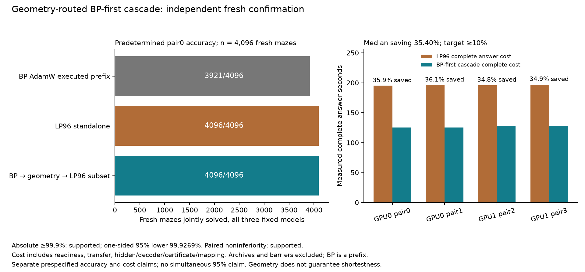

The fixed cascade and LP96 each solve all 4,096 fresh mazes jointly across three fixed models; BP AdamW solves 3,921. The second panel shows all four balanced complete-cost comparisons and their 35.40% median saving. Model replicas and timing replays do not add independent accuracy trials. [Report and audit boundary](../research/20261114/work/REPORT.md#h2bo-fresh-confirmation-supports-999-joint-success-and-saves-3540-complete-answer-cost) · [Renderer](../research/20261114/work/plot_bp_first_fresh.py).

### Pairwise likelihood from repeated labels (H1cc)

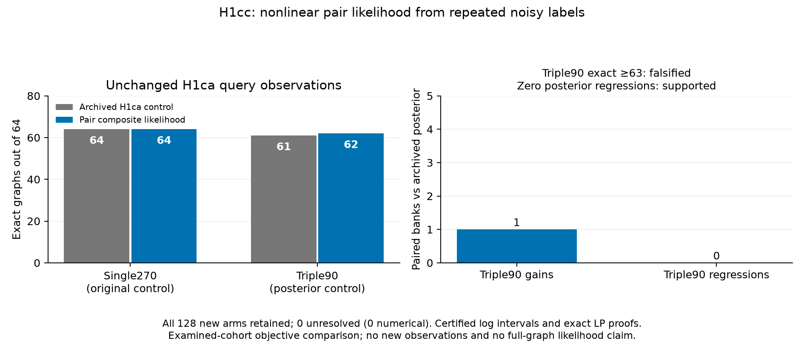

Archived posterior scoring recovers 61/64 and pairwise composite likelihood 62/64 on the same repeated-query cohort; the original single270 control and its new likelihood diagnostic both recover 64/64. Separate recovery and regression decisions remain visible. [Report](../research/20261114/ripper/REPORT-pair-likelihood.md) · [Renderer](../scripts/plot_pair_likelihood.py) · [Provenance](../assets/figures/pair_likelihood-provenance.json).

### Opposite-half conflict masks (H4ax)

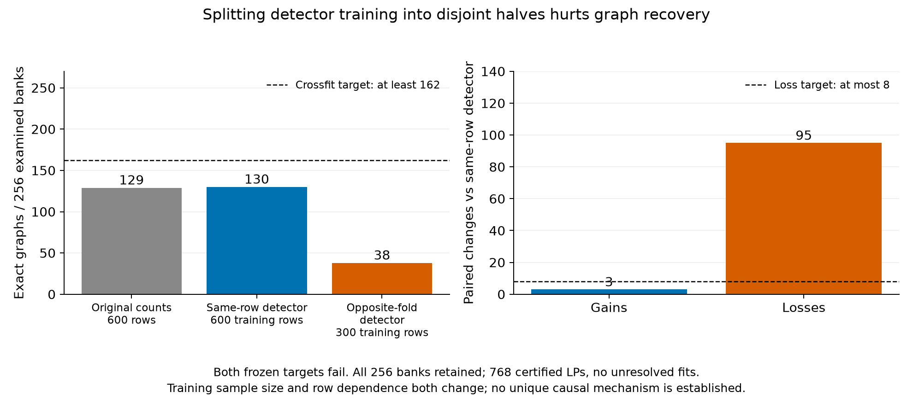

Both prespecified targets fail on all 256 examined banks. The graph-training sample falls from 600 to 300 rows, and target-row dependence changes at the same time. [Report](../research/20261114/foureyes/REPORT-crossfit-conflicts.md) · [Renderer](../scripts/plot_crossfit_conflicts.py) · [Provenance](../assets/figures/crossfit-conflicts-provenance.json).

### Fresh paired deeper question trees (H3bx)

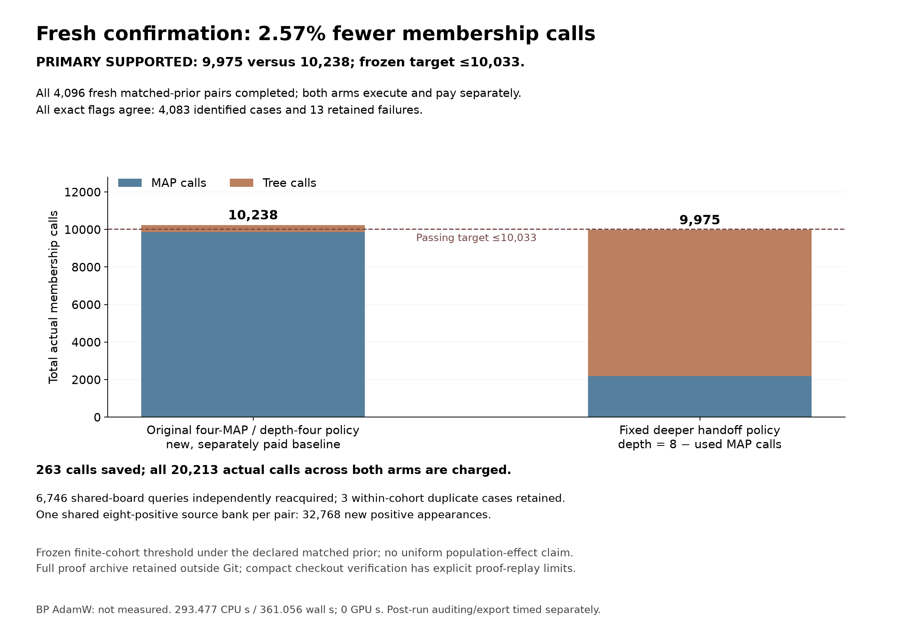

The plot retains both independently executed arms and their total paid calls, with the 2% threshold and all 4,096 cases. [Report](../research/20261114/loki/h3bx/REPORT.md) · [Renderer](../research/20261114/loki/h3bx/plot_public.py).

### Maze endpoint shift and complete-cost comparison (H2bp)

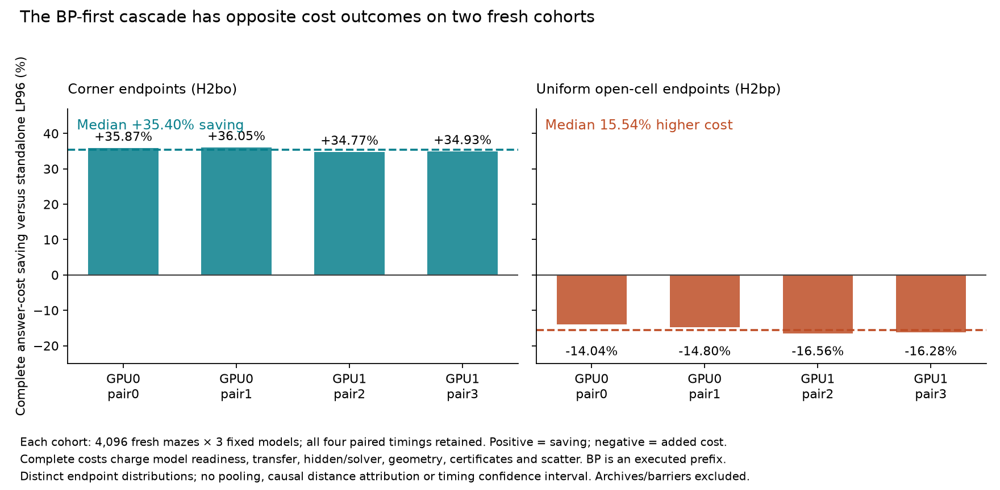

Every balanced timing pair appears for each distinct fresh cohort. Positive values are savings against standalone LP96; negative values are added cost. The two medians are 35.40% saving and 15.54% added cost. [Comparison renderer](../research/20261114/work/plot_endpoint_cost_comparison.py) · [Exact costs and provenance](../results/research/work/endpoint-cost-comparison/provenance.json) · [Standalone endpoint-shift renderer](../research/20261114/work/plot_endpoint_shift.py).

### Incorrect noise-channel assumptions (H1cd)

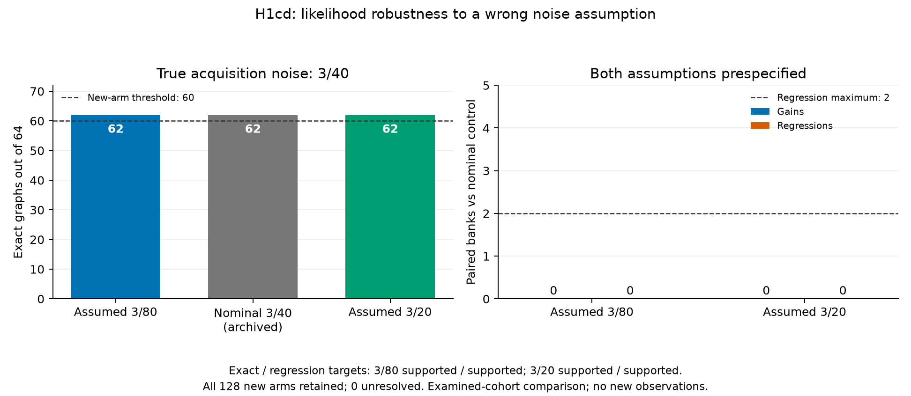

Both examined-cohort arms and all four prespecified decisions are retained. [Report](../research/20261114/ripper/REPORT-channel-misspecification.md) · [Renderer](../scripts/plot_channel_misspecification.py) · [Provenance](../assets/figures/channel_misspecification-provenance.json).

### Estimated noise channel (H1ce)

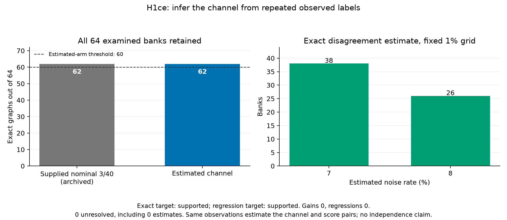

All 64 examined banks remain in the comparison; the supplied and estimated channel methods both recover 62. [Report](../research/20261114/ripper/REPORT-estimated-channel.md) · [Renderer](../scripts/plot_estimated_channel.py) · [Provenance](../assets/figures/estimated_channel-provenance.json).

### Disjoint donor and separately repaired audit (H4ay/H4az)

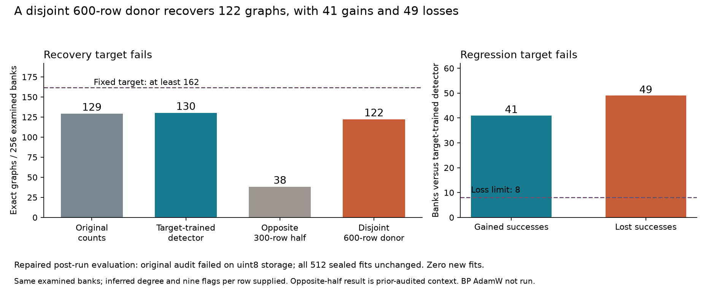

The original failed audit and unchanged sealed fits remain explicit. The 300-row opposite-half result is prior-audited context only. [Report](../research/20261114/foureyes/REPORT-disjoint-donor.md) · [Renderer](../scripts/plot_disjoint_donor.py) · [Provenance](../assets/figures/disjoint-donor-provenance.json).

### Uniform-truth prior shift (H3by)


All 4,096 paired cases, the fixed 2% threshold and both separately executed arms are retained. [Report](../research/20261114/loki/h3by/REPORT.md) · [Renderer](../research/20261114/loki/h3by/plot_public.py).

### Larger donor with donor-only control (H4ba)

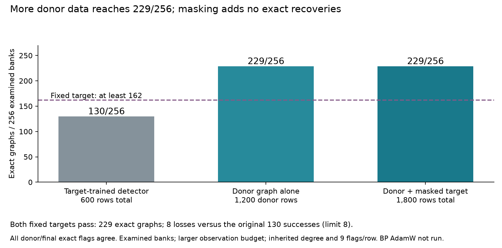

All 256 donor/final exact flags agree; the larger observation budgets are shown explicitly. [Report](../research/20261114/foureyes/REPORT-larger-donor.md) · [Renderer](../scripts/plot_larger_donor.py) · [Provenance](../assets/figures/larger-donor-provenance.json).

### Three maze endpoint distributions (H2bo/H2bp/H2bq)

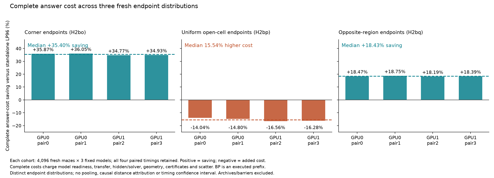

Each cohort contributes all four fixed paired timings and its own exact median. The prior two-cohort asset remains unchanged. [Renderer](../research/20261114/work/plot_endpoint_cost_three_cohorts.py) · [Provenance](../results/research/work/endpoint-cost-three-cohorts/provenance.json) · [Far-region study](../research/20261114/work/REPORT.md#h2bq-opposite-region-endpoints-preserve-joint-success-and-save-1843-complete-answer-cost).

### Matched observation-budget pooling (H4bb)

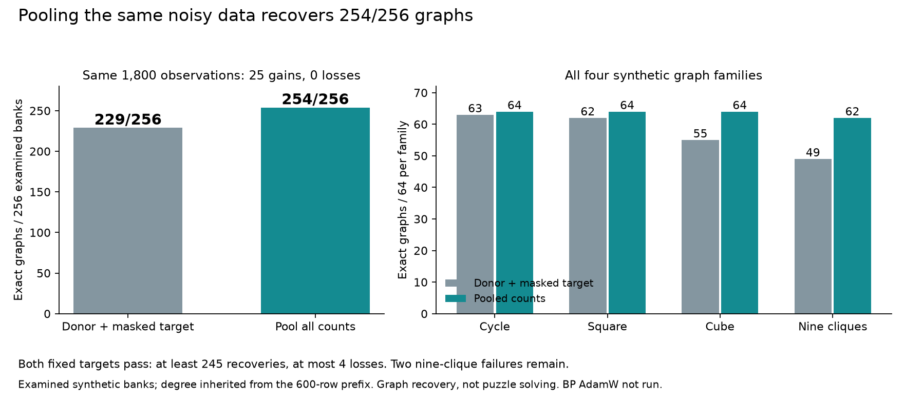

Both methods use the same 1,800-row union; all four families and two remaining failures are shown. [Report](../research/20261114/foureyes/REPORT-pooled-donor.md) · [Renderer](../scripts/plot_pooled_donor.py) · [Provenance](../assets/figures/pooled-donor-provenance.json).

### Fresh noise-rate variation (H1cf)

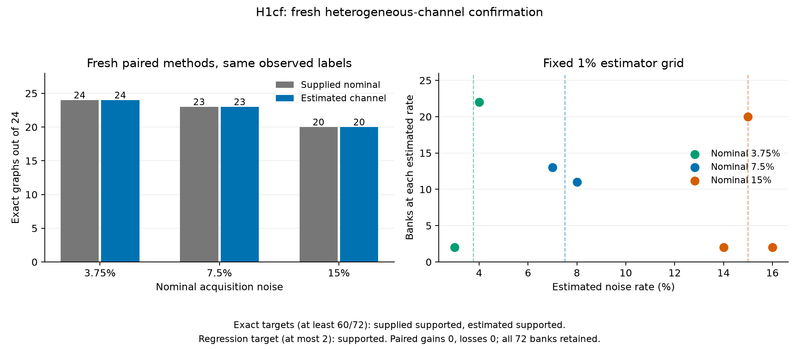

All 72 fresh banks and three rate strata remain in the figure. [Report](../research/20261114/ripper/REPORT-heterogeneous-channel.md) · [Renderer](../scripts/plot_heterogeneous_channel.py) · [Provenance](../assets/figures/heterogeneous_channel-provenance.json).

### Query savings with a lost success (H3bz)

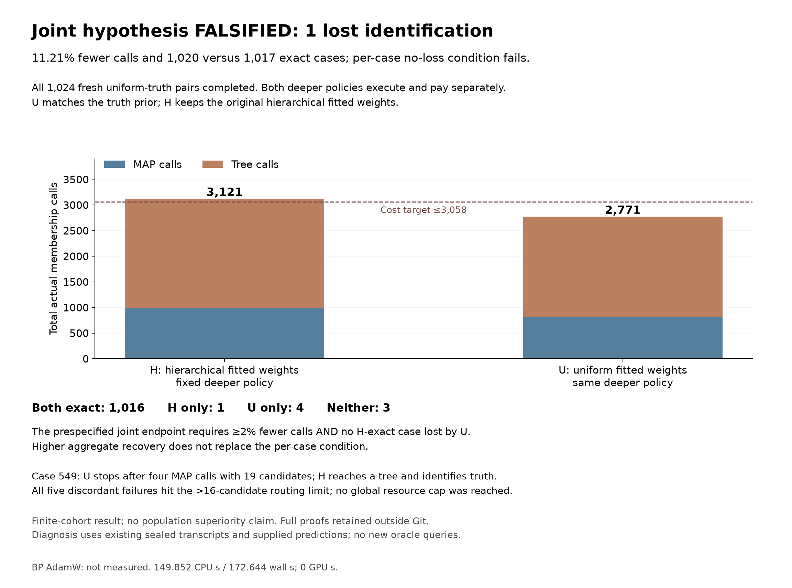

The figure retains all 1,024 pairs, the 11.21% cost saving and the single lost identification that falsifies the joint endpoint. [Report](../research/20261114/loki/h3bz/REPORT.md) · [Renderer](../research/20261114/loki/h3bz/plot_public.py) · [Provenance](../results/research/loki/h3bz/plot-provenance.json).

### Within-bank noise mixture (H1cg)

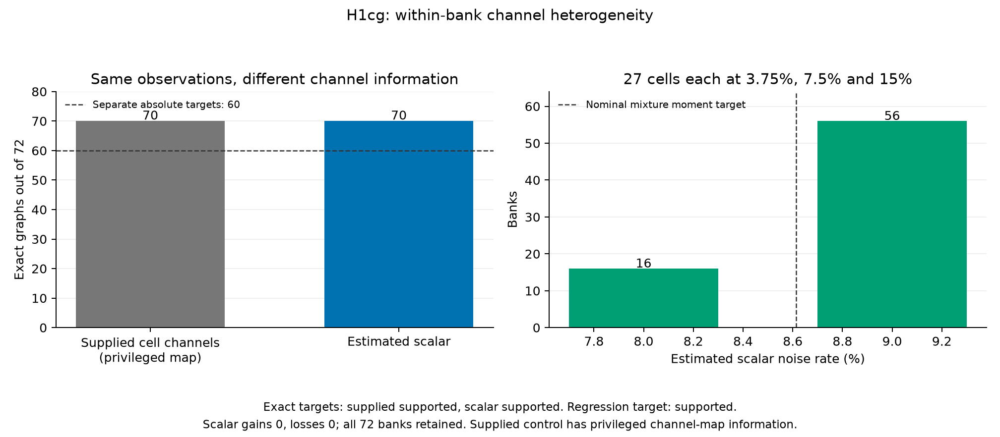

All 72 paired banks, two failures and the scalar calibration distribution are retained. [Report](../research/20261114/ripper/REPORT-cell-channel.md) · [Renderer](../scripts/plot_cell_channel.py) · [Provenance](../assets/figures/cell_channel-provenance.json).

### Fresh pooling confirmation with an audit correction (H4bc/H4bd)

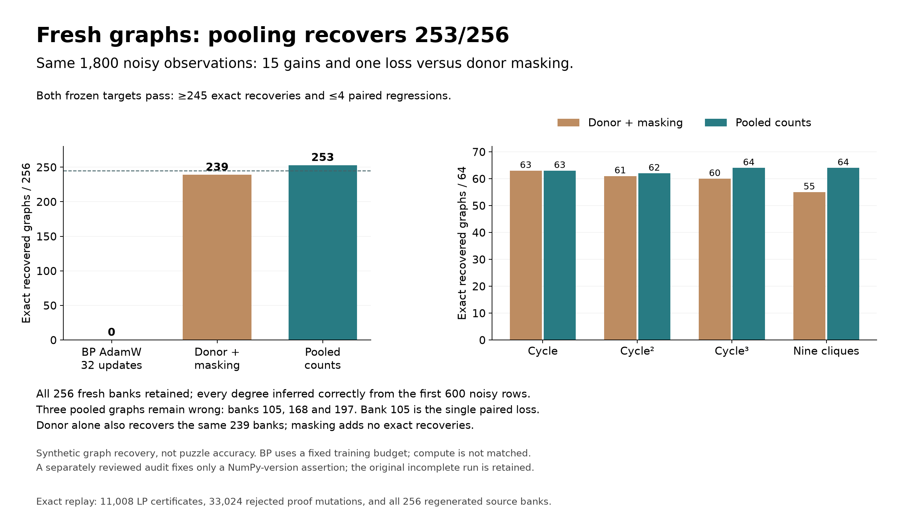

The figure shows BP AdamW first, all four families, the one paired regression and three remaining pooled failures. [Report](../research/20261114/foureyes/REPORT-fresh-pooled-donor.md) · [Renderer](../scripts/plot_fresh_pooled_donor.py) · [Provenance](../assets/figures/fresh-pooled-donor-provenance.json).

### Mixed-maze dispatch fails both cost targets (H2br)

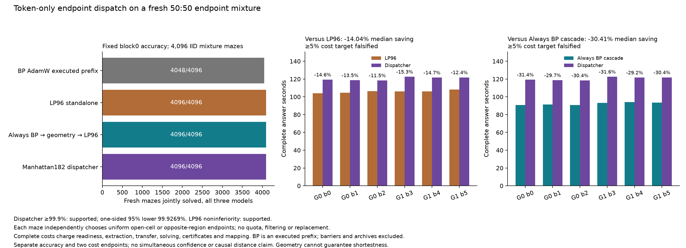

All six three-arm timing blocks and both failures remain visible. [Report](../research/20261114/work/REPORT.md#h2br-endpoint-dispatch-preserves-accuracy-but-falsifies-both-cost-targets) · [Renderer](../research/20261114/work/plot_endpoint_dispatch.py).

### Correlated repeats expose a recovery failure (H1ch)

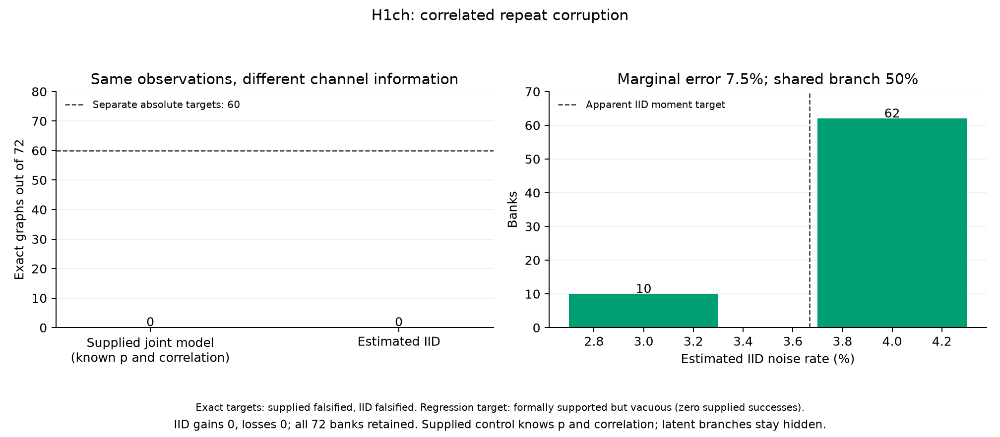

Both 0/72 outcomes and the misleading apparent IID rate are visible; the linked report retains every integral and fractional failure. [Report](../research/20261114/ripper/REPORT-correlated-repeat.md) · [Renderer](../scripts/plot_correlated_repeat.py).

### Matched tree weights with unchanged MAP routing (H3ca)

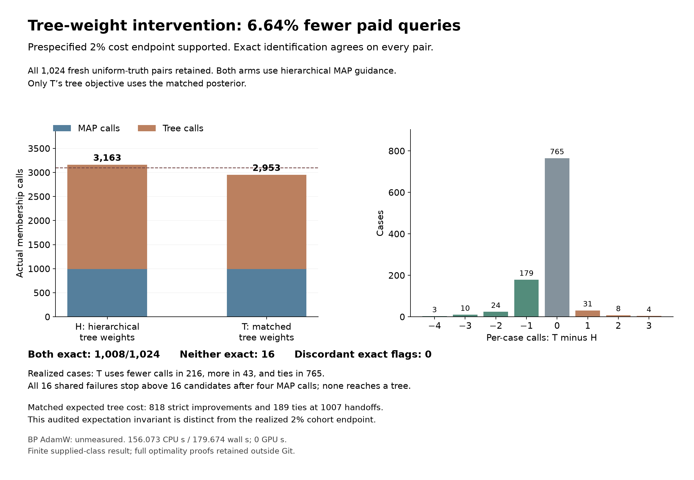

The chart retains all per-case differences, including 43 longer paths and 16 shared failures. [Report](../research/20261114/loki/h3ca/REPORT.md) · [Renderer](../research/20261114/loki/h3ca/plot_public.py).
