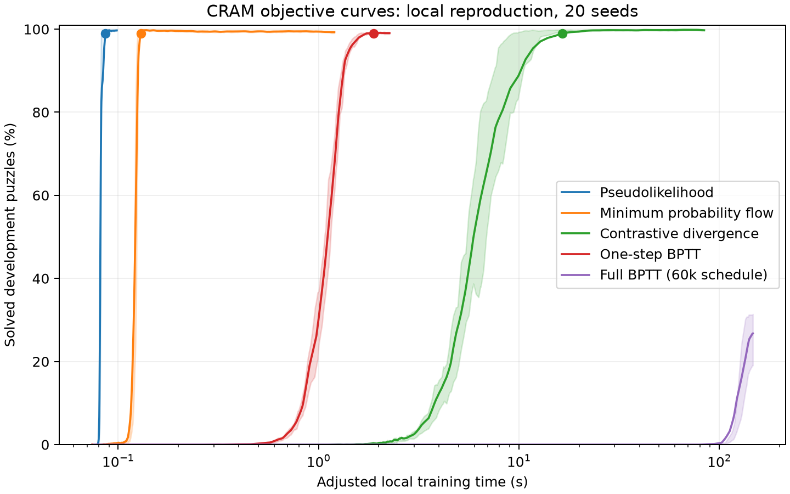

# Objective-family reproduction: final measured results

**Complete for this objective family:** all 84 Table 7 fits/tests (81 managed plus three 3.84-million-update controls), nine Appendix D.2 development-only fits, and all 100 Figure 4 curves. Every schedule finished. This does not declare the broader paper reproduction complete.

Pinned source: `62bbe830c7d6f87f2ba18f30a28039258b986454`. Local runtime: Python 3.13.13, PyTorch 2.11.0+cu128, CUDA 12.8, Triton 3.6.0. GPUs are RTX PRO 6000 Blackwell Workstation and Max-Q devices on four recorded hosts; published timings are H200 measurements. All published columns below are quoted reference results, not locally retrained looped baselines.

Each Table 7 row uses seeds 0–2, the frozen published recipe and development checkpoint selection, then 50,000 Sudoku-Extreme or 1,000 Maze-Unique test puzzles per seed. Means and sample standard deviations are recomputed from integer solved counts. No test inference was repeated for this consolidation. These experiments use the paper's SGD-family training; BP AdamW is outside this objective protocol and was not run.

`T99` is the first common probe update at which the three-run development mean reaches 99%; its reported time is the median adjusted fit clock at that update. Adjustment removes startup and includes readiness-statistic fitting. A dash means no crossing, unless explicitly noted as unreported at that schedule. FLOPs99 is locally counted training arithmetic to that same update, not inference cost. The shared objective harness differs from the optimized main-result harness; do not compare these times directly with Table 2.

## Sudoku-Extreme: standard schedules

Every method uses 2,000 updates except PL (32). Published five-step BPTT, full BPTT and EqProp accuracies here come from the standard-schedule footnote; their main Table 7 cells instead use the longer schedules below. Their standard T99/FLOPs99 values are not separately published.

| Method | Local solved (%) | Published solved (%) | Local T99 (s) | Published H200 T99 (s) | Local FLOPs99 | Published FLOPs99 |
|---|---:|---:|---:|---:|---:|---:|
| BP AdamW | Outside protocol; not run | Not in this study | — | — | — | — |
| Pseudolikelihood | 99.99533 ± 0.00231 | 100.00 ± 0.00 | 0.0878396 | 0.05 | 3.420e+10 | 3.420e+10 |
| Masked PL | 99.99333 ± 0.00416 | 99.99 ± 0.00 | 0.127925 | 0.198 | 1.946e+11 | 1.950e+11 |
| Minimum probability flow | 99.99667 ± 0.00306 | 99.99 ± 0.00 | 0.131094 | 0.225 | 1.947e+11 | 1.950e+11 |
| Denoising score matching | 99.97667 ± 0.00924 | 99.98 ± 0.01 | 0.921589 | 1.6 | 3.107e+12 | 2.200e+12 |
| Contrastive divergence | 100.00000 ± 0.00000 | 99.99 ± 0.00 | 14.9129 | 33.7 | 1.263e+14 | 1.260e+14 |
| Persistent CD | 99.99600 ± 0.00400 | 99.96 ± 0.06 | 15.0454 | 30.2 | 1.263e+14 | 1.260e+14 |
| Contrastive Hebbian | 99.99867 ± 0.00115 | 100.00 ± 0.00 | 0.228975 | 0.348 | 1.915e+12 | 1.920e+12 |
| Equilibrium propagation | 1.13867 ± 0.70103 | 1.10 ± 0.72 | — | — | — | — |
| Implicit differentiation | 0.43333 ± 0.53105 | 0.45 ± 0.50 | — | — | — | — |
| One-step BPTT | 99.57600 ± 0.34304 | 99.57 ± 0.29 | — | 4.6 | — | 2.350e+13 |
| Five-step BPTT | 98.33933 ± 2.44188 | 98.51 ± 2.15 | — | — | — | — |
| Full BPTT | 0.21667 ± 0.22327 | 0.72 ± 0.92 | — | — | — | — |

## Sudoku-Extreme: extended schedules

| Method and updates | Local solved (%) | Published solved (%) | Local T99 (s) | Published H200 T99 (s) | Local FLOPs99 | Published FLOPs99 |
|---|---:|---:|---:|---:|---:|---:|
| BP AdamW | Outside protocol; not run | Not in this study | — | — | — | — |
| Five-step BPTT, 60,000 | 99.90733 ± 0.11202 | 99.89 ± 0.07 | 139.66 | 174 | 1.932e+15 | 1.370e+15 |
| Equilibrium propagation, 240,000 | 16.55867 ± 3.75927 | 16.05 ± 8.75 | — | — | — | — |
| Full BPTT, 480,000 | 46.76533 ± 3.61701 | 46.24 ± 2.86 | — | — | — | — |
| Full BPTT, 3,840,000 | 48.56733 ± 4.12005 | 48.82 ± 3.73 | — | — | — | — |

Full 3.84-million-update BPTT scores were 52.740%, 44.502% and 48.460%, with complete raw fit clocks of 2.463–2.508 hours per seed; the published raw fits took 4.8–5.0 hours. These are different GPU platforms, not a controlled hardware speedup measurement. Five-step BPTT used LR 6 and 60,000 updates, EqProp LR 6 and 240,000 updates, and full BPTT LR 2 at 480,000 and 3,840,000 updates.

## Maze-Unique

All 36 standard runs solved 1,000/1,000 test mazes, with zero wrong stops and zero budget failures. Published solved accuracy is also 100.00 ± 0.00% for every method. PL uses 20 updates, sampling objectives 1,500, and other objectives 2,000.

| Method | Local solved (%) | Published solved (%) | Local T99 (s) | Published H200 T99 (s) | Local FLOPs99 | Published FLOPs99 |
|---|---:|---:|---:|---:|---:|---:|
| BP AdamW | Outside protocol; not run | Not in this study | — | — | — | — |
| Pseudolikelihood | 100.00000 ± 0.00000 | 100.00 ± 0.00 | 0.040374 | 0.043 | 6.152e+07 | 6.150e+07 |
| Masked PL | 100.00000 ± 0.00000 | 100.00 ± 0.00 | 0.0259107 | 0.022 | 3.110e+07 | 3.110e+07 |
| Minimum probability flow | 100.00000 ± 0.00000 | 100.00 ± 0.00 | 0.0320173 | 0.03 | 4.216e+07 | 4.220e+07 |
| Denoising score matching | 100.00000 ± 0.00000 | 100.00 ± 0.00 | 0.0247459 | 0.023 | 3.439e+07 | 3.440e+07 |
| Contrastive divergence | 100.00000 ± 0.00000 | 100.00 ± 0.00 | 0.148535 | 0.258 | 3.373e+09 | 3.370e+09 |
| Persistent CD | 100.00000 ± 0.00000 | 100.00 ± 0.00 | 0.147847 | 0.262 | 3.373e+09 | 3.370e+09 |
| Contrastive Hebbian | 100.00000 ± 0.00000 | 100.00 ± 0.00 | 0.0682083 | 0.111 | 2.148e+09 | 2.150e+09 |
| Equilibrium propagation | 100.00000 ± 0.00000 | 100.00 ± 0.00 | 2.26653 | 3.7 | 6.660e+10 | 6.660e+10 |
| Implicit differentiation | 100.00000 ± 0.00000 | 100.00 ± 0.00 | 1.32389 | 2.3 | 4.230e+10 | 4.230e+10 |
| One-step BPTT | 100.00000 ± 0.00000 | 100.00 ± 0.00 | 0.72605 | 1.1 | 7.410e+09 | 7.410e+09 |
| Five-step BPTT | 100.00000 ± 0.00000 | 100.00 ± 0.00 | 3.42188 | 4 | 1.236e+10 | 1.240e+10 |
| Full BPTT | 100.00000 ± 0.00000 | 100.00 ± 0.00 | 6.64981 | 7.7 | 1.856e+10 | 1.860e+10 |

## Figure 4: 20-seed development curves

All five objectives have seeds 0–19, each with its declared 1,000-puzzle training split and the fixed 512-puzzle development probe. All 9,740 scheduled probes completed (4,986,880 puzzle evaluations). The 12 dense trajectories matched their corresponding Table 7 clocks at all 228 shared checkpoints.

[PDF](../results/reproduction/figure4/figures/figure4.pdf) · [SVG](../results/reproduction/figure4/figures/figure4.svg) · [All individual curves](../results/reproduction/figure4/curves.json)

| Method | Local mean-curve T99 (s) | Published H200 T99 (s) | Local final development mean (%) | Local final adjusted time, median [min, max] (s) |
|---|---:|---:|---:|---:|
| BP AdamW | Outside protocol; not run | Not in this study | — | — |
| Pseudolikelihood | 0.0862179 | 0.048 | 99.68750 | 0.093 [0.091, 0.098] |
| Minimum probability flow | 0.130071 | 0.21 | 99.28711 | 1.132 [1.016, 1.199] |
| One-step BPTT | 1.87903 | 4.4 | 99.05273 | 2.168 [2.065, 2.261] |
| Contrastive divergence | 16.5123 | 33 | 99.72656 | 83.516 [79.401, 84.080] |
| Full BPTT | — | — | 26.74805 | 140.368 [121.625, 147.196] |

Full BPTT uses LR 60 and 60,000 updates here; its final 26.74805% development mean is close to the published 27% after 245 s. It is a distinct protocol from the longer LR-2 Table 7 controls. Local PL reaches 99% first, followed by MPF, one-step BPTT and CD, reproducing their reported ordering.

Each curve uses its recorded fit clock minus startup plus the median of the three standard-run readiness measurements for that method. Curves use linear interpolation in elapsed seconds, zero before the first observation, and hold the final value afterward; bands are the 25th–75th percentiles over 20 seeds. Readiness pooling and interpolation are reconstructed conventions because the final upstream plotting script is missing. The displayed clocks combine documented Blackwell hosts and are not H200 timing reproduction.

## Appendix D.2 implicit differentiation

All nine 60,000-update fits completed with knob 10 and L1 multiplier 0.01. They evaluate development data only. The largest observed solve rate was 3/512 = **0.5859375%**, agreeing with the published “at most 0.6%” bound for these released-script configurations.

| Learning rate | Seed 0 max solved / 512 | Seed 1 max solved / 512 | Seed 2 max solved / 512 |
|---:|---:|---:|---:|
| 6 | 1 | 1 | 3 |
| 20 | 2 | 1 | 2 |
| 60 | 1 | 0 | 2 |

The separate declared gradient diagnostic gave cosine ≈0.99999967 between beta=0.01 EqProp and full BPTT, using the recorded 32-example initialization test. The original diagnostic recipe and beta=0.5 divergence trajectory are unreleased; this check does not reproduce that unspecified trajectory.

## Differences and limits

- Nine of twelve objectives reach at least 99% mean test accuracy on both tasks when the designated extended schedules are used, matching the paper's qualitative conclusion.
- Standard one-step BPTT reaches 99.576 ± 0.343% on test, but its three-seed development mean peaks at 98.828125%; hence its local Table 7 T99 is absent, unlike the published 4.6 s. The distinct 20-seed Figure 4 mean does cross 99%.
- DSM crosses the three-seed development target at update 1,448 locally rather than the update 1,024 implied by the published arithmetic. Five-step BPTT crosses at 46,341 rather than 32,768; their higher local FLOPs99 reflect different convergence updates, not a different per-update counter. All 12 Maze FLOPs99 values match the paper at its printed precision.
- PL selected updates 23, 32 and 32 locally, versus published 16, 23 and 16. The cause of these trajectory/selection differences has not been isolated. Published choices were reused without local tuning.
- Private two-client MPS improved the matched two-checkpoint PL probe test from 56.962 s to 31.661 s (1.799×). This measured throughput improvement concerns deferred development evaluation; it does not alter fit clocks or establish the same speedup on every method/host. Source, configuration and checkpoint checks plus per-GPU ownership guards were retained.
- Optional legacy ALT-free/Adam Maze curves are excluded because they are not a reported arXiv-v1 figure or numerical claim. The required Maze objective result uses Table 7's SGD/free-kernel protocol.

## Evidence

- [Final validation receipt](../results/reproduction/objective_studies/final-validation.json): hashes, independently recomputed statistics, complete schedules, all dense-clock proofs and visual plot review.
- [Machine-readable Table 7 comparison](../results/reproduction/objective_studies/table7-comparison.csv), [Figure 4 comparison](../results/reproduction/objective_studies/figure4-comparison.csv), [D.2 results](../results/reproduction/objective_studies/d2-implicit-results.csv), [published-value provenance](../results/reproduction/objective_studies/published-comparisons.json).
- Raw objective and external-control evidence: [objective summary](../artifacts/objectives/summary.json) and [long-BPTT summary](../results/reproduction/long_bptt/collected/summary.json).
- Baseline figures are transcribed from the reviewed arXiv-v1 Table 7, its schedule footnote, and Figure 4 caption; published and locally measured values remain separate.
