# Detailed research results

The [README](../README.md) highlights the main results. This guide retains the expanded comparisons, negative results and links to complete experimental reports. The [development history](RESEARCH_TOUR.md) covers earlier work.

## Sudoku from simple counts

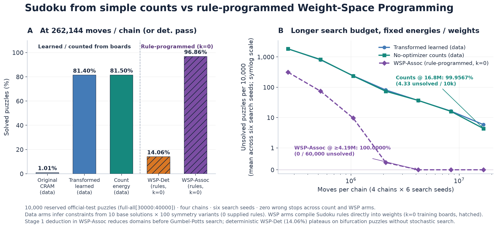

Connect cells that **never share a digit in training solutions**, assign weight one, and search. On 10,000 reserved official puzzles across six search seeds, this solves **59,974/60,000 evaluations (99.9567%)**, with zero wrong stops. The transformed learned energy reaches **99.9417%** at the same budget: four chains, 16,777,216 moves per chain. At the shorter 262,144-move cap, counts reach 81.50%.

This headline uses ten base solutions with 99 stored Sudoku-symmetry variants each. **Augmentation supplies task knowledge.** A separate control recovers the same constraint graph from 100 distinct unaugmented solutions in all six samples. The estimator receives no cell geometry. [Budget, uncertainty and stopping proof](../research/20261114/foureyes/REPORT-budget.md) · [Raw-data control](../research/20261114/ripper/REPORT-raw-count.md)

Under strong, concentrated label corruption, **LP cost curvature recovers all 64 graphs in a fresh confirmation without being given degree twenty**. Each bank contains 2,400 distinct rows, drawn after excluding 2,134,884 declared prior source IDs. Every bank selects twenty from the frozen degree grid, and all 2,560 optimizations have exact proof certificates. Equal degree and the bounded 0–40 grid remain supplied priors. Raw regularity recovers 3/64 and centered regularity 29/64 on the same observations. This measures graph recovery; it adds no new puzzle-solving result. [Fresh confirmation, controls and costs](../research/20261114/foureyes/REPORT-fresh-curvature.md) · [Earlier examined-input study](../research/20261114/foureyes/REPORT-degree-curvature.md)

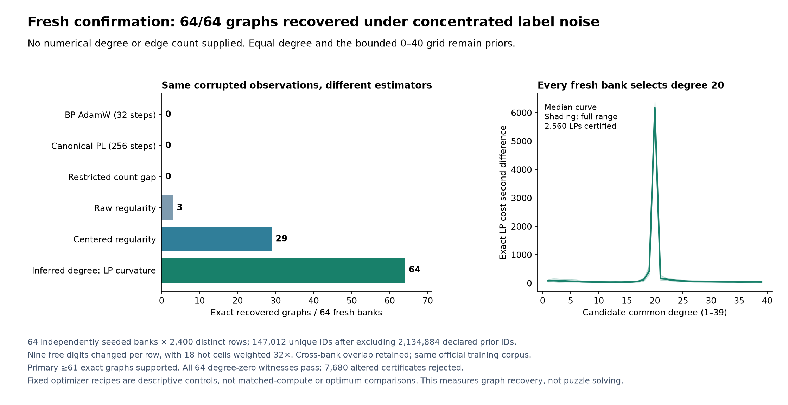

The same selector also recovers **64/64 graphs in each of four synthetic families**, selecting degrees two, four, six and eight. These are randomly permuted cycles, cycle squares, cycle cubes and nine-clique graphs, with uniform proper-coloring samples and the same concentrated corruption. These specified families do not establish arbitrary regular-graph recovery. With only 600 rows, exact recovery falls to **55/64, 40/64, 30/64 and 4/64**, even though all degrees remain correct. [Reduced-data test and all failed targets](../research/20261114/foureyes/REPORT-prefix-budget.md). [Degree-two/eight evidence](../research/20261114/foureyes/REPORT-varying-degree.md) · [Connected degree-four/six evidence and inline graph](../research/20261114/foureyes/REPORT-cycle-power.md)

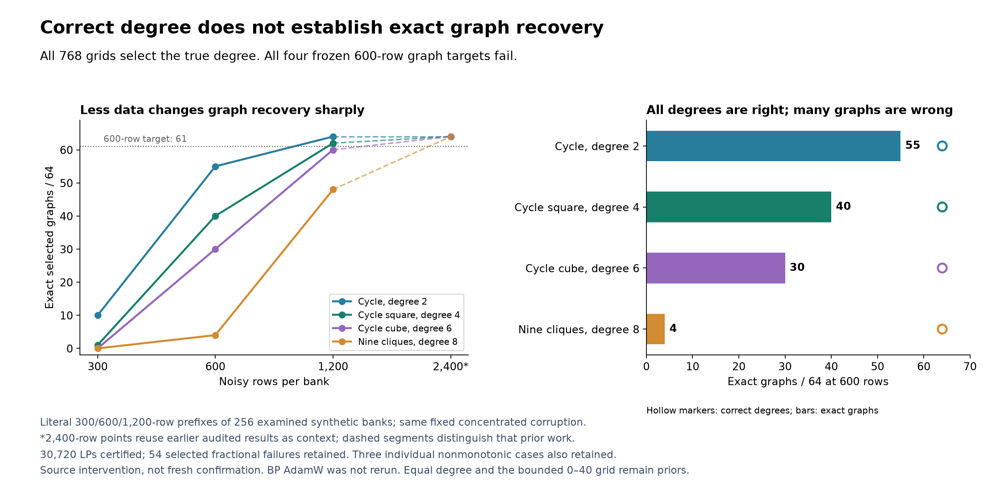

**Most of these failures are not ties:** the true graph has strictly higher empirical LP cost in **385/394** failed cases. For 331, a wrong integral graph is cheaper; another 54 have a cheaper fractional optimum. Only nine failures leave truth co-optimal. [Exact gap diagnosis and implications](../research/20261114/foureyes/REPORT-objective-gap.md)

Three refinements fail on the examined 600-row banks: bootstrap voting reduces recovery from **129/256 to 108/256**, per-cell deficit normalization reaches **98/256**, and an attenuation correction given the **actual corruption locations** reaches **88/256**. All fail their separate recovery and loss targets. The last method uses privileged information; its failure does not rule out other uses of those masks. [Bootstrap and exact loss diagnosis](../research/20261114/foureyes/REPORT-consensus-gap.md) · [Observable normalization](../research/20261114/foureyes/REPORT-normalized-deficit.md) · [Privileged-mask correction](../research/20261114/foureyes/REPORT-oracle-attenuation.md)

**Known corruption locations recover all 256/256 graphs** when observations involving corrupted cells are discarded, versus 129/256 from the original counts. This uses privileged masks and row-aligned noisy observations on the same examined banks. Every resulting never-equal support already matches truth, so these supports need no LP. Both recovery and loss targets pass; learning such masks remains untested. [Complete observations, certificates and scope](../research/20261114/foureyes/REPORT-corruption-censor.md)

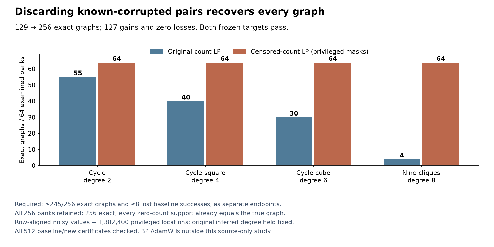

Revealing only **90%** of actual corruption locations still recovers **256/256**, passing the sole 245/256 target. Perfect precision remains supplied. The prespecified 50% diagnostic recovers 251/256; 75%, 95% and 99% each recover 256/256. [Complete partial-mask sensitivity experiment](../research/20261114/foureyes/REPORT-partial-mask-recall.md)

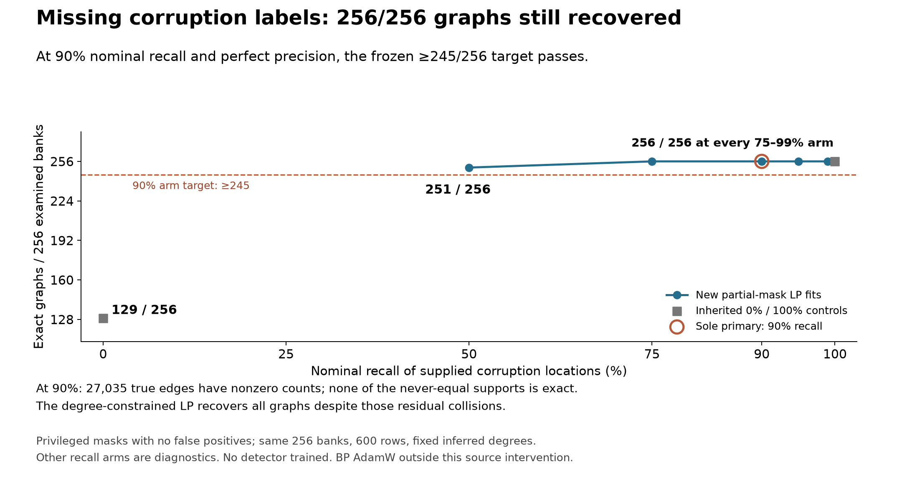

An observable conflict heuristic then recovers **130/256**, compared with **129/256** from the original counts and **71/256** under random nine-cell masks. Its absolute 200/256 target fails; the separate 32-graph advantage over random passes with a net gain of 59. Detector precision and recall are 42.32%, versus 11.12% random. All 512 fits are sealed before actual-mask diagnostics. [Full detector test, fractional outputs and exact certificates](../research/20261114/foureyes/REPORT-conflict-mask.md)

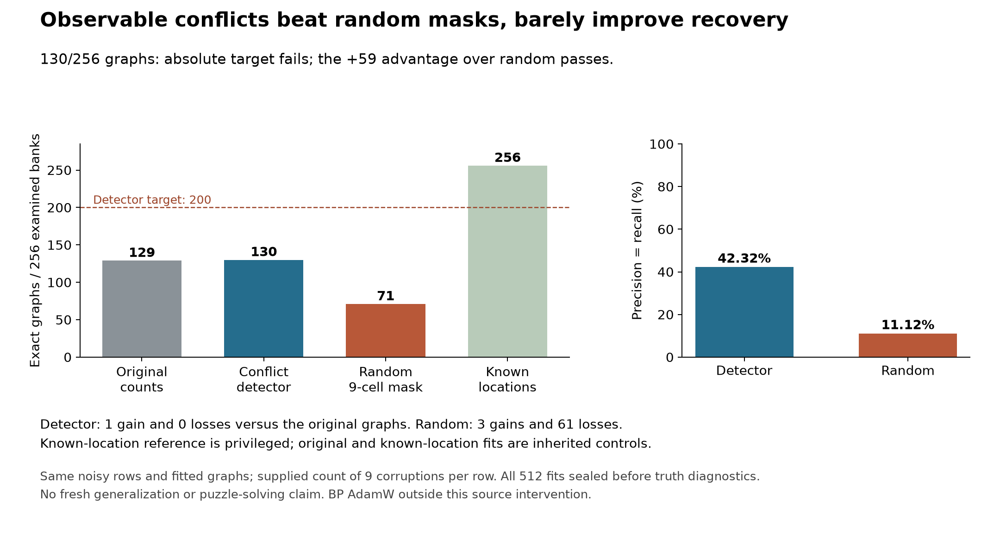

**Perfect precision alone does not rescue the conflict detector.** Removing its false positives leaves recovery at **130/256**, while sampling the same number of true corruptions in each row randomly reaches **237/256**. Both new masks are privileged, perfectly precise and have 42.3176% recall. The purified ≥200 target and absolute-count-difference ≤16 target both fail. Random locations gain107 graphs and lose none versus purification. [Complete matched-recall intervention and every failure](../research/20261114/foureyes/REPORT-purified-detector.md)

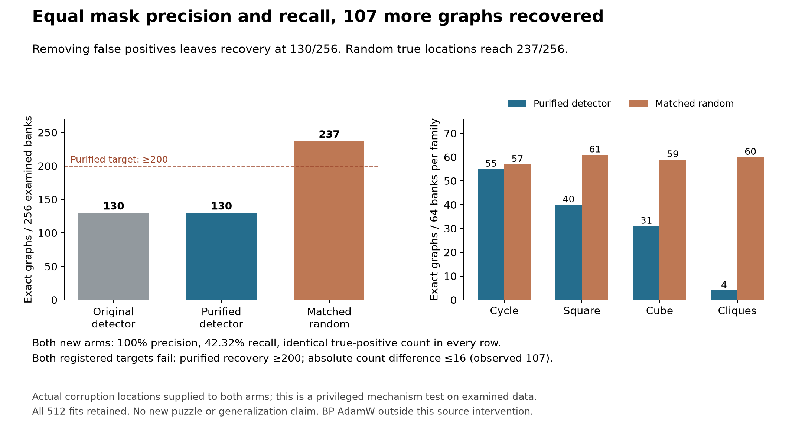

**Spend the same label budget on more cells per board:** querying 72 cells on 200 boards recovers **32/32 noisy Sudoku graphs**, versus **6/32** from 32 cells on 450 boards. Both cost 14,400 labels per bank. This fresh paired experiment changes both pair coverage and the number of independent boards; it does not isolate either as the sole cause. [Frozen targets, query accounting and controls](../research/20261114/ripper/REPORT-coverage-tradeoff.md)

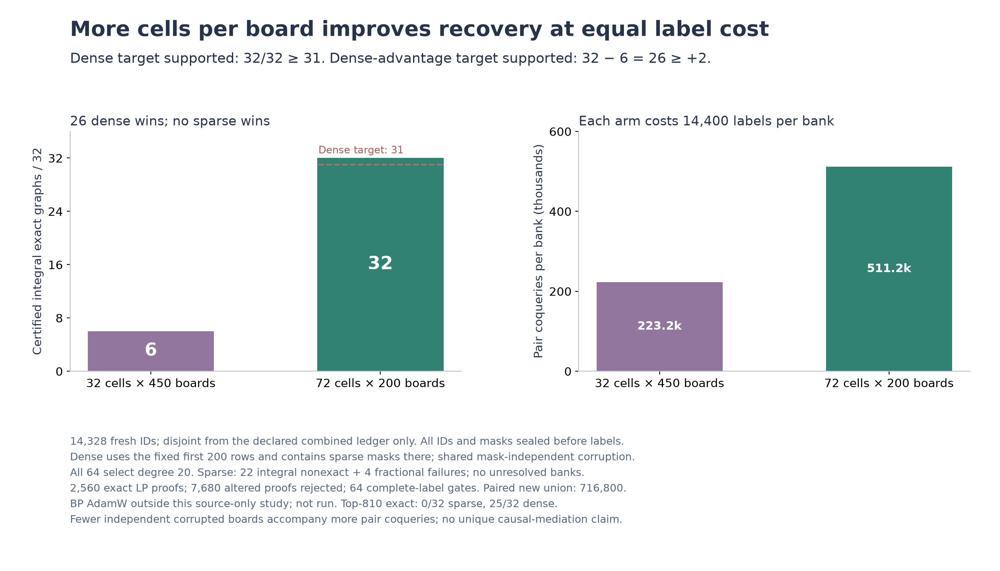

When total pair coqueries are matched instead, dense acquisition recovers **31/32**, versus **30/32** for sparse acquisition, using 8,928 versus 20,448 labels per bank. The separate target of two additional recoveries is **falsified**. This fresh follow-up limits the advantage claim; equal pair totals still leave different exposure variance and dependencies. [Matched-pair-budget control](../research/20261114/ripper/REPORT-matched-coquery.md)

**Noise structure matters as well as its marginal rate.** On fresh 124-row banks, independent 5% digit corruption recovers **15/32 graphs**, versus **30/32** for bursty corruption at the same marginal rate. Matching true-edge collision probability instead restores 30/32. A separate fresh test recovers **32/32** under independent 5% noise with 248 rows, versus **12/32** on their literal 124-row prefixes. [Corruption-law control](../research/20261114/ripper/REPORT-corruption-law.md) · [Doubled-data confirmation](../research/20261114/ripper/REPORT-iid-row-budget.md)

Balancing every pair’s exposure gives **32/32**, tying uniform masks at 5% noise. At 7.5% noise, it reaches **26/32 versus 25/32**; the prespecified four-recovery advantage fails. Equal exposure alone does not guarantee better recovery. [Balanced-mask control](../research/20261114/ripper/REPORT-balanced-masks.md) · [Harder-noise test](../research/20261114/ripper/REPORT-higher-noise.md)

The curvature signal survives a stricter control: **all 32 real banks beat shuffled controls in both mask arms**, even when every cell’s observed digit histogram is preserved exactly. All 13 nonexact real graphs also pass this contrast, so detecting structure does not certify graph recovery. [Histogram-preserving control](../research/20261114/ripper/REPORT-marginal-shuffle.md) · [Independent-label null](../research/20261114/ripper/REPORT-null-signal.md) A subsequent fixed permutation test signals on **32/32 examined real banks and 0/32 fresh IID null banks**, while accepting all 13 nonexact real graphs. Its null calibration concerns structure detection; the real sensitivity is retrospective. [Signal test and its limits](../research/20261114/ripper/REPORT-signal-detection.md)

At **7.5% independent noise**, a fresh confirmation recovers **64/64 graphs from 270 rows**, versus **58/64 from their 180-row prefixes**. Every row queries 72 cells, for 19,440 noisy labels per bank. The ≥61 recovery target passes; the separate target of eight additional recoveries fails with six gains and no losses. [Fresh sources, fixed protocol and full costs](../research/20261114/ripper/REPORT-fixed-270-confirm.md)

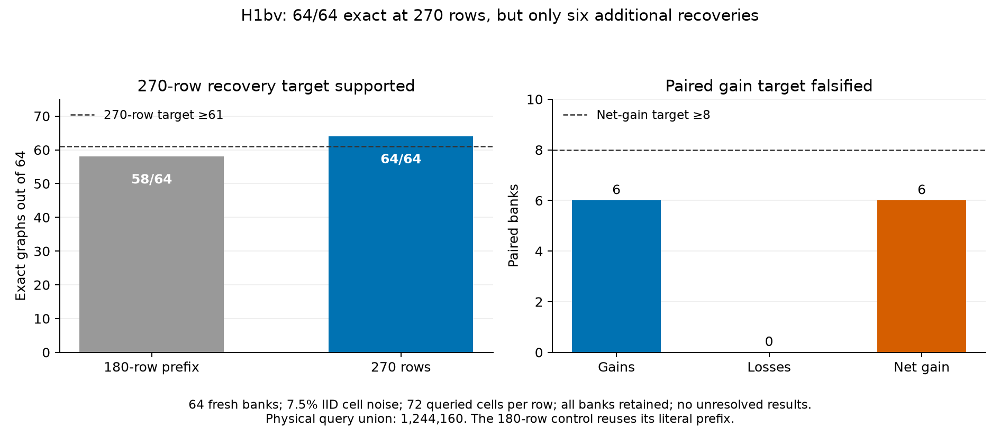

**More boards beat repeated labels at equal query cost:** 270 boards queried once recover **64/64 graphs**, versus **50/64** from 90 boards queried three times. Majority decoding reduces observed label error to 1.148%, but both graph-recovery targets fail. Each arm spends 19,440 queries per bank. An exact follow-up finds truth strictly excluded in nine of the 14 failures and co-optimal in five; its separate ten-exclusion target also fails. [Fresh paired acquisition test](../research/20261114/ripper/REPORT-repeat-query-tradeoff.md) · [Exact objective diagnosis](../research/20261114/ripper/REPORT-repeated-objective-gap.md)

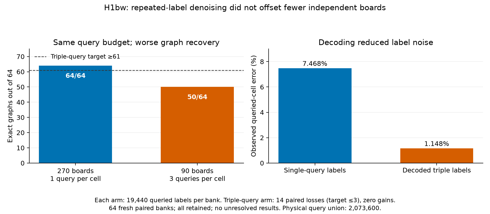

Removing cost quantization subsequently gives **49/64**, versus 50/64 for rounded costs, with five gains and six losses. Both improvement and regression targets fail; changes among tied optima prevent attributing individual outcomes solely to rounding. [Raw-count control and all proofs](../research/20261114/ripper/REPORT-raw-count-quantization.md)

An earlier repeated-graph stopping rule recovers 32/32 but needs 281.25 rows on average, missing its separate ≤270-row target. Its stopping costs are evaluated on physically acquired 360-row prefixes. [Stopping experiment and budget limit](../research/20261114/ripper/REPORT-stability-stopping.md)

**Retaining uncertainty improves repeated-label recovery.** Given the known 7.5% corruption channel and a uniform per-cell digit prior, posterior expected-equality scores recover **63/64** on the examined repeated-query banks, versus 50/64 for the hard decoder: fourteen gains and one loss. This changes the estimator without acquiring more observations. [Examined-cohort intervention and exact arithmetic](../research/20261114/ripper/REPORT-posterior-query-labels.md)

On a new 64-bank cohort, the fixed posterior method recovers **61/64**, hard decoding **51/64**, and single-query sampling of more boards **64/64**, all at equal label cost. Both preregistered posterior targets pass exactly at their boundaries; banks 6, 7 and 57 remain failures. The three arms retain all 7,680 LP certificates. This is graph recovery with supplied noise-law knowledge, not a new puzzle-solving result. [Fresh confirmation, exclusions and complete ledger](../research/20261114/ripper/REPORT-posterior-fresh-confirm.md)

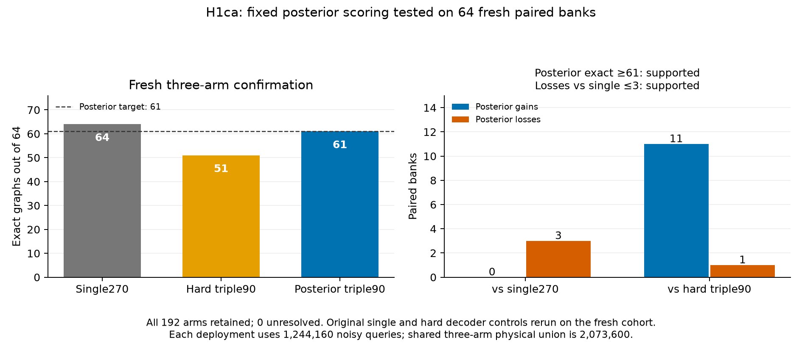

All three remaining fresh posterior failures **strictly exclude truth** from the selected objective optimum. Their exact ordinary-cost gaps are 4,597, 999 and 13,285. The registered at-least-two strict-exclusion target passes. A separately labeled mathematical corollary bounds the effect of integer rounding on each truth-versus-witness gap by810; each selected feasible witness therefore remains cheaper under the exact pre-round objective. This does not assert the witness stays optimal. [Exact gaps, rounding proof and all192 controls](../research/20261114/ripper/REPORT-posterior-residual-gap.md)

## Cycle cuts solve fresh dense mazes

The fresh BP-first confirmation solves **4,096/4,096** new mazes across all three models, versus **3,921** for BP AdamW and **4,096** for LP96. Its median measured complete answer-cost saving is **35.40%** over four balanced paired replays. The separate 99.9% reliability, −0.1-point noninferiority and 10% savings targets all pass. [Fresh confirmation and complete audit](../research/20261114/work/REPORT.md#h2bo-fresh-confirmation-supports-999-joint-success-and-saves-3540-complete-answer-cost).

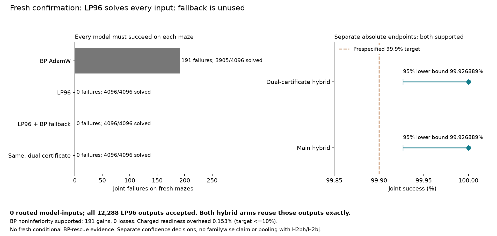

At **180×180 and 80% loop density**, LP96 solves **4,096/4,096 new mazes jointly across all three fixed models**, versus **3,905** for BP AdamW. All 12,288 LP outputs pass numerical acceptance. The two tested hybrid policies therefore return those same LP outputs: **no input invokes the BP fallback**. Both prespecified 99.9% hybrid-success endpoints pass, with a one-sided 95% lower bound of **99.9269%**. BP noninferiority and the separate added-cost target also pass. [Fresh cohort, separate endpoints and full audit](../research/20261114/work/REPORT.md#h2bk-fresh-lp96-solves-40964096-the-fallback-branch-is-never-used)

Keeping the fallback ready adds **0.153%** measured answer cost, including BP model loading. This cohort tests accepted LP96 outputs and unused fallback readiness; it supplies no fresh conditional rescue evidence. An earlier cohort retained one LP96 failure that BP solved, and actual numerical-only fallback was verified there. That earlier 99.9% endpoint remains **inconclusive**. [Retained failure](../research/20261114/work/REPORT.md#h2bh-fresh96-reaches-40954096-the-absolute-999-target-remains-inconclusive) · [Source fallback verification](../research/20261114/work/REPORT.md#h2bj-the-known-bp-rescue-executes-correctly-and-also-passes-the-original-lp-certificate)

The decoder supplies an explicit graph prior and permits moves that increase the learned energy. Choosing cycle cuts by learned energy did not improve the earlier matched comparison over lexicographic ordering. Local energy certificates alone do not establish graph validity, shortestness or global optimality; all reported solves receive independent graph checks.

Testing that limitation directly, an additional LP energy certificate rejects only **1 of 510 archived wrong BP answers**, while retaining all 11,778 correct answers. Its ≥90% error-rejection target fails. [Complete failure cases and independent verification](../research/20261114/work/REPORT.md#h2bl-an-additional-lp-certificate-rejects-only-1-of-510-bp-graph-errors)

An independent geometry analysis catches **all 510 errors**: each violates simple-path geometry. This analyzes the same existing answers; it does not yet measure a faster routing policy or fresh accuracy. [Full failure decomposition](../research/20261114/work/REPORT.md#h2bm-all-510-archived-bp-failures-violate-simple-path-geometry)

The earlier fresh confirmations also solve **8,192/8,192 at 120×120**, **4,096/4,096 at 180×180 with a larger move limit**, and **4,096/4,096 at 50% loop density** across all three fixed models. These are separate finite cohorts and policies; their prespecified minimum-gain endpoints have different outcomes. [120×120 transfer](../research/20261114/work/REPORT.md#h2au-fixed-cycle-cut-policies-solve-the-fresh-8192-input-cohort) · [Larger-move confirmation](../research/20261114/work/REPORT.md#h2ax-fresh-180180-cap-confirmation-supports-safety-and-bp-noninferiority-the-minimum-gain-target-remains-inconclusive) · [50% density confirmation](../research/20261114/work/REPORT.md#h2bc-fresh-bounded-decoder-confirmation-supports-the-budget-mechanism-while-the-one-point-gain-target-remains-inconclusive)

Exact geometry optimizations produce **1.33×** and **1.46×** complete-policy speedups on separate fixed replay cohorts, preserving boards and search traces. Bounded asynchronous archive writes improve complete research-pipeline throughput **1.28×**, with every scientific archive byte-identical. These measure different scopes and cohorts; the ratios should not be multiplied. [Bridge geometry](../research/20261114/work/REPORT.md#h2bd-exact-bridge-geometry-meets-separate-geometry-and-complete-policy-speed-targets) · [Veto geometry](../research/20261114/work/REPORT.md#h2bf-exact-veto-geometry-meets-its-own-local-and-complete-policy-speed-targets) · [Archive throughput](../research/20261114/work/REPORT.md#h2bi-bounded-asynchronous-archives-improve-complete-research-pipeline-throughput-by-1279)

## A search prior makes the same learned energy much more useful

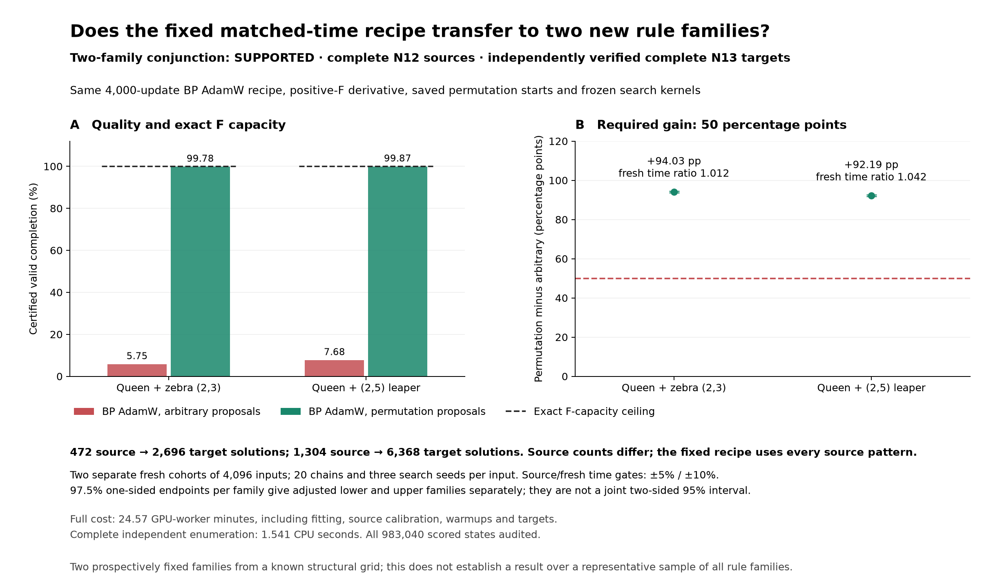

Keep one queen in each row and column while proposing moves. With identical fitted weights and starting boards, this raises certified success from **5.75% to 99.78%** for queen-plus-zebra and **7.68% to 99.87%** for queen-plus-(2,5)-leaper. Median complete GPU solve times are within **1.2% and 4.2%**, respectively. Both frozen ≥50-point gain targets pass, with zero wrong stops.

Each family uses a complete N12 training universe and 4,096 fresh N13 inputs, with 20 chains and three search seeds. These are **two fixed families**, not representative sampling over all rules; preserving a permutation adds a search prior. Learned supports exactly match the target attack graphs here. [Protocol, timing costs and audit](../research/20261114/loki/h3ad/REPORT.md)

**A practical CPU control is faster still for these fixed N13 models.** Compile the complete learned zero-energy set once, then answer three batches of 4,096 clue queries: **100% certified success**, with total compile/load/query wall time **32.9× and 16.6× lower** than the GPU permutation solver for the two families. This includes independent completeness verification and cache construction. The complete sets contain only 2,696 and 6,368 boards; this is a reusable fixed-size cache comparison across different hardware, not a general scaling result. [Exact compiler, label-free queries and full cost accounting](../research/20261114/loki/h3ae/REPORT.md) · [N15 verification-budget boundary](../research/20261114/loki/h3af/REPORT.md)

An earlier queen-plus-camel replication fits **four independent source-bank draws**: permutation search reaches **92.47–94.49%**, versus **19.45–21.06%** for arbitrary-cell proposals at matched measured GPU time. The four fits have two distinct supports; extra exclusions limit their certified accuracy. [Four-bank replication](../research/20261114/loki/h3ac/REPORT.md) · [Initialization versus proposal control](../research/20261114/loki/h3aa/REPORT.md)

## Better questions identify hard rules

With a supplied class of **1,541 queen rules**, 16 valid N12 examples and at most eight binary N13 membership queries, bounded decision trees identify **1,408/1,408 models** across fresh banks from 22 selected hard rules. The preceding MAP-guided policy identifies 1,371; the paired comparison has 37 gains and zero losses. Both frozen success targets pass. The tree policy uses 19 more membership labels in aggregate, so this is a recovery improvement with a slightly higher observed label cost. [Fresh paired study, supplied priors and full query ledger](../research/20261114/loki/h3bj/REPORT.md)

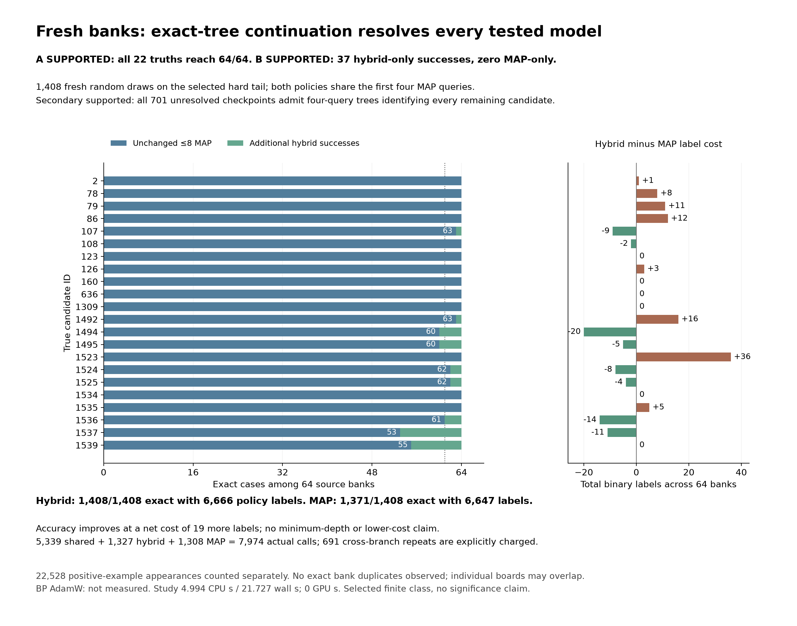

The source-example budget matters: on a new paired cohort, **eight positives identify 1,354/1,408 rules, versus 1,408/1,408 with sixteen** under the same query policy. All 54 failures reach candidate sets too large to identify within the remaining four binary questions. The frozen per-rule reliability target fails for five of the 22 selected rules. [Paired evidence-budget test and information bounds](../research/20261114/loki/h3bm/REPORT.md)

**Which question weights help depends on how the rules are sampled.** On fresh banks from the same 22 selected hard rules, uniform trees use **2,651 continuation calls**, versus 2,761 for first-lex trees and 2,882 for posterior-weighted trees. The separate 2% and 5% reduction targets pass; all three policies identify the same 1,368/1,408 cases. [Fresh selected-rule confirmation](../research/20261114/loki/h3bq/REPORT.md)

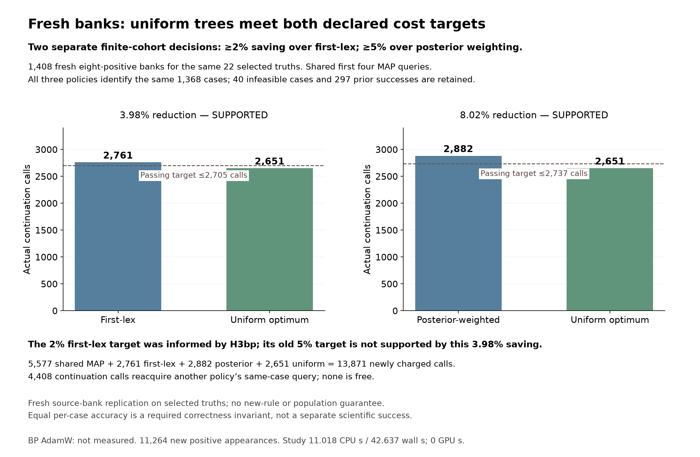

When 4,096 fresh rule-and-example cases are instead sampled from the declared prior, posterior weighting uses **422 continuation calls versus 488 for uniform (13.52% fewer)**, supporting its separate 2% target. Including the shared MAP questions, total policy cost falls only **0.63%: 10,421 → 10,355**. All policies identify 4,083/4,096 cases. These are finite cohorts within the supplied rule class. [Matched-prior test, full costs and sampling audit](../research/20261114/loki/h3br/REPORT.md)

Earlier failures remain explicit: posterior weighting increased actual cost on selected checkpoints, and uniform weighting's initial 2.83% saving missed its frozen 5% target. [Expected-versus-actual discrepancy](../research/20261114/loki/h3bn/REPORT.md) · [Selected posterior diagnostic](../research/20261114/loki/h3bo/REPORT.md) · [Retained uniform-target failure](../research/20261114/loki/h3bp/REPORT.md)

Switching to a question tree as soon as one fits also fails: it preserves the same 4,083 exact results but raises total paid calls from **10,355 to 10,937 (+5.62%)** on the archived cohort. Fewer preliminary questions do not necessarily mean fewer total labels. [Early-handoff test and cost decomposition](../research/20261114/loki/h3bs/REPORT.md)

Requiring the tree's exact expected cost to beat the remaining baseline lowers total calls to **10,291**, with the same 4,083 exact results. The **0.62%** saving misses the frozen 2% target: an expected-cost guarantee does not guarantee that finite-cohort reduction. [Guarded handoff, every paid query and proof](../research/20261114/loki/h3bt/REPORT.md)

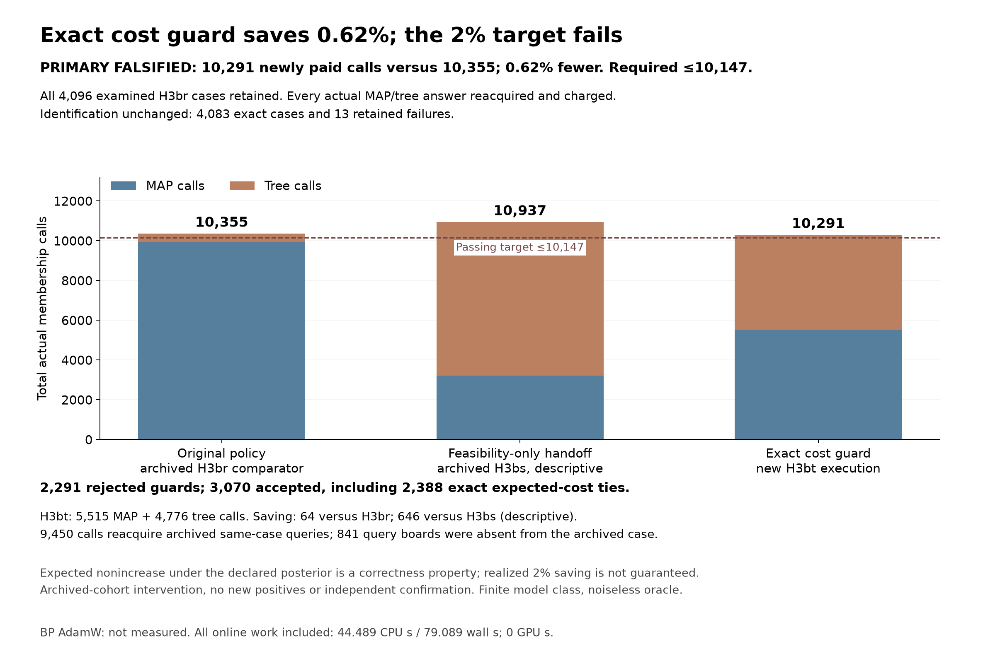

Two deeper-tree follow-ups reach their frozen two-million-state caps after **1,779/4,096** and **3,836/4,096** cases. Both studies remain incomplete, with no primary decision or partial-cohort saving claim. [Original deeper-tree cap](../research/20261114/loki/h3bu/REPORT.md) · [Exact-pruning study and archive boundary](../research/20261114/loki/h3bv/REPORT.md)

## Confidence weights recover answers under noisy labels

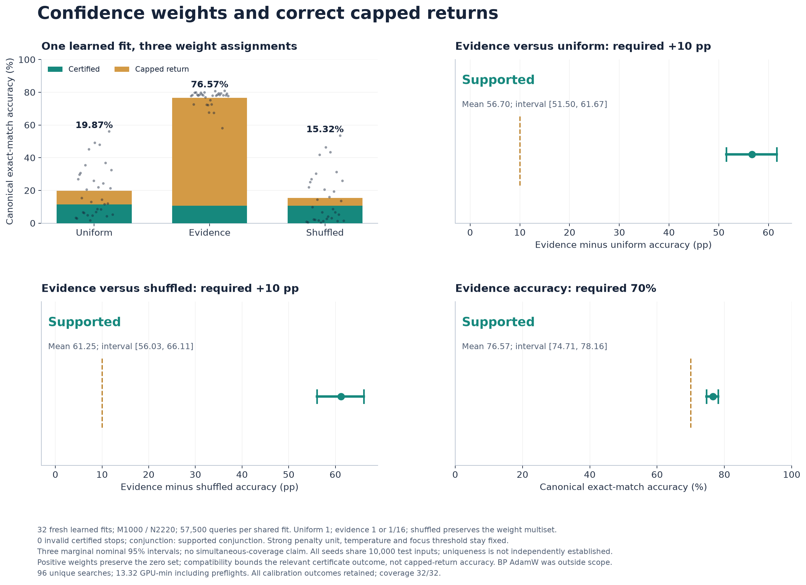

At **5% queried-label noise**, evidence-based weights raise Sudoku exact-match accuracy from **19.87% to 76.57%** on the same learned supports. Shuffling the same weights gives **15.32%**. The evidence-minus-uniform gain is **56.70 points**, with a paired 95% interval of **[51.50, 61.67]**.

This compares 32 shared fits, each costing 57,500 label queries, on 10,000 fresh puzzles. **The gain comes from correct answers returned at the search cap:** 65.98% are correct capped returns and 10.59% are correct certified stops. Positive weights preserve the zero set; they improve search without making more solutions certifiable. Zero invalid certificates were observed. [Frozen targets, controls and full audit](../research/20261114/ripper/REPORT-confidence-weight.md)

The budget boundary matters: with half as many training boards and 29,750 total queries, accuracy falls to **23.55%**, falsifying the frozen 70% target. No certificates occur in that study. [Retained negative result](../research/20261114/ripper/REPORT-confidence-budget.md)

## Faster inference

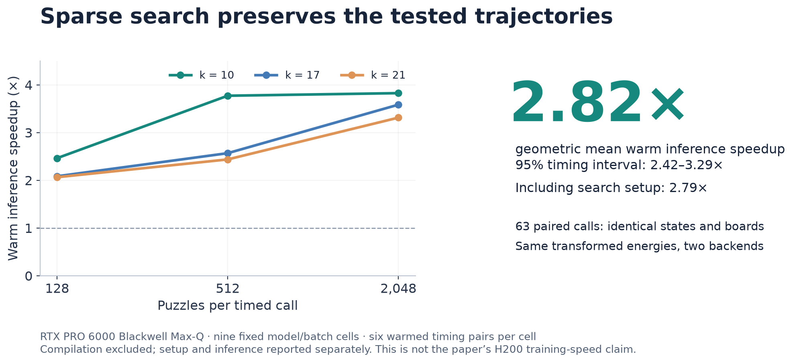

The sparse backend runs transformed Sudoku energies **2.82× faster** in warm inference, or **2.79× including search setup**, on RTX PRO 6000 Blackwell Max-Q. All 63 paired timing calls return identical states and boards. Compilation is excluded from warm timing. [Measurements and parity checks](../research/20261114/ripper/REPORT-sparse.md)

## What was reproduced?

The original campaign measured **99.996689% Sudoku accuracy** across three full held-out runs, **100% Maze-Unique**, **99.9% Maze-Hard**, and all graph-coloring quality cells. It completed 84 objective runs, 100 training curves, 102 data-efficiency runs, and the declared controls and supplemental ablations. These original protocols differ from the research experiments above.

Baselines are explicitly **published results**. The paper's H200 **“1,000×” speed claim is not independently established** by our Blackwell experiments. [Reproduction evidence and limits](../REPRODUCTION.md) · [Paper coverage](../docs/PAPER_COVERAGE.md)

Negative results remain public: learned certificates can accept invalid boards, better energy rankings can worsen solving, and more training can damage a fixed transformation pipeline. [All hypotheses and outcomes](../results/README.md) · [Expanded research history](../docs/RESEARCH_TOUR.md)

## Deeper exact question trees finish within budget

On the same examined 4,096 matched-prior cases, recomputing admissible Huffman bounds inline lets the deeper policy finish within its frozen caps. It uses **10,133 paid queries versus 10,355**, saving **2.1439%** and passing the sole 2% target by fourteen calls. All **4,083 exact identifications and thirteen failures** are preserved. The result is about paid query count, not elapsed-time speed or fresh generalization.

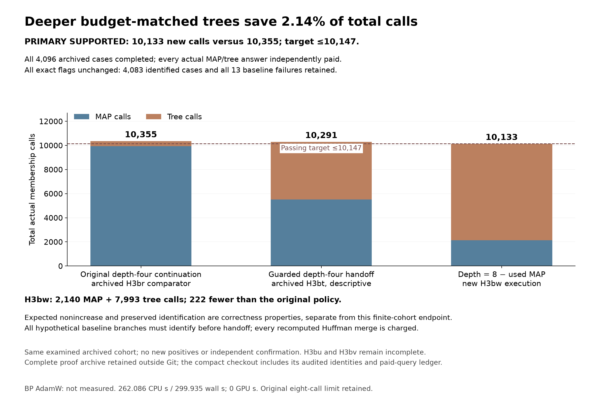

Every repeated bound merge is charged; the run takes 299.93 seconds wall and 262.09 seconds aggregate CPU. A separate full archive audit checks every tree, bound, pruning decision, canonical reuse and counterfactual exact flag. Git contains portable ledgers, compact evidence and proof hashes; full optimality replay requires the separately retained archive. Earlier state-capped attempts remain incomplete. [Complete result and audit boundary](../research/20261114/loki/h3bw/REPORT.md) · [Earlier capped attempt](../research/20261114/loki/h3bv/REPORT.md)

## Nonlinear likelihood after repeated-label posterior scoring

On the examined H1ca cohort, pairwise composite likelihood recovers **62/64** repeated-query graphs versus **61/64** for the fixed posterior score. It rescues one graph and loses none, but the prespecified target of at least 63 recoveries fails. Both residual failures strictly exclude the true graph. This uses the known noise channel and the same observations; no fresh generalization is claimed. [All arms, certified arithmetic and limits](../research/20261114/ripper/REPORT-pair-likelihood.md).

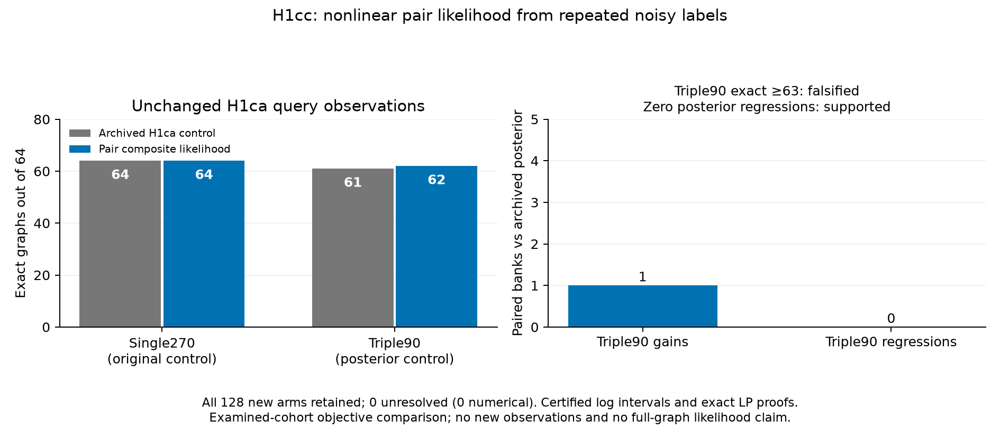

## Cross-fitting conflict masks

Training each detector on the opposite 300-row half reduces exact graph recovery to **38/256**, versus **130/256** for the original 600-row detector, with three gains and 95 losses. Both fixed targets fail. Each donor graph has half as much training data, so this does not isolate the effect of disjoint rows. [Protocol, all failures and exact proofs](../research/20261114/foureyes/REPORT-crossfit-conflicts.md).

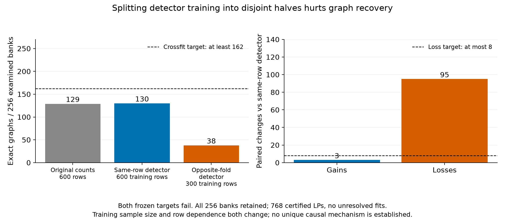

## Fresh paired question-tree confirmation

On 4,096 fresh cases, deeper question planning uses **9,975 paid calls** versus **10,238** for a separately executed baseline: **263 fewer calls (2.57%)**. The fixed 2% whole-cohort target passes. Both policies recover exactly 4,083 graphs and retain all 13 failures; cross-arm repeated queries are reacquired and charged. This is a finite-cohort result under the declared prior. [Fresh generation, full audit and portable proof boundary](../research/20261114/loki/h3bx/REPORT.md).

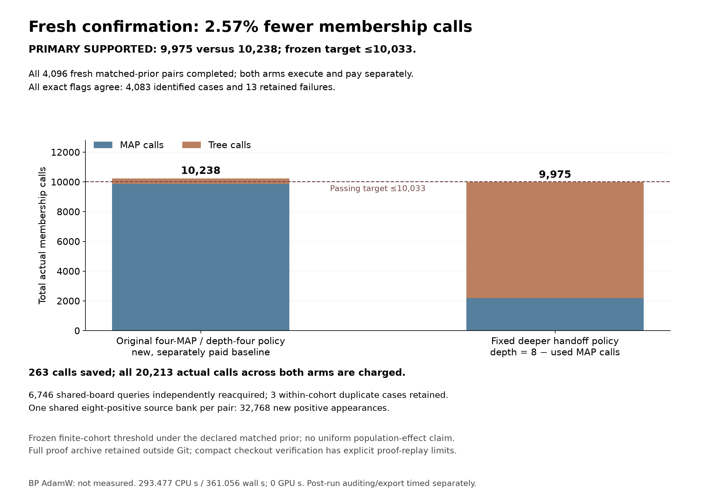

## Endpoint shift reverses the maze cost result

Sampling ordered endpoints uniformly from all open cells gives **4,096/4,096** joint successes for both LP96 and the fixed BP-first cascade, versus **4,079/4,096** for BP AdamW. Both accuracy targets pass, but the cascade's median complete answer cost rises **15.54%**, falsifying the separate 10% saving target. Only 50 inputs route to LP96, yet the BP prefix costs more than the LP work it replaces on this cohort. This is a descriptive cost decomposition, not a causal path-length conclusion.

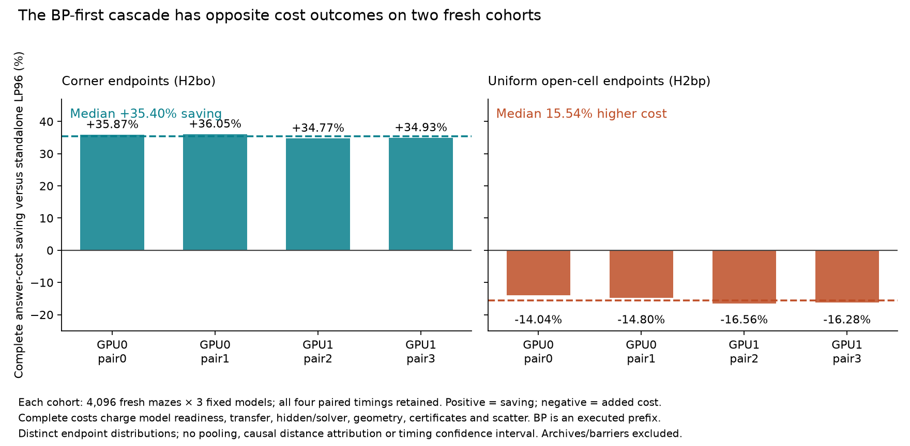

The earlier corner-endpoint cohort saves 35.40%; both cohorts use 4,096 fresh mazes and three fixed models. Endpoint distributions and timing pairs remain separate. [Uniform endpoint study](../research/20261114/work/REPORT.md#h2bp-uniform-endpoints-preserve-joint-success-but-falsify-the-cost-saving-target) · [Original endpoint confirmation](../research/20261114/work/REPORT.md#h2bo-fresh-confirmation-supports-999-joint-success-and-saves-3540-complete-answer-cost).

## Likelihood robustness to two wrong noise rates

Assuming half or double the actual 7.5% label-noise rate yields **62/64** exact graphs in both arms, with **zero regressions** versus the nominal likelihood control. All four separate targets pass. Every selected primal is unchanged despite different integer costs. This tests two fixed assumptions on examined repeated-query records; it does not establish a continuous robustness interval or fresh generalization. [Protocol, arithmetic certificates and residual failures](../research/20261114/ripper/REPORT-channel-misspecification.md).

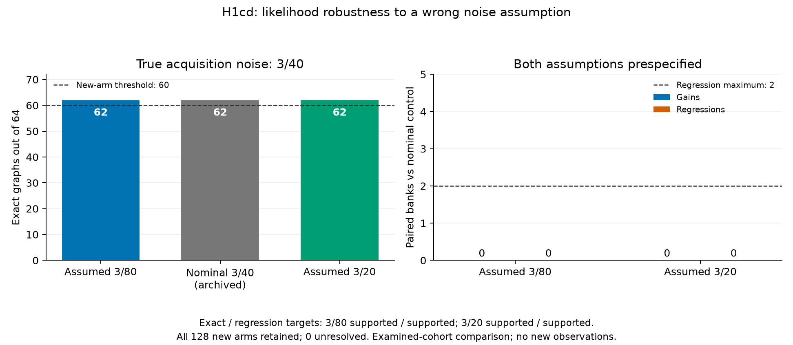

## Estimate the noise channel from repeated observations

The fixed disagreement-moment estimator retains **62/64** exact graphs and every nominal-channel success on the examined repeated-query cohort. It selects 7% noise in 38 banks and 8% in 26; both the at-least-60 recovery target and at-most-two-regression target pass. Every selected primal is unchanged from the known-rate likelihood control. The estimator and objective use the same observations, and this is not a fresh heterogeneous-noise test. [Full numerical and source checks](../research/20261114/ripper/REPORT-estimated-channel.md).

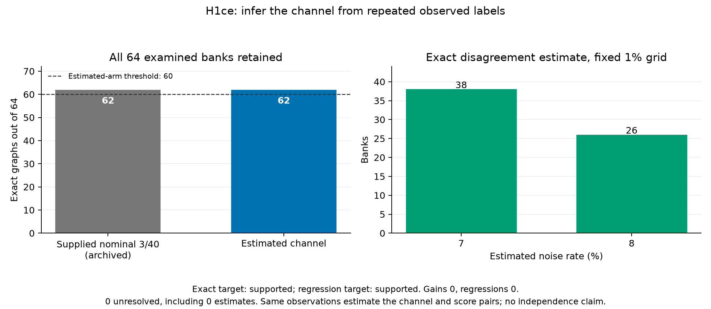

## A larger disjoint sample does not rescue the detector at 600 rows

A disjoint 600-row donor yields **122/256** exact final graphs, with **41 gains and 49 losses** versus the original 130/256 detector. Both frozen targets fail. The original run completed and sealed all 512 fits, then failed an incorrect integer-dtype assertion. A separately frozen audit repair checks those unchanged outputs with **zero new fits**. The failed run and repair have separate accounting; the result is a repaired post-run evaluation on examined data. [Original failure, repaired proofs and comparison limits](../research/20261114/foureyes/REPORT-disjoint-donor.md).

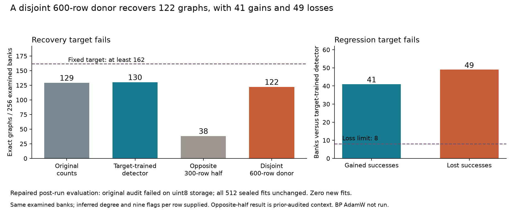

## Question planning under a shifted truth prior

With truths sampled uniformly while both policies retain their fixed hierarchical inference weights, the deeper policy uses **12,583 calls versus 12,958**, saving **375 calls (2.89%)**. The fixed 2% target passes on 4,096 fresh paired cases; both arms retain 4,064 exact identifications and 32 failures. All repeated queries are reacquired and paid. This finite-cohort finding does not establish an expected-cost guarantee under the shifted truth law. [Full independent audit, seed-scope disclosure and public proof boundary](../research/20261114/loki/h3by/REPORT.md).

## More donor data helps; masking adds no exact recoveries

Increasing the disjoint donor to 1,200 rows raises final recovery to **229/256**, with **107 gains and eight losses** versus the original 600-row detector. Both fixed targets pass, with regressions exactly at the allowed limit. **The donor graph alone recovers the same 229 banks**, so the masking/refitting stage adds no exact recoveries in this cohort. The full method uses 1,800 stored observations; this examined-data result has a larger observation budget than the original detector. [Complete comparison and proofs](../research/20261114/foureyes/REPORT-larger-donor.md).

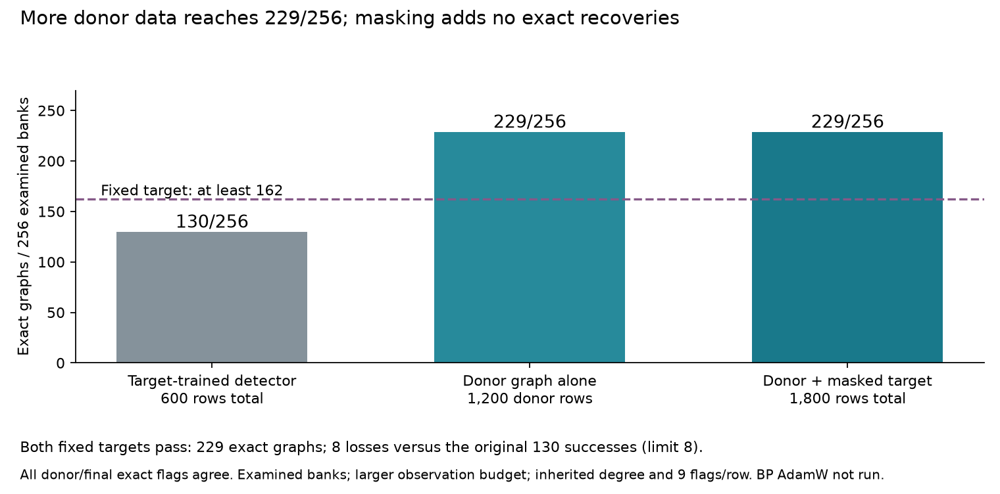

## Opposite-region maze endpoints preserve a cost advantage

With endpoints uniformly sampled within opposite 45×45 corner regions, both LP96 and the cascade solve **4,096/4,096** fresh mazes across all three fixed models; BP AdamW solves **4,003**. The cascade saves **18.43%** median complete answer cost. All three prespecified accuracy and cost targets pass; all four paired timings remain visible. The earlier corner, uniform-open-cell and opposite-region distributions remain separate, with no causal distance claim. [Protocol, all inputs and audit](../research/20261114/work/REPORT.md#h2bq-opposite-region-endpoints-preserve-joint-success-and-save-1843-complete-answer-cost).

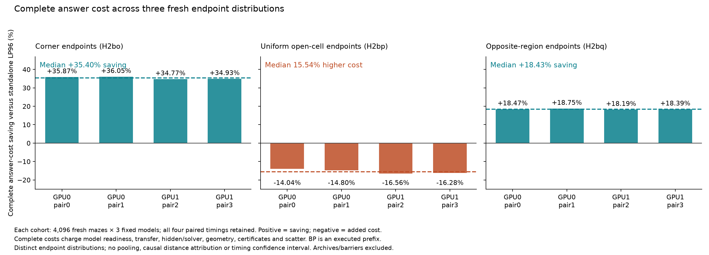

## Pooling beats masking at the same observation budget

One raw-count fit on the same 1,800 observations recovers **254/256** examined synthetic graphs, versus **229/256** with donor masking: **25 gains, zero losses**. Both separate targets pass (at least 245 recoveries, at most four losses). Two nine-clique failures remain; all degrees are inherited from the original 600-row target. This is an examined-data structural test, without a fresh-cohort or puzzle-solving claim. [Full matched comparison](../research/20261114/foureyes/REPORT-pooled-donor.md).

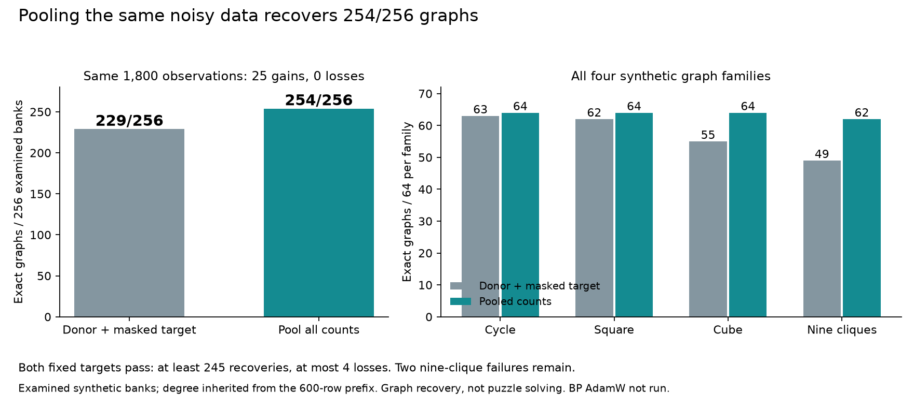

## Estimating noise across fresh rates

On 72 fresh banks with 24 each at 3.75%, 7.5% and 15% noise, supplied-rate and estimated-rate likelihoods each recover **67/72** exact graphs, with no paired gains or losses. Both absolute targets and the regression bound pass. All five wrong outputs strictly exclude truth under their objectives. Rates differ between banks and remain constant across cells within each bank. [Fresh protocol, strata and exact gaps](../research/20261114/ripper/REPORT-heterogeneous-channel.md).
