# Research context and earlier experiments

This expanded tour preserves the experiment narrative previously on the front page. It is a historical snapshot through H3ab; the [current highlights](../README.md) and [complete results index](../results/README.md) link subsequent studies, including confidence weighting and source-bank and new-family search replications. Results below retain their original cohorts and protocols.

## Simple counts match the transformed Sudoku energy

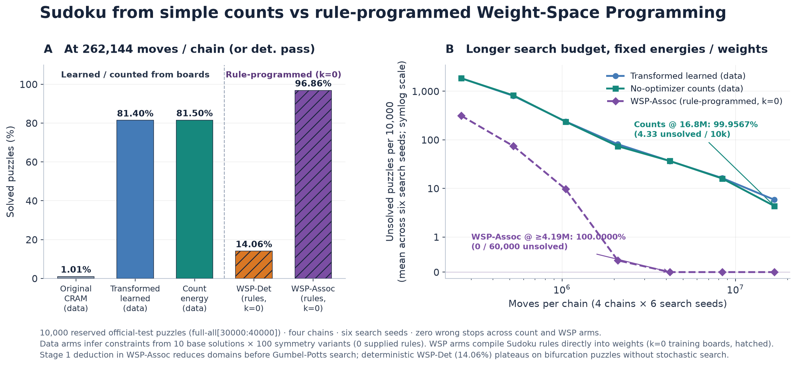

Connect two cells if they **never share a digit in the training solutions**. Give each retained pair weight one, then run the same focused Gibbs search. This simple estimator recovers the same 810-edge constraint graph as our transformed learned energies, without an optimizer or a supplied Sudoku peer graph.

On a reserved **10,000-puzzle official test slice**, the count energy solves **59,974/60,000 evaluations (99.9567%)** across six search seeds, with **zero wrong stops**, using four chains and **16,777,216 moves per chain**. The transformed learned energy reaches 99.9417% under the same budget. The paired difference is +0.015 points; its one-sided 95% lower bound of −0.0151 points passes the frozen 0.1-point noninferiority margin. At the shorter **262,144-move** cap, the count method solves **81.50%**.

**The augmentation prior matters.** These training counts use ten unique base solutions **plus 99 stored Sudoku-symmetry variants per base**. The transformations supply task knowledge. A larger one-base-solution study recovered the exact graph in **8,105/8,192 fresh trials** with 99 spatial variants. This uses augmentation-group knowledge; it is not one unaugmented example learning Sudoku. [Coverage theorem and fresh-RNG validation →](../research/20261114/ripper/REPORT-coverage.md) The count comparison also reuses the official corpus and a follow-up cohort. [Protocols, full budget curve, stopping proof and limitations →](../research/20261114/foureyes/REPORT-budget.md) · [Count and augmentation controls →](../research/20261114/ripper/REPORT-count.md)

**Spatial augmentation is not required with more raw solutions.** Counting recovers the exact graph from **100 distinct, unaugmented training solutions in all six samples**. A stronger matched control then compared counting with the fixed transformation pipeline applied to digit-relabeling PL fits. At 262,144 moves per chain, counting solves **80.79%** versus **80.46%** for transformed PL, with zero wrong stops; PL passes the frozen 2-point noninferiority margin. The simpler count estimator matches a properly transformed learned model. [Raw-count structure →](../research/20261114/ripper/REPORT-raw-count.md) · [Matched transformation control →](../research/20261114/foureyes/REPORT-raw-transform.md)

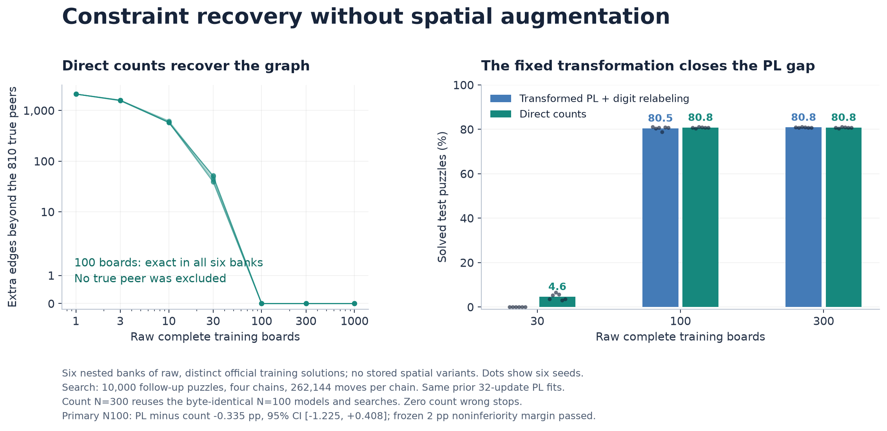

Hidden solution labels can also be removed: counts from **3,000 partially observed training puzzles** recover the same graph in all six samples. Masked digits never enter estimation or calibration. These are official clue masks, whose selection may carry useful information. [Clues-only experiment and leakage checks →](../research/20261114/ripper/REPORT-clues.md)

**More training data makes count recovery robust to label noise.** Change nine free digits in every training board, preserve its clues, and choose the threshold using the largest gap in equality counts. With 3,000 boards, this recovers the exact graph in **512/512 independent fresh-bank and corruption draws**, with a one-sided 95% lower recovery bound of **99.4166%**. At 600 boards it recovers 493/512 graphs; at 300, only 21/512. This measures graph recovery within the official training corpus under a declared random corruption law. [Fresh-bank replication and failure diagnosis →](../research/20261114/foureyes/REPORT-noise-source-replication.md)

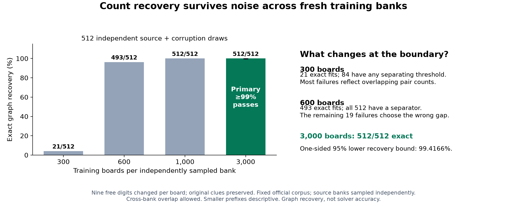

The fixed learned transformation is less robust at 600 noisy boards: the paper recipe solves **20.27%**, versus **80.25%** for restricted counts, and produces 240,000 wrong stops across 320,000 logical evaluations. An untuned AdamW control reaches 78.03% with zero observed wrong stops. All arms use the same zero-threshold search; optimizer and regularization differences remain explicit. [Noisy-label comparison and audited graph failures →](../research/20261114/foureyes/REPORT-noisy-pl.md)

More training does not repair that fixed pipeline: a fresh 64-bank test scores **18.76% at 256 SGD updates**, versus **27.59% at 32 updates** and **79.99% for restricted counts**. The AdamW control now produces 838 wrong stops, underscoring the limits of an earlier zero-error observation. [Matched training-budget test and numerical checks →](../research/20261114/foureyes/REPORT-noisy-pl-long.md)

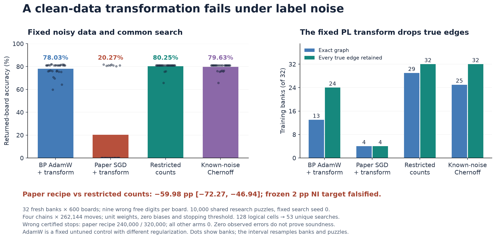

The earlier intervention result remains useful: digit symmetry and repulsion increased low-data accuracy by **47.83 points** on a separate reserved slice. Counting explains why the transformed models recover the same graph. [Earlier matched results →](../research/20261114/ripper/REPORT-heldout.md)

## Choose useful clues—even when labels are noisy

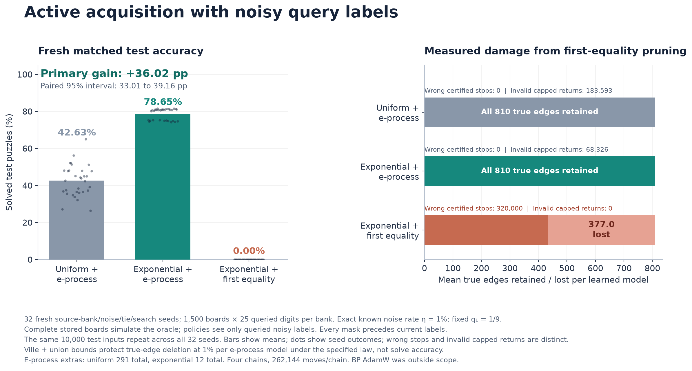

With **1% independent noise in queried labels**, adaptive querying plus a sequential evidence rule solves **78.65%**, versus **42.63%** for uniform querying with the same evidence rule: **+36.02 points**, with a paired 95% interval of **[33.01, 39.15]**. Both methods preserve every true constraint in all 32 fitted models and have zero wrong stops. Naively deleting a constraint after its first observed equality solves 0% and produces 320,000 wrong stops.

Each policy receives **1,500 training boards × 25 queries** per board. The 32 source-bank runs share the same 10,000 test puzzles and fixed short search budget. Complete stored solutions act as a simulated label oracle; only queried, corrupted digits reach the policy. The evidence rule is supplied the **exact 1% noise law**. Its conditional guarantee protects true constraints under that law; it does not guarantee exact graph recovery or solve accuracy. [Sequential evidence proof, controls and audit →](../research/20261114/ripper/REPORT-noisy.md)

**At a fixed query budget, spend more on training and less on calibration.** With 57,500 queries per bank, using 1,000 repeated-query pairs to estimate noise and 2,220 training boards solves **83.17%**, versus **76.31%** with 10,000 calibration pairs and 1,500 training boards. The observed gain is **6.86 points**, with a paired 95% interval of **[4.76, 9.14]**; the frozen 5-point noninferiority target passes, with zero wrong stops. All 32 cheaper-calibration models recover the exact graph and match the known-noise control's outcomes through identical energies. This result concerns the declared independent 1% noise law. [Equal-query controls, proof and audit →](../research/20261114/ripper/REPORT-equal-budget.md)

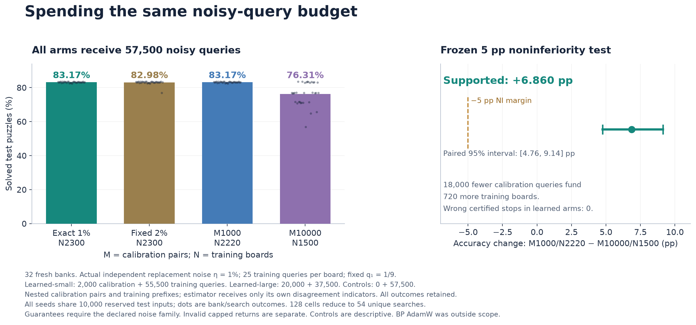

The earlier experiment established that repeated queries could estimate a useful noise bound, but charged the learned-bound arm extra queries. [Original calibration study and limits →](../research/20261114/ripper/REPORT-calibrated.md)

The economical allocation fails at **5% noise**: learned calibration solves **24.17%**, versus **52.32%** with exact noise knowledge, failing both the five-point accuracy margin and the frozen 70% accuracy floor. Both still have zero wrong stops; preserving true constraints does not guarantee useful solve accuracy. [Noise-rate transfer and retained calibration failure →](../research/20261114/ripper/REPORT-rate-transfer.md)

**Doubling training restores performance at 5% noise.** With 4,440 training boards and 1,000 calibration pairs, both learned and exact noise calibration recover all 32 graphs and solve **82.34%**, with zero wrong stops. This costs **113,000 queries** per bank for learned calibration and **111,000** for exact calibration. It passes the frozen accuracy and stopping targets; the gain comes with more data. [Fresh-bank test, nested controls and costs →](../research/20261114/ripper/REPORT-scaled-noise.md)

Noise calibration matters: using a conservative **2% upper bound when actual noise is 1%** preserves true constraints but falls to **57.10%** versus **78.98%** for exact calibration on a separate fresh cohort, falsifying the frozen 10-point noninferiority target. [Conservative-bound control and figure →](../research/20261114/ripper/REPORT-noise-bound.md)

The noiseless experiments remain separate: a mixture query score reduced extra constraints by **50.6%** versus the previous policy; a fresh ablation found the simpler exponential score noninferior under the frozen margin. At **600 boards × 25 queries**, exponential querying recovered the exact graph in **243/256 fresh source-bank draws**, passing the frozen 90% recovery target. [Original improvement](../research/20261114/ripper/REPORT-spike.md) · [Ablation](../research/20261114/ripper/REPORT-exponential.md) · [Independent recovery confirmation](../research/20261114/ripper/REPORT-recovery-confirm.md)

## The same transformed model, faster inference

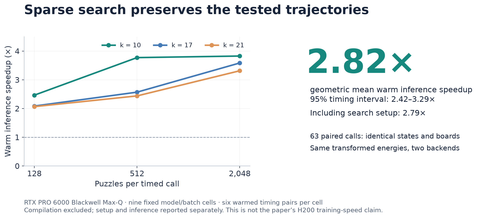

A sparse backend runs the same repulsive energies **2.82× faster** in warm inference, or **2.79× including search setup**, on RTX PRO 6000 Blackwell Max-Q. All 63 paired warmup/timing calls produced identical final states and boards. Broader bounded checks covered 18 models, followed by a full 10,000-puzzle integration comparison. Compilation is excluded from warm timing. [Timing data, parity checks and limitations →](../research/20261114/ripper/REPORT-sparse.md)

## Fewer maze failures with a selective fallback

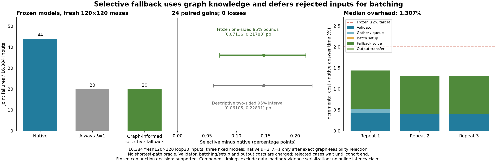

On **16,384 fresh 120×120 loopy mazes**, a selective fallback reduces joint failures across three frozen models from **44 to 20**: **24 gains and zero losses**. Median additional answer time is **1.31%** across three complete timing repetitions, including validation, queueing, setup and output transfer. The frozen accuracy and ≤2% overhead targets both pass.

The decoder checks whether the native answer forms a valid path on the **supplied maze graph**, then retries rejected cases with a fixed continuous relaxation. This adds explicit graph knowledge; it uses no shortest-path oracle. Rejected cases are batched **at cohort end**, so the result measures offline throughput and does not establish low response latency. Only 114 of 49,152 model-inputs needed a retry. [Frozen protocol, complete timings and audit →](../research/20261114/work/REPORT.md)

A separate trial flushes rejected cases every **1,024 native inputs**. It keeps the accuracy benefit, but costs **6.9%** more answer time, falsifying the unchanged 2% target. This quantifies the batching-versus-delay tradeoff. [Bounded-delay trial and complete timing →](../research/20261114/work/REPORT.md)

A hand-engineered, single-threaded **BFS control solves all 16,384 supplied graphs in 1.679 CPU seconds**. That task-specific solver is much faster than the learned decoder; the report separates hardware, workload and timing scope. [Practical solver control →](../research/20261114/work/REPORT.md)

The retry adds $\lambda\sum_{i\in\mathrm{free}}p_i(1-p_i)$ with $\lambda=1$. It changes the continuous search while leaving every binary energy and the original flip certificate unchanged. Applying it to every maze also reduced failures on separate 90×90 and 120×120 cohorts, at about 18–19% more answer time; one 120×120 input regressed. [Derivation](../research/20261114/work/binary-preserving-derivation.md) · [Always-on confirmation and regression case](../research/20261114/work/REPORT.md)

Earlier, changing the inference step size from **0.2 to 0.5** reduced median answer updates by **2.38× at 60×60** and **2.42× at 90×90**, with measured hidden-plus-answer runtime improvements of **2.09× and 2.21×**. Both arms solved all 768 generated inputs at the 8,192-update cap. These generated mazes differ from the original Maze-Hard distribution. [Step-size graph](../results/research/work/eta-acceleration.png) · [All maze controls](../research/20261114/work/REPORT.md)

## N-Queens: unseen solutions from training counts

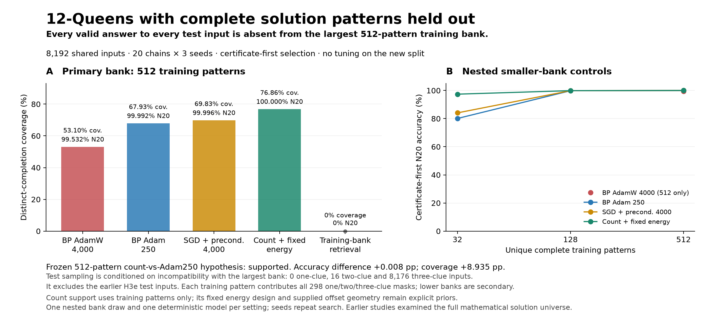

With **512 complete training patterns**, a count-based exclusion energy reaches **100% accuracy and 76.86% solution coverage** on 8,192 new N-Queens-12 partial inputs. Every valid completion lies outside the training bank, so retrieving compatible training examples cannot solve any of these inputs. Adam at 250 updates reaches 99.9919% accuracy and 67.93% coverage. The count method gains **8.94 coverage points**; the paired one-sided 95% lower bound is +8.78 points. Ordinary BP AdamW at 4,000 updates reaches 99.5321% accuracy and 53.10% coverage.

These measurements use 20 search chains and three search seeds, with a certificate-first output rule. The count method uses no optimizer, but retains a fixed energy design and displacement-sharing architecture. The test distribution is conditioned on incompatibility with the training bank and consists almost entirely of three-clue inputs; it differs from the original benchmark. The 512 patterns expand into 152,576 labeled training examples. [Frozen split, all controls and independent 4.9-million-board audit →](../research/20261114/loki/h3g/REPORT.md)

Sharing is consequential: with 32 training patterns, removing displacement sharing drops accuracy from 97.39% to 0%. False exclusions can also make invalid initial boards pass the learned certificate. [Matched architecture ablation and certificate audit →](../research/20261114/loki/h3h/REPORT.md)

The earlier study included every complete pattern in training, where simple bank retrieval was already competitive. That control motivated this stricter follow-up. [Full-bank controls and limitations →](../research/20261114/loki/h3f/REPORT.md)

Earlier N-Queens-10 experiments showed faster fitting with Adam and a weight-decay gap. A learned-certificate-first output policy then fixed all 77 failed AdamW input–seed cases without extra search, showing that the gap depends on output selection. [Optimizer experiments →](../research/20261114/loki/h3c/REPORT.md) · [Selection control →](../research/20261114/loki/h3d/REPORT.md)

**Preserving a permutation makes search much more effective at matched measured GPU time.** With identical learned weights, temperatures and permutation starting boards, permutation-preserving proposals reach **88.77%** certified queen-plus-camel success versus **21.06%** for arbitrary-cell proposals. The gain is **67.71 points**, with one-sided 95% endpoints [66.79, 68.56] and zero wrong stops. Median complete solve calls take **21.31 versus 21.86 seconds**, passing the frozen ±10% timing gate. Counts were selected using source-only timing before fresh targets: 12,000 versus 20,000 proposals per chain. This measures GPU time, not equal FLOPs, and uses one inherited fitted model. [Matched-time protocol, full calibration costs and audit →](../research/20261114/loki/h3ab/REPORT.md)

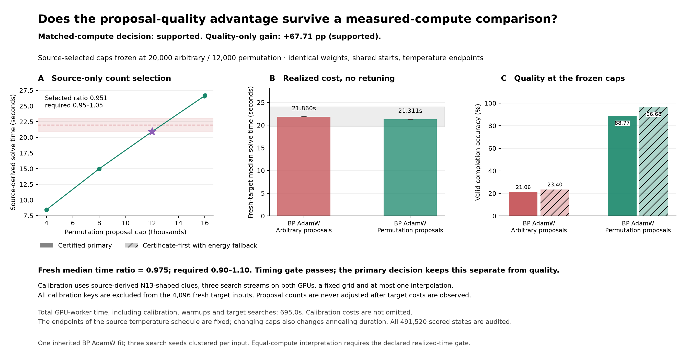

An earlier three-arm control showed that changing initialization alone gives no demonstrated large gain; changing proposals with identical starts raises success by **66.36 points** at equal proposal caps. The added prior comes from source-inferred rows and columns. [Initialization/proposal decomposition →](../research/20261114/loki/h3aa/REPORT.md) · [Original combined intervention →](../research/20261114/loki/h3w/REPORT.md)

**A complete source universe can support compact rule learning.** Given all 176 N12 queen-plus-camel solutions, an explicit completeness assumption, D4 symmetry and a preference for fewer rule generators, exhaustive selection identifies the single `(1,3)` leaper rule. Its N13 energy exactly matches the already-audited oracle, inheriting **100%** certified success without another search. This uses substantial extra priors and reused outcomes. A fixed 18-case stress grid succeeds in 12 cases and includes a unique wrong rule that certifies 12 invalid complete boards. [Exact selection and identity mapping](../research/20261114/loki/h3x/REPORT.md) · [Full stress grid and counterexamples](../research/20261114/loki/h3y/REPORT.md)

## Failures are part of the result

The maze step-size benefit has a limit: a new maze with many tied shortest paths produces certified branched or disconnected answers for two models. Simple tied-cycle controls still solve perfectly, so ties alone do not explain the failure. [Saved graph, boards and causal controls →](../research/20261114/work/REPORT.md)

A stronger check proves that the invalid endpoint-only answer is the **unique global binary minimum** on one selected maze, for all three frozen models. A public verifier checks exact rational certificates over **4,434 free binary cells**, with the hidden readout and wall/endpoint clamps fixed. This is an objective-level counterexample, not a claim about other graphs or the continuous energy. [Derivation and full certificates](../research/20261114/work/global-bound-derivation.md) · [Standalone verifier](../research/20261114/work/verify_global_bound.py)

A matched training intervention then fixes label-versus-endpoint ranking on all **4,096 fresh mazes**, but drops joint shortest-path solves from **4,089 to zero**. The failed outputs select about 92% of free cells; nearly every correct label still remains a local minimum. Improving one energy ranking is insufficient to make the decoder solve the task. [Training controls, full diagnostics and figure →](../research/20261114/work/REPORT.md)

Linear programming can satisfy every declared training flip and sparse/dense ranking constraint, with public primal and dual certificates. Yet a norm-matched version still solves zero fresh mazes under native inference: its final probabilities are nearly stationary and fractional, and rounding remains invalid. A fresh binary-preserving penalty removes the fractional probabilities but still solves zero: every output rounds to the all-open board. [Feasibility, norm bounds and the failed decoder test →](../research/20261114/work/REPORT.md)

The learned Sudoku pipeline's four-million-move **99% all-seed joint-success hypothesis was inconclusive**, despite 99.635% mean accuracy. The sixteen-million-move secondary endpoint passed. Projection still fails at extremely low data; largest-gap pruning collapses without spatial augmentation; and maze mass rescaling gives no improvement. [All hypotheses, including negative and inconclusive outcomes →](../results/README.md)

Learning valid constraints at one board size does not guarantee transfer to a larger board. For superqueens, a source-based hybrid model reaches **37.23%** on larger N13 boards while the supplied-rule oracle reaches 100%. Some exclusions inferred from all N12 solutions become false at N13. Adding every N11 solution leaves the model unchanged. [Superqueen boundary →](../research/20261114/loki/h3l/REPORT.md) · [Smaller-source control →](../research/20261114/loki/h3m/REPORT.md)

A larger prospective upward-transfer test also **falsifies** the frozen 0.1-point noninferiority target: the full N14 superqueen source gives **99.6419%** on N15 versus **99.9410%** for the supplied-rule oracle. Extra exclusions leave 49 of 16,384 inputs without any valid certificate. The earlier smaller test remains inconclusive. [Confirmation and structural audit →](../research/20261114/loki/h3p/REPORT.md)

Learning soft weights does not automatically fix transfer. On queen-plus-camel boards, grouped BP AdamW reaches **75.63%** versus **88.75%** for matched filtered counts, with **9,965 wrong stopped chains**. Independent energy reconstruction confirms that negative interactions can compensate for real conflicts and satisfy the source-trained certificate. [Matched optimizer control and failure mechanism →](../research/20261114/loki/h3u/REPORT.md)

Removing negative interactions and using a strict zero-conflict stop eliminates observed wrong stops, but learned positive weights find certified solutions on only **21.25%** of fresh inputs versus **83.41%** for uniform weights on the **same support and zero set**. This separates search behavior from which solutions the energy allows. [Fixed-support experiment, capacity census and kernel validation →](../research/20261114/loki/h3v/REPORT.md)

Fixed Sudoku restarts also failed their frozen +0.1-point improvement target: the gain was +0.012 points, with a paired 95% interval [−0.068, +0.093]. [Restart control and full curve →](../research/20261114/foureyes/REPORT-restart.md)

At N15, compiling the reverse verifier completes the exact CPU comparison, but its **3.93× / 2.58×** speed ratios falsify the frozen 10× target. Replacing dense certificate sums with occupied-cell pair sums then improves full compilation by **1.32× / 1.41×**, with complete caches unchanged and shared build costs charged to every arm. The much larger certificate microbenchmark speedups do not describe whole-program speed. [Completed comparison](../research/20261114/loki/h3ag/REPORT.md) · [Microbenchmark](../research/20261114/loki/h3ah/REPORT.md) · [Compiler integration](../research/20261114/loki/h3ai/REPORT.md)

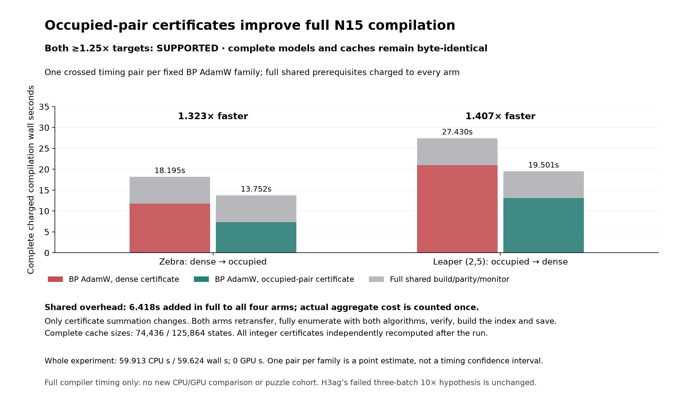

Noise correlation can destroy the constraint-retention premise even at the same nominal **5% fixed-cell error**. A specified board-shared collapse law removes true edges in **32/32 banks**, while repeated queries always agree and underestimate noise. This measures structural failure; no solver certificates were evaluated. [Law, matched controls and independent replay](../research/20261114/ripper/REPORT-collapsed-noise.md)

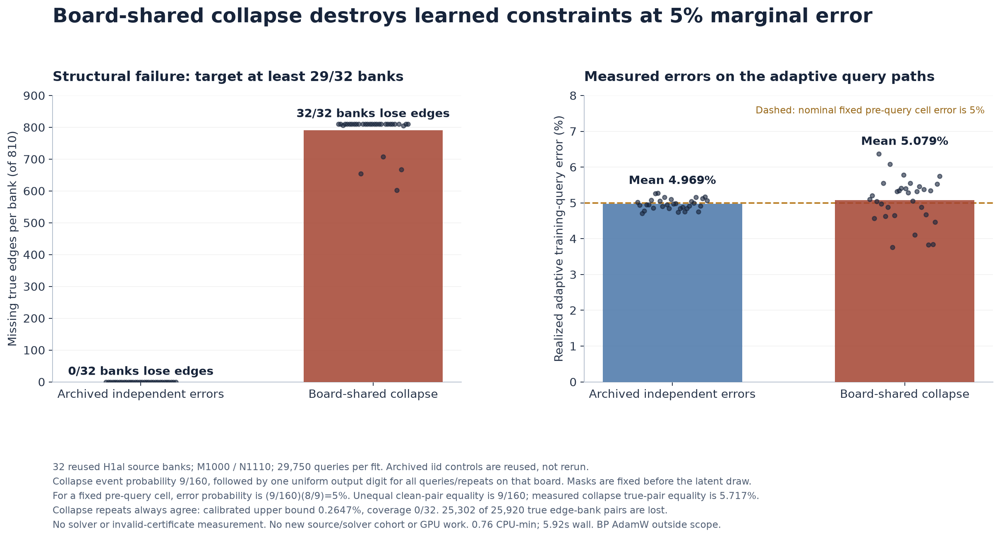

A fresh **4,096-maze** factorial separates training from inference. New hard-negative training leaves binary predictions unchanged; block moves add 63 joint solves but lose 40, for a net **+0.562 points**. All 40 losses disconnect endpoints on the first accepted energy-decreasing deletion. The combined method still fails the frozen noninferiority target against BP AdamW. [All states, candidate deltas and connectivity audit](../research/20261114/work/REPORT.md)

Reducing weak Sudoku penalties from 1/16 to 1/256 raises accuracy by **1.355 points**, below the frozen five-point target. All three weight levels preserve the same zero set and produce no certificates. This is a mechanism test on already-seen inputs, with a full integer arithmetic and board audit. [Penalty strength and paired uncertainty](../research/20261114/foureyes/REPORT-weak-weight-study.md)

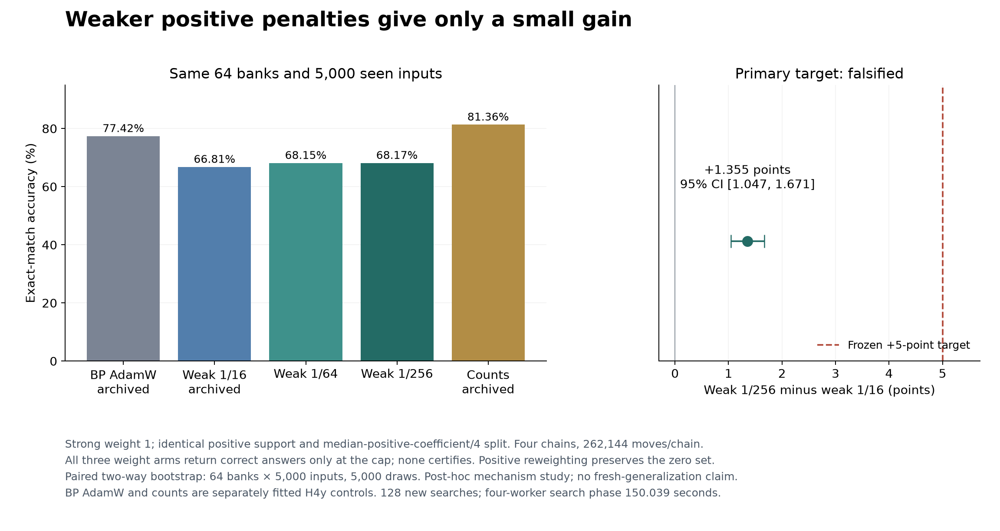

Under the specified shared-collapse noise law, a supplied digit-multiplicity prior rejects every corrupted training board while preserving every clean one. The original evidence rule nevertheless recovers only **9/32** graphs exactly. Reusing the same accepted observations, a rule that removes a constraint after any clean equality witness recovers **32/32**. The first result misses its target; the second isolates overly conservative retention. Both depend on the declared corruption model, and neither measures solver accuracy. [Filter study](../research/20261114/ripper/REPORT-balanced-filter.md) · [Fixed-evidence ablation](../research/20261114/ripper/REPORT-positive-witness.md)

An exact census over **831,605 eligible N15 camel clue inputs** puts certified capacity at **89.54–92.32%** across four fitted source banks. Every learned zero-energy state is valid, but extra exclusions remove valid completions. All four fits fail the frozen 95% capacity target; more search cannot overcome this ceiling. [Complete public census and verifier](../research/20261114/loki/h3aj/REPORT.md)

Deleting weak Sudoku edges then restores valid certificates and raises accuracy to **72.38%**, but its **+4.21-point** gain still misses the frozen five-point target. This changes the zero set, unlike positive reweighting. The full audit finds zero invalid certificates; it does not prove universal soundness for the reduced supports. An erroneous stop-index check was corrected in a separate auditor, with original source, diff and unchanged result hashes preserved. [Deletion study and audit correction](../research/20261114/foureyes/REPORT-strong-support-study.md)

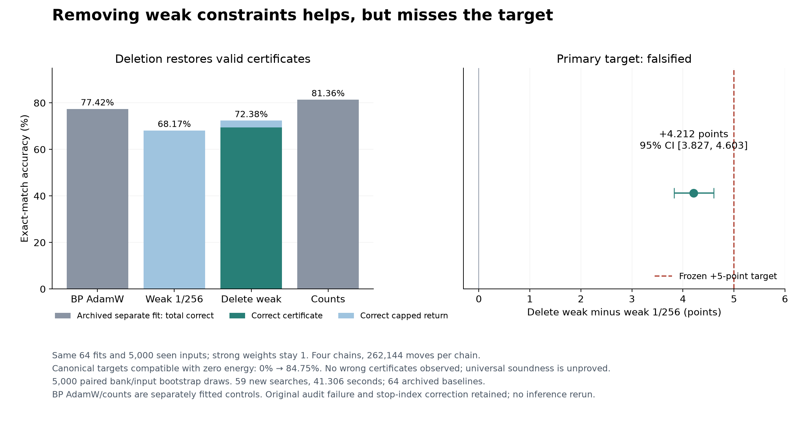

On the already-seen maze cohort, preserving initial simple paths removes all 40 block regressions while retaining all 63 gains. A pre-deletion connectivity veto retains those gains and adds 11 more, again with zero observed regressions. These supplied-graph policies are post-hoc interventions. The proposed larger-maze padding gate fails because real wall cells add boundary energy terms that zero convolution padding does not. [Policy controls, full audit and retained gate failure](../research/20261114/work/REPORT.md)

A noise control preserves every complete board's digit counts while permuting cell positions. The multiplicity filter accepts all **2,071 corrupted training boards**, and **21/32** fits lose a true constraint, meeting the frozen ≥16-bank target. Repeated queries still agree. This establishes the filter's limitation under a different specified five-percent marginal-error law, without claiming that every missing edge causes an invalid certificate. [Exact corruption law and full trajectory replay](../research/20261114/ripper/REPORT-permuted-noise.md)

Acquiring **64 positive N13 boards per fixed camel fit** repairs N15 certified capacity to **96.36%, 100%, 98.25% and 98.25%**, supporting the prospective 95% target for these four draws. Repair only deletes exclusions contradicted by positive witnesses; it receives no target geometry, labels or capacity scores. This relies on a size-invariant pair-rule assumption and evaluates the same already-seen N15 universe. The reliability of new random acquisition streams remains a separate question. [Acquisition, access isolation, complete capacities and public replay](../research/20261114/loki/h3ak/REPORT.md)

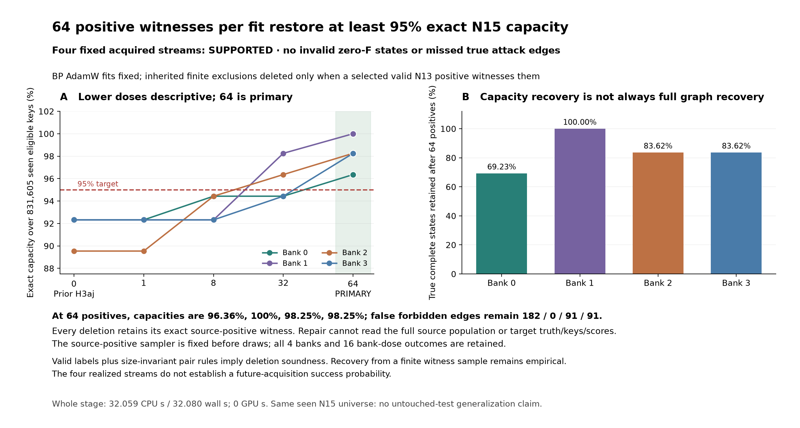

Missing a true Sudoku edge does not by itself establish a false global certificate. Auditing all 32 fits from the digit-count-preserving corruption study proves **28 globally sound**, supplies explicit invalid zero-energy boards for **two**, and leaves **two unresolved** after bounded search. The frozen ≥29-sound hypothesis is inconclusive: an unresolved case is not an unsound graph. Geometry is supplied only to this audit. [Complete proofs, witnesses, limits and public verifier](../research/20261114/ripper/REPORT-permuted-soundness.md)

