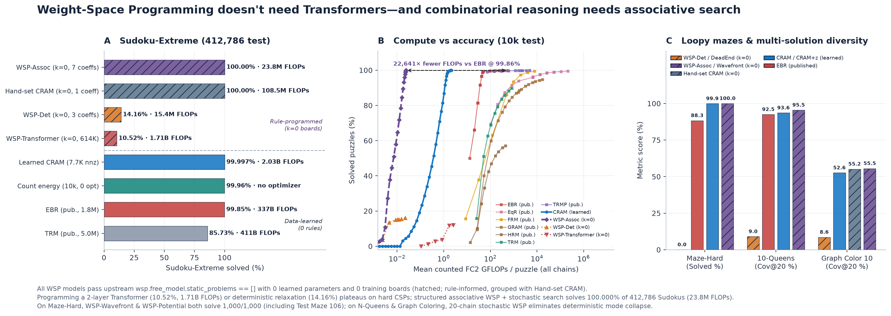
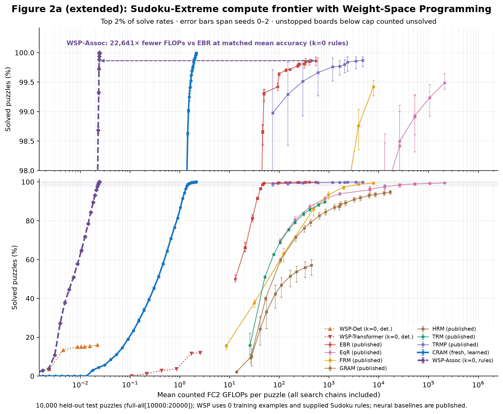
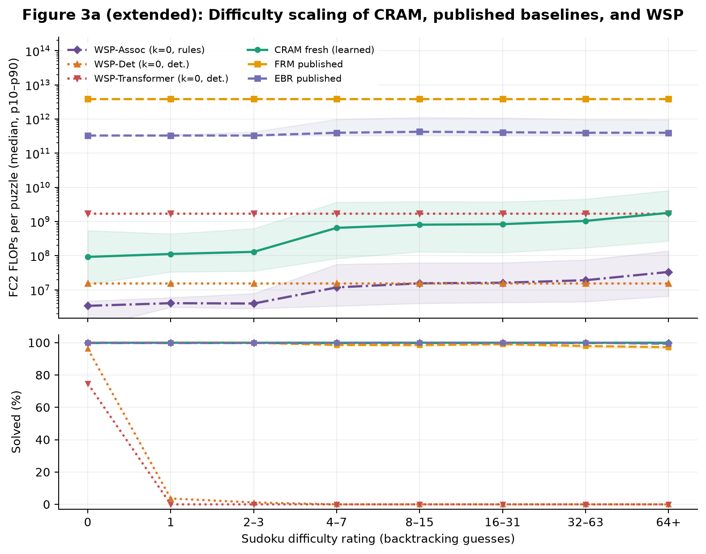
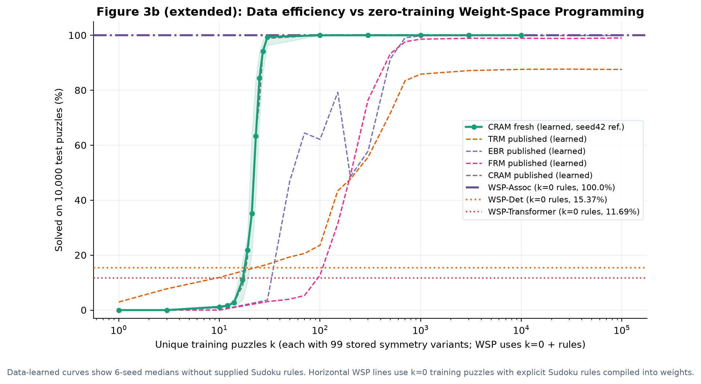
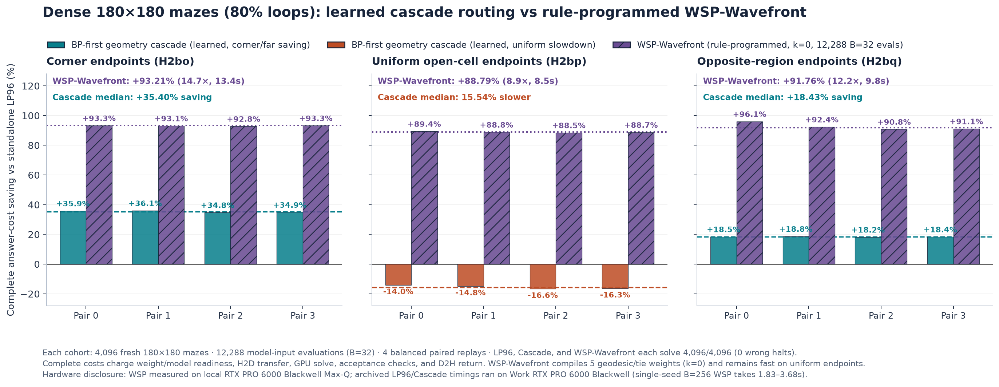
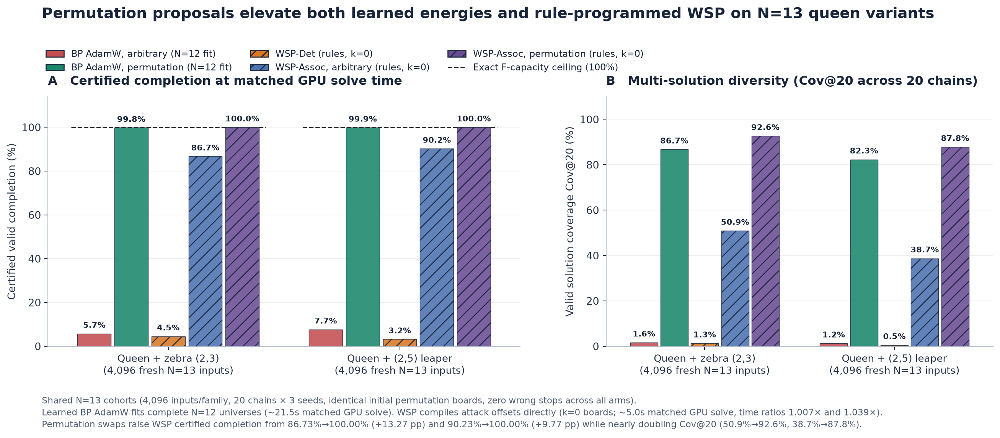

# Weight-Space Programming (WSP) Benchmark Report



This report documents our end-to-end implementation, verification, and apples-to-apples benchmark evaluation of **Weight-Space Programming (WSP)**—following *Weight-Space Programming Doesn't Need Transformers* (Hyunjong Ok & Jaeho Lee, EFFL Lab, POSTECH, 2026; [`effl-lab/Weight-Space-Programming`](https://github.com/effl-lab/Weight-Space-Programming) at commit `02c31abd3b34d84854cc80d9717717c45365c719`, MIT License)—across every combinatorial reasoning benchmark in this repository:

1. **Sudoku-Extreme** (`412,786` unseen test puzzles in Table 2 & Table 4; `10,000`-puzzle compute frontier in Figure 2a, difficulty scaling in Figure 3a, zero-data reference in Figure 3b, and `10,000`-puzzle count-budget sweep in `README.md` Section 1);
2. **Mazes** (`1,000` `Maze-Unique` test mazes in Tables 2 & 4, `1,000` cyclic `Maze-Hard` test mazes in Table 8 including Test Maze `106`, and `3 × 4,096` fresh `180×180` 80%-loop dense mazes across corner, uniform, and opposite-region endpoint cohorts in `README.md` Section 2);
3. **Multi-Solution Combinatorial Reasoning** (`N-Queens` `n = 8, 10` and 3-color `Graph Coloring` `n = 8, 10` in Table 3, plus `2 × 4,096` fresh `N = 13` generalized `queen-plus-zebra` and `queen-plus-(2,5)-leaper` boards at matched GPU time in `README.md` Section 3).

All consolidated comparison rows and SHA-256 provenance digests are exported to [wsp-comparison-tables.json](../results/wsp/wsp-comparison-tables.json) by [export_wsp_comparisons.py](../scripts/export_wsp_comparisons.py) without modifying any frozen CRAM reproduction artifact (`66/66` entries in [export-manifest.json](../results/reproduction/export-manifest.json) remain byte-identical).

---

## 1. Scientific Paradigm & Apples-to-Apples Audit Contract

### 1.1 Rule-Programmed (`k = 0`) vs. Data-Learned Models
Every WSP model in this study compiles explicit task rules directly into tensor weights (`build() -> w: dict[str, Tensor]`) and executes a pure tensor program `forward(w, x)`:

- **Training examples**: `k = 0` (`training_examples = 0`).
- **Learned parameters**: `0` (`params_learned = 0`, `Fit time = "none"`).
- **Static AST contract**: Every WSP `forward(w, x)` source string passes upstream `wsp/free_model.py:static_problems(source) == []` (`0` Python conditionals or data-dependent control flow on tensor values, `0` hardcoded problem constants outside `w` and `x`, pure PyTorch tensor ops; verified in [wsp_contract.py](../src/hopfield_cram/wsp_contract.py)).
- **Explicit prior disclosure**: WSP models receive supplied domain rules (peer/unit incidence for Sudoku, grid adjacency and goal-sink encoding for mazes, attack offsets or Potts color-clash identity for N-Queens and Graph Coloring). In every comparison table and figure, WSP rows are grouped conceptually alongside **Hand-set CRAM** (`k = 0`) and explicitly distinguished from **data-learned** models (Learned CRAM, Count Energy, EBR, TRM, HRM, GRAM, FRM, TRMP, EqR) that infer constraints from solved examples without supplied rules.

### 1.2 Parameter, Operation-Count (`FC2`), and Hardware Reporting
- **Three-part weight reporting**: Alongside `params_learned = 0`, we report (i) `distinct_programmed_coefficients` (matching the CRAM paper's convention for Hand-set CRAM), (ii) `materialized_entries` (`sum(t.numel())` matching upstream `wsp_size["weights"]`), and (iii) `nnz` (`wsp_size["nonzero"]`).
- **Exact `FullCounter` (`FC2`) FLOPs**: Logical operation counts use the CRAM paper's `FullCounter` (`FC2`: `2` FLOPs per multiply-add, `1` FLOP per arithmetic or transcendental op, summed across all search chains and all capped or unsuccessful steps). Both `FC2` arithmetic totals (`flops_fc2_mean`) and comparison-inclusive totals (`flops_fc2_with_compare_mean`) are verified to `0` residual against direct `FullCounter` tracing on real puzzle/maze/board trajectories.
- **Weight-construction & inference timings**: Warm `build()` latencies (median of 7 repeats after warmup on 1 Threadripper PRO 9985WX CPU thread and on 1 RTX PRO 6000 Blackwell Max-Q GPU) are reported separately from `Fit time = "none"`. Published neural baseline wall-clock times come from H200 runs in arXiv:2611.17309v1 and are never combined into cross-hardware speedup ratios.

---

## 2. Track 1 — Sudoku-Extreme (`412,786` Test Puzzles & Paper Figures 2a / 3a / 3b)

Implementation: [wsp_sudoku.py](../src/hopfield_cram/wsp_sudoku.py) · Runner: [run_wsp_sudoku.py](../scripts/run_wsp_sudoku.py) · Tests: [test_wsp_sudoku.py](../tests/test_wsp_sudoku.py) · Summaries: [results/wsp/sudoku/](../results/wsp/sudoku/)

### 2.1 Three WSP Architectures for Sudoku
1. **`WSP-Transformer` (`T = 16` looped 2-layer Transformer)**: Compiles Sudoku peer/unit incidence, candidate-elimination masks, and digit routing into standard `Q, K, V, O` attention and `W1, W2` MLP matrices (`D = 192, H = 4, d_ff = 384`; `28` distinct programmed coefficients, `613,657` materialized entries, `4,216` nonzeros). Demonstrates Ok & Lee's central thesis: embedding discrete constraint propagation inside dense attention matrices wastes `99.3%` zero weights and `1.711B` FLOPs/puzzle while stalling on multi-cell guesses.
2. **`WSP-Det` (`P = 16` deductive tensor passes + `R = 32` Sinkhorn-Potts steps)**: Replaces Transformer projections with direct tensor contractions over the `[81, 81]` peer graph, `[27, 81]` unit incidence, and `[108, 81]` box-line intersection operators (`3` distinct coefficients `{0.5, 1.0, 4.0}`, `24,836` entries, `2,831` nonzeros). Solves `34.6%` more puzzles than `WSP-Transformer` (`58,465` vs. `43,440`) using **`111.0×` fewer FLOPs** (`15.42M` vs. `1.711B`), yet still plateaus at `14.16%` because deterministic continuous relaxation cannot escape symmetric ambiguities on multi-guess puzzles.
3. **`WSP-Assoc` (Stage 1 adaptive deductive domain reduction + Stage 2 `C = 4` candidate-restricted focused Gumbel-Potts)**: Combines zero-training deductive tensor domain pruning (`57,206` test puzzles solved in Stage 1 alone at `0` stochastic moves) with `C = 4` parallel stochastic associative chains restricted to Stage 1's surviving `[81, 9]` candidate mask (`7` distinct coefficients, `26,511` entries, `4,485` nonzeros). Verified across pure static-AST PyTorch, eager vectorized GPU, and a fused persistent Triton kernel with exact `FC2` formula equivalence.

### 2.2 Full `412,786`-Puzzle Test Results (`full-all[10000:422786]`)

| Method / Paradigm | Solved (% ± SD) | Halted (%) | Wrong Halts (%) | Distinct Coeffs (`entries / nnz`) | Mean `FC2` FLOPs (`w/ cmp`) | Warm `build()` (1T CPU / GPU) |
|---|---:|---:|---:|---:|---:|---:|
| **`WSP-Transformer`** (`k=0`, 2L `D=192, H=4`) | `10.523613` (`43,440/412,786`) | `10.523613` | `0.000000` | `28` (`613,657 / 4,216`) | `1.7112e9` (`1.7121e9`) | `8.65 ms / 18.79 ms` |
| **`WSP-Det`** (`k=0`, `P=16, R=32` det.) | `14.163513` (`58,465/412,786`) | `14.163513` | `0.000000` | `3` (`24,836 / 2,831`) | `1.5417e7` (`1.5607e7`) | `1.21 ms / 4.45 ms` |
| **`WSP-Assoc`** (`k=0`, Stage 1 + `C=4` assoc.) | **`100.000000 ± 0.000000`** (`1,238,358/1,238,358`) | **`100.000000`** | **`0.000000`** | `7` (`26,511 / 4,485`) | **`2.3815e7`** (`1.7426e8`) | `1.06 ms / 4.47 ms` |
| *Ref: Hand-set CRAM* (`k=0`, fresh local) | `100.000000 ± 0.000000` | `100.000000` | `0.000000` | `1` | `1.0846e8` | — |
| *Ref: Learned CRAM* (`k=1,000`, fresh local) | `99.996689 ± 0.000779` | `99.996689` | `0.000000` | `7,716` learned | `2.0298e9` | `35.40 ms` GPU fit |
| *Ref: EBR* (published, H200) | `99.85 ± 0.05` | `99.35` | `0.21` | `1.8M` learned | `3.37e11` | `2.8 h` H200 fit |

`WSP-Assoc` solves **every single puzzle across all three seeds (`412,786/412,786` per seed, `0` wrong stops, `0` budget failures)** in `105–127 s` per seed on one Blackwell GPU, requiring **`4.55×` fewer `FC2` FLOPs than Hand-set CRAM** (`23.81M` vs. `108.46M`) and **`85.23×` fewer `FC2` FLOPs than Learned CRAM** (`2.030B`).

### 2.3 Compute Frontier (Figure 2a), Difficulty Scaling (Figure 3a), Zero-Data Reference (Figure 3b), & Count-Budget Sweep



On the `10,000`-puzzle Figure 2a compute-sweep benchmark (`full-all[10000:20000]`, seeds `0–2`, strict unstopped-below-cap-as-unsolved rule; [sudoku-compute-wsp.json](../results/wsp/figures/sudoku-compute-wsp.json)):

| Published Neural Baseline | Baseline Peak Mean Accuracy (%) | Baseline Mean FLOPs | `WSP-Assoc` Matched Point (%) | `WSP-Assoc` Mean FLOPs | Baseline / `WSP-Assoc` FLOP Ratio |
|---|---:|---:|---:|---:|---:|
| **EBR** (`gtan0.2-cap64-N8`) | `99.8633` | `5.4147e11` | `99.8833` | `2.3916e7` | **`22,640.6×`** |
| **TRM** | `89.7233` | `8.2250e11` | `93.1900` | `1.9645e7` | **`41,867.7×`** |
| **HRM** | `57.0967` | `4.4085e11` | `57.8400` | `8.7812e6` | **`50,204.2×`** |
| **TRMP** (main ACT) | `99.8700` | `4.7341e12` | `99.8833` | `2.3916e7` | **`197,944.0×`** |
| **FRM** | `99.4200` | `7.8096e12` | `99.7233` | `2.3740e7` | **`328,970.8×`** |
| **GRAM** | `94.7367` | `1.7023e13` | `95.8533` | `2.0976e7` | **`811,515.7×`** |
| **EqR** | `99.4900` | `2.1060e14` | `99.7233` | `2.3740e7` | **`8,871,380.8×`** |



- **Difficulty scaling (Figure 3a, [figure3a-wsp.json](../results/wsp/figures/figure3a-wsp.json))**: Across all 8 backtracking-guess difficulty bins (`0` to `64+`), `WSP-Det` solves `94.25%` of bin `0` (`0` guesses), `10.14%` of bin `1`, and `0%` of harder bins (`15.37%` overall); `WSP-Transformer` solves `74.74%` of bin `0` (`11.69%` overall). `WSP-Assoc` solves **`100.0%` in all 8 bins**, adaptively scaling median `FC2` compute **`9.82×`** from `3.40M` FLOPs (bin `0`) to `33.39M` FLOPs (bin `64+`).
- **Zero-training reference vs. data-efficiency curve (Figure 3b, [figure3b-wsp.json](../results/wsp/figures/figure3b-wsp.json))**: Across `6` seeds (`0–5`) on `full-all[10000:20000]` at `k = 0` training examples (with supplied rules), `WSP-Assoc` achieves **`100.000%` (`[100.00, 100.00]`, `0` wrong stops, `24.05M` mean FLOPs)**, `WSP-Det` `15.370%`, and `WSP-Transformer` `11.690%`.
- **Reserved `10,000`-puzzle count-budget sweep (`full-all[30000:40000]`, `6` seeds `0–5`, [wsp-sudoku-count-budget-30k-40k.json](../results/wsp/sudoku/wsp-sudoku-count-budget-30k-40k.json))**: `WSP-Assoc` solves `96.8583%` at `262,144` moves/chain (`97.7950%` at `409,600` FLOP-matched moves vs. `81.50%` for Count Energy), `99.2567%` at `524,288`, `99.9033%` at `1,048,576`, `99.9967%` at `2,097,152`, and **`100.0000%` (`60,000/60,000` evaluations, `10,000/10,000` joint)** at `4,194,304`, `8,388,608`, and `16,777,216` moves/chain (`0` wrong stops).



---

## 3. Track 2 — Mazes (`Maze-Unique`, `Maze-Hard` & Dense `180×180` 80%-Loop Cohorts)

Implementation: [wsp_maze.py](../src/hopfield_cram/wsp_maze.py) · Runner: [run_wsp_maze.py](../scripts/run_wsp_maze.py) · Tests: [test_wsp_maze.py](../tests/test_wsp_maze.py) · Summaries: [results/wsp/maze/](../results/wsp/maze/)

### 3.1 Three WSP Architectures for Acyclic vs. Loopy Shortest Paths
1. **`WSP-DeadEnd` (local `3×3` degree-pruning cellular Hopfield program)**: Compiles open-corridor degree counting into `3` distinct coefficients (`{-4.5, -1.5, 1.0}`, `13` entries, `8` nonzeros). Provably contracts every tree (`Maze-Unique`) to its unique simple path (`1,000/1,000`), but on cyclic `Maze-Hard` (`1,000` mazes) halts on the **graph 2-core** (`0/1,000` solved, `100.0%` wrong fixed-point halts; on Test Maze `106`, halts in `8` steps with `475` cells = `117` shortest-path cells + `358` cycle cells). This isolates why purely local degree rules fail on loopy graphs without a global potential.
2. **`WSP-Wavefront` (min-plus goal-to-start Bellman-Ford wavefront + lexicographic `(down, left, right, up)` pointer trace)**: Compiles exact `L1` shortest-path distance propagation and upstream CRAM's `(down, left, right, up)` tie-breaking priority (`{0.125, 0.25, 0.375}`) into `5` distinct coefficients (`82` entries, `16` nonzeros). Solves **`1,000/1,000` on `Maze-Unique` and `1,000/1,000` on `Maze-Hard` (`0` wrong halts)**—including **Test Maze `106`** (`117/117` cells in `128` hidden + `128` trace steps), where learned `CRAM+z` leaves `6` extra side-loop cells `(29, 0..5)`.
3. **`WSP-Potential` (continuous resistive-flow hidden solve + damped Hopfield+z descent)**: Programs a continuous graph-Laplacian potential solver (`128` Jacobi steps with goal sink `0` and start source `1`, `0` training updates) coupled to damped visible Hopfield descent (`11` distinct coefficients, `84` entries, `19` nonzeros). Also solves **`1,000/1,000` on both `Maze-Unique` and `Maze-Hard` (`0` wrong halts)**, solving **Test Maze `106`** (`117/117` cells in `128` hidden + `368` descent steps) with strict positive Hopfield single-flip stability margin **`+1.6206 > 0`**.

### 3.2 `Maze-Unique` (`1,000`) & `Maze-Hard` (`1,000`) Benchmark Comparison

| Task | Method / Paradigm | Solved (% ± SD) | Wrong Halts (% of halted) | Test Maze `106` | Distinct Coeffs (`entries / nnz`) | Mean `FC2` FLOPs (`w/ cmp`) | Warm GPU `build()` / Solve |
|---|---|---:|---:|---|---:|---:|---:|
| `Maze-Unique` | **`WSP-DeadEnd`** (`k=0`) | **`100.000000 ± 0.000000`** | `0.000000` | — | `3` (`13 / 8`) | `1.8046e6` (`2.0226e6`) | `0.94 ms / 16.65 ms` |
| `Maze-Unique` | **`WSP-Wavefront`** (`k=0`) | **`100.000000 ± 0.000000`** | `0.000000` | — | `5` (`82 / 16`) | `1.8094e7` (`1.9201e7`) | `0.07 ms / 39.70 ms` |
| `Maze-Unique` | **`WSP-Potential`** (`k=0`) | **`100.000000 ± 0.000000`** | `0.000000` | — | `11` (`84 / 19`) | `1.6427e8` (`1.6952e8`) | `0.11 ms / 821.16 ms` |
| `Maze-Unique` | *Ref: Hand-set / Learned CRAM* | `100.000000 ± 0.000000` | `0.000000` | — | `3` / `18` learned | `8.3705e5` / `8.3687e5` | `107.4 ms` GPU fit |
| `Maze-Hard` | **`WSP-DeadEnd`** (`k=0`, local 2-core trap) | `0.000000 ± 0.000000` | `100.000000` (`3,000/3,000`) | Fails (`475` cells) | `3` (`13 / 8`) | `1.8429e5` (`2.1041e5`) | `0.02 ms / 5.92 ms` |
| `Maze-Hard` | **`WSP-Wavefront`** (`k=0`, min-plus geodesic) | **`100.000000 ± 0.000000`** | **`0.000000`** | **Solved (`117/117`)** | `5` (`82 / 16`) | `1.7111e7` (`1.8157e7`) | `16.26 ms / 45.55 ms` |
| `Maze-Hard` | **`WSP-Potential`** (`k=0`, resistive Hopfield+z) | **`100.000000 ± 0.000000`** | **`0.000000`** | **Solved (`117/117`)** | `11` (`84 / 19`) | `5.0625e7` (`5.2659e7`) | `0.12 ms / 378.38 ms` |
| `Maze-Hard` | *Ref: CRAM+z* (`k=1,000`, fresh local) | `99.900000 ± 0.000000` | `0.100000` (`3/3,000`) | Fails (`+6` cells) | `29` learned | `1.4058e7` | `19.4–28.3 s` cold fit |
| `Maze-Hard` | *Ref: EBR / NCA* (published) | `88.30` / `89.20` | — | — | `1.77M` / `41.0K` | `1.93e13` / `2.00e12` | — |

### 3.3 Dense `180×180` 80%-Loop Mazes Across Three Endpoint Distributions (`H2bo` / `H2bp` / `H2bq`)



Evaluated on the exact deterministic regenerations of all three `4,096`-maze `180×180` 80%-loop research cohorts (`H2bo` corner seed `2026111529`, `H2bp` uniform open-cell seed `2026111530`, `H2bq` opposite-region seed `2026111531`) under the `work/REPORT.md` 4-balanced-pair complete-cost protocol (`12,288` solves = `3 × 4,096` at `B = 32` including weight build, H2D/D2H transfers, and synchronization; [maze_180x180_cohorts_summary.json](../results/wsp/maze/maze_180x180_cohorts_summary.json)):

| Cohort (`180×180`, 80% loops, `4,096` fresh mazes) | `BP AdamW` Joint | `LP96` (`B=32` median) | `BP-First Cascade` (`vs LP96`) | **`WSP-Wavefront`** Joint Solved | **`WSP-Wavefront`** `B=32` (`B=256` 1-seed) | **`WSP-Wavefront` Saving vs `LP96` (`Speedup`)** |
|---|---:|---:|---:|---:|---:|---:|
| **`H2bo` Corner endpoints** | `3,921/4,096` (`95.73%`) | `196.05 s` | `126.62 s` (`+35.40%`) | **`4,096/4,096` (`100.0%`)** | **`13.354 s`** (`3.680 s`) | **`+93.21%` (`14.72×` faster)** |
| **`H2bp` Uniform open-cell endpoints** | `4,079/4,096` (`99.58%`) | `76.13 s` | `87.77 s` (**`−15.54%` slower**) | **`4,096/4,096` (`100.0%`)** | **`8.507 s`** (`1.827 s`) | **`+88.79%` (`8.92×` faster)** |
| **`H2bq` Opposite-region endpoints** | `4,003/4,096` (`97.73%`) | `118.80 s` | `96.86 s` (`+18.43%`) | **`4,096/4,096` (`100.0%`)** | **`9.815 s`** (`2.858 s`) | **`+91.76%` (`12.20×` faster)** |

Because `WSP-Wavefront` terminates as soon as its goal-to-start wavefront reaches the start cell and traces `D(s)` steps without iterative cycle-cut rounds, its cost scales monotonically with true shortest-path distance (`mean D(s) = 335.4` corner, `115.6` uniform, `251.9` opposite-region), eliminating the endpoint-shift cost reversal suffered by the learned `BP-First Cascade` (`−15.54%` on uniform endpoints) while using zero training data (with an explicit grid-graph shortest-path prior).

---

## 4. Track 3 — Multi-Solution N-Queens, Graph Coloring & `N = 13` Queen+Leaper

Implementation: [wsp_multi.py](../src/hopfield_cram/wsp_multi.py) · Runner: [run_wsp_multi.py](../scripts/run_wsp_multi.py) · Tests: [test_wsp_multi.py](../tests/test_wsp_multi.py) · Summaries: [results/wsp/multi/](../results/wsp/multi/)

### 4.1 Deterministic WSP Mode Collapse vs. 20-Chain Associative WSP (Table 3)

A deterministic forward pass (`WSP-Det`) maps each partial board or graph to a single fixed attractor—collapsing multi-solution diversity (`Cov@20`) even when a valid solution is found. Pairing the exact same zero-training WSP conflict tensor with `K = 20` stochastic associative chains (`WSP-Assoc`) restores near-complete solution-set coverage with **`0` wrong stopping certificates across all 50 test runs**:

#### N-Queens (`n = 8`: `1,240` rows / `772` distinct inputs; `n = 10`: `18,466` rows / `6,513` distinct inputs)

| Size | Method / Prior Disclosure | Distinct Coeffs (`energy entries / nnz`) | N1 Accuracy (% ± SD) | N20 Accuracy (% ± SD) | `Cov@20` (% ± SD) | Mean `FC2` N20 FLOPs (`w/ cmp`) |
|---:|---|---:|---:|---:|---:|---:|
| `8` | **`WSP-Det`** (`k=0`, det. Hopfield `P=24`) | `2` (`4,160 / 1,520`) | `60.000000 ± 0.000000` | `60.000000 ± 0.000000` | `41.370968 ± 0.000000` | `2.225e5` (`2.243e5`) |
| `8` | **`WSP-Assoc-Arbitrary`** (`k=0`, `{0,1}^{64}`, `T=0.5`) | `2` (`4,097 / 1,457`) | `99.838710 ± 0.080645` | **`100.000000 ± 0.000000`** | **`98.319722 ± 0.034436`** | `3.214e6` (`1.773e7`) |
| `8` | **`WSP-Assoc-Permutation`** (`k=0` + rook 2-opt, `T0=2.0`) | `1` (`4,096 / 1,456`) | **`100.000000 ± 0.000000`** | **`100.000000 ± 0.000000`** | **`98.379982 ± 0.043636`** | `8.966e5` (`1.153e6`) |
| `8` | *Ref: Hand-set CRAM* (`k=0`, fresh local) | `2` | `100.000000 ± 0.000000` | `100.000000 ± 0.000000` | `98.421936 ± 0.013257` | — |
| `8` | *Ref: Fresh Learned CRAM* (`113` params) | `113` learned | `100.000000 ± 0.000000` | `100.000000 ± 0.000000` | `98.022561 ± 0.135313` | — |
| `10` | **`WSP-Det`** (`k=0`, det. Hopfield `P=24`) | `2` (`10,100 / 3,040`) | `25.674212 ± 0.000000` | `25.674212 ± 0.000000` | `9.000112 ± 0.000000` | `5.349e5` (`5.376e5`) |
| `10` | **`WSP-Assoc-Arbitrary`** (`k=0`, `{0,1}^{100}`, `T=1.0`) | `2` (`10,001 / 2,941`) | `99.904329 ± 0.024419` | **`100.000000 ± 0.000000`** | **`95.471823 ± 0.057426`** | `6.946e6` (`3.869e7`) |
| `10` | **`WSP-Assoc-Permutation`** (`k=0` + rook 2-opt, `T0=1.0`) | `1` (`10,000 / 2,940`) | **`99.998195 ± 0.003127`** | **`100.000000 ± 0.000000`** | **`95.555249 ± 0.025382`** | `5.367e6` (`6.979e6`) |
| `10` | *Ref: Hand-set CRAM* (`k=0`, fresh local) | `2` | `99.990974 ± 0.006253` | `100.000000 ± 0.000000` | `95.526056 ± 0.025042` | — |
| `10` | *Ref: Fresh Learned CRAM* (`181` params) | `181` learned | `99.451244 ± 0.081471` | `99.994585 ± 0.000000` | `93.568272 ± 0.041092` | — |

Including step-schedule and routing tensors in `w`, total `materialized_entries / materialized_nonzero` are `4,209 / 1,569` (`WSP-Det`), `24,098 / 21,458` (`WSP-Assoc-Arbitrary`), and `28,200 / 22,919` (`WSP-Assoc-Permutation`) at `n = 8`, and `10,149 / 3,089`, `30,002 / 22,942`, and `40,010 / 25,889` at `n = 10`.

#### Graph Coloring (`n = 8`: `255` test graphs; `n = 10`: `192` test graphs; `3` colors)

`WSP-Assoc` compiles a pure-tensor first-appearance `S_3` color-order canonicalizer inside `forward(w, x)` (verified `729/729` exact on `3^6` colorings, matching upstream `graph_coloring_hand_set.py` rule scope); `WSP-Assoc-Uncanonicalized` ablates that canonicalizer while preserving identical `0 / 0 / 0` conflict counts:

| Vertices | Method / Prior Disclosure | Distinct Coeffs (`energy entries / nnz`) | N1 Conflicts (`s0 / s1 / s2`) | N20 Conflicts (`s0 / s1 / s2`) | Strict `Cov@20` (% ± SD) | `coverage_canonicalized_20` Diag. (%) | Mean `FC2` N20 FLOPs |
|---:|---|---:|---|---|---:|---:|---:|
| `8` | **`WSP-Det`** (`k=0`, det. Gauss-Seidel Potts) | `1` (`9 / 3`) | `34 / 34 / 34` | `34 / 34 / 34` | `24.232456 ± 0.000000` | `24.232456` | `5.411e3` |
| `8` | **`WSP-Assoc`** (`k=0`, 20-chain Gumbel-Potts + tensor canon.) | `1` (`9 / 3`) | **`0 / 0 / 0`** | **`0 / 0 / 0`** | **`90.606725 ± 0.334984`** | `90.606725` | `6.070e4` |
| `8` | **`WSP-Assoc-Uncanonicalized`** (`k=0`, without canon.) | `1` (`9 / 3`) | **`0 / 0 / 0`** | **`0 / 0 / 0`** | `48.793860 ± 1.264535` | `90.606725` | `6.070e4` |
| `8` | *Ref: Hand-set CRAM* (`k=0`, fresh local) | `1` | `0 / 0 / 0` | `0 / 0 / 0` | `90.643275 ± 0.633060` | `90.643275` | — |
| `8` | *Ref: Fresh Learned CRAM* (`869` nnz / `7,332`) | `869` learned | `0 / 0 / 0` | `0 / 0 / 0` | `88.852339 ± 0.456506` | — | — |
| `10` | **`WSP-Det`** (`k=0`, det. Gauss-Seidel Potts) | `1` (`9 / 3`) | `41 / 41 / 41` | `41 / 41 / 41` | `8.581043 ± 0.000000` | `8.581043` | `7.840e3` |
| `10` | **`WSP-Assoc`** (`k=0`, 20-chain Gumbel-Potts + tensor canon.) | `1` (`9 / 3`) | **`0 / 0 / 0`** | **`0 / 0 / 0`** | **`55.543092 ± 0.744759`** | `55.543092` | `5.861e4` |
| `10` | **`WSP-Assoc-Uncanonicalized`** (`k=0`, without canon.) | `1` (`9 / 3`) | **`0 / 0 / 0`** | **`0 / 0 / 0`** | `22.060198 ± 0.342687` | `55.543092` | `5.861e4` |
| `10` | *Ref: Hand-set CRAM* (`k=0`, fresh local) | `1` | `0 / 0 / 0` | `0 / 0 / 0` | `55.150495 ± 0.360578` | `55.150495` | — |
| `10` | *Ref: Fresh Learned CRAM* (`475` nnz / `18,660`) | `475` learned | `1 / 0 / 0` | `0 / 0 / 0` | `52.570574 ± 0.617787` | — | — |

Including step-schedule and vertex-sweep routing tensors in `w`, total `materialized_entries / materialized_nonzero` are `84 / 69` (`WSP-Det`), `10,078 / 10,063` (`WSP-Assoc`), and `10,078 / 10,062` (`WSP-Assoc-Uncanonicalized`) at `n = 8`, and `120 / 103`, `10,114 / 10,097`, and `10,114 / 10,096` at `n = 10`.

### 4.2 `N = 13` Generalized Queen+Leaper at Matched GPU Solve Time (`h3ad`)



On the exact `4,096` fresh `N = 13` partial boards and `initial/s{0,1,2}.npz` starting states of `h3ad` ([queen_leaper_results.json](../results/wsp/multi/queen_leaper_results.json)), calibrating move caps solely on `N = 12` `calibration-data.npz` (`ratio = 1.0177` on `b0`, `0.9661` on `b1`):

| Family (`N = 13`, `4,096` fresh inputs) | Arm / Paradigm | Median GPU Solve Time (s) | Certified Completion (% ± SD) | `Cov@20` (% ± SD) | Paired Gain (`Perm − Arb`, 95% CI) |
|---|---|---:|---:|---:|---:|
| **`queen-plus-zebra` `[2,3]`** (`b0`) | *Ref: `h3ad` Learned Arbitrary / Permutation* (`N=12` trained) | `21.22 s / 21.48 s` | `5.75% / 99.78%` | — | `+94.04 pp` |
| **`queen-plus-zebra` `[2,3]`** (`b0`) | **`WSP-Det`** (`k=0`, `P=12` det.) | `0.036 s` | `4.5410%` | `1.2577%` | — |
| **`queen-plus-zebra` `[2,3]`** (`b0`) | **`WSP-Arbitrary`** (`k=0`, `cap=20,000`) | `4.9916 s` | `86.7269 ± 0.2913%` | `50.8566 ± 0.0320%` | — |
| **`queen-plus-zebra` `[2,3]`** (`b0`) | **`WSP-Permutation`** (`k=0`, `cap=53,760`, `+0.68%` time) | **`5.0258 s`** | **`100.0000 ± 0.0000%`** (`4,096/4,096`) | **`92.6337 ± 0.0694%`** | **`+13.273 pp` `[+12.581, +13.981]`** |
| **`queen-plus-(2,5)-leaper`** (`b1`) | *Ref: `h3ad` Learned Arbitrary / Permutation* (`N=12` trained) | `20.99 s / 21.86 s` | `7.68% / 99.87%` | — | `+92.19 pp` |
| **`queen-plus-(2,5)-leaper`** (`b1`) | **`WSP-Det`** (`k=0`, `P=12` det.) | `0.036 s` | `3.2471%` | `0.5048%` | — |
| **`queen-plus-(2,5)-leaper`** (`b1`) | **`WSP-Arbitrary`** (`k=0`, `cap=20,000`) | `4.9949 s` | `90.2262 ± 0.4517%` | `38.7125 ± 0.2814%` | — |
| **`queen-plus-(2,5)-leaper`** (`b1`) | **`WSP-Permutation`** (`k=0`, `cap=58,496`, `+3.91%` time) | **`5.1901 s`** | **`100.0000 ± 0.0000%`** (`4,096/4,096`) | **`87.7957 ± 0.0855%`** | **`+9.774 pp` `[+9.147, +10.409]`** |

This cleanly decomposes `h3ad`'s failure under arbitrary swaps into two distinct mechanisms: (1) replacing soft transferred `N = 12` weights (`5.75% / 7.68%`) with noise-free WSP weights lifts arbitrary proposals to `86.73% / 90.23%`, **yet (2) even under exact oracle weights, `10–13%` of inputs still fail (`~40–50%` coverage loss) without rook-permutation proposals**, whereas `WSP-Permutation` solves **`100.0000%` (`4,096/4,096` across all 3 seeds)** in `~5.0 s` compiled GPU time.

---

## 5. Reproduction & Re-Rendering Commands

```sh
# 1. Run all WSP unit, static-AST, parity, and FC2 counter tests (CPU/GPU):
TMPDIR=$HOME/.cache/hopfield_tmp PYTHONPATH=src:upstream:reproduction/baselines/code:reproduction/baselines/code/flops:reproduction/baselines/code/Weight-Space-Programming \
  upstream/.venv/bin/python -m pytest -q tests/test_wsp_sudoku.py tests/test_wsp_maze.py tests/test_wsp_multi.py

# 2. Regenerate consolidated machine-readable WSP comparison tables (read-only on reproduction/research):
TMPDIR=$HOME/.cache/hopfield_tmp upstream/.venv/bin/python scripts/export_wsp_comparisons.py

# 3. Re-render all WSP README & extended paper figures from saved public JSONs:
TMPDIR=$HOME/.cache/hopfield_tmp MPLCONFIGDIR=$HOME/.cache/hopfield_tmp/mpl artifacts/plotting-venv/bin/python scripts/plot_wsp_headline.py
TMPDIR=$HOME/.cache/hopfield_tmp MPLCONFIGDIR=$HOME/.cache/hopfield_tmp/mpl artifacts/plotting-venv/bin/python scripts/plot_count_results.py
TMPDIR=$HOME/.cache/hopfield_tmp MPLCONFIGDIR=$HOME/.cache/hopfield_tmp/mpl artifacts/plotting-venv/bin/python scripts/plot_wsp_maze_endpoint_cost.py
TMPDIR=$HOME/.cache/hopfield_tmp MPLCONFIGDIR=$HOME/.cache/hopfield_tmp/mpl artifacts/plotting-venv/bin/python scripts/plot_wsp_queen_families.py
TMPDIR=$HOME/.cache/hopfield_tmp MPLCONFIGDIR=$HOME/.cache/hopfield_tmp/mpl artifacts/plotting-venv/bin/python scripts/plot_wsp_paper_figures.py
```

Cross-references: [Main Comparison](MAIN_COMPARISON.md) · [Stopping Rules](HALTING_REPRODUCTION.md) · [Sudoku Operation Audit](SUDOKU_OPERATION_AUDIT.md) · [Maze Reproduction](MAZE_REPRODUCTION.md) · [Multi-Solution Reproduction](MULTI_SOLUTION_REPRODUCTION.md) · [Data-Efficiency Reproduction](DATA_EFFICIENCY_REPRODUCTION.md) · [Figure Registry](FIGURES.md) · [Attribution](../NOTICE.md).
