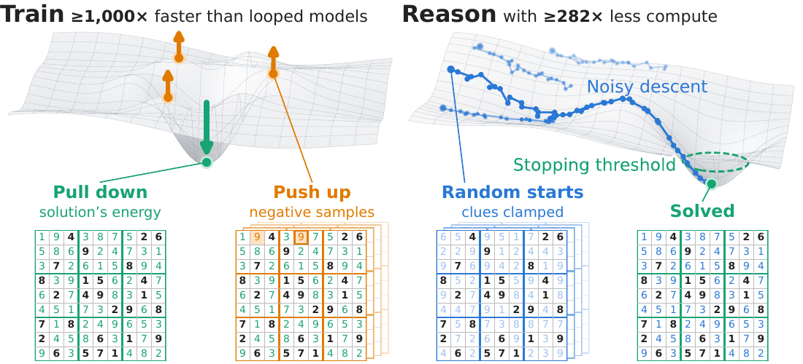
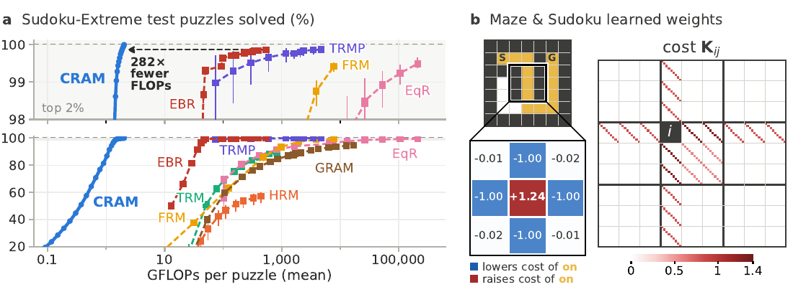
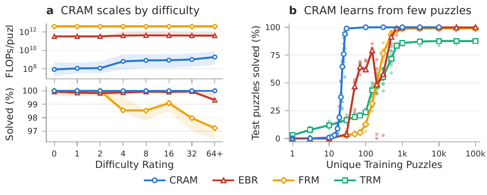
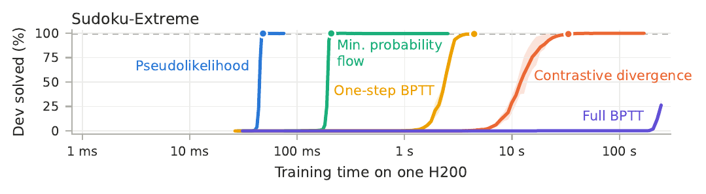

## 1 Introduction

An emerging new paradigm for reasoning is looping, in which a layer, or block of layers, is repeatedly applied to produce an answer. Small looped models \[[62](#bib.bib62), [38](#bib.bib38)\] (millions of parameters) have had successes on simple benchmarks such as Sudoku and mazes. However, they are slow to train in part due to their use of truncated backprop-through-time (BPTT), and the reasons behind their successes remain unclear \[[2](#bib.bib2), [51](#bib.bib51)\].

Energy minimization is a related framework that offers a principled approach to looping. Here, each loop step corresponds to a gradient descent step on an energy function. Minimizing energy offers many potential benefits, such as guaranteed stability, early stopping, and efficient training methods that bypass the need for BPTT. Indeed, looped reasoners have begun adopting the ideas of energy-based networks without adopting an explicit energy. Some train their updates to converge to attractors or fixed points, a guarantee intrinsic to energy network dynamics \[[36](#bib.bib36), [44](#bib.bib44)\]. Others learn when to stop with a separate halting network \[[28](#bib.bib28), [5](#bib.bib5), [62](#bib.bib62), [38](#bib.bib38)\]. Each of these desirable properties is generally added on top of the looped network through an extra head, loss, or module, and the network is trained by backpropagating through its repeated applications. With looped models rebuilding the desirable properties of an energy one at a time, we ask: why not learn the energy directly?

It’s already known that constraint puzzles like Sudoku have a corresponding energy that, when minimized, solves the puzzle \[[34](#bib.bib34)\]. In the 1980’s, Hopfield and Tank showed how to hand-design an energy function that solves certain classes of logic problems \[[35](#bib.bib35)\]. It is, however, less well understood if an explicit energy can be learned from data to solve a wide array of reasoning problems.

[Original vector figure](../source/figures/overview.pdf)

Figure 1: **CRAM learns an energy from solved puzzles in seconds, and the energy tells the search when to stop.** *Training* (left) pulls down the energy of each solution and pushes up the energy of negative samples, *without* differentiating through a reasoning trajectory (shown is a pseudolikelihood objective, [Eq. 5](#A4.E5)). On one H200, training takes 42 ms on Sudoku-Extreme and 132 ms on Maze-Unique, at least 1,000${\times}$ faster than the looped models of [Table 2](#S3.T2). *Reasoning* (right) clamps the clues of a new puzzle, starts several chains from random fills of the other cells (light-blue guesses; one board per chain), and minimizes the energy one cell at a time, using at least 282${\times}$ fewer inference FLOPs ([Fig. 2](#S4.F2)) than looped models at matched accuracy. The chains are independent, and the descent can be noisy, which lets a chain escape spurious local minima. The search stops when any chain’s energy falls below a stopping threshold fitted from the training solutions.

Here, we develop a trainable version of the Hopfield-Tank energy and then learn the weights directly from puzzles. We call this tiny trainable energy, together with the recurrent dynamics that descend it at inference time, a Compact Reasoning Associative Memory (CRAM). We call it this because, as in a Hopfield network \[[32](#bib.bib32)\], its weights *memorize associations* between pairs of valid cells, and descent on the energy completes a corrupted pattern (i.e., a puzzle provided with only its clues). CRAM’s energy is a special case of the energies of modern Hopfield networks \[[40](#bib.bib40), [41](#bib.bib41)\].

In this work we: 1) show that CRAM trains at least 1,000${\times}$ faster than modern looped models and reasons with at least 282${\times}$ fewer inference FLOPs on a variety of different puzzles (Sudoku-Extreme \[[62](#bib.bib62)\], Maze-Unique \[[36](#bib.bib36)\], and the N-Queens and graph-coloring sets of [Baek et al. \[3\]](#bib.bib3)); 2) show that CRAM provides a stopping test that allows compute to scale with the difficulty of a puzzle; 3) show that CRAM is data-efficient, learning interpretable weights from Sudoku-Extreme using an order of magnitude fewer training puzzles than looped models; 4) show that local training objectives train fastest compared to other methods of training the same energy — significantly faster than BPTT; and 5) show that a hand-set CRAM energy with few unique weights can solve every test puzzle from every benchmark exactly.

CRAM represents the state of the art on speed and efficiency of looping to solve constraint puzzles, by several orders of magnitude. However, since these puzzles can be solved easily with so few parameters using CRAM, our work suggests that high accuracy on these benchmarks are not indicative of future performance on harder tasks. Indeed, CRAM’s simple energy on its own would struggle to learn more complex reasoning tasks like ARC-AGI \[[12](#bib.bib12)\], though we do show how a simple latent extension of CRAM can solve Maze-Hard near perfectly in [App. F](#A6). Nevertheless, the dramatic speed-up that this energy provides on the presented tasks offers a potential path forward for data-efficient general reasoning capabilities.

## 2 Background

CRAM’s energy is a form of **pairwise graphical model** in that it is a sum of costs on and between cells, as in the energy of a Markov random field (MRF) \[[7](#bib.bib7), [61](#bib.bib61)\]. Learning these costs goes by several names, such as constraint programming \[[54](#bib.bib54)\] or constraint acquisition \[[9](#bib.bib9), [6](#bib.bib6), [15](#bib.bib15)\]. Recent methods show that you can learn pairwise costs for Sudoku directly from solved puzzles, using approximate likelihood methods like those studied in this work \[[10](#bib.bib10), [16](#bib.bib16), [17](#bib.bib17)\]. However, to infer solutions to new puzzles, these methods pass the learned constraints to an external solver \[[13](#bib.bib13)\]. CRAM keeps this learning problem but uses neural optimization methods to replace the external solver with recurrent search on its own energy \[[35](#bib.bib35), [47](#bib.bib47)\].

**Energy-based networks** treat an energy over a large search space of possible solutions as the objective of both training and inference. Training shapes the energy to be low at observed data; inference or “reasoning” minimizes the energy to sample low-energy solutions (see [Fig. 1](#S1.F1)) \[[32](#bib.bib32), [42](#bib.bib42)\]. Hopfield and Tank used a version of the Hopfield Network with continuous neurons to solve constraint problems like the Traveling Salesman Problem with hand-set weights \[[33](#bib.bib33), [35](#bib.bib35)\], and later work did the same for Sudoku \[[34](#bib.bib34)\]. CRAM writes these energies in a mean-field free energy form with learnable weights \[[47](#bib.bib47)\]. This form approximates the free energy of a Boltzmann machine, which have similarly been applied to logic and combinatorial problems \[[1](#bib.bib1), [30](#bib.bib30), [14](#bib.bib14), [59](#bib.bib59)\]. However, none of these energies have been trained by observing puzzle solutions alone.

**Modern looped reasoners** use deep, weight-tied networks to learn puzzles directly from data. HRM and TRM popularized this design for Sudoku, mazes and ARC, building on recurrent relational networks and universal transformers \[[62](#bib.bib62), [38](#bib.bib38), [12](#bib.bib12), [46](#bib.bib46), [18](#bib.bib18)\]. Later works varied the architecture but kept the same training approach: backpropagating through the reasoning trajectory of a depth-recurrent model to refine the model’s prediction for a specified input \[[25](#bib.bib25), [3](#bib.bib3), [55](#bib.bib55), [24](#bib.bib24), [64](#bib.bib64), [39](#bib.bib39), [57](#bib.bib57), [52](#bib.bib52)\]. Some approaches use diffusion- and flow-style training to avoid BPTT \[[21](#bib.bib21), [64](#bib.bib64), [39](#bib.bib39), [29](#bib.bib29), [65](#bib.bib65), [57](#bib.bib57)\]. Others engineer fixed point behavior into deep models, training the update loop to converge to stable equilibria \[[36](#bib.bib36), [44](#bib.bib44), [29](#bib.bib29), [65](#bib.bib65), [23](#bib.bib23)\]. This last direction holds promise, since Hopfield & Tank already showed that these reasoning puzzles are naturally suited to fixed-point problems.

**Energy-based looped models** encourage convergence by training an energy on top of a deep network, seeking to combine the best of looped models with advantages of Hopfield Networks and Boltzmann Machines \[[20](#bib.bib20), [21](#bib.bib21), [27](#bib.bib27), [43](#bib.bib43), [49](#bib.bib49), [66](#bib.bib66), [11](#bib.bib11)\]. For example, concurrent work Energy-Based Reasoners (EBR) \[[11](#bib.bib11)\] showcases several advantages of energy for looped model reasoning: it trains an energy on the latent states of a TRM-style transformer, descends it with noisy projected gradient steps, and stops when the gradient norm is small \[[11](#bib.bib11)\]. Though similar in spirit, these networks are much larger and slower than CRAM, and all of them learn through BPTT.

## 3 Method

The reasoning tasks studied in this work can be represented via $M$ answer variables called *cells*, each with up to $C$ candidate values. Therefore, an energy is assigned to each $M\times C$ belief array ${\color{#2A78D6}\boldsymbol{p}}$, whose (non-negative) entry ${\color{#2A78D6}p}_{ia}$ gives the probability of candidate value $a$ at cell $i$. Simply, ${\color{#2A78D6}\boldsymbol{p}}_{i}$ is modeled as a softmax distribution over possible answers for cell $i$.

CRAM’s energy can be written as

$$
E_{\boldsymbol{{\color{#EB6834}\theta}}}({\color{#2A78D6}\boldsymbol{p}})=\underbrace{\beta^{-1}\sum_{i}{\color{#2A78D6}\boldsymbol{p}}_{i}^{\!\top}\log{\color{#2A78D6}\boldsymbol{p}}_{i}}_{\mathclap{\text{\scriptsize negative entropy}}}+\underbrace{\frac{1}{2}\sum_{i\neq j}{\color{#2A78D6}\boldsymbol{p}}_{i}^{\!\top}\boldsymbol{{\color{#EB6834}K}}_{ij}{\color{#2A78D6}\boldsymbol{p}}_{j}}_{\mathclap{\text{\scriptsize interaction energy}}}+\underbrace{\sum_{i}\boldsymbol{{\color{#EB6834}B}}_{i}^{\top}{\color{#2A78D6}\boldsymbol{p}}_{i}}_{\mathclap{\text{\scriptsize input}}}, \tag{1}
$$

Throughout, blue identifies dynamic states and orange learned weights.

with learnable parameters $\boldsymbol{{\color{#EB6834}\theta}}$ and inverse temperature $\beta>0$. For each pair of cells $i,j$, the matrix $\boldsymbol{{\color{#EB6834}K}}_{ij}\in\mathbb{R}^{C\times C}$ contains trainable “costs” for all pairs of candidate values. The vector $\boldsymbol{{\color{#EB6834}B}}_{i}\in\mathbb{R}^{C}$ is a “bias” that describes the cost of each belief at cell $i$. When ${\color{#2A78D6}\boldsymbol{p}}_{i}$ is one-hot, the entropy term is zero, and [Eq. 1](#S3.E1) is simply the sum of the pair and input costs of the chosen values. This energy is a mean-field free energy, which extends the energy of a continuous Hopfield network to $C$-state neurons \[[47](#bib.bib47), [33](#bib.bib33)\].

##### Reasoning as energy minimization.

CRAM infers solutions by recurrently minimizing the energy of [Eq. 1](#S3.E1) with a puzzle’s givens held fixed; this is termed *relaxation*. Each cell has an unconstrained recurrent neuron state ${\color{#2A78D6}\boldsymbol{v}}_{i}\in\mathbb{R}^{C}$ which is used as the logits for the belief ${\color{#2A78D6}\boldsymbol{p}}_{i}=\operatorname{softmax}(\beta{\color{#2A78D6}\boldsymbol{v}}_{i})$ over possible answer states. With time constant $\tau_{i}>0$, free neuron states evolve as the derivative of the energy,

$$
\tau_{i}\frac{d{\color{#2A78D6}\boldsymbol{v}}_{i}}{dt}=-{\color{#2A78D6}\boldsymbol{v}}_{i}-\sum_{j}\boldsymbol{{\color{#EB6834}W}}_{ij}{\color{#2A78D6}\boldsymbol{p}}_{j}-\boldsymbol{{\color{#EB6834}B}}_{i}\simeq-\nabla_{{\color{#2A78D6}\boldsymbol{p}}_{i}}E_{\boldsymbol{{\color{#EB6834}\theta}}}({\color{#2A78D6}\boldsymbol{p}}), \tag{2}
$$

$\simeq$ denotes equality up to an additive scalar $c$, leaving ${\color{#2A78D6}\boldsymbol{p}}_{i}=\operatorname{softmax}(\beta{\color{#2A78D6}\boldsymbol{v}}_{i}+c)=\operatorname{softmax}(\beta{\color{#2A78D6}\boldsymbol{v}}_{i})$ unchanged.

where $\boldsymbol{{\color{#EB6834}W}}_{ij}=(\boldsymbol{{\color{#EB6834}K}}_{ij}+\boldsymbol{{\color{#EB6834}K}}_{ji}^{\top})/2$ for $i\neq j$ pops out from the energy gradient, and $\boldsymbol{{\color{#EB6834}W}}_{ii}=\boldsymbol{0}$ (because the energy excludes self-interactions). We are able to update ${\color{#2A78D6}\boldsymbol{v}}_{i}$ using the gradient of $E$ w.r.t. ${\color{#2A78D6}\boldsymbol{p}}_{i}$ because the softmax is a monotonic function, so convergence to the same fixed ${\color{#2A78D6}\boldsymbol{p}}_{i}^{\star}$ is still guaranteed. With equal time constants $\tau$ and step size $\eta=\Delta t/\tau$, an Euler step of [Eq. 2](#S3.E2) is:

$$
{\color{#2A78D6}\boldsymbol{v}}_{i}\leftarrow(1-\eta){\color{#2A78D6}\boldsymbol{v}}_{i}-\eta\Big(\sum_{j}\boldsymbol{{\color{#EB6834}W}}_{ij}{\color{#2A78D6}\boldsymbol{p}}_{j}+\boldsymbol{{\color{#EB6834}B}}_{i}\Big). \tag{3}
$$

With $\eta=1$, this is the one-step update ${\color{#2A78D6}\boldsymbol{v}}_{i}\leftarrow-\sum_{j}\boldsymbol{{\color{#EB6834}W}}_{ij}{\color{#2A78D6}\boldsymbol{p}}_{j}-\boldsymbol{{\color{#EB6834}B}}_{i}$, so each iteration is one layer of recurrence, as in looped models. For fixed parameters and temperature, the deterministic descent of [Eq. 2](#S3.E2) guarantees that the energy never increases in continuous time (i.e., $dE/dt\leq 0$, see [App. E](#A5)). We find that randomness during inference is important to help escape local minima and explore distinct solutions, so for our experiments we use a form of Gibbs sampling known as focused Gibbs search which prioritizes cell updates based on their local energy \[[35](#bib.bib35), [26](#bib.bib26)\]. The energy also provides a natural early-stopping criterion: search can stop either when a board’s energy is at most a threshold fitted from the training solutions, or when no single-cell change lowers the energy ([App. C](#A3)).

##### Training shapes the energy.

A common principle of energy-based learning is to lower the energy of observed solutions ${\color{#18A372}\boldsymbol{x}}\sim P_{\mathrm{data}}$, and raise that of competing answers or *negative samples* ${\color{#2A78D6}\boldsymbol{x}}^{-}\sim P_{\boldsymbol{{\color{#EB6834}\theta}}}$ favored by the model, where $P_{\boldsymbol{{\color{#EB6834}\theta}}}({\color{#2A78D6}\boldsymbol{x}}^{-})\propto\exp[-E_{\boldsymbol{{\color{#EB6834}\theta}}}({\color{#2A78D6}\boldsymbol{x}}^{-})]$ is the Boltzmann distribution induced by the model’s energy \[[1](#bib.bib1), [42](#bib.bib42)\]. This objective is depicted in [Fig. 1](#S1.F1) and mathematically described as

$$
\nabla_{\boldsymbol{{\color{#EB6834}\theta}}}\mathcal{J}_{\mathrm{ML}}(\boldsymbol{{\color{#EB6834}\theta}})=\underbrace{\mathbb{E}_{{\color{#18A372}\boldsymbol{x}}\sim P_{\mathrm{data}}}\!\left[\nabla_{\boldsymbol{{\color{#EB6834}\theta}}}E_{\boldsymbol{{\color{#EB6834}\theta}}}({\color{#18A372}\boldsymbol{x}})\right]}_{\mathclap{\text{\scriptsize lower energy on data}}}-\underbrace{\mathbb{E}_{{\color{#2A78D6}\boldsymbol{x}}^{-}\sim P_{\boldsymbol{{\color{#EB6834}\theta}}}}\!\left[\nabla_{\boldsymbol{{\color{#EB6834}\theta}}}E_{\boldsymbol{{\color{#EB6834}\theta}}}({\color{#2A78D6}\boldsymbol{x}}^{-})\right]}_{\mathclap{\text{\scriptsize raise energy on model samples}}}. \tag{4}
$$

Throughout, green identifies training labels.

Importantly, these methods *avoid differentiating through relaxation* (i.e., the looping of [Eq. 3](#S3.E3)). This can significantly reduce fitting cost compared to BPTT, which must propagate gradients through a reasoning trajectory.

Raising energy on model samples (the second term of [Eq. 4](#S3.E4)) can be prohibitively expensive, and several methods approximate it with samples from short Markov chains or relaxations \[[31](#bib.bib31), [58](#bib.bib58), [45](#bib.bib45)\]. In this paper, we primarily use a *pseudolikelihood* (PL) objective for its combination of high accuracy, simplicity, and short fitting time on these tasks \[[8](#bib.bib8), [37](#bib.bib37)\], though other methods are similarly effective (see [Table 7](#A4.T7)). See [Apps. C](#A3) and [D.1](#A4.SS1) for training details.

Table 1: **Supplied priors by task.** $M{\times}C$ is the shape of the answer grid (num cells${\times}$num values). NParams is the total number of parameters available to train. NChains is the number of independent search chains per input: for N-Queens and graph coloring it is $N$, which varies in [Table 3](#S4.T3) ($N{=}1$ or $N{=}20$). Init is the value ${\color{#2A78D6}x}_{i}$ at the start of a search chain; $\mathcal{U}(C)$ draws it uniformly from the $C$ values.

|  | **Sudoku-Extreme** | **Maze-Unique** | **N-Queens** $8{\times}8$ ($10{\times}10$) | **Graph coloring** 8 (10) |
|----|----|----|----|----|
| $M{\times}C$ | $81{\times}9$ | $900{\times}2$ | $64{\times}2$ ($100{\times}2$) | $8{\times}3$ ($10{\times}3$) |
| $\boldsymbol{{\color{#EB6834}K}}_{ij}$ | $9{\times}9$ per cell pair | $2{\times}2$ per offset in $3{\times}3$ window | one cost per offset | $3{\times}3$ per pair + $3{\times}3$ per edge |
| $\boldsymbol{{\color{#EB6834}B}}_{i}$ | free per cell | shared by all cells | shared by all cells | free per cell (vertex) |
| **NParams** | 263K | 18 | 113 (181) | 7.3K (18.7K) |
| **Priors** | digit augmentation | locality, translation invariance | relative position only | none |
| **Input** | clues clamped | walls, endpoints clamped | given queens clamped | edges select per-edge tables |
| **NChains** | 4 | 1 | $N$ | $N$ |
| **Init** | ${\color{#2A78D6}x}_{i}\sim\mathcal{U}(C)$ | ${\color{#2A78D6}x}_{i}{=}1$ (open cells on) | ${\color{#2A78D6}x}_{i}{=}0$ (no queen) | ${\color{#2A78D6}x}_{i}\sim\mathcal{U}(C)$ |

Table 2: **CRAM trains faster and is more accurate and efficient than every looped baseline.** The table reports accuracies and FLOPs at each model’s listed inference setting. Note that we also report a hand-set CRAM energy (gray). Solved: mean $\pm$stdev test accuracy (%) over 3 training seeds. Params: nonzero, contributing params of the evaluated model. FLOPs/puzl: avg inference FLOPs per puzzle, including all search chains and failed searches ([App. C.2](#A3.SS2)). Fit time: wall clock of training seed 0 on one H200 ([App. C.2](#A3.SS2)); one run in a fresh process for each baseline, including initialization and compilation, and for CRAM the median of seven complete runs that follow a first run in the same process. More details in [App. C.1](#A3.SS1).

**Sudoku-Extreme**

| Model | Solved | Params | FLOPs/puzl | Fit time |
|---|---:|---:|---:|---:|
| [HRM](https://arxiv.org/abs/2506.21734) \[[62](#bib.bib62)\] | 54.62 ±4.18 | 27.0M | 2.20e11 | 1.2 h |
| [TRM](https://arxiv.org/abs/2510.04871) \[[38](#bib.bib38)\] | 85.73 ±0.74 | 5.0M | 4.11e11 | 2.5 h |
| [GRAM](https://arxiv.org/abs/2605.19376) \[[3](#bib.bib3)\] | 96.10† | 9.1M | 8.51e12 | 3.2 h |
| [EqR](https://arxiv.org/abs/2605.21488) \[[36](#bib.bib36)\] | 99.49 ±0.14 | 5.0M | 2.11e14 | 2.0 h |
| [FRM](https://arxiv.org/abs/2606.29150) \[[29](#bib.bib29)\] | 99.13 ±0.29 | 7.0M | 3.91e12 | 2.9 h |
| [TRMP§](https://arxiv.org/abs/2610.18649) \[[52](#bib.bib52)\] | 99.87 ±0.08 | 32.8K | 4.57e12 | 9.0 h |
| [EBR](https://energy-based-reasoners.github.io/) \[[11](#bib.bib11)\] | 99.85 ±0.05 | 1.8M | 3.37e11 | 2.8 h |
| **CRAM** | **100.00** ±0.00 | **7.7K** | **2.02e9** | **0.04 s** |
| (hand-set)‡ | 100.00 ±0.00 | 1 | 1.08e8 | none |

**Maze-Unique**

| Model | Solved | Params | FLOPs/puzl | Fit time |
|---|---:|---:|---:|---:|
| [HRM](https://arxiv.org/abs/2506.21734) \[[62](#bib.bib62)\] | 39.97 ±33.90 | 27.0M | 3.01e12 | 7.1 h |
| [TRM](https://arxiv.org/abs/2510.04871) \[[38](#bib.bib38)\] | 92.23 ±13.37 | 6.8M | 3.84e12 | 15.6 h |
| [GRAM](https://arxiv.org/abs/2605.19376) \[[3](#bib.bib3)\] | 98.63 ±1.31 | 10.9M | 8.00e13 | 23.2 h |
| [EqR](https://arxiv.org/abs/2605.21488) \[[36](#bib.bib36)\] | 93.00† | 263.8K | 1.16e14 | 7.2 h |
| [FRM](https://arxiv.org/abs/2606.29150) \[[29](#bib.bib29)\] | 97.27 ±2.80 | 8.0M | 4.70e12 | 9.7 h |
| [TRMP§](https://arxiv.org/abs/2610.18649) \[[52](#bib.bib52)\] | 99.23 ±0.31 | 60.7K | 1.80e13 | 7.6 h |
| [EBR](https://energy-based-reasoners.github.io/) \[[11](#bib.bib11)\] | 89.80 ±6.35 | 1.8M | 1.93e13 | 2.0 h |
| **CRAM** | **100.00** ±0.00 | **18** | **8.37e5** | **0.13 s** |
| (hand-set)‡ | 100.00 ±0.00 | 3 | 8.37e5 | none |

† published accuracy, shown where our three-seed reproduction scored lower.\
‡ Hand-set: CRAM with weights set by hand from the task’s rules. Params counts unique nonzero values.\
§ TRMP’s abstract also reports a 16k-parameter lattice model that trains in about ten minutes; it pairs the network with a hand-written search (candidate elimination, random commits and restarts). Our reimplementation solves 98.90% of Sudoku-Extreme after a 13m28s fit ([App. C.8](#A3.SS8)).

## 4 Experiments

In our experiments, a learned energy loses no accuracy against looped models, trains at least 1,000${\times}$ faster, and uses less inference compute ([Sec. 4.1](#S4.SS1)). Its stopping test lets compute follow the difficulty of a puzzle, and its learned weights can be read as the rules of a puzzle ([Sec. 4.2](#S4.SS2)). It trains fastest with local objectives, and from few training puzzles ([Sec. 4.3](#S4.SS3)). Finally, we show that simple CRAM energies whose weights are set by hand from the rules of each task solves all tested benchmarks at least as accurately as every trained baseline, using at most three unique weights ([Sec. 4.3](#S4.SS3.SSS0.Px3)).

##### Tasks.

We evaluate CRAM on four reasoning tasks: Sudoku-Extreme \[[62](#bib.bib62)\] (a set of hard $9\times 9$ Sudoku puzzles), Maze-Unique \[[36](#bib.bib36)\] (a set of $30\times 30$ mazes whose answer is the unique path between two endpoints), N-Queens, and Graph Coloring \[[3](#bib.bib3), [11](#bib.bib11)\] (tasks that have many valid answers per input). Every task trains the pairwise energy of [Eq. 1](#S3.E1), and we specify how each task informs the structure of CRAM’s weights in [Table 1](#S3.T1). In no task is the energy told the rules of a puzzle.

##### Baselines.

We test against HRM \[[62](#bib.bib62)\], Tiny Recursive Model (TRM) \[[38](#bib.bib38)\], Generative Recursive Reasoning (GRAM) \[[3](#bib.bib3)\], Equilibrium Reasoners (EqR) \[[36](#bib.bib36)\], Flow Reasoning Models (FRM) \[[29](#bib.bib29)\], Tiny Recursive Message Passing (TRMP) \[[52](#bib.bib52)\] and Energy Based Reasoners (EBR) \[[11](#bib.bib11)\]. Where available, we retrain each baseline with its authors’ code and recipe on one H200 for timing and score each baseline with its published inference setting.[^trmp-training] We score every method on the same test set of each task, and no method chooses a setting or a checkpoint on the test set ([App. C.1](#A3.SS1)). CRAM and each baseline trains with three seeds, and we report the mean over the three runs. We compare only against models that produce the answer by their own recurrent computation. Methods that pass learned costs to an external exact solver \[[10](#bib.bib10), [16](#bib.bib16), [17](#bib.bib17)\] are outside the scope of this work.

##### Training CRAM.

CRAM weights are initialized to zero and are trained to minimizes the PL objective of [Eq. 5](#A4.E5) at the labeled solutions using with SGD with momentum and a cosine schedule. The priors of [Table 1](#S3.T1) enter as shared weights or, on Sudoku-Extreme, as digit relabeling of the training boards. We take the final trained model and do not select a best performing checkpoint when reporting CRAM’s results ([App. C](#A3)). Training runs finish by computing the stopping threshold from the training solutions (their highest energy plus a small tolerance); reported fit times include this step.

[Original vector figure](../source/figures/compute-couplings.pdf)

Figure 2: **(a) CRAM matches each looped model’s highest accuracy using at least 282${\times}$ fewer inference FLOPs.** Each point is one method showing what fraction of a 10,000 Sudoku-Extreme test puzzle was solved within a given inference budget, reported as the mean accuracy over three training runs with error bars spanning the lowest to the highest run. The arrow joins the most accurate point of EBR, the cheapest looped model, to the cheapest CRAM point that solves at least as many puzzles. The upper panel zooms into the top 2% shaded are of the lower panel. CRAM, TRMP and EBR points include early stopping, and FLOPs include the full reasoning search including every search chain (see [App. C.2](#A3.SS2) for details). **(b) CRAM learns weights that describe the reasoning task.** Maze-Unique learns 3${\times}$3 shared weights, shown in units of the mean coupling to the four side neighbours, that describe a dead-end pruning algorithm for solving Maze-Unique, by exclusively observing valid maze solutions. On Sudoku-Extreme, CRAM learns correct sudoku costs despite receiving no positional constraint graph. Trained weights for sudoku and maze correspond to the CRAM model reported in [Table 2](#S3.T2).

### 4.1 Comparison with looped models

##### High accuracy at small sizes and fast training.

Does a CRAM energy that learns from solved puzzles reach the accuracy of looped models, and at what cost? [Table 2](#S3.T2) compares CRAM with the seven looped baselines on Sudoku-Extreme and Maze-Unique. On both tasks, CRAM is the most accurate method, solving 99.996% of the Sudoku-Extreme test puzzles and every Maze-Unique test maze. The most accurate looped model, TRMP, solves 99.87% and 99.23%. CRAM reaches this accuracy with thousands of times less training time than every looped model. All results are trained from examples except the gray rows of [Table 2](#S3.T2), which are a reference for an optimal CRAM energy that is coded by hand from the puzzles explicit constraints ([Sec. 4.3](#S4.SS3.SSS0.Px3)).

##### Efficient inference.

Each method has a setting that allows us to vary its maximum allowed inference budget: the number of reasoning steps (HRM, TRM, FRM), restarts (EqR), sampled trajectories (GRAM, EBR), rollouts (TRMP), or for CRAM, the number of allowed search moves. By sweeping across allowed inference budgets of each method on 10,000 Sudoku-Extreme test puzzles, we can get a simple “scaling law” plot for inference compute, as shown in [Fig. 2](#S4.F2)a. On this plot, CRAM uses between 282${\times}$ (against EBR) and 128,000${\times}$ (against EqR) fewer FLOPs than the looped models when compared at each baseline’s most accurate setting. CRAM reaches EBR’s top accuracy (99.86%) using $1.9\times 10^{9}$ FLOPs per puzzle vs EBR’s $5.4\times 10^{11}$ FLOPs. At max accuracy, CRAM solves 99.997% of the puzzles with a mean of $2.0\times 10^{9}$ FLOPs per puzzle. Note that CRAM never returns a wrong answer, it only “misses” where a search reaches its budget before any board passes the stopping threshold.

##### Diverse valid solutions.

N-Queens and graph coloring test whether the same energy finds many different answers. Since both have many solutions per input, we follow GRAM and EBR \[[3](#bib.bib3), [11](#bib.bib11)\] and report two scores in [Table 3](#S4.T3): the accuracy of a single answer (out of $N=1$ or $N=20$ chains), and a valid-diversity score over 20 samples (Cov@20). CRAM’s learned energy performs competitively to the best looped baselines across all metrics, despite training in seconds. Note that every Cov@20 value here comes from EBR’s evaluator, since GRAM publishes values from a different normalizer.

Table 3: **CRAM matches larger baselines on N-Queens and graph coloring.** Both N-Queens on $8{\times}8$ and $10{\times}10$ boards and graph coloring of graphs with 8 and 10 vertices are evaluated on GRAM’s test sets. All numbers report mean $\pm$stdev over three training seeds; the best learned value of each row is in bold. Acc.: test inputs whose kept answer is correct (%); $N{=}1$ keeps one sample, and $N{=}20$ keeps the majority vote of 20 samples for GRAM and the lowest-energy sample of 20 for EBR and CRAM; TRM and HRM are deterministic, so their two values are equal. Cov@20: share of each input’s solutions found by 20 samples (%). Conflict: conflicting edges of the kept answer, summed over the test graphs. Params: as in [Table 2](#S3.T2); each task trains its own model. Fit time: training seed 0 on one H200; one run for each baseline, and for CRAM the median of seven runs that follow a first run in the same process ([App. C.5](#A3.SS5)).

**N-Queens $8\times8$**

| Metric | [HRM](https://arxiv.org/abs/2506.21734) \[[62](#bib.bib62)\] | [TRM](https://arxiv.org/abs/2510.04871) \[[38](#bib.bib38)\] | [GRAM](https://arxiv.org/abs/2605.19376) \[[3](#bib.bib3)\] | [EBR](https://energy-based-reasoners.github.io/) \[[11](#bib.bib11)\] | **CRAM** | (hand-set)‡ |
|---|---:|---:|---:|---:|---:|---:|
| Acc., $N=1$ | 84.41 ±2.2 | 67.39 ±6.8 | 99.44 ±0.2 | **100.00** ±0.0 | 99.95 ±0.0 | 100.00 ±0.0 |
| Acc., $N=20$ | 84.41 ±2.2 | 67.39 ±6.8 | **100.00** ±0.0 | 99.95 ±0.1 | **100.00** ±0.0 | 100.00 ±0.0 |
| Cov@20 | 58.8 ±0.6 | 51.4 ±3.1 | 97.9 ±0.2 | **98.1** ±0.2 | 97.9 ±0.1 | 98.4 ±0.0 |
| Params | 27.3M | 6.8M | 10.9M | 7.1M | **113** | 2 |
| Fit time | 59 min | 1.3 h | 1.3 h | 3.2 h | **2.9 s** | none |

**N-Queens $10\times10$**

| Metric | [HRM](https://arxiv.org/abs/2506.21734) \[[62](#bib.bib62)\] | [TRM](https://arxiv.org/abs/2510.04871) \[[38](#bib.bib38)\] | [GRAM](https://arxiv.org/abs/2605.19376) \[[3](#bib.bib3)\] | [EBR](https://energy-based-reasoners.github.io/) \[[11](#bib.bib11)\] | **CRAM** | (hand-set)‡ |
|---|---:|---:|---:|---:|---:|---:|
| Acc., $N=1$ | 37.80† | 17.50† | 88.91 ±3.1 | 99.31 ±0.3 | **99.45** ±0.1 | 99.99 ±0.0 |
| Acc., $N=20$ | 37.80† | 17.50† | 99.98 ±0.0 | **99.99** ±0.0 | **99.99** ±0.0 | 100.00 ±0.0 |
| Cov@20 | 10.7 ±4.0 | 3.3 ±3.6 | 92.9 ±0.3 | 92.5 ±0.7 | **93.6** ±0.1 | 95.5 ±0.0 |
| Params | 27.3M | 6.8M | 10.9M | 7.1M | **181** | 2 |
| Fit time | 4.0 h | 5.0 h | 5.2 h | 7.6 h | **6.8 s** | none |

**Graph coloring, 8 vertices**

| Metric | [HRM](https://arxiv.org/abs/2506.21734) \[[62](#bib.bib62)\] | [TRM](https://arxiv.org/abs/2510.04871) \[[38](#bib.bib38)\] | [GRAM](https://arxiv.org/abs/2605.19376) \[[3](#bib.bib3)\] | [EBR](https://energy-based-reasoners.github.io/) \[[11](#bib.bib11)\] | **CRAM** | (hand-set)‡ |
|---|---:|---:|---:|---:|---:|---:|
| Conflict, $N=1$ | 139.7 ±10.7 | 118.0 ±15.5 | 3.3 ±2.5 | **0.0** ±0.0 | **0.0** ±0.0 | 0.0 ±0.0 |
| Conflict, $N=20$ | 139.7 ±10.7 | 118.0 ±15.5 | 3.3 ±1.2 | 2.7 ±4.6 | **0.0** ±0.0 | 0.0 ±0.0 |
| Cov@20 | 20.6 ±0.4 | 21.8 ±0.8 | 87.9 ±0.6 | **88.9** ±0.1 | **88.9** ±0.5 | 90.6 ±0.6 |
| Params | 27.3M | 6.8M | 10.9M | 7.1M | **869** | 1 |
| Fit time | 41 min | 54 min | 53 min | 4.5 h | **1.3 s** | none |

**Graph coloring, 10 vertices**

| Metric | [HRM](https://arxiv.org/abs/2506.21734) \[[62](#bib.bib62)\] | [TRM](https://arxiv.org/abs/2510.04871) \[[38](#bib.bib38)\] | [GRAM](https://arxiv.org/abs/2605.19376) \[[3](#bib.bib3)\] | [EBR](https://energy-based-reasoners.github.io/) \[[11](#bib.bib11)\] | **CRAM** | (hand-set)‡ |
|---|---:|---:|---:|---:|---:|---:|
| Conflict, $N=1$ | 182.7 ±17.8 | 169.0 ±20.3 | 52.7 ±82.6 | **0.3** ±0.6 | **0.3** ±0.6 | 0.0 ±0.0 |
| Conflict, $N=20$ | 182.7 ±17.8 | 169.0 ±20.3 | 52.7 ±83.4 | 0.7 ±1.2 | **0.0** ±0.0 | 0.0 ±0.0 |
| Cov@20 | 6.2 ±0.9 | 6.9 ±0.5 | 37.8 ±24.7 | **54.8** ±0.2 | 52.6 ±0.6 | 55.2 ±0.4 |
| Params | 27.3M | 6.8M | 10.9M | 7.1M | **475** | 1 |
| Fit time | 1.7 h | 2.1 h | 2.2 h | 7.6 h | **0.3 s** | none |

N-Queens Cov@20 follows EBR’s evaluator, normalizing over every valid solution per puzzle. GRAM reports a different normalizer.

† published accuracy, shown where our three-seed reproduction scored lower.

‡ Hand-set: CRAM with weights set by hand from the task’s rules. Params counts unique nonzero values.

### 4.2 Advantages of explicit energy

##### Compute that adapts to difficulty.

CRAM’s search stops at the first board whose energy is at most the threshold fitted from the training solutions, which lets CRAM dynamically adjust its compute to follow problem difficulty. When we bin the 10,000 test puzzles of [Fig. 2](#S4.F2)a by the difficulty rating of the dataset ([Fig. 3](#S4.F3)a), the median compute of CRAM grows 22${\times}$ from the easiest bin to the hardest. In contrast, FRM spends the same compute for every puzzle and EBR, whose gradient-norm stopping rule enables early stopping for Sudoku, barely changes compute needs across puzzle difficulty. Note that the stopping test of CRAM is also reliable: it never stops at an incorrect board, whereas the halting rules of HRM, TRM, EqR, TRMP and EBR each stop at an incorrect board on 0.05–3.54% of the puzzles that they stop on ([Table 4](#A1.T4)).

[Original vector figure](../source/figures/difficulty-data-efficiency.pdf)

Figure 3: **(a) CRAM’s compute grows gently with puzzle difficulty.** The 10,000 Sudoku-Extreme test puzzles of [Fig. 2](#S4.F2) are binned by difficulty rating provided by the dataset, where each tick gives the lowest rating of its bin (0, 1, 2–3, 4–7, 8–15, 16–31, 32–63, and 64+). FRM uses static compute for every puzzle, whereas both CRAM and EBR implement early stopping. EBR’s early stop barely lowers its compute on easy puzzles: its median stays between 3.3 and $4.2\times 10^{11}$ FLOPs in every bin, near its minimum cost. Top: median FLOPs per puzzle, with bands spanning the 10th to 90th percentiles. Bottom: test accuracy, median over three training runs, with bands spanning the runs. **(b) CRAM is data efficient, learning Sudoku using an order of magnitude fewer examples.** Shown is model accuracy on the same 10,000 test puzzles vs. the number of unique training puzzles seen in the data (each data point is augmented with the same 99 augmentations). Points connect the median value across 6 training runs.

##### Inspectable learned weights.

The nature of these logic puzzles mean we can read the rules of the puzzle directly from CRAM’s learned weights ([Fig. 2](#S4.F2)b). Despite receiving no task-informed constraints for Sudoku, in every training run CRAM learned to put positive equal-digit costs on exactly the 810 cell pairs that share a row, column or box, leaving all other costs zero. On Maze-Unique, the 18 learned costs make each move of the search turn off one dead-end cell, which is dead-end filling \[[50](#bib.bib50)\], a local rule that solves every perfect maze ([App. C.4](#A3.SS4)).

### 4.3 Training the energy

##### Characterizing fast training objectives.

All results above use pseudolikelihood (PL), but the energy of [Eq. 1](#S3.E1) accepts many other training methods. We compare three classes of training methods on Sudoku-Extreme to see which methods train CRAM the fastest (wall-clock time on a single H200). *Local objectives* such as PL are evaluated directly at the labeled solution, with no unrolled trajectory during training. *Sampling-based methods* draw the negative samples of [Eq. 4](#S3.E4) by unrolling the model, but no differentiation is taken through those unrolled trajectories. A third class *differentiates through the relaxation* of [Eq. 2](#S3.E2). This is how looped models are traditionally trained, using truncated or full BPTT, but it also includes methods that approximate BPTT such as implicit differentiation \[[48](#bib.bib48), [4](#bib.bib4)\]. [Fig. 4](#S4.F4) shows that local objectives like pseudolikelihood and min probability flow \[[56](#bib.bib56)\] train fastest, followed by short, truncated BPTT. Contrastive divergence follows, and full BPTT (training through all 10 unrolled relaxation steps) fails to solve more than 48.8% after 5 h of training. Full comparison of results are in [Table 7](#A4.T7) of [App. D](#A4).

##### Data efficient learning.

CRAM is data efficient. [Fig. 3](#S4.F3)b explores how many unique Sudoku-Extreme training puzzles are needed to solve a 10k Sudoku-Extreme test set. Each method is provided the same unique puzzles, symmetrically augmented an additional 99 times. On this dataset, CRAM needs an order of magnitude fewer puzzles to reach 98% accuracy than looped models, using only 30 unique puzzles to EBR’s 700. Interestingly, TRM solves the most test puzzles in the extremely data-limited regime ($<10$ puzzles), but it scales much slower than both energy-based methods. In the low-data regime, CRAM converged to many incorrect solutions.

##### Hand-set energies perform best.

In [Tables 2](#S3.T2) and [3](#S4.T3), we compare a CRAM energy whose weights were set by hand using the rules of a task ([App. C.7](#A3.SS7)). Under the same search as learned CRAM, the hand-set energies solve every Sudoku, Maze, N-Queens, and Graph Coloring test puzzle, using up to 19${\times}$ fewer inference FLOPs than a learned energy on Sudoku. On both N-Queens and Graph Coloring, hand-set CRAM is the top performing model across all metrics and board sizes. A high score on these benchmarks therefore only shows that a model has learned a few pairwise rules between answer cells—a gentle caution against throwing larger looping models at these reasoning problems.

[Original vector figure](../source/figures/alt-training.pdf)

Figure 4: **Local methods that avoid sampling the energy train significantly faster.** We train CRAM with five objectives, the four named below and one-step BPTT \[[62](#bib.bib62)\], and plot the mean solve rate on 512 Sudoku-Extreme development puzzles over 20 training runs against training time. Bands span the 25th to 75th percentile of the runs. The mean reaches 99% (circles) after 48 ms with pseudolikelihood \[[8](#bib.bib8)\] and 0.21 s with minimum probability flow \[[56](#bib.bib56)\], against 4.4 s with one-step BPTT and 33 s with contrastive divergence \[[31](#bib.bib31)\]. Full BPTT \[[63](#bib.bib63)\] ends at a mean of 27% after 245 s, still rising at the end of its schedule; with 3,840,000 updates (about 5 h) it solves 48.8% of test puzzles. Training times include fitting the stopping threshold from the training solutions (24–75 ms) and exclude each run’s one-time start-up (0.08–0.30 s), as do the $T_{99}$ times of [Table 7](#A4.T7), which compares twelve methods on Sudoku-Extreme and Maze-Unique; [App. D](#A4) gives details of each objective.

## 5 Discussion

Recent work has suggested the looping provides an alternative to chain-of-thought on reasoning tasks. In this work, we have used the formal framework of energies to provide a concrete basis for looped models, in which convergence is guaranteed, computations can adapt to problem difficulty, and BPTT can be avoided. We introduced a specific trainable energy, CRAM, and have shown that it is able to learn a suite of commonly used reasoning benchmarks three orders of magnitude faster than other looped methods.

We note that all results with fit times are wall-clock times on a shared cluster, so they vary with concurrent work on a node. For any model that trains on the order of seconds or minutes, where compilation could meaningfully affect reported training times, we report warm fit times that avoid one-time startup costs, such as kernel loading and compilation (see [App. C.2](#A3.SS2)). Longer runs report cold-fit times.

The puzzles evaluated in this work—Sudoku-Extreme \[[62](#bib.bib62)\], Maze-Unique \[[36](#bib.bib36)\], and the N-Queens and graph-coloring sets of [Baek et al. \[3\]](#bib.bib3)—belong to a category of logic puzzles that CRAM’s pairwise energy can represent exactly \[[35](#bib.bib35), [34](#bib.bib34)\]. In fact, [Table 2](#S3.T2) shows that a hand-set CRAM energy with one unique weight value solves every Sudoku-Extreme test puzzle, and one with three values solves every Maze-Unique test maze. High accuracy on these logic benchmarks therefore does not indicate that a model can scale to harder tasks such as ARC-AGI-1 \[[62](#bib.bib62), [12](#bib.bib12)\], where the answer depends on quantities that the model must compute from the visible board, such as each cell’s distance to the goal in Maze-Hard. In [App. F](#A6), we show how a simple latent extension of CRAM can learn nearly all of the 1,000 Maze-Hard test mazes, but learning such latent quantities in general and without foreknowledge of the task’s design remains an important open research direction to scale these energies to harder reasoning tasks.

Building efficient reasoning models that are applicable to general tasks is a central challenge in AI research. Our results indicate that energy is a powerful framework for reasoning on constraint puzzles, offering almost 300${\times}$ faster inference and 1,000${\times}$ faster training than looped models with no loss in accuracy. Though the energy studied here is not a final answer for all reasoning tasks, it showcases the incredible benefit that an explicit energy provides, and provides a promising path towards data-efficient general reasoning capabilities.

## Acknowledgments

We thank Ales Kubicek, Kai Sandbrink, Andrea Caciolai, Fraser Greenlee, Liangzu Peng, Zihan Yan, Sukrit Sumant, Alec Helbling, and Adrian Rodriguez for insightful discussions and feedback.

[^trmp-training]: The training code of TRMP is not released, so we reimplement TRMP from the recipe in its paper ([App. C.8](#A3.SS8)).
