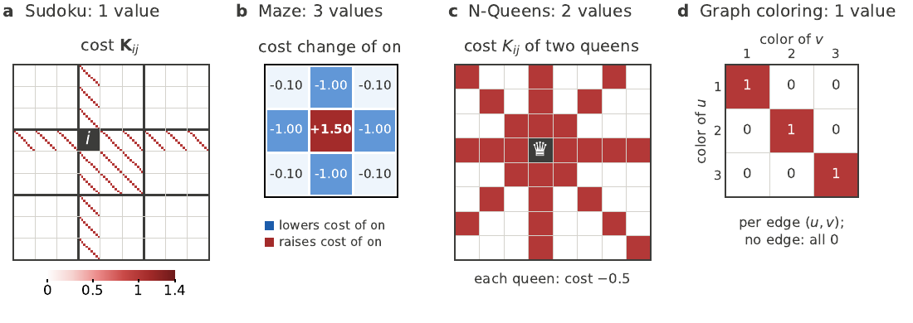

## Appendix A Stopping rules of looped models and CRAM

HRM, TRM, EqR and TRMP learn early stopping with a separate network \[[62](#bib.bib62), [38](#bib.bib38), [36](#bib.bib36), [28](#bib.bib28)\]. EBR stops a sample when the norm of its energy gradient falls below 0.2 \[[11](#bib.bib11)\]. CRAM is different, stopping at the first board whose energy is at most a threshold fitted from the training solutions. [Table 4](#A1.T4) shows that only CRAM never stops at an incorrect board — all other early stopping methods do. Note that EBR’s stop does not work on Maze-Unique since its gradient norm stays near 2 even at correct mazes. EBR’s published maze protocol runs a fixed number of segments instead.

Table 4: **CRAM never halts at an incorrect board.** Each looped model runs one rollout in its halting mode, capped at its trained depth; EBR’s first sample stops at a gradient norm below 0.2 or after 64 segments, as in its code. Halted: puzzles on which the rule stopped before the cap. Wrong halts: halted puzzles whose board is incorrect (% of halted). Full test sets (412,786 puzzles and 1,000 mazes), pooled over three training runs.

**Sudoku-Extreme**

| Stopping rule | Halted (%) | Wrong halts (%) | Solved (%) |
|---|---:|---:|---:|
| HRM (halting head) | 54.5 | 0.62 | 54.7 |
| TRM (halting head) | 85.8 | 2.37 | 83.8 |
| EqR (halting head) | 87.5 | 1.61 | 86.1 |
| TRMP (halting head) | 93.8 | 0.05 | 93.8 |
| EBR (gradient-norm stop) | 99.35 | 0.21 | 99.31 |
| CRAM (energy threshold) | 99.996 | 0.00 | 99.996 |

**Maze-Unique**

| Stopping rule | Halted (%) | Wrong halts (%) | Solved (%) |
|---|---:|---:|---:|
| HRM (halting head) | 21.4 | 0.16 | 40.3 |
| TRM (halting head) | 99.9 | 3.54 | 96.4 |
| EqR (halting head) | 66.0 | 1.06 | 65.3 |
| TRMP (halting head) | 91.2 | 0.73 | 99.2 |
| EBR (gradient-norm stop) | no stopping rule | no stopping rule | no stopping rule |
| CRAM (energy threshold) | 100.00 | 0.00 | 100.00 |

## Appendix B Compute

Every experiment in this paper runs on one NVIDIA H200 GPU. Training jobs used GPUs on unreserved nodes of a shared cluster, so other jobs could use a node’s other GPUs and CPU cores which could affect reproducibility of timing a fit. Wherever CPU times are reported, they use one thread of an Intel Xeon Platinum 8468 CPU. CRAM’s search moves run in Triton kernels with one GPU warp per chain. A move changes one cell, so the kernel keeps the field of every cell in memory and updates only the fields of the cells with a nonzero coupling to the moved cell. The code, data preparation, run records and exported results behind every table and figure are at <https://github.com/Prefrontal-AI/CRAM>.

## Appendix C Experimental protocols

### C.1 Shared protocol

Every method, CRAM and each baseline, is trained three times under different seeds, and each trained model is scored once on the test set. Where a published accuracy was selected on the test set, we say so. The test sets have 412,786 puzzles (Sudoku-Extreme), 1,000 mazes (Maze-Unique), 1,240 and 18,466 rows (N-Queens, $8\times 8$ and $10\times 10$) and 255 and 192 graphs (graph coloring, 8 and 10 vertices).

When reproducing baselines, whenever our three-seed mean accuracy is more 2 points below their published accuracy, a table shows the published value (dagger), but we still count that baseline’s parameters and FLOPs ourselves. A baseline’s Params is the parameter count of its network: we do not check its weights for zeros, so it is an upper bound on the nonzero parameters that CRAM’s count reports.

CRAM inference is a focused Gibbs search with four chains (Sudoku-Extreme) or with $N$ chains ($N{=}1$ or 20 in [Table 3](#S4.T3); N-Queens and graph coloring), and zero-temperature single-cell moves (Maze-Unique). In general, we use each baseline’s published inference setting when solving a task.

- **TRMP**: the most confident of 64 noisy rollouts (the ACT model in [Table 2](#S3.T2)).

- **TRMP’s lattice model** (the § footnote of [Table 2](#S3.T2)): 64 search chains, each restarted on a detected conflict, for at most 1,000 steps.

- **EqR**: depth 64 with 128 noisy restarts, answer chosen by the model’s convergence score \[[36](#bib.bib36)\].

- **GRAM**: majority vote of 20 sampled trajectories of 16 steps.

- **EBR**: the lowest-energy of five samples; OR when its energy-gradient norm falls below 0.2, or after 64 segments (Sudoku Extreme); OR after 16 updates (Maze-Unique)

### C.2 Operation counts and fit time

**Reported FLOPs** count the operations along all their sampling trajectories, stopping tests, selection amongst samples, and decoding; it excludes losses and metrics computed from labels.

Every FLOP count in this paper, for CRAM and every baseline, uses the following convention:

- A matrix product counts 2 FLOPs per multiply-add.

- Every elementwise addition, subtraction, multiplication (also by a 0/1 mask), division, negation and absolute value counts 1, on floats or integers.

- Every exp, log, square root, sigmoid, tanh and erf counts 1.

- Comparisons, selections, min, max, argmax, mask logic, indexing, data movement, casts and random-number generation count 0. Arithmetic applied to a random number (scaling noise, a Gumbel transform) counts.

For the neural baselines, a PyTorch counter at the operator-dispatch level applies these rules to every operator during inference, including gradient computations. CRAM’s moves use Triton kernels that are invisible to the counter, so count their transcription line by line. CRAM’s code outside the kernels is counted directly. A CRAM search counts FLOPs up until a move first passes its stopping test.

**Reported fit times** are the wall clock of one complete fit. The clock starts when the training data are in host memory and stops when the inference-ready model is read, including its stopping statistics. In total, it includes: transfer to the device, initialization, augmentation, every forward, backward and optimizer step, compilation and CUDA-graph capture with their warm-up, and fitting stopping thresholds and focus statistics from the training solutions. It excludes reading files, evaluation, saving and module imports.

We report the warm time for CRAM, because its one-time start-up (0.2–0.9 s on one H200) is a large part of a fit that takes milliseconds, but a negligible part of a baseline fit that takes hours.

- **Cold**: the first fit in a fresh process, including one-time kernel loading, compilation and graph capture. CUDA context creation (0.4–0.7 s) is measured separately and excluded.

- **Warm**: the median of seven further fits in the same process.

It was not within our compute budget to compute warm-starts for long baseline runs. Thus, each baseline time is one cold fit on one H200 with an empty compilation cache. Its start-up (compilation, kernel loading and the first update) takes 6 s to 16 min, at most 2.2% of the fit (3.5% for TRMP on Maze-Unique).

### C.3 CRAM recipes

[Table 5](#A3.T5) lists the training and search settings of every CRAM fit. Two fits add a step that the table does not list. The Sudoku-Extreme fit applies a fresh random digit relabeling to the training boards at each update. The N-Queens fit divides the gradient of each offset cost by a per-offset preconditioner ([App. C.5](#A3.SS5)).

Table 5: **Every CRAM fit is a few dozen to a few thousand SGD updates of pseudolikelihood, and every search is a single-cell local search.** All fits start at zero and use SGD with momentum 0.5 and a cosine schedule; the L1 term is a soft-threshold after each step. Values in parentheses are for the larger N-Queens board or graph. $\bar{h}$: mean positive learned cost; $u$: the N-Queens temperature unit ([App. C.5](#A3.SS5)); $\tau$: highest energy of a training solution.

**Training**

| Setting | Sudoku-Extreme | Maze-Unique | N-Queens $8\times8$ ($10\times10$) | Graph coloring, 8 (10) vertices |
|---|---|---|---|---|
| Training rows | 1,000 | 1,000 | 7,224 (108,234) | 7,002 (13,465) |
| Loss | PL + L1, $\lambda=3.33\times10^{-4}$ | PL | PL | PL + L1, $\lambda=10^{-4}$ ($10^{-3}$) |
| Updates | 32, full batch | 20, batches of 64 | 4,000, full batch | 1,024 (256), full batch |
| Learning rate | 540 | 1 | 30 | 10 |

**Search**

| Setting | Sudoku-Extreme | Maze-Unique | N-Queens $8\times8$ ($10\times10$) | Graph coloring, 8 (10) vertices |
|---|---|---|---|---|
| Start | uniform random | every open cell on | given queens only | uniform random |
| Moves | focused Gibbs | $T=0$ single-cell | focused Gibbs | focused Gibbs |
| Temperature | $0.40\bar{h}\to0.31\bar{h}$ | 0 | $u$ | $2\bar{h}$ ($3\bar{h}$) |
| Chains | 4 | 1 | 1 or 20 | 1 or 20 |
| Stopping test | energy $\leq\tau+10^{-3}$ | fixed point | local margin | every term below its training maximum |
| Budget | $6.3\times10^{11}$ FLOPs | 20,000 moves | 20,000 moves | 10,000 moves |

#### C.3.1 Sudoku-Extreme

Sudoku-Extreme \[[62](#bib.bib62)\] (`sapientinc/sudoku-extreme`) has an official training split and a test split of 422,786 puzzles. CRAM trains on the three 1,000-puzzle training splits of FRM \[[29](#bib.bib29)\], one per seed, which FRM draws from the training split balanced over its difficulty-rating bins. Our development set is 10,000 puzzles of the test split, and our test set is the other 412,786. The cells are opaque indices: CRAM is told neither the rows, columns and boxes nor any structure of the digits. Each pair of cells has a free $9\times 9$ cost block $\boldsymbol{\color{#EB6834}{K}}_{ij}=\boldsymbol{\color{#EB6834}{K}}_{ji}^{\top}$ and each cell a free input cost $\boldsymbol{\color{#EB6834}{B}}_{i}\in\mathbb{R}^{9}$ (263,169 parameters), clue cells are clamped, and training follows [Table 5](#A3.T5).

FRM, EqR and TRMP train on the same splits. HRM, TRM, GRAM and EBR keep the data pipeline of their own code: HRM, TRM and GRAM train on one 1,000-puzzle draw from TRM’s data builder (the command of the authors’ README, which fixes no random seed), with 1,000 stored symmetry variants per puzzle, and EBR trains on its own draw (seed 42). [Fig. 3](#S4.F3)b trains CRAM, TRM, EBR and FRM on identical rows.

For CRAM each sudoku puzzle runs four chains from random boards. A move picks a uniformly random free cell whose local energy exceeds its training-solution mean by more than $0.45\bar{h}$ (any free cell if there is none) and samples its digit from its belief. The temperature falls geometrically from $0.40\bar{h}$ to $0.31\bar{h}$ over 524,288 moves and then restarts, and the cached fields are recomputed exactly every 4,096 moves. A puzzle stops at the first board of any chain with energy at most $\tau+10^{-3}$, where $\tau$ is the highest energy of a training solution of its split ($-1.7\times 10^{-4}$ to $-3\times 10^{-6}$), and otherwise returns its lowest-energy board at the budget. We tuned the temperatures and the stopping threshold on development puzzles. On the test set, no search stopped at an incorrect board. 51 of 1,238,358 searches reached the budget.

### C.4 Maze-Unique

Maze-Unique \[[36](#bib.bib36)\] (`locuslab/EqR-data`, subset `maze-30x30-unique-1k`) has 1,000 training and 1,000 test mazes of $30\times 30$ cells, whose answers are a unique path from start to goal. Walls are clamped off, the start and goal on, and PL of the binary path labels is applied at every open cell. We chose the number of updates and the learning rate on 100 held-out training mazes: the fewest updates (10, 20, 50 or 100), then the smallest rate (0.3, 1 or 3), at which every run solves at least 99 of them with focused Gibbs search when trained on nested subsets of 10 to 900 mazes. The final fits use all 1,000 mazes.

Searching a maze starts with every open cell on. Each move sets a uniformly random cell that is not at its lowest-energy value to that value, and the search stops at a fixed point (at most 290 moves were used). From this start, each move turns off one dead-end cell, so the search performs dead-end filling. This choice of start matters since the empty board has lower energy than the solution on every development maze, and explains why exact solvers like toulbar2 can’t find this solution.

### C.5 N-Queens

N-Queens uses GRAM’s data \[[3](#bib.bib3)\] without augmentation. An input is a solution with $k$ queens removed ($k\in\{5,6,7\}$ on $8\times 8$, $\{7,8,9\}$ on $10\times 10$), and an input with $S$ solutions occurs $S$ times, once with each solution as its label (7,224 training and 1,240 test rows on $8\times 8$; 108,234 and 18,466 on $10\times 10$). Accuracy counts the test rows whose answer is a valid board that keeps every given queen. Cov@20 sums, over distinct test inputs, the distinct valid solutions among 20 samples, capped at $\min(S,20)$, and divides by the sum of $\min(S,20)$. This is the rule of EBR’s evaluator, not GRAM’s. Training follows [Table 5](#A3.T5), with the gradient of each $J_{d}$ divided by $m_{d}/\bar{m}$, where $m_{d}$ is the number of cell pairs at offset $d$ and $\bar{m}$ its mean. Without this preconditioner, the long diagonals (2 pairs, against 162 for the shortest) barely train since there is insufficient data to learn long correlations.

Each chain starts from the given queens. A move picks a uniformly random free cell whose current state has the higher field (any free cell if there is none) and draws its state with probability proportional to $\exp(-g_{i}(a)/u)$. A chain stops when every free cell has a margin of at least $\delta-10^{-3}$, or after 20,000 moves with its lowest-energy board; $N{=}1$ is the first chain, and $N{=}20$ the lowest-energy board of 20 chains. A rule fixed before testing chose this recipe on $10\times 10$ validation inputs; we report it at both sizes, a choice made after seeing the test results (on $8\times 8$, the rule’s own choice scores 100.00% and 98.3% Cov@20, against 99.95% and 97.9%). To save GPU kernels, the fit builds the pair-cost matrix from the offset costs as one product with a fixed 0/1 matrix instead of by indexing. We timed this fit and tested the models of an indexing fit, whose parameters agree with it to within $10^{-7}$ of the largest parameter.

### C.6 Graph coloring

Graph coloring uses GRAM’s graphs with chromatic number 3, each labeled with one 3-coloring in canonical order. We score each graph once. Conflict counts the edges whose two vertices share a color, summed over the test graphs. Cov@20 is the number of distinct proper colorings in canonical order that 20 samples find, over the number of such colorings, summed over graphs (GRAM’s definition). For each pair of vertices, the $3\times 3$ cost table is an affine function of all the adjacency tokens of the graph, so CRAM is not told which edge belongs to which pair (7,332 and 18,660 parameters; 869 and 475 are nonzero after training). Training follows [Table 5](#A3.T5).

Each chain starts from a uniformly random coloring and makes the focused moves of Sudoku-Extreme, with focus threshold $0.45\bar{h}$. It stops at the first coloring on which every pair term and input cost is at most its highest value on a training coloring.

### C.7 Hand-set energies

[Tables 2](#S3.T2) and [3](#S4.T3) include CRAM energies whose weights we set by hand from the rules of each task ([Fig. 5](#A3.F5)). Reported numbers use the same search as the learned energy on the task.

[Original vector figure](../source/figures/hand-set-energies.pdf)

Figure 5: **Hand-set weights on CRAM energy.** Each title gives the number of distinct nonzero values. (a) Sudoku: board cell $j$ shows the $9\times 9$ cost block $\boldsymbol{\color{#EB6834}{K}}_{ij}$ between the digits of the chosen cell $i$ (rows) and of cell $j$ (columns), on the color scale of the learned costs in [Fig. 2](#S4.F2)b. It is the identity on the 20 cells that share a row, column or box with $i$. (b) Maze-Unique: change in energy when an open cell turns on; the center is the change with no neighbor on, and each other entry is the change that a neighbor on at that offset adds. (c) N-Queens ($8\times 8$): cost of a queen at each cell together with a queen at the dark cell, 1 when they attack each other. (d) Graph coloring: cost of the colors of the two vertices of an edge; pairs without an edge cost 0.

### C.8 Looped-model baselines

We retrain every baseline on one H200 with its authors’ code and recipe: HRM \[[62](#bib.bib62)\] (commit `ac15626`), TRM \[[38](#bib.bib38)\] (`c011037`), FRM \[[29](#bib.bib29)\] (`6149a01`), EqR \[[36](#bib.bib36)\] (`134c754`), GRAM \[[3](#bib.bib3)\] (`f2e32b9`) and EBR \[[11](#bib.bib11)\] (`8c5271c`). The training code of TRMP \[[52](#bib.bib52)\] is not released, so we reimplement two of its recipes: the adaptive computation time (ACT) model of its Appendix B and Table 9 (row TRMP), its most accurate on Sudoku-Extreme, and the 16k-parameter factor-graph lattice model of its abstract (its Table 4), which the § footnote of [Table 2](#S3.T2) reports. The lattice model trains for 20,000 updates of a 512-board pool, as in that table, and its fit time in the footnote is the median of seven complete fits that follow a first fit in the same process, as for CRAM; the first fit takes 14m46s. GRAM’s paper reports TRM and HRM on N-Queens and graph coloring without a recipe, so we train both in GRAM’s code, which contains both architectures, with GRAM’s per-task settings. Every baseline trains in bf16 with torch.compile, and is scored at its final weights (their exponential moving average where the authors use one), or at a checkpoint chosen on development data (HRM, FRM and TRMP). CRAM fits, in contrast, run as eager PyTorch in single precision, without compilation or CUDA graphs. We change a recipe only where our tests require it:

- **Maze-Unique recipes.** HRM, TRM, GRAM and EBR publish no Maze-Unique basline, so we run their Maze-Hard recipes unchanged. GRAM runs the TRM recipe with GRAM’s settings for its non-Sudoku tasks, at global batch 384 (the largest that fits on one H200).

- **Compilation and optimizer.** We compile the whole model where the authors’ code does not (FRM; EqR on Maze-Unique), which makes training 1.8–2.2 times faster. TRM and EqR use a pure-PyTorch AdamATan2 in place of the authors’ CUDA package, which adds less than 1% to an update. TRMP trains in bf16, where its paper uses single precision for the Sudoku model.

- **Schedules.** HRM trains on Sudoku-Extreme for 40,000 epochs, the schedule of its released checkpoint (though its README states 20,000).

- **Test subset.** At 128 restarts, EqR is scored on the first 10,000 Sudoku-Extreme test puzzles, because the full set would take about 105 GPU-hours per seed.

- **Published accuracies.** Our GRAM runs solve 93.61 $\pm$ 1.21% of Sudoku-Extreme, 2.5 points below the published 96.1%, so [Table 2](#S3.T2) shows the published value. On Maze-Unique, EqR’s repository configuration (hidden size 44) solves 100.0%, 99.6% and 0% with three seeds, so [Table 2](#S3.T2) shows the published 93.0% with the parameters, FLOPs and fit time of the paper’s configuration (hidden size 128). On $10\times 10$ N-Queens, our TRM and HRM runs solve 6.90% and 22.72%, against the published 17.5% and 37.8%, so [Table 3](#S4.T3) shows the published values.

### C.9 Data efficiency

In [Fig. 3](#S4.F3)b, CRAM, TRM, EBR and FRM train on the same data samples and only the number $k$ of unique training puzzles changes.

- **Puzzles.** For $k<1{,}000$, seed $s$ takes the first $k$ puzzles of a seed-$s$ permutation of TRM’s 1,000-puzzle draw, so the subsets of one seed are nested. $k=1{,}000$ is the whole draw, and $k=3{,}000$ to 100,000 add puzzles from the official training split with the same builder.

- **Augmentation.** Each puzzle is augmented with 99 symmetry variants (digit relabeling, transposition, and permutations of bands, stacks, rows and columns). No method adds its own augmentation.

- **CRAM**: Training is deterministic, so at $k=1{,}000$ the six seeds give one model and differ only in the search.

- **TRM**: 65,100 updates of batch 768 at every $k$ (65,117 at $k=30{,}000$).

- **EBR**: 60,000 updates of batch 768, scored as in [Table 2](#S3.T2). Its loader needs at least 768 puzzle groups, so for $k<768$ each group is repeated $\lceil 768/k\rceil$ times.

- **FRM**: Stage A and Stage B of 100,000 updates each at batch 128, checkpoint chosen on 256 development puzzles.

- **Scoring**: six runs (seeds 0–5) per point, on the 10,000 test puzzles of [Fig. 2](#S4.F2)a.
