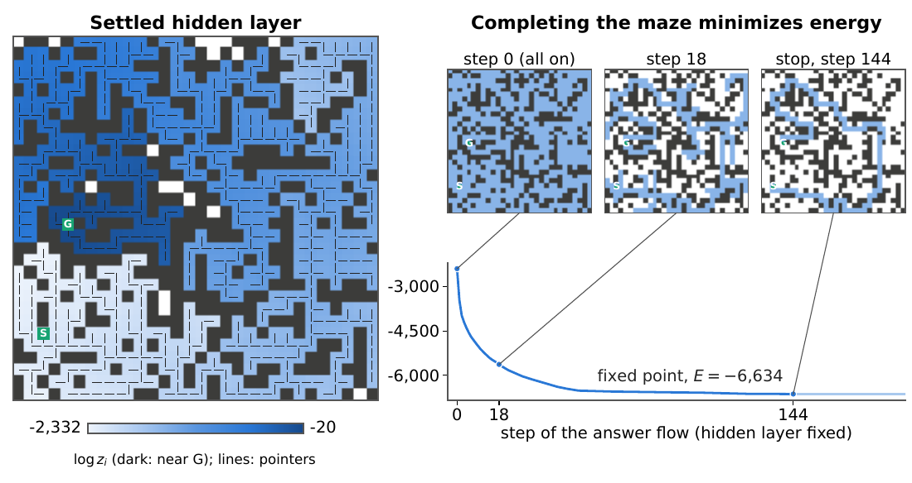

## Appendix D Training methods for CRAM

As discussed in the paper, there are many ways to train the energy using approximate likelihood methods as per [Eq. 4](#S3.E4). [Table 7](#A4.T7) compares twelve such methods across three classes ([Table 6](#A4.T6)). This section describes pseudolikelihood \[[8](#bib.bib8)\] and characterizes the twelve methods on Sudoku-Extreme and Maze-Unique.

### D.1 Pseudolikelihood, maximum likelihood, and cross-entropy

Pseudolikelihood (PL) replaces the model term of [Eq. 4](#S3.E4) with a comparison between the observed solution ${\color{#18A372}\boldsymbol{x}}$ and its single-cell changes. Let $\mathcal{F}$ be the cells whose answers the input does not give, and let ${\color{#2A78D6}\boldsymbol{x}}^{-}_{i\leftarrow a}$ be ${\color{#18A372}\boldsymbol{x}}$ with cell $i$ set to value $a$. We minimize

$$
\mathcal{J}_{\mathrm{PL}}(\boldsymbol{{\color{#EB6834}\theta}};{\color{#18A372}\boldsymbol{x}})=\underbrace{E_{\boldsymbol{{\color{#EB6834}\theta}}}({\color{#18A372}\boldsymbol{x}})}_{\mathclap{\substack{\text{lower energy}\\\text{on data}}}}+\underbrace{\frac{1}{|\mathcal{F}|}\sum_{i\in\mathcal{F}}\log\sum_{a}\exp\!\left[-E_{\boldsymbol{{\color{#EB6834}\theta}}}({\color{#2A78D6}\boldsymbol{x}}^{-}_{i\leftarrow a})\right]}_{\mathclap{\text{\scriptsize raise energy on model ``samples''}}}, \tag{5}
$$

where $a$ runs over all permitted values, the labeled one included. Where a task needs it, we add local terms that depend only on the weights and the labeled solution, such as an L1 penalty on the costs. The L1 penalty sets a cost exactly to zero where the examples show no constraint between two cells, so the fitted energy is sparse. Below, we write ${\color{#18A372}\boldsymbol{y}}$ for ${\color{#18A372}\boldsymbol{x}}$ and ${\color{#18A372}\boldsymbol{y}}^{i\leftarrow a}$ for ${\color{#2A78D6}\boldsymbol{x}}^{-}_{i\leftarrow a}$.

At unit temperature, the energy defines a joint distribution $P_{\boldsymbol{{\color{#EB6834}\theta}}}({\color{#2A78D6}\boldsymbol{p}}\mid{\color{#4A3AA7}\boldsymbol{x}})=\exp[-E_{\boldsymbol{{\color{#EB6834}\theta}}}({\color{#2A78D6}\boldsymbol{p}})]/Z_{\boldsymbol{{\color{#EB6834}\theta}}}({\color{#4A3AA7}\boldsymbol{x}})$ over the set $\mathcal{S}({\color{#4A3AA7}\boldsymbol{x}})$ of one-hot answer arrays that respect the givens, and maximum likelihood minimizes $-\log P_{\boldsymbol{{\color{#EB6834}\theta}}}({\color{#18A372}\boldsymbol{y}}\mid{\color{#4A3AA7}\boldsymbol{x}})=E_{\boldsymbol{{\color{#EB6834}\theta}}}({\color{#18A372}\boldsymbol{y}})+\log Z_{\boldsymbol{{\color{#EB6834}\theta}}}({\color{#4A3AA7}\boldsymbol{x}})$ \[[1](#bib.bib1), [42](#bib.bib42)\]. The partition function $Z_{\boldsymbol{{\color{#EB6834}\theta}}}({\color{#4A3AA7}\boldsymbol{x}})=\sum_{{\color{#2A78D6}\boldsymbol{p}}^{\prime}\in\mathcal{S}({\color{#4A3AA7}\boldsymbol{x}})}\exp[-E_{\boldsymbol{{\color{#EB6834}\theta}}}({\color{#2A78D6}\boldsymbol{p}}^{\prime})]$ sums over up to $C^{|\mathcal{F}|}$ assignments, so this objective is intractable for the tasks of this paper.

Conditioning on every labeled cell except $i$ cancels the partition function. With $\boldsymbol{e}_{a}$ the one-hot vector of value $a$, the exact conditional of cell $i$ is a softmax,

$$
q_{i}(a)\equiv P_{\boldsymbol{{\color{#EB6834}\theta}}}({\color{#2A78D6}\boldsymbol{p}}_{i}=\boldsymbol{e}_{a}\mid{\color{#2A78D6}\boldsymbol{p}}_{-i}={\color{#18A372}\boldsymbol{y}}_{-i},{\color{#4A3AA7}\boldsymbol{x}})=\frac{\exp z_{ia}}{\sum_{b}\exp z_{ib}},\qquad z_{ia}=-E_{\boldsymbol{{\color{#EB6834}\theta}}}({\color{#18A372}\boldsymbol{y}}^{i\leftarrow a}), \tag{6}
$$

over the permitted values. [Eq. 5](#A4.E5) is the mean over free cells of the cross-entropy $\ell_{i}=-\sum_{a}{\color{#18A372}y}_{ia}\log q_{i}(a)$ of the label ${\color{#18A372}\boldsymbol{y}}_{i}=({\color{#18A372}y}_{ia})_{a}$, with the familiar gradient $\partial\ell_{i}/\partial z_{ia}=q_{i}(a)-{\color{#18A372}y}_{ia}$. Every energy term without cell $i$ cancels in $q_{i}$, so the logits need only the pair and input costs of cell $i$, and no inference. Each conditional is exact; the approximation is replacing the joint likelihood with a sum of conditionals \[[8](#bib.bib8), [37](#bib.bib37)\].

### D.2 Comparing twelve objectives

[Table 6](#A4.T6) lists different training objectives and how it relates to [Eq. 4](#S3.E4). A relaxation runs $n$ Euler steps of [Eq. 2](#S3.E2) (step size 0.5) from uniform beliefs, with clues clamped. Each sampling method lowers the energy of the labeled solution and raises the energy of a negative, a board or belief state drawn from the model; no gradient flows through the drawing of the negative. To keep the energies bounded, each also penalizes their squares, as in [Du and Mordatch \[19\]](#bib.bib19).

A few choices are specific to CRAM. Masked pseudolikelihood sets a hidden cell’s state to zero, so that it adds nothing to the other cells’ fields. Denoising score matching uses the clean logits $3({\color{#18A372}\boldsymbol{y}}_{i}-\mathbf{1}/C)$. Contrastive divergence draws its moves at temperature 1, and persistent CD relabels each stored Sudoku chain together with its puzzle. Equilibrium propagation uses $\beta=0.01$, at which its gradient has cosine similarity 0.99999 with the full-BPTT gradient ($\beta=0.5$ diverged). Implicit differentiation runs $n$ forward and $n$ adjoint iterations, without a convergence test, and full BPTT uses $T=10$, selected on both tasks.

Table 6: **Local training objective overview.** **L** local objectives, evaluated at the labeled solution. **S** sampling methods, whose negatives get no gradient. **D** methods that differentiate through a relaxation or its fixed point. $k$, $n$, $T$, $q$ and $\sigma$ are tuned ([App. D](#A4)).

| **Training method** | **Compares the labeled solution with** |
|----|----|
| **L** Pseudolikelihood \[[8](#bib.bib8)\] | every single-cell change ([Eq. 5](#A4.E5)) |
| **L** Masked pseudolikelihood \[[17](#bib.bib17)\] | its single-cell changes, with each cell hidden with probability $q$ |
| **L** Min Probability Flow \[[56](#bib.bib56)\] | every single-cell change, weighted by $\exp(-\Delta E/2)$ |
| **L** Denoising Score Matching \[[60](#bib.bib60)\] | its own logits plus Gaussian noise of scale $\sigma$ |
| **S** Contrastive divergence \[[31](#bib.bib31)\] | the board after $k$ heat-bath moves from it |
| **S** Persistent CD \[[58](#bib.bib58)\] | a stored chain per training board, advanced $k$ moves per visit |
| **S** Contrastive Hebbian \[[45](#bib.bib45)\] | the state after a relaxation of $n$ steps |
| **D** Eq Prop \[[53](#bib.bib53)\] | two relaxations nudged toward and away from it |
| **D** Implicit Diff. \[[4](#bib.bib4)\] | the relaxed state, through its adjoint |
| **D** Truncated BPTT ($t{=}1$) \[[62](#bib.bib62)\] | the relaxed state, through the last of $T$ steps |
| **D** Truncated BPTT ($t{=}5$) \[[63](#bib.bib63)\] | the relaxed state, through the last 5 of $T$ steps |
| **D** BPTT (full) \[[63](#bib.bib63)\] | the relaxed state, through all $T$ steps |

Every method trains the energy of [Table 2](#S3.T2) from the same weight initialization, with SGD (momentum 0.5, cosine schedule) and the L1 penalty as a soft-threshold of $\eta_{k}\lambda$ after each step. All twelve methods run in one shared training harness, so their times compare with each other but **not** with the fit times of [Table 2](#S3.T2). The harness is slower than [Table 2](#S3.T2) because it synchronizes the GPU before and after every update, to time each update and place the development probes.

Each method tunes on seed 0, using development puzzles not in the train or test set:

- the learning rate: 6, 60 or 540 (Sudoku-Extreme); 0.1, 0.3 or 1 (Maze-Unique);

- the L1 strength: 1, 0.1 or 0.01 times that of [Table 2](#S3.T2) (Sudoku-Extreme); 0, 0.003 or 0.03 (Maze-Unique);

- its own setting: $q\in\{0.1,0.3\}$ (masked PL); $\sigma\in\{0.5,1.5\}$ (DSM); $k\in\{81,324\}$ moves on Sudoku-Extreme and $\{256,1024\}$ on Maze-Unique (CD, persistent CD); $n\in\{10,30\}$ on Sudoku-Extreme and $\{30,100\}$ on Maze-Unique (contrastive Hebbian learning, equilibrium propagation, implicit differentiation); $T\in\{10,30\}$ (truncated and full BPTT); and the weight of the [Du and Mordatch \[19\]](#bib.bib19) regularizer, 0 or 1 (class S).

Pseudolikelihood keeps the learning rate and number of updates of [Table 2](#S3.T2) and tunes only its L1 strength; every other method runs 2,000 updates (1,500 for class S on Maze-Unique). The rule takes the highest development solve rate, then the shortest fit time. The settings selected for each method are in the code release.

[Fig. 4](#S4.F4) trains each of its five methods 20 times; its x-axis is the fit time without the one-time start-up, and full BPTT runs 60,000 updates. Four differentiating methods were still improving after 2,000 updates on Sudoku-Extreme, so we gave them longer schedules (footnote of [Table 7](#A4.T7)). Full BPTT, equilibrium propagation and implicit differentiation stop at incorrect boards and fail to train. On Maze-Unique, every method solves every test maze.

Notes on [Table 7](#A4.T7):

- $T_{99}$ is the median over the three runs of the fit time at the first probe where their mean reaches 99%, minus each run’s one-time start-up (0.10–1.83 s on Sudoku-Extreme and 0.64–1.22 s on Maze-Unique), plus the time to fit the stopping threshold and focus statistic (24–75 ms on Sudoku-Extreme; the Maze-Unique search fits none).

- Contrastive divergence runs 324 heat-bath moves per update on Sudoku-Extreme and 256 on Maze-Unique.

- The pseudolikelihood row is the recipe of [Table 2](#S3.T2) under this protocol. Its test solve rates equal those of [Table 2](#S3.T2), but its fit times and FLOPs differ: it tests the checkpoint chosen on the probe (updates 16, 23 and 16 of 32 on Sudoku-Extreme; 6 of 20 on Maze-Unique), tunes the L1 strength (Maze-Unique selects 0.003, where [Table 2](#S3.T2) uses none), trains Maze-Unique on 900 mazes, and tests Sudoku-Extreme on 50,000 puzzles.

Table 7: **Nine of the twelve training methods reach at least 99% test accuracy on both tasks, and a local objective is the first to reach 99% on the development probe of each task.** $T_{99}$: training time until the mean development solve rate of three runs first reaches 99% (dash: never). $\mathrm{FLOPs}_{99}$: training arithmetic to that point. Solved: exact test solve rate (%), mean $\pm$ SD over three runs. Classes, protocol and notes in [App. D](#A4); bold: best value of each column. Every method runs in one shared training harness that is slower than the recipes of [Table 2](#S3.T2), so compare these times with each other, not with [Table 2](#S3.T2): a full pseudolikelihood fit on Sudoku-Extreme takes about 70 ms here, against 42 ms there.

| Training method | Sudoku-Extreme: $T_{99}$ | Sudoku-Extreme: $\mathrm{FLOPs}_{99}$ | Sudoku-Extreme: Solved | Maze-Unique: $T_{99}$ | Maze-Unique: $\mathrm{FLOPs}_{99}$ | Maze-Unique: Solved |
|---|---:|---:|---:|---:|---:|---:|
| **L** Pseudolikelihood \[[8](#bib.bib8)\] | **50 ms** | **3.42e10** | 100.00 ± 0.00 | 43 ms | 6.15e7 | **100.00 ± 0.00** |
| **L** Masked pseudolikelihood \[[17](#bib.bib17)\] | 198 ms | 1.95e11 | 99.99 ± 0.00 | **22 ms** | **3.11e7** | **100.00 ± 0.00** |
| **L** Min Probability Flow \[[56](#bib.bib56)\] | 225 ms | 1.95e11 | 99.99 ± 0.00 | 30 ms | 4.22e7 | **100.00 ± 0.00** |
| **L** Denoising Score Matching \[[60](#bib.bib60)\] | 1.6 s | 2.20e12 | 99.98 ± 0.01 | 23 ms | 3.44e7 | **100.00 ± 0.00** |
| **S** Contrastive divergence \[[31](#bib.bib31)\] | 33.7 s | 1.26e14 | 99.99 ± 0.00 | 258 ms | 3.37e9 | **100.00 ± 0.00** |
| **S** Persistent CD \[[58](#bib.bib58)\] | 30.2 s | 1.26e14 | 99.96 ± 0.06 | 262 ms | 3.37e9 | **100.00 ± 0.00** |
| **S** Contrastive Hebbian \[[45](#bib.bib45)\] | 348 ms | 1.92e12 | **100.00 ± 0.00** | 111 ms | 2.15e9 | **100.00 ± 0.00** |
| **D** Eq Prop \[[53](#bib.bib53)\] | — | — | 16.05 ± 8.75† | 3.7 s | 6.66e10 | **100.00 ± 0.00** |
| **D** Implicit Diff. \[[4](#bib.bib4)\] | — | — | 0.45 ± 0.50 | 2.3 s | 4.23e10 | **100.00 ± 0.00** |
| **D** Truncated BPTT ($t{=}1$) \[[62](#bib.bib62)\] | 4.6 s | 2.35e13 | 99.57 ± 0.29 | 1.1 s | 7.41e9 | **100.00 ± 0.00** |
| **D** Truncated BPTT ($t{=}5$) \[[63](#bib.bib63)\] | 2.9 min | 1.37e15 | 99.89 ± 0.07† | 4.0 s | 1.24e10 | **100.00 ± 0.00** |
| **D** BPTT (full) \[[63](#bib.bib63)\] | — | — | 48.82 ± 3.73† | 7.7 s | 1.86e10 | **100.00 ± 0.00** |

† Longer cosine schedules on Sudoku-Extreme, without the one-hour cap, with the learning rate chosen on the seed-0 probe. Truncated BPTT ($t{=}5$): 60,000 updates at learning rate 6 (5.3–5.4 min per run; 98.51 $\pm$ 2.15% with 2,000 updates); Eq Prop: 240,000 updates at learning rate 6 (49–50 min per run; 1.10 $\pm$ 0.72% with 2,000 updates); BPTT (full): 3,840,000 updates at learning rate 2 (4.8–5.0 h per run; 0.72 $\pm$ 0.92% with 2,000 updates, and 46.24 $\pm$ 2.86% after 480,000 updates). Implicit differentiation keeps its 2,000-update cells; with 60,000 updates it solved at most 0.6% of development puzzles.

## Appendix E Energy descent

Here we show how deterministic dynamics of [Eq. 2](#S3.E2) never increase the energy. Define the convex logsumexp function as $\mathcal{L}({\color{#2A78D6}\boldsymbol{v}}_{i})=\beta^{-1}\log\sum_{a}\exp(\beta{\color{#2A78D6}v}_{ia})$. Its derivative is the softmax belief, ${\color{#2A78D6}\boldsymbol{p}}_{i}=\partial\mathcal{L}/\partial{\color{#2A78D6}\boldsymbol{v}}_{i}$, and

$$
{\color{#2A78D6}\boldsymbol{v}}_{i}^{\top}{\color{#2A78D6}\boldsymbol{p}}_{i}-\mathcal{L}({\color{#2A78D6}\boldsymbol{v}}_{i})=\beta^{-1}\sum_{a}{\color{#2A78D6}p}_{ia}\log{\color{#2A78D6}p}_{ia}. \tag{7}
$$

so the negative-entropy term of [Eq. 1](#S3.E1) is the Legendre transform of $\mathcal{L}$. For masked cells, all sums and derivatives run over permitted values only. Inside the simplex, the derivative of the energy with respect to a belief is

$$
\frac{\partial E}{\partial{\color{#2A78D6}\boldsymbol{p}}_{i}}=\beta^{-1}(\log{\color{#2A78D6}\boldsymbol{p}}_{i}+1)+\sum_{j}\boldsymbol{{\color{#EB6834}W}}_{ij}{\color{#2A78D6}\boldsymbol{p}}_{j}+\boldsymbol{{\color{#EB6834}B}}_{i}={\color{#2A78D6}\boldsymbol{v}}_{i}+\sum_{j}\boldsymbol{{\color{#EB6834}W}}_{ij}{\color{#2A78D6}\boldsymbol{p}}_{j}+\boldsymbol{{\color{#EB6834}B}}_{i}+c_{i}, \tag{8}
$$

where the scalar $c_{i}=\beta^{-1}-\mathcal{L}({\color{#2A78D6}\boldsymbol{v}}_{i})$ is added to every entry. So [Eq. 2](#S3.E2) follows $-\partial E/\partial{\color{#2A78D6}\boldsymbol{p}}_{i}$ up to a constant across values, which leaves the softmax beliefs unchanged. $\mathcal{L}$ is a convex function, so its Hessian is positive semidefinite:

$$
H_{i}=\frac{\partial^{2}\mathcal{L}}{\partial{\color{#2A78D6}\boldsymbol{v}}_{i}\,\partial{\color{#2A78D6}\boldsymbol{v}}_{i}^{\top}}=\beta\big[\operatorname{diag}({\color{#2A78D6}\boldsymbol{p}}_{i})-{\color{#2A78D6}\boldsymbol{p}}_{i}{\color{#2A78D6}\boldsymbol{p}}_{i}^{\top}\big]\succeq 0. \tag{9}
$$

which is singular along the all-ones direction, because adding a constant to all logits leaves the softmax unchanged. Since $\partial{\color{#2A78D6}\boldsymbol{p}}_{i}/\partial{\color{#2A78D6}\boldsymbol{v}}_{i}=H_{i}$, and $H_{i}$ removes the constant $c_{i}$, the chain rule and [Eq. 2](#S3.E2) give

$$
\frac{dE}{dt}=\sum_{i\in\mathcal{F}}\Big(\frac{\partial E}{\partial{\color{#2A78D6}\boldsymbol{p}}_{i}}\Big)^{\!\top}\frac{\partial{\color{#2A78D6}\boldsymbol{p}}_{i}}{\partial{\color{#2A78D6}\boldsymbol{v}}_{i}}\frac{d{\color{#2A78D6}\boldsymbol{v}}_{i}}{dt}=-\sum_{i\in\mathcal{F}}\tau_{i}\dot{{\color{#2A78D6}\boldsymbol{v}}}_{i}^{\top}H_{i}\dot{{\color{#2A78D6}\boldsymbol{v}}}_{i}\leq 0. \tag{10}
$$

This holds for fixed inputs, parameters, temperature and clamps, positive time constants, and continuous time. It does not show convergence to a unique minimum, rule out saddles, or say that a minimum is a correct solution. Discrete steps and finite precision need their own analysis.

A board is a single-cell local minimum if no permitted single-cell change lowers its energy. If every labeled cell strictly prefers its label given the other labels, the labeled board is such a minimum. A small average pseudolikelihood loss does not guarantee this for every cell, and it does not say which minimum a search reaches from a puzzle. Focused Gibbs search can pass through higher-energy boards, and it can stop at the energy threshold before it reaches a local minimum.

## Appendix F Extending CRAM to Maze-Hard

**Summary.** The Maze-Unique energy, extended with 11 learned parameters and one hidden layer that settles in its own relaxation, solves 99.9% of the Maze-Hard test mazes after **less than 30 seconds of training** on one GPU.

On Maze-Unique, the learned energy fills dead ends from the all-open board until only the unique solution path is left ([App. C.4](#A3.SS4)). Maze-Hard mazes, on the other hand, contain loops that break dead-end filling, because the choice between two sides of a loop depends on distances to the goal. With nowhere in [Eq. 1](#S3.E1) to store these distance calculations, CRAM solves none of the Maze-Hard test mazes.

To solve this, we can add one layer of hidden neurons ${\color{#2A78D6}\boldsymbol{z}}$ whose state falls by a fixed amount with each step away from the goal, and let the pair costs of [Eq. 1](#S3.E1) read it. Training is the pseudolikelihood of [Eq. 5](#A4.E5), as for the other tasks.

Table 8: **CRAM+$z$ solves 99.9% of the Maze-Hard test mazes with 29 parameters.** Exact match to the labeled path on the 1,000 test mazes. Baselines: accuracy published by their authors. CRAM+$z$: mean and standard deviation over three training runs (999 of 1,000 in each).

| **Model** | **Solved** | **Params** | **FLOPs/puzl** |
|----|----|----|----|
| [HRM](https://arxiv.org/abs/2506.21734)† \[[62](#bib.bib62)\] | $74.50$ | 2.70e7 | 3.01e12 |
| [TRM](https://arxiv.org/abs/2510.04871)† \[[38](#bib.bib38)\] | $85.30$ | 6.82e6 | 3.84e12 |
| [FPRM](https://arxiv.org/abs/2606.18206)† \[[44](#bib.bib44)\] | $87.00$ | 6.83e6 | 4.78e14 |
| [NCA](https://arxiv.org/abs/2609.36126)† \[[22](#bib.bib22)\] | $89.20$ | 4.10e4 | 2.00e12 |
| [EBR](https://energy-based-reasoners.github.io/)† \[[11](#bib.bib11)\] | $88.30$ | 1.77e6 | 1.93e13 |
| **CRAM+$z$** | **99.90 ± 0.00** | **2.90e1** | **1.41e7** |

$\dagger$ Accuracy from the original paper; parameter counts and FLOPs computed locally.

FPRM: its published setting (at most 35,000 iterations per batch of 768 mazes, restart seed 4), which solved 86.9% in our run of the released checkpoint.

NCA: trained and scored on the official A\* targets. EBR: lowest energy of 5 sampled trajectories, its published setting.

##### Data.

Maze-Hard \[[62](#bib.bib62)\] has 1,000 training and 1,000 test mazes of $30\times 30$ cells, with tokens ${\color{#4A3AA7}x}_{i}\in\{\text{wall},\text{open},\text{S},\text{G}\}$ for the start S and the goal G. The label marks one shortest path from S to G, the one that breadth-first search finds with the neighbour order down, left, right, up \[[11](#bib.bib11)\]. Every development training maze has at least 512 shortest paths, so this tie-break decides most labels.

[Original vector figure](../source/figures/maze-hard.pdf)

Figure 6: **CRAM+$z$ solves a Maze-Hard test maze in two relaxations: the hidden layer settles to a distance-like field, and the answers prune the tree of pointers down to the path.** Left: the hidden layer on test maze 0 (seed-0 model), settled first by [Eq. 13](#A6.E13): $\log{\color{#2A78D6}z}^{\star}_{i}$ (white: not connected to G; dark gray: walls) and each cell’s pointer, a line toward its largest weight in [Eq. 14](#A6.E14); the pointers form a tree rooted at G. Top right: rounded answers of the answer flow, run second with the hidden layer fixed, from the all-on board: leaves switch off first; at the stop the board equals the labeled path. Bottom right: the answer energy ([Eq. 1](#S3.E1), entropy included) decreases at every step of that flow; the lighter line continues the flow for 48 steps after the stop, to its fixed point.

##### The hidden layer.

Each cell is either a wall, empty, the start S or the goal G. A cell is “open” if it is not a wall. Let $\mathcal{N}(i)$ be the set of open side neighbours of an open cell $i$. Each open cell has one hidden neuron with output ${\color{#2A78D6}z}_{i}$ and the identity activation; ${\color{#2A78D6}z}_{\mathrm{G}}$ is the output of the neuron at G. The hidden energy is

$$
E_{z}({\color{#2A78D6}\boldsymbol{z}})=\sum_{i}\Big[\frac{{\color{#EB6834}m}}{2}{\color{#2A78D6}z}_{i}^{2}-\frac{1}{2}\sum_{j\in\mathcal{N}(i)}{\color{#2A78D6}z}_{i}{\color{#2A78D6}z}_{j}\Big]-{\color{#2A78D6}z}_{\mathrm{G}}, \tag{11}
$$

with one learned mass ${\color{#EB6834}m}$. The maze enters only through which cells are open, in $\mathcal{N}(i)$, and through the position of G. The first term pulls every output toward zero, the second rewards neighbouring outputs that are both large, and the third is a unit input to the neuron at G. A cell has at most four neighbors, requiring that ${\color{#EB6834}m}>4$, (enforced by learning $\log({\color{#EB6834}m}-4)$). In each row of the Hessian $\nabla^{2}_{{\color{#2A78D6}\boldsymbol{z}}}E_{z}$, the diagonal entry ${\color{#EB6834}m}$ is larger than the sum of the other entries, which are at most four entries of size 1, so the Hessian is positive definite. $E_{z}$ is then strictly convex and has one minimum ${\color{#2A78D6}\boldsymbol{z}}^{\star}$, positive on the cells connected to G and zero elsewhere.

The neurons follow the gradient of the energy,

$$
\tau\frac{d{\color{#2A78D6}z}_{i}}{dt}=-\frac{\partial E_{z}}{\partial{\color{#2A78D6}z}_{i}}=\begin{cases}\displaystyle-{\color{#EB6834}m}{\color{#2A78D6}z}_{i}+\sum_{j\in\mathcal{N}(i)}{\color{#2A78D6}z}_{j}+1,&i=\mathrm{G},\\[14.0pt]
\displaystyle-{\color{#EB6834}m}{\color{#2A78D6}z}_{i}+\sum_{j\in\mathcal{N}(i)}{\color{#2A78D6}z}_{j},&\text{otherwise}.\end{cases} \tag{12}
$$

The time constant $\tau$ does not affect the fixed point, only the speed of these dynamics. Letting $\tau={\color{#EB6834}m}$, an Euler step of size 1 replaces every output, all at once, by the sum of its neighbours’ outputs (plus 1 at G) divided by ${\color{#EB6834}m}$:

$$
{\color{#2A78D6}z}_{i}\leftarrow\begin{cases}\displaystyle\frac{1}{{\color{#EB6834}m}}\Big(\sum_{j\in\mathcal{N}(i)}{\color{#2A78D6}z}_{j}+1\Big),&i=\mathrm{G},\\[14.0pt]
\displaystyle\frac{1}{{\color{#EB6834}m}}\sum_{j\in\mathcal{N}(i)}{\color{#2A78D6}z}_{j},&\text{otherwise}.\end{cases} \tag{13}
$$

So each neuron takes the sum of its neighbours’ outputs, plus the input at G, damped by the factor $1/{\color{#EB6834}m}$. This update converges to ${\color{#2A78D6}\boldsymbol{z}}^{\star}$ from any start. Let the error of a neuron be ${\color{#2A78D6}z}_{i}-{\color{#2A78D6}z}^{\star}_{i}$. One update makes the error of each neuron equal to the sum of its neighbours’ errors, divided by ${\color{#EB6834}m}$. A neuron has at most four neighbours, so each update multiplies the largest error by at most $4/{\color{#EB6834}m}$, which is less than 1. From ${\color{#2A78D6}\boldsymbol{z}}=\boldsymbol{0}$, a cell at distance $d$ from G first becomes nonzero after $d+1$ updates, so the layer settles in about as many updates as the longest distance (at most 152 on the development mazes).

##### Solving a maze.

A maze is solved with two relaxations, one after the other ([Fig. 6](#A6.F6)). First, the hidden layer settles, where [Eq. 13](#A6.E13) updates initial state ${\color{#2A78D6}\boldsymbol{z}}=\boldsymbol{0}$ to fixed point. Then, the answers start with every open cell on and follow [Eq. 2](#S3.E2). The hidden layer is linked to the visible layer via ${\color{#EB6834}L}_{ij}({\color{#2A78D6}\boldsymbol{z}})$ through attention weights $\alpha_{ij}$ over $\mathcal{M}(i)=\mathcal{N}(i)\cup\{i\}$:

$$
\displaystyle\alpha_{ij}({\color{#2A78D6}\boldsymbol{z}}) \displaystyle=\frac{e^{{\color{#EB6834}\beta}_{j-i}}\,{\color{#2A78D6}z}_{j}}{\sum_{k\in\mathcal{M}(i)}e^{{\color{#EB6834}\beta}_{k-i}}\,{\color{#2A78D6}z}_{k}},\qquad{\color{#EB6834}L}_{ij}({\color{#2A78D6}\boldsymbol{z}})={\color{#EB6834}\kappa}_{j-i}\,\alpha_{ij}({\color{#2A78D6}\boldsymbol{z}})+{\color{#EB6834}\kappa}_{i-j}\,\alpha_{ji}({\color{#2A78D6}\boldsymbol{z}}). \tag{14}
$$

Each answer update of [Eq. 3](#S3.E3) then adds $\eta\sum_{j\in\mathcal{M}(i)}{\color{#EB6834}L}_{ij}({\color{#2A78D6}\boldsymbol{z}})\,{\color{#2A78D6}p}_{j}$ to the Maze-Unique update of cell $i$, and learnable ${\color{#EB6834}\beta}_{\delta}$ (one per direct neighbor, and itself) allows the model to learn Maze-Hard’s preference for direction. The answers ${\color{#2A78D6}p}_{i}\in[0,1]$ have the same Maze-Unique energy as in [App. C.4](#A3.SS4), such that their update is:

$$
\begin{aligned}
\displaystyle{\color{#2A78D6}\boldsymbol{v}}_{i} & \displaystyle\leftarrow(1-\eta)\,{\color{#2A78D6}\boldsymbol{v}}_{i}-\eta\Big(\sum_{j}\big(\underbrace{\boldsymbol{{\color{#EB6834}W}}_{ij}}_{\mathclap{\text{\scriptsize Maze-Unique}}}-\underbrace{{\color{#EB6834}L}_{ij}({\color{#2A78D6}\boldsymbol{z}})\operatorname{diag}(0,1)}_{\mathclap{\text{\scriptsize links to the hidden layer}}}\big){\color{#2A78D6}\boldsymbol{p}}_{j}+\boldsymbol{{\color{#EB6834}B}}_{i}\Big), \\
\displaystyle{\color{#2A78D6}\boldsymbol{p}}_{i} & \displaystyle=\operatorname{softmax}({\color{#2A78D6}\boldsymbol{v}}_{i}).
\end{aligned} \tag{15}
$$

Here ${\color{#2A78D6}\boldsymbol{v}}_{i}\in\mathbb{R}^{2}$ holds the logits of the off and on states of cell $i$, and $\boldsymbol{{\color{#EB6834}W}}_{ij}$ and $\boldsymbol{{\color{#EB6834}B}}_{i}$ are the $2\times 2$ pair costs and the input cost of the Maze-Unique energy, so with ${\color{#EB6834}L}=0$ this is [Eq. 3](#S3.E3) for Maze-Unique; $\operatorname{diag}(0,1)$ keeps only the on–on entry, so a link lowers the cost of two linked cells being on together. The links raise the on logit of cell $i$ by the on probabilities of itself and its neighbours, weighted by their links. Walls stay off, and S and G stay on.

The fixed point of this optimization is the predicted path.

**Training** uses pseudolikelihood training as in Maze-Unique, and an adjoint solver for the hidden parameters, without differentiating through either relaxation. The model has 29 total learned parameters: the 18 of the Maze-Unique energy, five ${\color{#EB6834}\kappa}$, five ${\color{#EB6834}\beta}$ and ${\color{#EB6834}m}$: with ${\color{#EB6834}\kappa}=0$ it is the Maze-Unique model.

##### Results.

On the development mazes, each of three training runs solves 100 of 100. Trained on all 1,000 training mazes and scored once on the test set, each of three runs solves 999 of 1,000, with one incorrect stop and no exhausted budget ([Table 8](#A6.T8)). All three fail on the same maze, where a dead end of six cells along the maze’s border, next to the path, stays on: its cells support each other through the $3\times 3$ pair costs, so the flow does not prune it. On the development mazes, learning an input per token in place of the input at G solves 0 of 300, and one gate per pair in place of the normalized window weights solves 0 of 100. A fit takes about half a minute on one H200, with the hidden-layer relaxation and its adjoint each run as one fused Triton kernel per maze.
