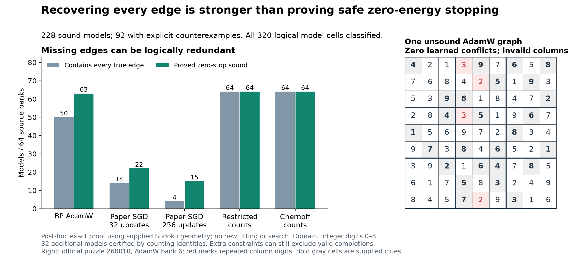

# Missing constraints need not make a zero-energy certificate unsound

**All 320 frozen H4s models now have an exact classification.** A small proof checker certifies 228 as sound for zero-conflict stopping; the remaining 92 have explicit invalid zero-conflict boards. These are logical bank–arm cells, representing 121 distinct supports. This post-hoc diagnosis uses supplied Sudoku geometry and adds no fit, search or fresh statistical test.

| Method | Contains every true edge / 64 | Proved sound / 64 | Explicit unsound witness / 64 |
|---|---:|---:|---:|
| BP AdamW + fixed transform | 50 | **63** | 1 |
| Paper SGD, 32 updates + fixed transform | 14 | 22 | 42 |
| Paper SGD, 256 updates + fixed transform | 4 | 15 | 49 |
| Restricted counts | 64 | 64 | 0 |
| Known-noise Chernoff counts | 64 | 64 | 0 |



Missing a true edge is sufficient to disprove exact graph recovery, but insufficient to establish that an invalid board can have zero energy. **32 sound models are missing one or more true edges.** Their remaining constraints logically imply those edges. Conversely, every unresolved model in this particular collection has an explicit counterexample; the proof procedure is not claimed complete for other graphs.

For AdamW, bank 6 is the only unsound graph. It contains 808 of the 810 true edges, no extras, and accounts for all 838 observed wrong stops. The saved board at official puzzle index 260010 is a concrete witness: it preserves the clues and violates two columns while having zero conflicts on the learned support. The other 13 AdamW models missing true edges are proved sound for **every** assignment of digits 0–8, beyond the tested puzzles.

## Exact counting proof

For a retained-edge graph $F$, the normalized energy is

$$E_F(y)=\sum_{\{i,j\}\in F}\mathbf 1[y_i=y_j],\qquad y\in\{0,\ldots,8\}^{81}.$$

All terms are nonnegative. Thus $E_F(y)=0$ means that every retained pair has distinct digits. If a nine-cell unit forms a clique in $F$, its nine digits are distinct and each digit appears exactly once.

Suppose already certified units satisfy the cell-indicator identity

$$\sum_{U\in\mathcal A}\mathbf 1_U
=\sum_{V\in\mathcal B}\mathbf 1_V+\mathbf 1_C,
\qquad |\mathcal A|=|\mathcal B|+1.$$

For any digit $d$, take the dot product with $\mathbf 1[y_i=d]$. Every known unit contributes one, so $C$ contains $|\mathcal A|-|\mathcal B|=1$ copies of $d$. This holds for all nine digits, proving the target unit is all-different. Its clique edges may then be added to the proof without changing the graph's zero set. Overlapping units are allowed: the checker verifies the full integer indicator identity, including multiplicities.

The producer searches identities from whole-grid row/column/box partitions, each band's rows versus boxes, and each stack's columns versus boxes. Newly implied edges can complete other cliques. The independent checker accepts each step only after its premises have been proved. Certifying all 27 official units proves that every zero-conflict assignment is valid Sudoku. The 32 additional certificates use 48 counting steps; malformed-identity checks reject all 32 corrupted proof fixtures.

This establishes a one-way implication from zero conflicts to Sudoku validity. Extra learned edges may exclude valid Sudoku solutions, and a sound graph may have no compatible solution for a given input. It does not certify every local minimum, any continuous relaxation, or the search's probability of reaching zero energy. It applies to the unit, zero-bias, zero-threshold transformed graphs; it is not a certificate for the raw likelihood weights.

## Public verification and provenance

The compact export includes all 121 supports, all proof traces and 65 distinct invalid witness boards. Logical mappings preserve repeated source models. Support hashes match the existing H4s audit; witness archives are bound to its saved-board hashes. The verifier checks integer digits, clues, valid reference solutions, zero learned conflicts, invalid official units, count identities and aggregate classifications using only NumPy and the public files.

```sh
uv run --with numpy python research/20261114/foureyes/verify_sudoku_soundness.py
```

[Producer](certify_sudoku_soundness.py) · [Independent verifier](verify_sudoku_soundness.py) · [Proofs and witnesses](../../../results/research/foureyes/logical_soundness/certificates.json) · [Supports](../../../results/research/foureyes/logical_soundness/supports.npz) · [Verification receipt](../../../results/research/foureyes/logical_soundness/verification.json) · [Original experiment](REPORT-noisy-pl-long.md)

The rule's mathematical validity received an independent agent review. That review did not independently reconstruct the empirical bank counts; those are checked by the public verifier and hash-bound to the previous saved-state audit.
