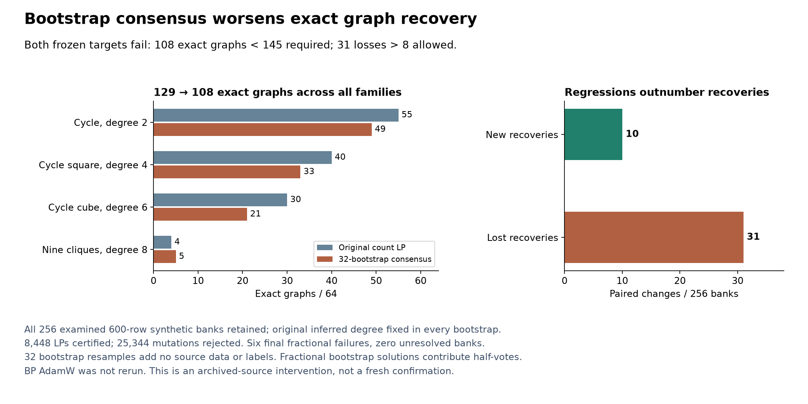

# H4ap: bootstrap consensus loses more graphs than it recovers

**Exact graph recovery falls from 129/256 to 108/256, with ten gains and thirty-one losses.** Both separate frozen targets fail: at least 145 exact graphs were required, and at most eight previously correct graphs could be lost. Every bank is resolved; there are no uncertified cases that could change either decision.



| Estimator | Cycle /64 | Square /64 | Cube /64 | Nine cliques /64 | Total /256 |
|---|---:|---:|---:|---:|---:|
| BP AdamW | Outside this count/LP intervention; not rerun | — | — | — | — |
| Original 600-row count LP | 55 | 40 | 30 | 4 | 129 |
| 32-bootstrap consensus | 49 | 33 | 21 | 5 | 108 |

| Family | New recoveries | Lost recoveries | Final fractional failures |
|---|---:|---:|---:|
| Cycle | 2 | 8 | 1 |
| Cycle square | 2 | 9 | 0 |
| Cycle cube | 2 | 11 | 3 |
| Nine cliques | 4 | 3 | 2 |

This is an intervention on all 256 already examined 600-row banks from [H4an](REPORT-prefix-budget.md), motivated by the [finding that the empirical objective often excludes truth](REPORT-objective-gap.md). It adds no new source examples, labels, corruption or puzzle-solving evidence. The four graph families and their 64 banks each are fixed; no result is filtered or replaced. The one-family increase does not replace either failed aggregate target.

For each bank, the original inferred degree is held fixed. The original procedure selected the correct degree in all these cases, but no new true degree, geometry or family identifier is supplied to estimation. Thirty-two independent bootstrap streams each sample 600 observed noisy rows with replacement. Each resample gets an exact LP at that inferred degree. Certified fractional solutions contribute their literal half-edge weights; they are not rounded or omitted. The sum of the 32 scale-two primal vectors is an integer vote count between zero and 64. A final LP minimizes `64 - votes_twice` at the same degree. This maximizes total bootstrap support under the common-degree constraint.

All 256 index arrays are sealed before any LP runs. The experiment contains **8,192 bootstrap resamples / 4,915,200 sampled row indices**, not new source observations. Distinct per-resample RNG streams and per-LP solver seeds are frozen. A registry check finds no collisions with 17,441 explicit seed values in 297 frozen protocols; it does not claim coverage of undocumented streams or every implied seed formula.

All **8,448 LP certificates** pass independent checks, and **25,344 altered certificates** are rejected. Among bootstrap LPs, 1,299 optima are fractional and remain valid votes. Among final consensus outputs, six fractional optima count as graph-recovery failures; the other 142 failures are integral nonexact graphs. Any uncertified bootstrap would have made its bank unresolved and skipped consensus, with no zero-filled votes or reduced bootstrap denominator. That path was not needed here. The loss decision conservatively includes unresolved banks that were previously successful; there are none.

The independent auditor regenerates every bootstrap index stream, computes counts directly from resampled rows, rechecks the original degree-bound baseline certificate, reconstructs each truth graph from the sealed vertex order, verifies every bootstrap and consensus primal/dual witness, and recomputes all final classifications and paired endpoints. The public replay additionally regenerates the synthetic noisy observations from their parent seeds; original private archives are not required. Raw source hashes and unavailable dependency paths remain explicit in the public verifier output.

Counting uses a bounded optimization: multiplicity weights multiply the per-row binary equality indicators in float64. Every product and nonnegative partial sum is an integer at most 600, exactly representable in binary64; the cast back to integer is also checked. Independent direct row comparisons establish parity on every actual resample. An unrelated toy benchmark, including multiplicity construction, indicators and conversions but excluding common resampling indices, measures **22.41×** median count speedup across three trials (0.002747 versus 0.061566 seconds). The integer matrix path gives 2.83×. These are toy count timings, not whole-experiment speedups.

The complete scientific run, including index sealing, counts, LPs, independent auditing and export, takes **12.588 wall seconds / 91.194 aggregate CPU seconds**, within the frozen 180-wall/900-CPU limits. Eight single-threaded workers handle separate banks. Sixty monitor samples retain live process IDs and forward progress: at 2.478 seconds, 1,301 LPs and 32 bank audits were complete; the final sample records all 8,448 LPs, 256 audited banks and no active workers. No GPU work is used for these CPU linear programs.

```sh
OPENBLAS_NUM_THREADS=1 OMP_NUM_THREADS=1 python research/20261114/foureyes/audit_bootstrap_consensus.py
python scripts/plot_bootstrap_consensus.py
```

[Frozen protocol](bootstrap-consensus.json) · [Prospective design](bootstrap-consensus-proposal.json) · [Toy gates and count benchmark](bootstrap-consensus-preflight.json) · [Seed audit](bootstrap-consensus-seed-audit.json) · [Producer](bootstrap_consensus.py) · [Independent public verifier](audit_bootstrap_consensus.py) · [All counts, draws and certificates](../../../results/research/foureyes/bootstrap_consensus/) · [Figure provenance](../../../assets/figures/bootstrap-consensus-provenance.json)
