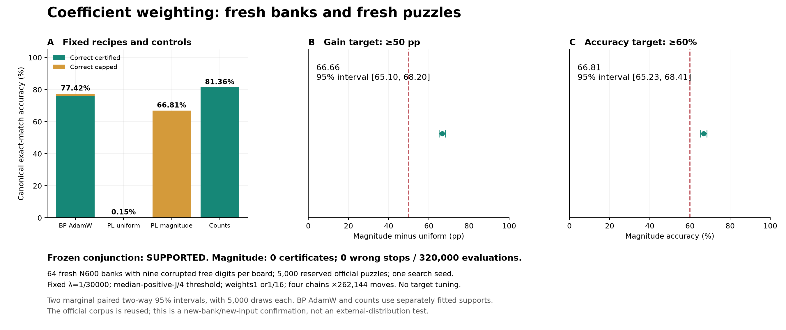

# H4y: fresh confirmation of coefficient-magnitude weighting

**The frozen conjunction is supported.** Across 64 new training banks and 5,000 previously unused official puzzles, fixed magnitude weighting reaches **66.811563%** accuracy, versus **0.151875%** for uniform weights on the same supports. It passes the declared **60% accuracy floor** and **50-point improvement target**. It remains below the separately fitted count and BP AdamW controls.

| Method | Canonical accuracy (%) | Correct certified (%) | Correct capped (%) | Invalid certified stops |
|---|---:|---:|---:|---:|
| BP AdamW, 32 updates + inherited transform | 77.417188 | 76.226250 | 1.190938 | 0 |
| Canonical PL, uniform positive-support weights | 0.151875 | 0 | 0.151875 | 0 |
| Same canonical PL fits, magnitude weights | **66.811563** | 0 | 66.811563 | 0 |
| Restricted-gap counts | **81.360000** | 81.360000 | 0 | 0 |

Magnitude-minus-uniform is **+66.659688 points**, with paired two-way 95% interval **[65.096828, 68.196664]**. Magnitude accuracy has interval **[65.228117, 68.411883]%**. The intervals independently resample banks and shared puzzle indices in 5,000 draws, with seeds 20261116021 and 20261116022. They have separate marginal nominal coverage, not simultaneous coverage.

**All correct magnitude outputs are capped returns; no magnitude or uniform certificates occur.** The observed zero-invalid-stop gate is therefore vacuous for these two arms. Separately, the source audit shows that all true Sudoku edges remain positive in every fitted canonical support, which proves sound exact zero-energy stops for those supports. The weighting intervention preserves the zero set; it does not make additional answers certifiable. BP AdamW's zero observed wrong stops are an empirical result here, not a universal soundness theorem.

## Fixed recipe and fresh scope

The [protocol](canonical_confirm.json), SHA `d41e5ed81487d410f8fd748756e9fc9b99de225f530f70e8718ca78e36ec9810`, was frozen before drawing the new source banks. It retains the [H4x](REPORT-canonical-weights.md) raw penalty **λ=1/30000**, 256 FP64 proximal-gradient updates, unrestricted real pair coefficients, and exact digit-invariant PL. Inference retains $J>0$, sets threshold to one quarter of the median positive coefficient, and uses weight **1 above or at the threshold, 1/16 below it**. There is no tuning on new source structure or target outcomes.

Each bank samples 600 distinct eligible official training rows. Nine distinct free digits per board are changed uniformly to different digits; clues remain unchanged. Source, noise and augmentation RNG bases are 202611340000, 202611350000 and 202611360000. Cross-bank and historical overlap is allowed; 38,233 distinct CSV rows occur in these new draws. An independent audit rereads all selected CSV records, reconstructs corruption, coefficients' objective/gradient and support transforms. Maximum canonical numerical KKT residual is **3.0252×10⁻¹⁵**, not an exact-arithmetic optimum certificate.

Inference uses reserved official rows **[410000,415000)**, shared across all 64 banks, with search seed 0, four chains and 262,144 moves per chain. Unit, temperature, focus and stopping settings remain fixed. All fits are retained. The same full weights, settings and inputs reduce **256 logical cells to 167 unique searches**, preserving logical bank weights. This is a fresh-bank/fresh-input confirmation within the reused official corpus, not an external-distribution test.

BP AdamW has different regularization, finite augmentation and update settings; restricted counts use a different estimator. These controls are descriptive, not matched-training-compute comparisons. Their supports respectively omit 20 true edge-bank pairs and add 40 extras, or recover the exact graph in all 64 draws. Both canonical inference arms retain all true edges but add **7,997 extras**. Magnitude weighting weakens **39 true pairs** and **7,901 extras**, leaving **96 extras strong**. This postfit geometry is never used for assignment or bank filtering.

The original JSON retains an inherited H4w `graph_rule` sentence describing unit weights. A [timestamped clarification](canonical-confirm-protocol-note.json), recorded before weight mapping or inference, identifies the explicit H4y `rule`, four-arm list and frozen implementation as authoritative. It changes no recipe, code, hypothesis or statistic; the original protocol remains intact.

## Verification and cost

Every new search passes 150 general/sparse, 132 hidden-target and six scaled-integer field/energy/focus checks, including 127 moves without refresh. All **835,000 distinct returned boards** are audited for digit domain, clues, Sudoku units, exact-match scoring, energy of every certified stop, model weights and file identities. The audit retains noncanonical-valid-return counts separately.

The four-worker fit queue takes **8.372 seconds**; inference takes **176.699 seconds**, within the frozen 180/360-second ceilings. Charging all four workers for both phases gives a **12.338 GPU-minute upper envelope**, below the 36-minute budget. Independent source validation takes 5.983 seconds; that CPU cost and final audits are separate from GPU phases. Deduplication avoids 89 redundant searches. Live GPU utilization and progress samples are retained in the summary.

The [public-only verifier](verify_canonical_confirm.py) reconstructs all weight assignments, shared trajectory identities, accuracy/certificate/capped counts and both bootstrap intervals, including 16 literal two-dimensional draws per endpoint. Full saved-board and CSV audits require the excluded local archives.

[Summary and provenance](../../../results/research/foureyes/canonical_confirm/summary.json) · [Model arrays](../../../results/research/foureyes/canonical_confirm/models.npz) · [Runner](canonical_confirm.py) · [Independent raw auditor](audit_canonical_confirm.py) · [Figure renderer](../../../scripts/plot_canonical_confirm.py)
