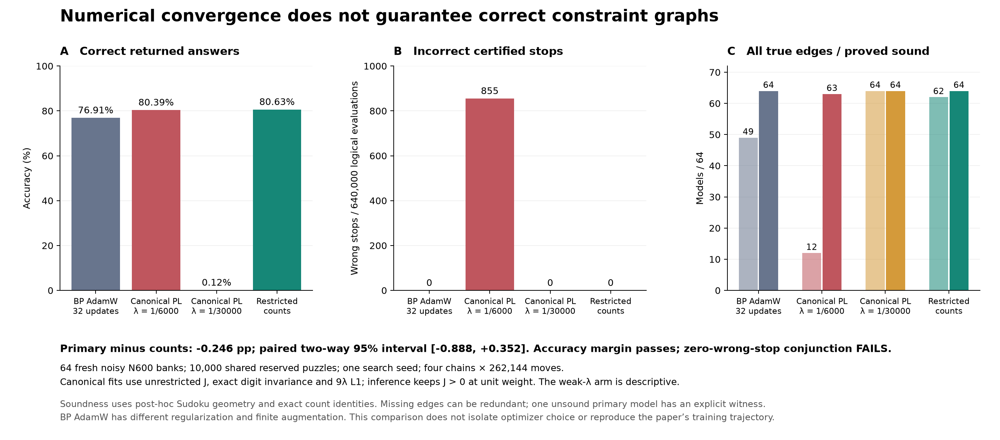

# H4w: convex digit-invariant PL under corrupted training labels

**The frozen conjunction is falsified.** Canonical PL at raw L1 coefficient 1/6000 nearly matches counting in accuracy, but produces **855 incorrect certified stops**, all from bank 32. Its separate 2-percentage-point accuracy noninferiority condition passes. These are fixed finite-budget recipes, not tuned optimizer comparisons.



| Method | Accuracy (%) | Wrong stops / 640,000 logical evaluations | Exact graphs / 64 | All true edges retained / 64 | Zero-stop soundness proved / 64 |
|---|---:|---:|---:|---:|---:|
| BP AdamW, 32 updates + original gap transform | 76.909375 | 0 | 28 | 49 | 64 |
| Canonical PL, raw λ=1/6000, positive support | 80.388281 | 855 | 12 | 12 | 63 |
| Canonical PL, raw λ=1/30000, positive support; descriptive | 0.124688 | 0 | 0 | 64 | 64 |
| Restricted-gap counts | 80.634063 | 0 | 61 | 62 | 64 |

Primary canonical-minus-count accuracy is **−0.245781 points**, with paired two-way 95% bootstrap interval **[−0.887816, +0.351879]**. The lower endpoint exceeds the frozen −2-point margin. Any primary wrong stop nevertheless falsifies the conjunction. The weak-penalty arm is descriptive; no primary claim is made from its accuracy.

## Protocol and scope

The [frozen protocol](canonical_study.json), SHA `5196283d1fbf72f057ea24becd7ab4b4fb0f7b82be6f85ecaafe4b0f38e45e37`, draws 64 fresh N600 source banks from the same eligible official training corpus. Nine uniformly sampled free digits per board are changed to different digits; clues are preserved. Banks are sampled independently without replacement internally; cross-bank and historical overlap is allowed. There are 38,225 distinct selected CSV rows. Fresh research inference uses the same 10,000 official puzzles `[390000,400000)` across all banks and one search seed, not 640,000 distinct puzzles.

Canonical training uses unrestricted real pair coefficients, FP64 proximal gradient, 256 updates and backtracking. The [equivalence argument](CANONICAL_PL.md) applies to the exact all-digit-permutation average with canonical L1 coefficient **9λ**. The new inference transformation retains coefficients strictly above zero and assigns unit weights; training receives no Sudoku geometry. BP AdamW keeps its inherited 32-update settings and largest-positive-gap transform, with different regularization and finite augmentation.

Every arm uses four chains, 262,144 moves per chain, unit weights, zero unary and stop threshold, temperatures .4→.31, focus .45, anneal 524,288 and checks every 4,096. The 256 logical cells collapse to **148 unique searches** by identical support, settings, seed and inputs; logical bank weights are retained in statistics. All 1,480,000 distinct returned boards were independently audited. Uncertainty uses 5,000 paired bank/input bootstrap draws, seed 20261115999.

The source-only design gates and failed raw weak-penalty experiment remain in [the derivation and gate history](CANONICAL_PL.md). An inherited `limits` sentence in the frozen JSON mentions a Chernoff control; **H4w has no Chernoff arm**. The explicit four-arm list and measured rows above are authoritative. The protocol is retained unchanged.

## What the failures establish

Across bank-edge pairs, primary canonical supports omit 118 true constraints and add no extras. The weaker penalty retains all true constraints but adds **8,016 extra constraints**; unit-weight inference almost never solves. BP AdamW omits 18 true constraints and adds 44 extras. Restricted counts omit two and add one. Missing true edges alone do not prove unsoundness: other constraints can imply them.

A post-hoc diagnostic supplies Sudoku geometry and checks exact clique/count identities. It proves sound zero stops for **255 of 256 logical models**, including 51 primary models missing true edges. The remaining primary model has an explicit invalid zero-energy board, verified with integer digits, clue preservation and all retained edge constraints. These are one-way soundness proofs; extra constraints can still exclude valid solutions. [Proofs and witness](../../../results/research/foureyes/canonical_study/certificates.json) · [Independent public verifier](verify_canonical_study.py)

An independent source auditor rereads the CSV, recreates corruption, reconstructs every support, and recomputes canonical losses and gradients in NumPy. The largest numerical KKT residual is **3.7537×10⁻¹⁵**. This supports numerical stationarity; it is not an exact-arithmetic optimum certificate and does not make extracted graphs correct.

Four-worker fit time is **12.431 seconds**; search queue time is **260.844 seconds**, below their 180/270-second ceilings. Charging all four workers for both complete phases gives an **18.219 GPU-minute upper envelope**, within the 30-minute budget. Source audits, earlier gates and publication checks are separate CPU/experimental costs. Live utilization and completion counters are retained in the summary. Reusing identical searches avoids 108 redundant jobs.

## Rerun and verify

With the pinned upstream environment and prepared data:

```sh
upstream/.venv/bin/python research/20261114/foureyes/canonical_study.py prepare
upstream/.venv/bin/python research/20261114/foureyes/canonical_study.py launch-fit
upstream/.venv/bin/python research/20261114/foureyes/audit_canonical_study.py sources
upstream/.venv/bin/python research/20261114/foureyes/canonical_study.py map
upstream/.venv/bin/python research/20261114/foureyes/canonical_study.py launch-search
upstream/.venv/bin/python research/20261114/foureyes/audit_canonical_study.py outcomes
```

These commands require the hash-pinned local input/gate archives and a fresh output directory; they intentionally refuse to overwrite completed evidence. From public exports alone:

```sh
python research/20261114/foureyes/verify_canonical_study.py
python scripts/plot_canonical_pl.py
```

The public checker reconstructs support selection, graph counts, all 256 outcome mappings, accuracy and wrong-stop counts, the complete interval, 16 literal bootstrap draws, and all exact proof/witness checks. Full board audits need excluded raw archives. [Summary](../../../results/research/foureyes/canonical_study/summary.json) · [Compact model arrays](../../../results/research/foureyes/canonical_study/models.npz)
