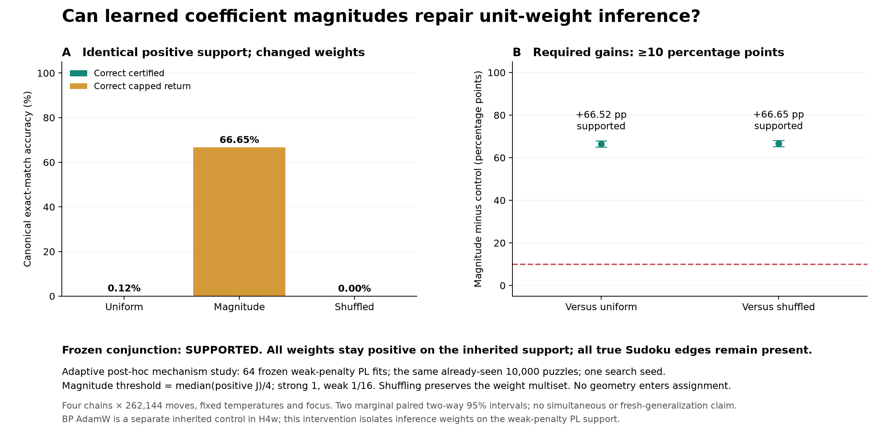

# H4x: coefficient magnitudes repair much of the unit-weight failure

**Both frozen ≥10-point improvement targets are supported.** On the 64 inherited weak-penalty H4w likelihood fits, coefficient-derived weights raise canonical exact-match accuracy from **0.124688% to 66.646406%**. Shuffling those same weights gives **0.000938%**. This is an adaptive, post-hoc mechanism study using the **same already-seen 10,000 puzzles**, not fresh generalization evidence.

| Method | Canonical accuracy (%) | Correct certified (%) | Correct capped (%) | Invalid certified stops |
|---|---:|---:|---:|---:|
| BP AdamW, inherited H4w control; different fitted support | 76.909375 | 75.652187 | 1.257187 | 0 |
| Restricted counts, inherited H4w control; different fitted support | 80.634063 | 80.605312 | 0.028750 | 0 |
| Weak-penalty PL support, uniform weights | 0.124688 | 0.000156 | 0.124531 | 0 |
| Same support, coefficient-magnitude weights | **66.646406** | 0.000156 | 66.646250 | 0 |
| Same support, shuffled magnitude weights | 0.000938 | 0 | 0.000938 | 0 |

The comparison isolates weight placement within the last three rows. The first two are separately fitted controls from [H4w](REPORT-canonical-study.md), not matched-support arms or new runs. Magnitude weighting still falls below the count control.

Magnitude minus uniform is **+66.521719 points**, with paired two-way 95% interval **[65.126609, 67.912234]**. Magnitude minus shuffled is **+66.645469 points**, interval **[65.238590, 68.027098]**. Both lower endpoints exceed the frozen ten-point target, and no invalid certified stops occur. These are separate marginal bootstrap intervals, not simultaneous intervals or correction for the adaptive selection of this study. Absolute accuracy is descriptive; no accuracy-floor hypothesis was declared.

## Frozen intervention

The [protocol](canonical_weights.json), SHA `220f4b5646a6197dd7d22c482ed631eda8b58bf5dd4d8efbd4eac5d6f0876918`, was frozen before constructing these weights or observing intervention outcomes. It inherits the 64 canonical PL fits at raw λ=1/30000. Each fit used 600 noisy training boards, 256 FP64 proximal-gradient updates and the exact digit-invariant parameterization.

For each coefficient vector $J$, compute $t=\operatorname{median}(J[J>0])/4$. Give retained pairs weight **1 if $J\geq t$**, and **1/16 otherwise**. Absent pairs stay absent. A separately seeded permutation shuffles these weights only over retained positions. No Sudoku geometry or puzzle label enters either assignment; there is no threshold sweep or per-model temperature rescaling.

The independent source audit checks all 192 weight vectors, the median boundary, exact shuffle identities, supports and hashes. As a postfit geometric diagnosis, the magnitude rule weakens **42 true edge-bank pairs** and **7,921 of 8,016 extra edge-bank pairs**; **95 extras remain strong**. Every true edge remains positive. Thus every arm has the same zero set and sound exact zero-energy certificates. Almost all observed gains are positive-energy capped returns: uniform and magnitude each have only **one correct certified return among 640,000 logical evaluations**, while shuffled has none. This is not an increase in certifiable solution capacity, nor a guarantee that capped outputs are correct.

## Search and independent checks

All arms use the same 10,000 puzzles `[390000,400000)`, seed 0, four chains, 262,144 moves per chain, temperatures .4→.31, focus .45, anneal 524,288 and check interval 4,096. Unary terms, stopping threshold and reference energy remain zero; tolerance is .001 and the strong penalty unit remains one.

The 64 uniform trajectories are inherited. Their restart-disabled capture class and the weighted runner's capture class are **exactly AST-identical after removing only the disabled restart branch/assertion**; the sparse classes also have identical ASTs. The frozen checker retains both source hashes and confirms this equivalence. No duplicate baseline search is charged as new evidence.

Every new weighted search checks 150 general/sparse state comparisons, 132 hidden-target comparisons and six independent scaled-integer field/energy/focus checks, including 127 moves without refresh. All **1,920,000 returned boards** from 192 distinct searches were independently audited, including **1,280,000 newly computed boards**. Checks cover digit domain, clues, full Sudoku units, exact-match scoring, stop energy, saved model weights and artifact hashes.

Uncertainty resamples the 64 banks and the common 10,000 puzzle indices in 5,000 paired two-way draws. Seeds are 20261116011 and 20261116012 for the two contrasts. The [public-only verifier](verify_canonical_weights.py) independently reconstructs assignments and mappings, checks inherited outcome identity, reproduces both intervals, and compares 16 literal two-dimensional bootstrap draws for each endpoint.

The four-worker queue completed all 128 new searches in **297.967 seconds**. Charging all four GPUs for the complete phase gives a **19.864 GPU-minute upper envelope**, below the frozen 30-minute limit. Preflight checks and saving outputs are included; source preparation, outcome audits and prior H4w fitting/search are separate costs. Live utilization and completion counters are retained. No new source data, labels or official test rows were consumed.

[Measurements and full receipts](../../../results/research/foureyes/canonical_weights/summary.json) · [Runner](canonical_weights.py) · [Independent raw audit](audit_canonical_weights.py) · [Public verifier](verify_canonical_weights.py) · [Figure source](../../../scripts/plot_canonical_weights.py)
