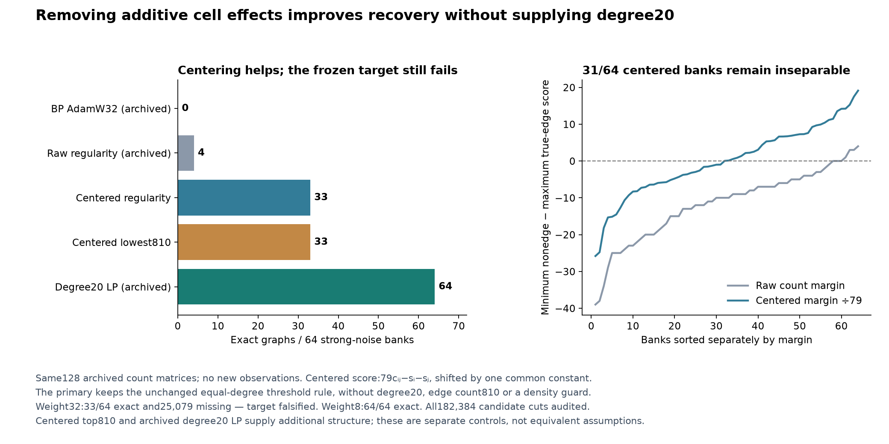

# H4ai: additive cell correction helps but does not replace a supplied degree

**The frozen target is falsified: centered equal-degree thresholding recovers 33/64 strong-noise graphs, with 25,079 missing and no extra edge-bank pairs.** The paired weight-eight control remains 64/64 exact. The adjustment improves on the archived raw threshold's 4/64 exact graphs; the archived degree-20 LP still recovers 64/64 on the same strong-noise observations.

| Estimator | Weight 8 exact / 64 | Weight 32 exact / 64 | Weight 32 missing / extra | Evidence |
|---|---:|---:|---:|---|
| BP AdamW, 32 updates | 9 | 0 | 20,248 / 0 | Archived H4ag |
| Canonical PL, 256 updates | 0 | 0 | 8,121 / 0 | Archived H4ag |
| Raw restricted count gap | 31 | 0 | 20,551 / 0 | Archived H4ag |
| Raw equal-degree threshold | 64 | 4 | 36,413 / 11 | Archived H4ag |
| Raw lowest-count 810 pairs | 64 | 4 | 127 / 127 | Archived H4ah |
| Degree exactly twenty, LP | 64 | 64 | 0 / 0 | Archived H4ah |
| Centered equal-degree threshold | **64** | **33** | **25,079 / 0** | New primary |
| Centered lowest-score 810 pairs | 64 | 33 | 37 / 37 | New cardinality control |

For each cell i, let sᵢ be the sum of its eighty off-diagonal equality counts. Compute the exact integer residual `rᵢⱼ = 79cᵢⱼ − sᵢ − sⱼ`, then subtract the minimum residual from every pair. The common shift only makes scores nonnegative for the inherited selector; it changes no ordering, gaps or threshold supports. This is proportional, up to a common constant, to the least-squares residual after fitting additive cell effects. If counts change by `bᵢ + bⱼ`, every residual changes by the same constant, so shifted scores remain identical. These algebraic identities are exact. The adequacy of additive effects as a model of the actual concentrated corruption is the hypothesis being tested.

The primary selector is unchanged: all distinct scores at or below their median are candidates; minimize `81 * sum(degree²) − sum(degree)²`, breaking ties by fewer edges then lower score. Equal degree is supplied as a structural prior. Neither degree twenty, edge count 810, geometry nor a minimum-density guard enters the primary scores or selection. The centered top-810 control explicitly supplies cardinality and breaks score ties by pair index.

Exactly the 33 recovered strong-noise banks admit a separating centered score threshold. The other 31 do not; their selected graph has **one edge each**, accounting for `31 × 809 = 25,079` missing edges. No separable bank is lost through threshold selection. Centered strong-noise margins range from −2,040 to +1,510 in integer score units, while all weaker-noise margins are positive, from +1,312 to +4,542. The figure divides centered margins by 79 for comparison with the original count scale. Top-810 makes only 37 missing/extra pairs across the 31 failing banks, showing how severely the unguarded dispersion objective can collapse when exact separation fails. No guard is added after seeing this result.

The frozen strong-noise endpoint requires at least 61/64 exact graphs **and zero missing true edges across all 64 banks**. Both fail. Every bank, sparse graph and candidate remains included. The weaker-noise control uses the same numerical criterion descriptively. These finite decisions are not population confidence bounds. No claim that all degree-free estimators must fail follows from this result.

This is a prospectively frozen adaptive follow-up on all 128 already examined H4ag count matrices. H4ah's successful supplied-degree repair motivated it. No new source identities, corruptions, labels, optimizer fits or puzzle inputs are introduced. Earlier optimizer recipes have different objectives and compute budgets and are labeled as archived controls, without an optimizer-superiority claim.

Six synthetic cases at four, eleven and 81 cells check literal off-diagonal sums, exact additive-cell invariance, independent least-squares residual agreement, constant and tied counts, and every candidate and tie break. The raw source selector remains byte-identical. The independent outcome auditor reconstructs scores with Python integer sums and maintains the sum of squared pairwise degree differences incrementally, separately from the production dispersion formula. It verifies all **182,384 candidate cuts**, their degrees, minimum ties, selected supports, source hashes and final error counts. Constant weighted row sums after centering are independently checked.

Candidate tables are retained as compressed int64 arrays with per-bank offsets, about 2.35 MB, avoiding a large repetitive JSON export. Scores, row sums, supports and selected records are also public. Selection takes **2.643321 wall seconds**; the independent audit takes **0.916792 wall / 0.916751 CPU seconds**. The complete monitored run takes **3.816236 wall / 3.674921 aggregate CPU seconds**, below the frozen 30-second selection, 120-second audit and 240 CPU-second ceilings. No GPU work is eligible for this count transformation. Synthetic preparation, plotting and later public replay are separate costs.

Run `upstream/.venv/bin/python research/20261114/foureyes/audit_centered_regularity.py` for the complete portable integer-score/candidate replay. No raw training archive, solver or GPU is required.

[Frozen protocol](centered_regularity.json) · [Study and synthetic gate](centered_regularity_study.py) · [Independent public audit](audit_centered_regularity.py) · [All results and compact candidates](../../../results/research/foureyes/centered_regularity/) · [Supplied-degree repair](REPORT-intensity-degree.md)
