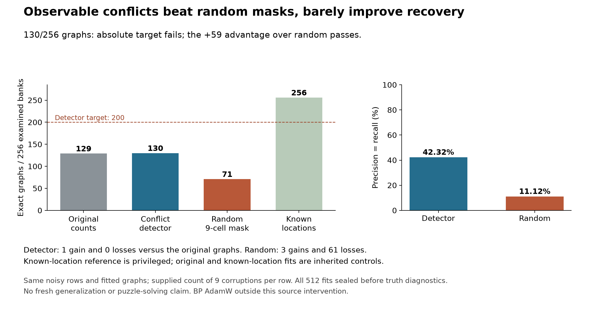

# H4av: observable conflicts do not reproduce the privileged-mask gain

The conflict detector recovers **130/256 graphs**, compared with **129/256** from original noisy counts and **71/256** from random masks. Its absolute target of at least 200 recoveries is **falsified**. The separate target of at least 32 additional recoveries versus random is **supported**, with a net advantage of 59. No output is unresolved.

| Method | Exact graphs | Integral nonexact | Fractional | Unresolved |
|---|---:|---:|---:|---:|
| BP AdamW | Outside this structural intervention; not run | — | — | — |
| Original noisy counts, inherited | 129/256 | See parent evidence | See parent evidence | 0 |
| Observable conflict detector | 130/256 | 122 | 4 | 0 |
| Uniform random nine-cell mask | 71/256 | 167 | 18 | 0 |
| Complete known corruption locations, inherited privileged reference | 256/256 | 0 | 0 | 0 |



This is an examined-cohort intervention on all 256 existing 600-row synthetic-family banks. The detector uses the original graph fitted to the same noisy observations, including literal half-integral weights. It receives the supplied count of nine corruptions per row. It does not receive true corruption locations, clean digits, hot cells or true graph structure. No source rows, labels, noise or puzzles are newly acquired.

## Frozen experiment and information boundary

The [proposal](conflict-mask-proposal.json), [seed audit](conflict-mask-seed-audit.json), and independently replayed [synthetic preflight](conflict-mask-preflight.json) precede the [frozen protocol](conflict-mask.json), SHA256 `26122b3bf31aa2c0459d9a5226a01098b32185d43cf087073e73d2d61af5bc2c`.

For every row and cell, sum the original fitted `primal_twice` weights to other cells displaying the same digit. Flag the nine largest conflict scores, breaking exact ties by increasing cell index. The random arm chooses nine distinct cells uniformly per row. Both discard pair observations involving flagged cells, retain raw equality counts without exposure normalization or smoothing, and refit the original inferred common degree. No iterative refit or outcome-based selection occurs. Zero-exposure pairs would retain zero cost.

Random-mask streams are PCG64 with seed `2120200000 + bank`, and solver seeds are `2120231702 + 2*bank + arm`, for 256 banks and detector/random arms 0/1. The 768 seeds are disjoint from recorded explicit frozen seed fields and expanded H4at/H4au solver ranges. The audit does not expand every historical formula or establish pseudorandom-stream independence.

Fit workers lazily decode only noisy observations and the selected original primal. All **512 fit outputs, receipts and detector scores are sealed together** before audit workers load actual masks and geometry. The [public seal](../../../results/research/foureyes/conflict_mask/fit-seal.json) binds every fit; each bank's audit-order receipt follows the seal. Parent observations and both inherited certificates are independently replayed after sealing. No diagnostic feeds back into fitting.

## Separate decisions and diagnostics

| Prespecified endpoint | Observed interval | Threshold | Decision |
|---|---:|---:|---|
| Detector exact count | [130, 130] | At least 200 | Falsified |
| Detector minus random exact count | [59, 59] | At least 32 | Supported |

Uncertified outputs would widen these bounds and remain in the denominator. Literal fractional optima are resolved graph failures. The detector gains bank 118 and loses none of the 129 original successes; its four fractional results are banks 15, 46, 122 and 238. Random masking gains banks 14, 16 and 140 while losing 61 original successes. Every failure appears in the [complete summary](../../../results/research/foureyes/conflict_mask/summary.json).

| Family, 64 banks each | Original | Detector | Random |
|---|---:|---:|---:|
| Cycle | 55 | 55 | 46 |
| Cycle square | 40 | 40 | 19 |
| Cycle cube | 30 | 31 | 6 |
| Nine-clique union | 4 | 4 | 0 |

Each arm flags 1,382,400 locations, equal to the actual corruption count. Detector precision and recall are both **42.3176%**, with 584,998 true positives and 797,402 false positives/false negatives. Random precision and recall are **11.1152%**, with 153,656 true positives. These are post-fit diagnostics. The detector improves location quality over random but preserves nearly all original graph errors.

Pair exposures range from 7 to 600 under the detector and 424 to 519 under random masks. Neither has a zero-exposure pair, and none of their raw never-equal supports is exact. Fixed mask size does not match per-cell frequencies, pair exposures or dependence on fitted errors. The control therefore does not isolate all possible mechanisms.

## Validation, performance and replay

The independent audit reconstructs conflict scores with a dense equality tensor, checks Python tuple sorting against the producer's stable sort, replays random choices by set membership, and recomputes counts via independent per-pair row selection. It verifies **512 new plus 512 inherited exact certificates** and rejects **3,072 altered proofs** in total. It retains all 512 new LP outputs and original floating-point values, verifying exact scale-two witnesses without rounding graph edges.

Synthetic gates include scalar/dense/sparse parity, integral and fractional weights, digit/vertex score permutations, exact ties, malformed inputs, random-mask replay, complete censoring, positive-objective and fractional certificates, endpoint boundaries, missing/early/repeated seals and post-seal tampering. The unchanged gate was independently replayed before freeze without accessing cohort masks or scores.

An unrelated 600×81 degree-eight fixture measured median sparse scoring at **0.916 ms**, versus **3.001 ms** for dense scoring, a 3.28× kernel improvement with identical outputs. This is not a complete-study speedup claim. Eight fit workers and then eight audit workers complete the charged experiment in **5.310803 wall seconds / 36.787391 aggregate CPU seconds**, below the frozen 120-wall/600-CPU ceilings, using no GPUs. The [runtime counters](../../../results/research/foureyes/conflict_mask/runtime.json) advance through 101, 243, 378, 500 and 512 LPs, then all 256 bank audits. The separate external process check occurred after the short run completed; the persistent monitor records the active worker PIDs and CPU progress.

From the repository root, with NumPy and the pinned HiGHS environment available:

```sh
OPENBLAS_NUM_THREADS=1 OMP_NUM_THREADS=1 MKL_NUM_THREADS=1 \
  artifacts/degree-lp-venv/bin/python research/20261114/foureyes/audit_conflict_mask.py
```

The audit reads public sources and results only; its interpreter path is local setup, not a required artifact input. All scientific outputs are available under [conflict_mask](../../../results/research/foureyes/conflict_mask/); inherited observations and controls are under [corruption_censor](../../../results/research/foureyes/corruption_censor/). See the [rerun guide](../../../docs/RERUN_GUIDE.md) for environment setup.

The result rejects this particular one-pass detector's absolute recovery target. It does not show that corruption detection is impossible, that random masking is a useful baseline estimator, or that the privileged-mask result generalizes to observable masks. No new puzzle-solving or fresh-generalization claim is made.
