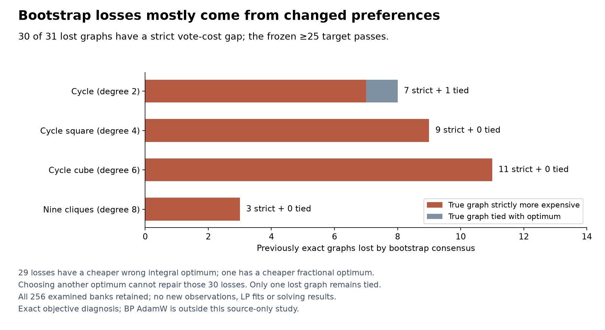

# H4aq: vote-cost gaps explain thirty of the thirty-one lost graphs

**The true graph is strictly more expensive than the consensus optimum in 30/31 previously correct graphs lost by bootstrap voting.** The frozen target of at least 25 strict gaps is supported. Only one lost graph leaves truth co-optimal. This explains a mechanism of the [failed bootstrap intervention](REPORT-bootstrap-consensus.md); it does not improve its 108/256 recovery or replace either of its failed targets.



| Diagnostic group | Lost baseline successes | Truth strictly suboptimal | Truth co-optimal | Strict losses with wrong integral optimum |
|---|---:|---:|---:|---:|
| BP AdamW | Outside this source-only diagnostic; not rerun | — | — | — |
| Cycle, degree 2 | 8 | 7 | 1 | 7 |
| Cycle square, degree 4 | 9 | 9 | 0 | 9 |
| Cycle cube, degree 6 | 11 | 11 | 0 | 10 |
| Nine cliques, degree 8 | 3 | 3 | 0 | 3 |
| Total | 31 | 30 | 1 | 29 |

The sole remaining strict loss has a fractional optimum. Choosing a different optimum of the same vote-cost LP cannot recover any of the thirty strictly excluded truths. For twenty-nine, a wrong **integral** graph already beats truth, so imposing integrality alone cannot repair them either. A zero gap means truth is one optimum; it does not prove uniqueness or guarantee that the solver will choose it. This diagnosis does not establish that the observations are insufficient for every possible estimator.

The 31 lost baseline successes were fixed by H4ap before this diagnostic was proposed. Their gap threshold was frozen before calculating true-graph vote costs. All 256 banks remain in the exported rows, including the ten new recoveries and all other failures. Descriptively, 147 of the 148 total consensus failures strictly exclude truth; every exact consensus output has zero gap. These are examined synthetic banks, with no new source observations, bootstrap resamples, label queries, LP optimization or puzzle-solving evidence.

For every bank, the producer reconstructs the final cost as `64 - sum(primal_twice)` over all 32 archived bootstrap LPs, including their fractional half-votes. It verifies the final and original selected-degree baseline primal/dual certificates and the true graph's degree feasibility. The exact doubled gap is `2 * sum(cost on true edges) - sum(cost * consensus_primal_twice)`. Integer arithmetic avoids numerical tie thresholds. The independent verifier reconstructs each true graph from its sealed vertex ordering, recomputes the vote sum with Python integers, checks all baseline/consensus classifications and rejects three altered versions of each proof.

All **512 baseline/consensus certificates** pass and **1,536 mutated certificates** fail. The 8,192 bootstrap proofs and their observation provenance inherit H4ap's complete public replay, which passed before this design was frozen; they are not counted as newly audited here. The frozen source and input hashes bind every parent model, receipt, per-bank audit, graph and summary used in the diagnosis. The public verifier needs no private data.

The complete diagnostic takes **6.855 wall seconds / 6.855 aggregate CPU seconds**, including hash checks, export and the first independent auditor with all mutations, within the frozen 90-wall/60-CPU limits. Producer and auditor run sequentially. Each compressed model member is loaded once before summation, avoiding repeated decompression in the independent loop. Synthetic gates check exact gaps above binary64 integer precision, co-optimal truths, infeasible truths, altered proofs, vote-reduction parity and the 24/25 decision boundary. Later publication replays are outside this scientific timing. Zero GPU work is used.

```sh
OPENBLAS_NUM_THREADS=1 OMP_NUM_THREADS=1 python research/20261114/foureyes/audit_consensus_gap.py
python scripts/plot_consensus_gap.py
```

[Frozen protocol](consensus-gap.json) · [Prospective design](consensus-gap-proposal.json) · [Synthetic gate](consensus-gap-preflight.json) · [Parent full replay](consensus-gap-parent-audit.json) · [Producer](consensus_gap.py) · [Independent verifier](audit_consensus_gap.py) · [All 256 gap rows](../../../results/research/foureyes/consensus_gap/rows.json) · [Summary](../../../results/research/foureyes/consensus_gap/summary.json) · [Charged audit](../../../results/research/foureyes/consensus_gap/independent-audit.json)
