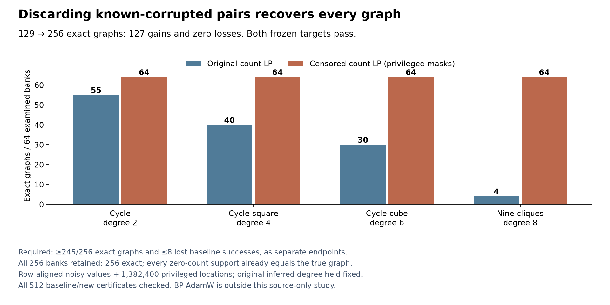

# H4at: discarding known-corrupted observations recovers every graph

**All 256 examined graphs are recovered, versus 129/256 from raw noisy counts.** The fixed censoring rule gains 127 recoveries and loses none. Both separate targets pass: at least 245 exact graphs and no more than eight lost baseline successes. This result requires supplied corruption locations.



| Estimator | Cycle /64 | Square /64 | Cube /64 | Nine cliques /64 | Total /256 |
|---|---:|---:|---:|---:|---:|
| BP AdamW | Outside this source intervention; not rerun | — | — | — | — |
| Original noisy-count LP | 55 | 40 | 30 | 4 | 129 |
| Censored-count LP with privileged masks | 64 | 64 | 64 | 64 | 256 |

The four families gain nine, 24, 34 and 60 recoveries respectively, with zero losses, fractional outputs or unresolved banks. **Every zero-count support already equals its true graph**, with no missing or extra edges. Thus the LP is unnecessary for these realized supports: the supplied masks let the simple never-equal rule recover the graph directly. This support observation is a prespecified diagnostic, not an additional fitted control or an independently measured runtime comparison.

The intervention uses all 256 examined [H4an](REPORT-prefix-budget.md) banks, their original 600 noisy rows and original inferred degrees. It receives the same **1,382,400 privileged corruption-location indices** used by [H4as](REPORT-oracle-attenuation.md), defining 12,441,600 Boolean entries. Unlike H4as's aggregate-count input, censoring also needs the existing observations aligned by row. Neither clean digits nor actual offsets enter the scorer. No new source observations, noisy labels, corruption draws or puzzle solves are collected.

For each cell pair, retain a row only when neither cell was corrupted. Its integer LP cost is the number of equal digits among retained rows:

```text
available_rij = (not corrupted_ri) AND (not corrupted_rj)
exposure_ij = sum_r available_rij
cost_ij = sum_r available_rij * I(noisy_ri = noisy_rj)
```

There is no exposure normalization, smoothing, imputation or pair deletion. A zero-exposure pair would remain with cost zero. In this run every pair has 135–597 retained observations; there are no zero-exposure pairs. One common-degree LP is fitted per bank at the earlier inferred degree, with unchanged exact scale-two primal/dual certification and no graph rounding.

With correct masks, retained observed digits equal their original clean values. True exclusion edges therefore have zero retained equality count. Since the true graph is feasible at the fixed correctly inferred degree and all costs are nonnegative, the optimum must be zero. **That conditional property does not establish uniqueness or recovery.** Preflight includes two distinct degree-one graphs with identical zero objective, and false zero-cost edges, to check this distinction. The observed absence of false zero-cost edges in all 256 study banks is what makes their supports identify truth here.

The previous supplied-mask attenuation correction recovered only 88/256 on this cohort. Censoring succeeds with those same known locations but a different observation interface and estimator. This establishes utility of this specified privileged-information procedure on examined inputs. It does not show that masks can be learned from noisy data, establish an oracle-optimal bound, isolate estimator variance as the cause, or provide fresh generalization or puzzle-solving evidence.

All **256 new and 256 baseline certificates** pass exact independent checks; **1,536 mutated proofs** are rejected. The auditor reconstructs the full original 2,400-row mask-selection stream before taking the 600-row prefix, verifies source mappings and raw archive hashes, reconstructs ordinary equality counts from the exported noisy observations, and recomputes retained counts by selecting rows separately for every pair. The producer instead uses dense pair arrays. True graphs are reconstructed only for post-fit diagnostics and endpoint evaluation. Any violation of the conditional true-edge or zero-objective invariant would make the study incomplete.

Every noisy row, corrupted index, Boolean mask, exposure, cost and proof is public. The portable checker can therefore repeat both ordinary and censored count construction without the raw parent archives. Original clean-source generation and corruption provenance remain inherited from the parents' complete audits and hash-bound archives; a public replay does not claim to repeat those generators. Unavailable raw archives are reported explicitly.

Before freeze, synthetic tests covered all/none/mixed corruption, unchanged values, zero exposures, malformed indices, vertex and digit permutation invariance, full-stream mask replay, distinct zero-cost regular optima, zero/positive LP certificates, and resolved/unresolved boundaries for both endpoints. Ripper independently reviewed the source and replayed the gate in an isolated copy. On the unrelated 600×81 fixture, dense construction took 2.45 ms versus 3.35 ms for blocked construction, so dense construction was retained. The independent pair-row audit took 14.84 ms versus 317.16 ms for literal Python loops. These are preparation microbenchmarks, not complete-study speedups.

The complete scientific run takes **2.852 wall seconds / 18.968 aggregate CPU seconds**, including hashes, extraction, counts, LPs, independent audits and export, within the frozen 90-wall/300-CPU limits. Eight single-threaded workers advance from 17 LPs/16 audits at 0.481 seconds to 42/38 at 0.683 seconds and 66/58 at 0.885 seconds. No GPU work is required. Separate full root and Ripper replays pass in 1.860 and 1.833 seconds.

```sh
OPENBLAS_NUM_THREADS=1 OMP_NUM_THREADS=1 python research/20261114/foureyes/audit_corruption_censor.py
python scripts/plot_corruption_censor.py
```

Protocol SHA-256: `264601ab596d87db9a145e66143f5fd9d2ccbb603b408ac7dbea205acb097ae7`.

[Frozen protocol](corruption-censor.json) · [Prospective design](corruption-censor-proposal.json) · [Preflight](corruption-censor-preflight.json) · [Seed audit](corruption-censor-seed-audit.json) · [Scorers](corruption_censor_math.py) · [Runner](corruption_censor.py) · [Independent verifier](audit_corruption_censor.py) · [All observations, masks and certificates](../../../results/research/foureyes/corruption_censor/) · [Summary](../../../results/research/foureyes/corruption_censor/summary.json) · [Runtime](../../../results/research/foureyes/corruption_censor/runtime.json)
