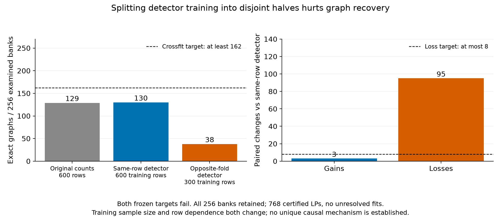

# H4ax: opposite-half conflict masks lose graph recoveries

Cross-fitting the conflict detector recovers **38/256 graphs**, versus **130/256** for the inherited full-data detector. It gains three graphs and loses 95 of the detector's successes. Both prespecified targets are **falsified**: at least 162 exact graphs and at most eight losses. Every bank remains in the denominator; no LP is unresolved.

| Method | Exact graphs / 256 | Scope |
|---|---:|---|
| BP AdamW | Not run | Outside this structural graph-inference intervention |
| Original equality counts | 129 | Inherited 600-row reference |
| Same-row observable conflict detector | 130 | Inherited paired comparator; graph fitted on 600 rows |
| Opposite-half conflict detector | 38 | New intervention; each detector graph fitted on 300 rows |
| Uniform random nine-cell mask | 71 | Inherited H4av reference |
| Supplied full true-corruption mask | 256 | Inherited privileged reference |



## Frozen method and separate decisions

The [prospective design](crossfit-conflicts-proposal.json), [synthetic gate](crossfit-conflicts-preflight.json) and [seed audit](crossfit-conflicts-seed-audit.json) precede the [protocol](crossfit-conflicts.json), SHA256 `8ccd9a5067ddc232bc96c71dfa45e981a5342ec83aa34d294f1f726ea0184e2d`. An independent agent reviewed the sources and replayed the gate in an isolated copy before any fold fit or new mask.

All 256 examined banks retain their original 600 noisy rows and inferred degree. Fit one raw equality-count degree-constrained LP on rows 0–299 and another on rows 300–599. Each graph scores only the opposite half: for each cell, sum literal twice-primal weights to same-digit neighbors. Flag exactly nine cells per row, using increasing cell index to break score ties. The supplied per-row corruption count remains a prior; no true corruption locations or graph geometry enter production. Censor observations involving either flagged cell, and fit one final LP using all 600 target rows. Costs are raw retained equality counts, including zero for zero exposure; there is no normalization, smoothing or integrality snapping.

All **512 fold outputs are sealed before any crossfit mask is constructed**. All **256 final outputs are sealed before ground-truth or corruption-mask diagnostics**. A certified fractional donor is valid. If either fold were uncertified, both attempts would be retained and the final fit would be explicitly skipped, leaving that bank unresolved in both endpoint bounds. Synthetic tests cover every fold-certification combination and forbid any final solver call for unresolved donors.

| Prespecified endpoint | Observed bound | Decision |
|---|---:|---|
| At least 162 exact final graphs | [38, 38] | Falsified |
| At most 8 losses among 130 detector successes | [95, 95] | Falsified |

The final outputs contain **189 integral nonexact** and **29 fractional** failures. Of the 218 failures, 217 strictly exclude truth under the integer objective; one has a zero truth-cost gap. Exact optima do not imply unique optima. Relative to the original count estimator, the intervention has three gains and 94 losses.

| Graph family | BP AdamW | Crossfit exact / 64 |
|---|---|---:|
| Cycle | Not run in this intervention | 25 |
| Square of cycle | Not run in this intervention | 12 |
| Cube of cycle | Not run in this intervention | 1 |
| Nine cliques | Not run in this intervention | 0 |

Only **25/512 fold graphs** are exact; 408 are integral nonexact and 79 fractional, all certified. The masks contain 558,651 true positives and 823,749 false positives, giving both precision and recall **40.4117%**, versus the inherited detector's 42.3176%. All 1,382,400 flags and every row's nine-cell count are retained. Per-bank fold statuses, costs, graph errors, exact truth gaps, mask frequencies and exposure counts are in the [summary](../../../results/research/foureyes/crossfit_conflicts/summary.json).

## Verification and resources

The charged run completes **768 LPs** in **9.291784 wall seconds / 64.783232 aggregate CPU seconds**, below 120 wall / 600 CPU seconds with eight workers and no GPU computation. It records 47 live phase/counter samples: all 768 fits finish before audits begin; all 256 audits complete before export. The external root sample arrived after completion, so it independently confirms termination and final counters rather than active CPU utilization. Aggregate process CPU and the internal monitor supply the execution evidence; no GPU utilization is claimed.

Independent checking verifies **768 new plus 1,024 inherited exact certificates**, with **5,376 rejected mutations** in total. It reconstructs half-row costs, opposite-fold scores and masks, final censored costs, inherited comparisons, graph truth and every endpoint. It also verifies both complete seals, source hashes, exact solver seeds, literal half-integrality, cost/objective agreement and every output receipt. Root and independent-agent public replays pass in 6.373 and 6.990 seconds respectively.

The independent per-pair count implementation uses vector row equality after a literal scalar gate. On an unrelated 600×81 fixture, it takes 0.00581 seconds versus 0.29560 seconds for literal Python row summation, with identical costs. This **50.86× microbenchmark** concerns the reference counting operation only, not full-study speed. All frozen scientific ancestors remain unchanged.

```sh
OPENBLAS_NUM_THREADS=1 OMP_NUM_THREADS=1 MKL_NUM_THREADS=1 \
  upstream/.venv/bin/python research/20261114/foureyes/audit_crossfit_conflicts.py
artifacts/plotting-venv/bin/python scripts/plot_crossfit_conflicts.py
```

Public arrays permit complete new-fit and inherited selected-proof replay. Original source generation remains inherited from H4at's complete source audit. There are no new source draws, labels, corruption draws, puzzle-solving trials or GPU training runs.

This result rejects the fixed half-sample crossfit method on these examined banks. It changes **training sample size and same-row dependence together**, while inheriting a degree inferred from all 600 rows. It does not isolate a single cause or show that detectors trained on a full-sized independent sample must fail. The earlier [matched-recall privileged experiment](REPORT-purified-detector.md) and [observable detector comparison](REPORT-conflict-mask.md) remain separate evidence.
