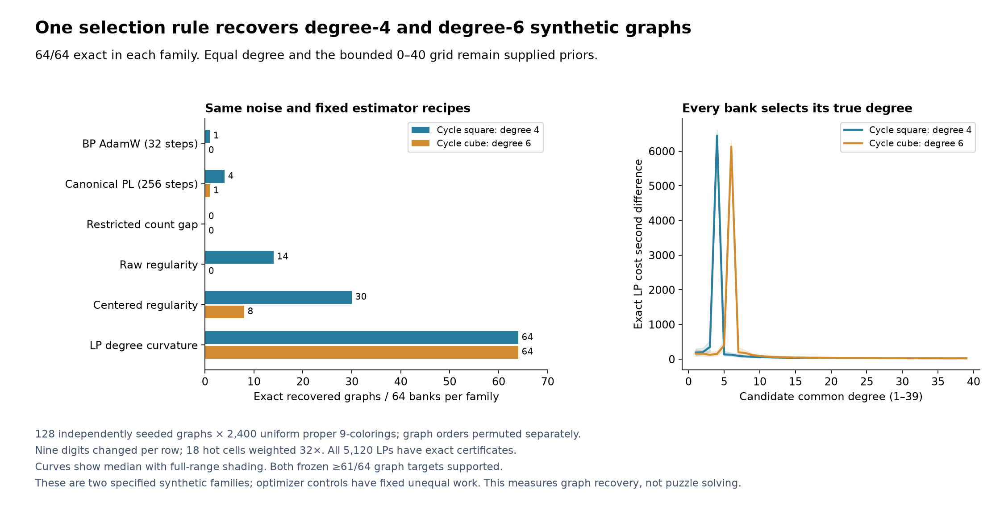

# H4am: degree inference on connected cycle powers

**The unchanged LP-curvature selector recovers 64/64 cycle-square graphs and 64/64 cycle-cube graphs, selecting degrees four and six respectively.** Both separately frozen ≥61/64 graph targets pass. These are two specified connected graph families with local triangles; they are not arbitrary degree-four/six graphs.



| Estimator | Cycle square: exact / 64 | Cycle cube: exact / 64 |
|---|---:|---:|
| BP AdamW, 32 updates | 1 | 0 |
| Canonical pseudolikelihood, 256 updates | 4 | 1 |
| Restricted count gap | 0 | 0 |
| Raw regularity | 14 | 0 |
| Centered regularity | 30 | 8 |
| Exact LP degree curvature | **64** | **64** |

All estimators receive the same corrupted observations. The fixed optimizer recipes have different work and objectives, so these are descriptive controls rather than matched-compute or optimum comparisons. Graph recovery adds no puzzle-solving evidence.

For each family, 64 independently seeded banks draw their own permutation of the 81 vertices and 2,400 IID uniform proper nine-colorings. In the k-th power of a cycle, vertices are adjacent when their circular distance is at most k. Here k is two or three. The sampler starts with a uniform ordered tuple of k distinct digits, then chooses uniformly among the nine-minus-k digits absent from the previous k positions. Those positions always form a clique. Every proper coloring of the open path power therefore has the same probability. Rejecting all k(k+1)/2 wraparound conflicts gives the uniform distribution over proper colorings of the cyclic graph.

The first 2,400 accepted rows are retained in fixed batches of 512, with a frozen 10,000-candidate ceiling per bank. There are no replacement rescues or outcome filters. Graph orders were sealed before coloring and noise generation; separate streams govern graphs, colors, heatmaps, noise and augmentation. Across 128 banks, 604,160 candidates were generated and 307,200 colorings retained. No within-bank duplicates occurred; duplicates would have been kept.

Each bank independently draws 18 hot cells weighted 32. Exactly nine digits per row are changed using the inherited weighted exponential race and nonzero offsets. All cells are free. Training reads noisy labels and free masks; LP inference reads equality counts. The graph family, true degree, true edge count, ordering and geometry never enter estimation. A common degree and bounded grid zero through forty remain explicit supplied priors.

Every positive grid degree gets a fresh LP minimizing raw equality-count cost over all 3,240 candidate pairs; degree zero has an analytic witness. The selector maximizes the exact cost second difference over degrees one through thirty-nine and breaks ties toward the smaller degree. All **5,120 LP certificates** and 128 zero witnesses passed independent checks; **15,360 altered certificates** were rejected. There were 3,479 intermediate fractional optima, all valid objective evidence. Every selected optimum was integral and exact, with no unresolved banks. Exact recovery implies correct-degree selection, so the latter is not independent corroboration.

Before freezing, exhaustive toy enumeration checked four uniform supports containing 6, 168, 24 and 600 proper colorings. Twelve sampler replays matched an independent Boolean allowed-digit implementation. Both samplers preserved the impossible-coloring cap failure, and corruption, worker ordering and unresolved endpoint bounds passed. Another agent independently reviewed the source. A lookup table for the allowed digits gave a **3.63× median toy-generation speed ratio** over the independent Boolean recurrence in three small trials, including table construction in the first trial; this is not a general runtime claim.

The actual four-GPU fit phase took **21.518 seconds**, with live utilization at 97% on every GPU and all 128 job counters advancing. The eight-worker LP, independent proof and export phase took **8.402 wall seconds / 54.754 aggregate CPU seconds**. The complete driver took **79.119 seconds**, including 11.832 seconds of preparation, 14.244 seconds of source auditing, GPU correctness gates, all fits and the 17.716-second controls audit. All frozen budgets were met.

The public controls verifier regenerates every graph, coloring, noise draw and equality count, then replays all 13,907 threshold candidates and graph diagnostics. The independent LP verifier rechecks every certificate and decision. Raw learned checkpoints and full objective histories remain in the local audit archive; the public provenance hashes do not replace those checks.

```sh
python research/20261114/foureyes/verify_cycle_power_public.py
python research/20261114/foureyes/audit_cycle_power_lp.py
```

Together with the earlier [degree-two/eight synthetic study](REPORT-varying-degree.md), this supports the same rule on four specified distributions. It establishes neither arbitrary regular-graph recovery nor a universal theorem about cost curvature. The [fresh Sudoku confirmation](REPORT-fresh-curvature.md) is separate evidence on a different distribution.

[Frozen protocol](cycle_power.json) · [Preflight](cycle-power-preflight.json) · [Sampler](cycle_power_sampling.py) · [Independent controls audit](audit_cycle_power_controls.py) · [Public controls verifier](verify_cycle_power_public.py) · [Exact LP verifier](audit_cycle_power_lp.py) · [Controls and source evidence](../../../results/research/foureyes/cycle_power/controls/) · [All LP proofs](../../../results/research/foureyes/cycle_power/degree/) · [Figure provenance](../../../assets/figures/cycle-power-provenance.json)
