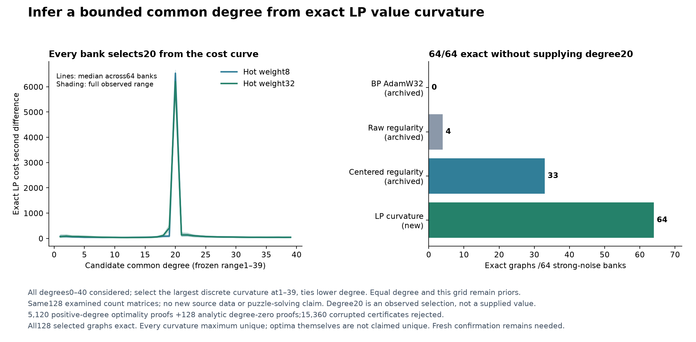

# H4aj: LP value curvature selects degree twenty and recovers every examined graph

**All 64 strong-noise graphs are recovered exactly without supplying degree twenty to the selector.** Every bank selects twenty from the same frozen bounded degree grid; the paired weaker-noise control also recovers 64/64. The frozen strong-noise target of at least 61/64 certified integral exact graphs is supported.

| Estimator | Weight 8 exact /64 | Weight 32 exact /64 | Evidence and supplied information |
|---|---:|---:|---|
| BP AdamW,32 updates | 9 | 0 | Archived H4ag |
| Canonical PL,256 updates | 0 | 0 | Archived H4ag |
| Raw restricted count gap | 31 | 0 | Archived H4ag |
| Raw equal-degree threshold | 64 | 4 | Archived H4ag; common degree |
| Raw lowest810 pairs | 64 | 4 | Archived H4ah; cardinality 810 |
| Centered equal-degree threshold | 64 | 33 | Archived H4ai; common degree |
| Centered lowest810 pairs | 64 | 33 | Archived H4ai; cardinality 810 |
| Degree20 LP | 64 | 64 | Archived H4ah; known degree 20 |
| **Degree selected by LP curvature** | **64** | **64** | New; common degree and bounded grid0–40 |

For every integer degree d=1,…,40, independently solve the same raw-count LP: minimize the sum of equality count times edge weight, with all 3,240 pairs eligible, weights between zero and one, and every cell having degree d. The degree-zero optimum is analytically zero. Use exact doubled optimal objectives V(d)=2F(d), and choose d=1,…,39 maximizing `V(d+1) − 2V(d) + V(d−1)`. Ties choose the smaller degree, including if every curvature is zero. Return the selected solver primal only if it is certified integral.

The supplied prior is **equal degree within a grid extending through half the maximum possible degree**. Degree twenty,810 edges and Sudoku geometry do not enter optimization or selection. This bounded search range is real structural information; the method is not prior-free and has no general guarantee of identifying a true degree. The true graph is used only after selection to evaluate exact recovery.

All 128 curves have a unique maximum at degree twenty. The peak doubled curvature ranges from 12,091 to 13,330; its smallest gap above the next-largest candidate is 11,000. Every selected graph is integral and exact, with zero missing or extra edges. A unique curvature maximum does **not** prove that each LP optimum is unique.

The optimal LP value is convex as a function of its common-degree right-hand side. The independent audit therefore checks every nonnegative exact discrete curvature. Adding a cell effect bᵢ+bⱼ to each edge cost changes F(d) by d times the sum of b, a linear term canceled by the curvature. This connects the method to H4ai's additive correction, while avoiding a single global edge-score threshold. It does not establish that the actual corruption follows a purely additive model.

All 5,120 positive-degree LP outputs have exact primal-dual optimality certificates, plus128 analytic degree-zero witnesses. Of the positive-degree outputs,3,426 are fractional; these are legitimate intermediate objective values. With 81 vertices, odd integral regular degrees are impossible. Such intermediate fractional solutions do not fail a bank. Only a selected fractional primal would be a procedure failure. Any uncertified grid point would make that entire bank unresolved, with exact-success lower and upper bounds retained. Here there are no unresolved banks or selected fractional outputs.

This is an adaptive, prospectively frozen follow-up on the same 128 examined H4ag count matrices after H4ah and H4ai. There are no new sources, corruptions, labels or puzzle-solving inputs. Every positive degree receives a fresh solver instance, including twenty; the method does not substitute the known successful archived degree-twenty primal. All objectives, candidate curvatures, ties, raw primal/dual arrays, selected degrees and graph outcomes are retained. Earlier fitting controls remain archived, with differing objectives and compute, without an optimizer-superiority claim.

The solver is HiGHS 1.12.0 with NumPy 2.3.4, one thread, dual simplex, presolve off,1e−9 feasibility tolerances and a one-second per-LP cap. Each degree has the frozen seed `2026141502 + input_index*41 + d`. The strict proof scheme accepts literal primal values only in{0,0.5,1}, with no primal rounding. Scale-two dual reconstruction must satisfy exact feasibility, complementarity and objective equality. Solver-reported objectives are checked separately. All 15,360 deliberately altered certificates are rejected.

Synthetic cases precede freezing: a four-node graph has the unique intended degree-two knee; a flat five-node value curve selects degree one by the frozen tie rule and correctly yields a fractional primal. Both retain identical curvatures after additive cell-cost perturbations. Analytic degree-zero proofs and exact convexity are checked as well.

The eight-worker run and separately monitored independent audit complete in **23.692227 wall seconds / 45.113387 aggregate CPU seconds**, within180 wall / 900 CPU seconds. Progress counters advance through all128banks and5,120 degrees. The independent proof/export audit accounts for20.275230 wall / 20.259518 CPU seconds, the principal wall-time cost; optimization itself is much shorter. No GPU work is eligible for this exact LP study. Synthetic preparation and later publication replay are separate. Public proof shards and reports total about 32.3 MB.

Run `upstream/.venv/bin/python research/20261114/foureyes/audit_degree_curvature.py` for the solver-free public replay. It checks all5,120 proofs,128 analytic zero witnesses,15,360 mutations, every curvature and every selected graph. A separate independent execution also passed. These are finite examined-source results; fresh-source confirmation remains necessary.

[Frozen protocol](degree_curvature.json) · [Study runner](degree_curvature_study.py) · [Independent proof and selection audit](audit_degree_curvature.py) · [All proof shards and outcomes](../../../results/research/foureyes/degree_curvature/) · [Centering failure](REPORT-centered-regularity.md) · [Supplied-degree control](REPORT-intensity-degree.md)
