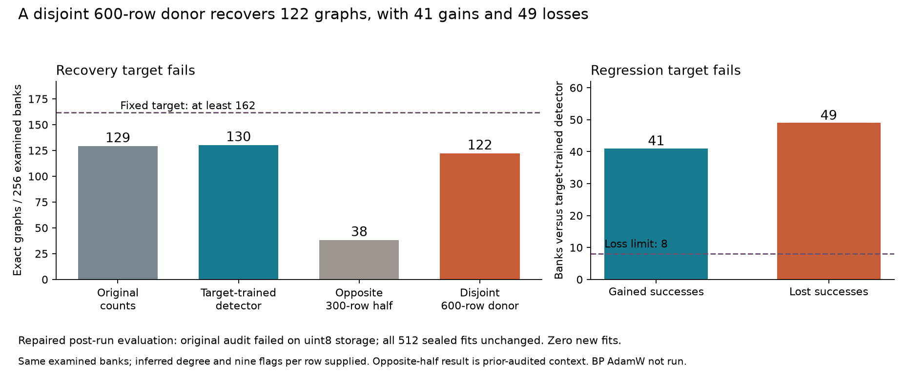

# H4ay/H4az: a disjoint 600-row donor does not improve conflict masking

The repaired evaluation recovers **122/256 exact graphs**, versus **130/256** for the original observable detector. There are **41 gains and 49 losses**. Both original targets fail: at least 162 exact recoveries and at most eight detector regressions. All 256 banks remain included, with 129 integral nonexact outputs, five fractional failures and no unresolved outputs.

**The original H4ay run is technically incomplete.** All 512 fits and both global phase seals finished, but the auditor rejected valid compact `uint8` labels because it required `int64`. H4az is a separately frozen, verification-only repair of those unchanged outputs. It runs no new fits and acquires no data. The result above is a repaired post-run evaluation, not a successful original run or fresh confirmation.

| Method | Exact / 256 | Status |
|---|---:|---|
| BP AdamW | Not run | Outside this structural-inference comparison |
| Original uncensored target counts | 129 | Inherited paired control; certificates rechecked |
| Target-trained observable detector | 130 | Inherited paired control; certificates rechecked |
| Opposite 300-row half detector | 38 | Prior-audited H4ax reference; not charged again here |
| Disjoint 600-row donor detector | **122** | H4az repaired evaluation of sealed H4ay outputs |



## Fixed experiment and separate repair

Each examined synthetic bank already contained 2,400 noisy rows. H4ay fits a donor graph from rows 600..1199 and uses it to detect conflicts on target rows 0..599. Every donor fit is sealed before any target mask is built; every final fit is sealed before outcome diagnostics. The donor and target each contain 600 rows. No newly drawn sources, noisy labels or masks are substituted. All inherited degrees inferred from the target and the supplied nine flags per target row remain fixed. A certified fractional donor is eligible; an uncertified donor would leave its final result unresolved.

The [original proposal](disjoint-donor-proposal.json), [gate](disjoint-donor-preflight.json), [seed audit](disjoint-donor-seed-audit.json) and [frozen H4ay protocol](disjoint-donor.json) remain unchanged. The protocol hash is `9917051ade3824c147d3595ed2ddcf56eff8e7e7aee3d71a2b4b4a1605f6b1ec`. Its [failed runtime](../../../results/research/foureyes/disjoint_donor_repair/original/runtime.json) and eight original error logs are retained, along with both phase seals and every sealed output.

The failure occurred at the first donor-dtype check in each audit worker. No bank audit, source-provenance receipt or outcome summary had been produced. Diagnosis inspected NPY headers only: all 256 donor arrays and all original clean/noisy arrays used `uint8`. The [repair proposal](disjoint-donor-repair-proposal.json), [synthetic gate](disjoint-donor-repair-preflight.json) and independent review preceded the [frozen H4az protocol](disjoint-donor-repair.json), hash `26ecb6c65ed34975698ace5dc185bcfa1ff64b5117c8f47d3998002e5f4ba940`.

The repair accepts integer labels only at the required shape and values 0..8. It preserves the clean array's dtype while reconstructing noise and requires exact dtype and value equality with the saved noisy array. Boolean free masks, float64 uniform draws and int64 offsets/cell indices retain their strict checks. All eight standard signed/unsigned integer widths pass unrelated synthetic replay; 22 invalid-format/value/stream cases are rejected. The original int64 behavior is unchanged. No fit, score, mask, solver seed, certificate or endpoint is altered.

## Outcomes and scope

| Prespecified endpoint | Observed bound | Decision |
|---|---:|---|
| Exact recovery ≥162/256 | [122,122] | Falsified |
| Regressions among 130 original detector successes ≤8 | [49,49] | Falsified |

The final exact counts by family are cycle 54/64, cycle-square 41/64, cycle-cube 19/64 and nine cliques 8/64. The donor graphs themselves contain 122 exact, 121 integral nonexact and 13 fractional outputs. All are certified; all 256 final fits execute. Equality of the two aggregate exact counts does not imply identical recovered banks or establish a mechanism.

The masks contain 586,107 actual corruption locations and 796,293 false positives; there are also 796,293 missed corruptions. Target and donor row indices are disjoint. No duplicated noisy row value appears within either selected set or across target and donor in any bank. These checks do not prove statistical independence of all structured observations.

Relative to H4ax's 38 recoveries, donor sample size rises from 300 to 600 and the final masking arrangement changes. Relative to the original target-trained detector, the graph uses an additional disjoint set of stored observations. These comparisons do not isolate a unique causal explanation for detector behavior. This is graph recovery on examined synthetic banks, not Sudoku puzzle-solving accuracy. Actual corruption locations enter diagnostics only; the inherited degree rule and fixed flag count remain supplied assumptions.

## Proofs, runtime and replay boundary

The repaired audit verifies all **512 sealed fit certificates** and **1,024 inherited certificates**, rejecting **4,608 proof mutations**. It independently reconstructs donor counts, target conflict scores, masks and censored costs. All 2,400 original noise rows per bank are replayed after the final global seal, including the offset RNG position after the complete uniform-draw array. The [public summary](../../../results/research/foureyes/disjoint_donor_repair/summary.json) retains every outcome and source receipt.

The failed original run cost **2.394636555 wall seconds / 11.854262 aggregate CPU seconds**. The separate repair cost **8.173361705 wall seconds / 53.961773 aggregate CPU seconds**, including input/source hashing, copying, audits, export and monitoring. Both are reported; original execution time is not reset or folded into a clean-run claim. The repair stays below its separate 120-wall/600-CPU limits and performs zero LP fits. Its 37 monitor samples show eight active workers and advancing audited-bank counters, ending at 256. An external snapshot occurred after completion and is not evidence of active CPU use. GPUs had no eligible work in this exact audit pipeline.

```bash
OPENBLAS_NUM_THREADS=1 OMP_NUM_THREADS=1 MKL_NUM_THREADS=1 \
  upstream/.venv/bin/python research/20261114/foureyes/audit_disjoint_donor_repair.py
```

The public checker verifies both frozen protocols, the original failure evidence, all sealed bytes, observations, masks, costs, exact proofs, inherited controls and endpoint decisions. A full checkout without raw archives can replay these calculations from public arrays. Original clean-source/noise-stream provenance is then explicitly inherited from the separately retained raw audit: the checker reports how many of the 256 source archives are unavailable. Restoring those archives enables full original-noise replay. Cryptographic hashes do not replace unavailable raw data.
