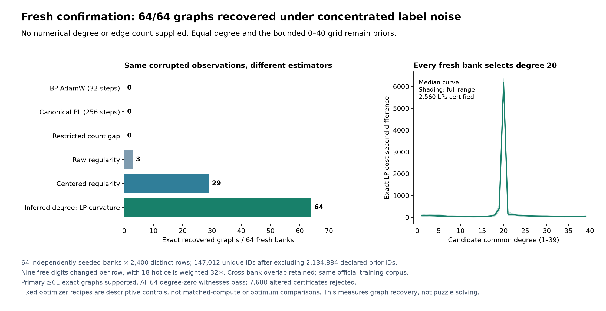

# H4ak: degree curvature recovers all 64 fresh strong-noise graphs

The prespecified **at least 61/64 exact graphs** target is supported: the unchanged degree-curvature procedure recovers **64/64**, with zero missing or extra edges. Every bank selects degree 20, and every curvature maximum is unique. Degree 20 and the 810-edge count are not supplied to selection. The common-degree assumption and bounded 0–40 grid remain supplied priors.



| Estimator on the same fresh observations | Exact graphs / 64 | Missing edge-bank pairs | Extra edge-bank pairs |
|---|---:|---:|---:|
| BP AdamW, 32 updates | 0 | 20,240 | 0 |
| Canonical pseudolikelihood, 256 updates | 0 | 8,023 | 0 |
| Restricted count-gap threshold | 0 | 20,540 | 0 |
| Raw regularity threshold | 3 | 42,060 | 11 |
| Centered regularity threshold | 29 | 27,506 | 1 |
| **Inferred degree, exact LP curvature** | **64** | **0** | **0** |
| Supplied degree 20, diagnostic from the new grid | 64 | 0 | 0 |

These are graph-estimation results under a specified corruption process. They do not measure puzzle-solving accuracy. BP and canonical training retain their fixed earlier recipes; they are descriptive controls, not optimizer optima or matched-compute comparisons. The supplied-degree diagnostic uses the newly solved degree-20 grid cell; it supplies additional information and is not the primary procedure.

The [protocol](fresh_curvature.json) was frozen before source draws, heatmaps, corruption and outcomes, following the examined-input success in [H4aj](REPORT-degree-curvature.md). Its SHA-256 is `7f2174153d77519b75f1fcfa73f552e5dcfa2f5b61984f1f2ea357bc599b48cf`. The primary requires certified integral exact selections on at least 61 of 64 banks. Any uncertified grid degree makes its bank unresolved; a fractional selected optimum is a failure. A resource failure leaves the study incomplete. This finite target is not a population-confidence guarantee.

Each independently seeded bank contains 2,400 distinct rows from the official training corpus. The frozen pool excludes **2,134,884 unique source IDs**: the latest declared Ripper union of 2,045,471, all H4af motivating rows, and H4af's prior exclusions, deduplicated. There are 1,697,110 eligible rows. The 153,600 draw appearances contain **147,012 unique IDs and 6,588 cross-bank repeats**; repeats are retained. Every within-bank row is distinct and there is zero overlap with the declared exclusion union. This is a new declared-disjoint cohort from the same corpus, not globally untouched or external data.

All 64 source-ID arrays were sealed before reading selected clean labels or generating corruption. The independent raw audit reparses every selected unique answer and clue mask from the original CSV, checks Sudoku validity, reconstructs every seeded draw and heatmap, and literally replays the corruption. In each bank, eighteen randomly chosen hot cells have sampling weight 32 and other cells weight one. An exponential race selects exactly nine free cells per row; each receives a nonzero digit offset. Clues remain unchanged. Weight 32 is a relative selection weight, not a 32% noise rate. Every estimator uses the same resulting observations.

For all 3,240 unordered cell pairs, the LP cost is the raw equality count. Fresh deterministic solves consider every integer degree 1 through 40, with an analytic degree-zero witness. Each solve minimizes the count-weighted edge sum, subject to edge values in [0,1] and the chosen common node degree. Selection maximizes the exact discrete second difference of doubled optimal costs over degrees 1 through 39, breaking ties toward the smaller degree. No geometry, preferred degree or edge count enters the estimator. Geometry is used only after selection to score recovery.

All **2,560 positive-degree LPs** have exact half-integral primal/dual optimality certificates, all **64 analytic zero witnesses** pass, and independent checks reject **7,680 deliberately altered certificates**. The grid contains 1,702 fractional optima; their certified values remain valid for curvature selection. No selected optimum is fractional or unresolved. The certificates establish optimality, not uniqueness of the LP optimum. Adding any cell-wise pair cost `b[i] + b[j]` shifts the degree-d optimum by `d * sum(b)` and leaves curvature unchanged. This exact identity does not guarantee that curvature identifies a true degree for arbitrary graph families or noise processes.

The complete fresh-data preparation took 7.474 seconds, the raw-source audit 11.613 seconds, and the four-GPU numerical gate 3.830 seconds. The four-GPU control fits took **12.782 seconds**; stored live samples show all four GPUs reaching 95–97% utilization and completed-bank counters advancing through all 64 fits. Independent control auditing took 10.526 seconds. The LP grid, centered control, eight direct independent proof-audit workers and export together took **4.261 wall seconds / 26.501 aggregate CPU-seconds**, within 180 wall / 900 CPU seconds. The LP stage uses no GPU. All phase budgets passed without a retry or extension.

Before freezing, an eight-bank archived audit compared serial and eight-process execution. Results matched exactly; times were 0.814092 and 0.129195 seconds, respectively, a 6.30× improvement on that one subset including process overhead. This is an implementation timing observation, not a general scaling claim. The new scientific run uses direct audit children so its aggregate CPU and advancing counters are monitored by the launcher.

The portable control verifier reconstructs the complete exclusion union from public predecessor exports, every source-ID draw, all 9,235 raw threshold candidates, graph outcomes, stored canonical gradients and KKT diagnostics. The independent degree verifier checks every LP proof, mutation, curvature selection, centered graph and primary decision. Both pass locally, and Ripper independently replayed all new LP evidence. Original labels, corruption arrays and full training-history replay remain covered by the raw archive audit; the public package contains compact identities, counts, coefficients and proof arrays rather than full datasets or checkpoints.

[Source and controls](fresh_curvature_study.py) · [Raw independent audit](audit_fresh_curvature_controls.py) · [LP execution](fresh_curvature_degree.py) · [Frozen LP auditor](audit_fresh_curvature_degree.py) · [Portable LP verifier](verify_fresh_curvature_degree_public.py) · [Portable control verifier](verify_fresh_curvature_public.py) · [Control results](../../../results/research/foureyes/fresh_curvature/controls/summary.json) · [Degree results and proofs](../../../results/research/foureyes/fresh_curvature/degree/summary.json)

```sh
uv run --with numpy python research/20261114/foureyes/verify_fresh_curvature_public.py
uv run --with numpy python research/20261114/foureyes/verify_fresh_curvature_degree_public.py
uv run --with numpy --with matplotlib python scripts/plot_fresh_curvature.py
```
