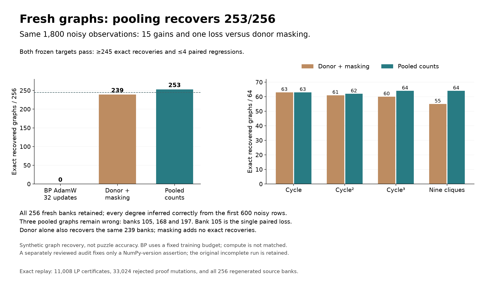

# Fresh confirmation: pooling recovers 253/256 graphs

Pooling 1,800 noisy observations recovers **253/256** fresh synthetic graphs, versus **239/256** for donor-plus-masking using the same observation union. There are **15 paired gains and one loss**. Both separately prespecified endpoints pass: at least 245 exact recoveries and at most four paired regressions.



The fresh H4bc fits finished and were globally sealed before outcome auditing. Its audit then failed because it required the LP environment's NumPy 2.3.4 in the separate GPU environment, which uses 2.5.4. **H4bc remains technically incomplete.** H4bd is a separately frozen, independently reviewed correction-only audit of those unchanged fits. Its auditor differs in precisely that version string. No observations, fitting, degree selection, thresholds or endpoints were changed or rerun. Eight initial workers computed partial structural values internally before the assertion, but emitted no bank audits or aggregate outcomes.

## All methods and failures

| Method | Cycle /64 | Cycle² /64 | Cycle³ /64 | Nine cliques /64 | Exact /256 |
|---|---:|---:|---:|---:|---:|
| BP AdamW, 32 updates | 0 | 0 | 0 | 0 | 0 |
| Pooled 1,800-row count LP | 63 | 62 | 64 | 64 | **253** |
| Donor 1,200 + masked target 600 | 63 | 61 | 60 | 55 | 239 |
| Donor 1,200 alone, diagnostic | 63 | 61 | 60 | 55 | 239 |

All 1,024 reported method outputs are integral; none is unresolved. BP is a descriptive control with zero initialization, ordinary AdamW, 32 full-batch updates, learning rate 0.01 with cosine decay, weight decay 0.01, FP32 parameters, and independent per-row digit permutations. All 256 fits are finite and their graph transforms eligible. This does not compare equal compute or optimizer convergence.

| Pooled failure | Family | Missing / extra edges | Twice the truth objective gap | Donor + masking exact? |
|---|---|---:|---:|---|
| 105 | Cycle² | 2 / 2 | 2 | Yes |
| 168 | Cycle | 2 / 2 | 28 | No |
| 197 | Cycle² | 2 / 2 | 14 | No |

Each wrong graph has a certified objective strictly below truth. Exact optimality does not imply uniqueness. Donor and masked-target exactness agree on every bank: masking adds no exact recoveries. The 15 pooled gains are banks 30, 35, 55, 66, 67, 70, 87, 106, 113, 127, 159, 187, 191, 209 and 255. Bank 105 is the sole regression.

## Frozen design and evidence

There are 64 independently relabeled 81-node graphs from each of four regular families. Each bank has 1,800 newly generated proper nine-colorings; duplicates are retained. Every observed row corrupts exactly nine cells, with an independent 18-cell heatmap receiving weight 32 in the fixed corruption sampler. No official puzzle examples are used.

One degree grid on the first 600 noisy rows selects the maximum objective curvature over degrees 1–39, with lower-degree ties. All 256 selected degrees equal truth. The methods receive no graph order, true degree, heatmap or actual corruption locations. The masking arm is supplied the fixed nine-corruptions-per-row prior. Source/noise provenance audits precede fitting; outcome joins wait for the global final seal.

- [Original prospective design](fresh-pooled-donor-proposal.json) and [frozen H4bc protocol](fresh-pooled-donor.json): `806adc2bede792b521807d61065b406b154dbd5b928b019178286a8de2c0511f`.
- [Correction design](fresh-pooled-donor-corrected-proposal.json) and [frozen H4bd protocol](fresh-pooled-donor-corrected.json): `7071ce20790dd2b5233dfbb273c290a92edebcbf51f434c36be1dc5664664c4a`.
- [Complete summary](../../../results/research/foureyes/fresh_pooled_donor_corrected/summary.json), [original incomplete runtime](../../../results/research/foureyes/fresh_pooled_donor_corrected/original-incomplete-runtime.json), and [correction runtime](../../../results/research/foureyes/fresh_pooled_donor_corrected/runtime.json).
- [Original assertion failure](../../../results/research/foureyes/fresh_pooled_donor_corrected/original-audit-failures/audit0.log), [unchanged original auditor](audit_fresh_pooled_donor.py), [corrected auditor](audit_fresh_pooled_donor_corrected.py), and [five synthetic lifecycle gates](fresh-pooled-donor-corrected-preflight.json).

All **11,008 LP certificates**, **33,024 proof mutations**, and **256 analytic zero witnesses** pass. Intermediate degree grids contain 6,960 fractional solutions; their literal certificates are retained. Public verification regenerates all 256 latent source archives byte-for-byte, independently replays source/noise correspondence and all exact proofs, and checks BP checkpoint transforms, histories and provenance. It does not retrain BP. Full raw arrays remain outside Git because they can be regenerated from the published seeds.

```sh
OPENBLAS_NUM_THREADS=1 OMP_NUM_THREADS=1 MKL_NUM_THREADS=1 \
  python research/20261114/foureyes/verify_fresh_pooled_donor_corrected_public.py
```

The verifier requires NumPy; the original fitting environment used NumPy 2.3.4 and HiGHS 1.12.0. GPU fitting used NumPy 2.5.4, Torch 2.11.0+cu128 and CUDA 12.8. Verification needs neither a GPU nor HiGHS. [Public file manifest](../../../results/research/foureyes/fresh_pooled_donor_corrected_public_manifest.json).

## Runtime and scope

The original run consumed **17.301773 wall seconds / 142.885827 aggregate CPU seconds**, including its failed audit. The separate successful correction and export consumed **12.150546 wall seconds / 79.463063 aggregate CPU seconds**, below its frozen 120-wall/600-CPU limits. Their measured phase durations sum to **29.452319 wall seconds / 222.348890 aggregate CPU seconds**; this excludes the intervening diagnosis/review time. The correction made zero new observations, LP calls or BP fits. Public replay is separately charged; the first full public reconstruction took 12.288590 seconds.

All four local GPUs processed the 256 independent BP fits, with advancing counters and 21 GPU samples. At 12 seconds, the queue had completed 138 BP fits and 175 degree grids, with GPU utilization 20–24%; these short kernels are dispatch-heavy. CPU source generation, LPs and eligible GPU training overlapped.

This confirms graph recovery on the specified fresh synthetic families under the corrected audit. It does not establish puzzle-solving accuracy, arbitrary-graph recovery or a population guarantee. The [earlier examined-cohort comparison](REPORT-pooled-donor.md) recovered 254 versus 229 with 25 gains and no losses; those banks are not pooled into this denominator.
