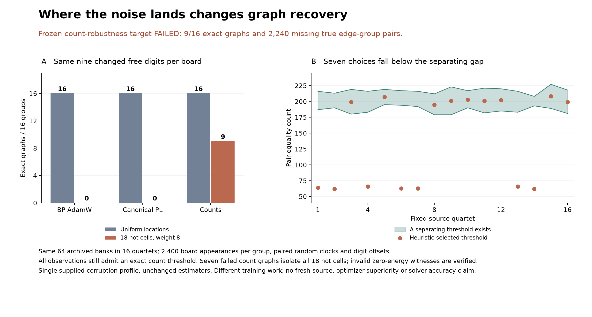

# H4ad: concentrating the same nine corruptions breaks graph recovery

**The frozen robustness target is falsified.** Restricted-gap counts recover 9/16 exact graphs under a fixed cell-noise profile and lose 2,240 true edge-group pairs in the other seven. Their paired uniform-noise control recovers 16/16. Each board has exactly nine changed free digits in both arms; the intervention changes where those errors occur.

| Estimator | Uniform: exact graphs | Concentrated: exact graphs | Concentrated: missing true edges | Concentrated: extra edges |
|---|---:|---:|---:|---:|
| BP AdamW, 32 updates and inherited transform | 16/16 | 0/16 | 33 | 18 |
| Canonical PL, 256 updates and fixed strong-support threshold | 16/16 | 0/16 | 522 | 0 |
| Restricted-gap counts | 16/16 | **9/16** | **2,240** | 0 |

The primary required at least 15/16 exact heterogeneous count graphs **and** zero missing true edges across all sixteen. BP and canonical controls are descriptive and use different objectives, regularizers and training work. Every fit is finite and every transform eligible; no bank is replaced or omitted. Graph recovery is the endpoint. No inference accuracy is measured here.

## Paired observations, fixed cell profile

All 64 H4y clean source banks are reused in sixteen ordered quartets. Each quartet contains 2,400 board appearances, including repeats of a source row. A new RNG selects one fixed set of eighteen cell indices uniformly without using geometry. Those cells receive sampling weight eight; the remaining cells receive weight one. The paired control assigns weight one everywhere.

On each board, independent exponential clocks select nine free cells without replacement: priority is `-log(U)/weight`, with `U = 1 - rng.random()` and stable cell-index ties. The two conditions share every uniform draw and cellwise nonzero digit offset. Each selected digit changes uniformly to a different digit. Given clues stay unchanged. There are 38,400 paired clean observations and 76,800 corrupted board appearances, with zero new source rows or solver inputs. The concentrated arm places 220,903 of its 345,600 changed digits in the eighteen hot cells.

The heat-map seed is 202611600000, source-bank corruption seeds are 202611610000 through 202611610063, and paired group augmentation seeds start at 202611620000. The [protocol](heterogeneous_noise.json), SHA `8091e001b5df22f0a6c7833b4f263ad7f26446665d4afee1363dfa906098cfa5`, was frozen after synthetic numerical checks and before these new draws. This is one fixed heat map on previously examined source banks, not a fresh-source replication or an average over noise locations.

Canonical PL retains the original FP64 raw penalty 1/30000, 256 proximal updates, initial step 540 and backtracking, then keeps positive coefficients at least one quarter of the median positive coefficient. BP retains its 32-update AdamW recipe, paired digit augmentations and first-largest-positive-gap transform. Counts retain the first largest gap between distinct equality counts whose upper endpoint is at or below the median. No geometry or clean answers enter these estimators.

## The observations still separate; the selected threshold fails

A postfit diagnostic finds **strict true/nonpeer count separation in every heterogeneous group**: every true edge has fewer equalities than every nonpeer. True maxima range from 179 to 195; nonpeer minima range from 208 to 227. Thus each observed matrix admits a scalar threshold that recovers the exact graph. Geometry is used to establish this diagnostic, not to choose a new threshold.

In the nine successful groups, the unchanged count heuristic selects thresholds 195–208. In the seven failures, it selects an earlier gap at 62–66, deleting exactly 320 true edges per group. Those seven groups share the same failed support: every edge incident to the eighteen hot cells is lost, and all eighteen become isolated. The failure is a threshold-selection mechanism on these observations, not a proof that the graph is statistically unidentifiable.

Seven [exact counterexamples](../../../results/research/foureyes/heterogeneous_noise/isolation-witnesses.json) establish that those failed count graphs are globally unsound: take a valid source board and change one isolated cell. Its graph energy remains exactly zero, while Sudoku validity is broken. A separate public verifier checks each board, energy and broken unit. This diagnosis was added after the frozen outcome. It demonstrates possible invalid certificates, not an observed solver return or compatibility with a particular clue mask. Missing edges in the other estimators alone do not establish their global unsoundness.

## Verification and resource scope

Before freezing, synthetic checks cover paired corruption, exact ties, nine distinct free-cell changes, the conditional equality probabilities 1/8 and 7/64, unrestricted W/B gradients against independent FP64 calculations and finite differences. The raw loss error is zero; the maximum finite-difference error is 1.11e−11. No study source/profile RNG or graph outcome is used by those checks.

Before fitting, all four GPUs pass full 2,400-row canonical loss/gradient checks for both conditions at three coefficient vectors, each below 1e−12. Independent unrestricted NumPy checks also verify upstream FP32 raw loss and both gradients on seventeen actual rows per condition. The source auditor reconstructs all paired random draws, selected cells, offsets, unmodified clues and repeated source-row mappings. The final audit checks all 32 fit jobs, 96 graph outcomes, BP checkpoint transforms, every canonical history and independent final loss/gradient/KKT residual, plus all cell and edge diagnostics.

Preparation takes 3.489 seconds. The four-worker numerical gate takes **5.673 wall seconds / 15.293 aggregate CPU seconds**; fitting takes **8.868 wall seconds / 30.846 aggregate CPU seconds**. Those phase timers include worker startup, imports and the parent monitor. Charging all four workers throughout both phases gives a **0.970 GPU-minute upper envelope**, below the frozen fifteen-minute limit. Live samples show advancing completions from 2 to 28 while individual GPUs range from 60% to 97% utilization. CPU source/outcome audits, development preflight and publication work are separate from these phase costs and do not have a combined timing claim.

The [public verifier](verify_heterogeneous_public.py) rebuilds graph transforms, decisions, all per-cell and edge diagnostics, stored-gradient KKT values and all seven counterexamples. It does not reconstruct gradients from unavailable noisy boards or replay BP training; those belong to the separately retained raw audit.

[Frozen runner](heterogeneous_noise_study.py) · [Synthetic preflight](preflight_heterogeneous_noise.py) · [Independent raw auditor](audit_heterogeneous_noise.py) · [Postfit witness construction](diagnose_heterogeneous_supports.py) · [Measurements and model arrays](../../../results/research/foureyes/heterogeneous_noise/) · [Figure renderer](../../../scripts/plot_heterogeneous_noise.py)
