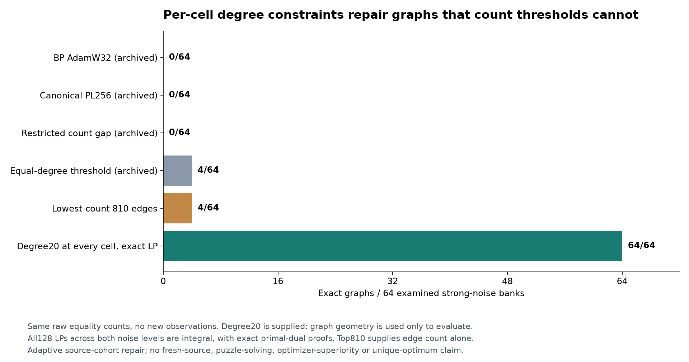

# H4ah: supplying each cell's degree repairs all concentrated-noise graphs

**The degree-20 LP recovers all 64 strong-noise graphs exactly, while selecting the 810 lowest-count pairs recovers only four.** Both use the same unchanged equality counts from H4ag. All 128 LPs across the paired weight-eight and weight-thirty-two conditions return integral solutions with exact primal-dual optimality certificates. The frozen strong-noise target of at least 61/64 certified integral exact graphs is supported.

| Estimator | Weight 8 exact / 64 | Weight 32 exact / 64 | Evidence |
|---|---:|---:|---|
| BP AdamW, 32 updates | 9 | 0 | Archived H4ag |
| Canonical PL, 256 updates | 0 | 0 | Archived H4ag |
| Restricted count-gap threshold | 31 | 0 | Archived H4ag |
| Equal-degree threshold, degree value unknown | 64 | 4 | Archived H4ag |
| Lowest-count 810 edges | 64 | 4 | New cardinality control |
| Degree exactly twenty at every cell, LP | **64** | **64** | New exact proofs |

This supplies a stronger prior: degree exactly twenty at each of 81 cells, which implies 810 edges. The optimizer receives all 3,240 unordered pairs and minimizes `sum(equality_count[e] * x[e])`, subject to `0 ≤ x[e] ≤ 1` and each cell having degree twenty. It receives no row, column or box geometry. Costs are the raw integer equality counts, without likelihood parameters, learned weights or quantization. The cardinality control sorts by count, breaking ties by lexicographic pair index, then selects 810 edges.

The stronger-noise cardinality control has 127 missing and 127 extra edge-bank pairs. The LP has none. All weight-eight outputs are exact for both new procedures. The result shows that per-cell degree information resolves these observed count overlaps where a global edge-count constraint fails. It does not establish that degree information is necessary for every successful estimator. The original equal-degree threshold failure remains a valid result of its frozen procedure.

These are all 128 previously examined H4ag count matrices on the same 64 clean banks and paired corruptions. This adaptive follow-up was frozen after the threshold failure was known and before any LP or top-810 outcome. There are no new source identities, noise draws, labels, optimizer fits or puzzle-solving evaluations. Archived fitting controls use different objectives and compute; no optimizer-superiority or matched-time claim is made.

The primary uses at least 61 certified integral exact graphs. Certified integral nonexact and certified fractional returns would be procedure failures; uncertified or nonrepresentable outputs would remain unresolved, with exact-success lower and upper bounds. Missing/extra counts apply only to integral outputs. Here all 128 are integral and certified, so the error totals cover every bank. The weaker-noise control also meets the same numerical threshold. Neither endpoint is a population confidence statement.

A deterministic single-thread HiGHS 1.12.0 dual-simplex solve uses all pair columns in fixed order, presolve off, seed `2026121502 + input_index`, one-second per-LP cap and 1e−9 feasibility tolerances. No objective perturbation or retry is used. The inherited proof scheme accepts literal primal values only from {0, 0.5, 1}; it does not round or snap them. Scale-two node duals and upper-bound duals must satisfy exact integer feasibility, complementarity and equal primal/dual objectives. The reported floating objective is separately checked against that exact value. These proofs establish optimality, **not uniqueness**; a fractional returned optimum would not exclude an integral co-optimum.

Synthetic checks precede freezing: exhaustive feasible-graph comparison on a four-node case, a deliberately fractional six-node case, and six rejected proof mutations. The real independent audit verifies all 128 certificates and rejects 384 altered certificates. Every count vector, raw primal/dual vector, certificate and outcome is public; the portable checker makes no solver call.

The monitored eight-worker run, including all LPs, certificates, aggregation and independent proof replay, takes **1.002028 wall seconds / 2.218425 aggregate CPU seconds**, within 120 wall / 240 CPU seconds. Each worker loads the count arrays once and handles sixteen jobs, avoiding a new interpreter per LP. Live worker receipts advance to 128 complete; no GPU operation is eligible for this exact LP test. Synthetic preparation, environment installation and publication are separate. A dedicated local environment pins NumPy 2.3.4 and HiGHS 1.12.0; existing fitting environments remain unchanged.

Run `upstream/.venv/bin/python research/20261114/foureyes/audit_intensity_degree.py` for the public solver-free replay. To repeat optimization, create an environment with `numpy==2.3.4 highspy==1.12.0` and use the frozen runner with its own empty output directory; all paths and hashes are retained in the protocol.

[Frozen protocol](intensity_degree.json) · [Runner and synthetic gate](intensity_degree_study.py) · [Independent public proof checker](audit_intensity_degree.py) · [Complete results](../../../results/research/foureyes/intensity_degree/) · [Original paired threshold failure](REPORT-regularity-intensity.md)
