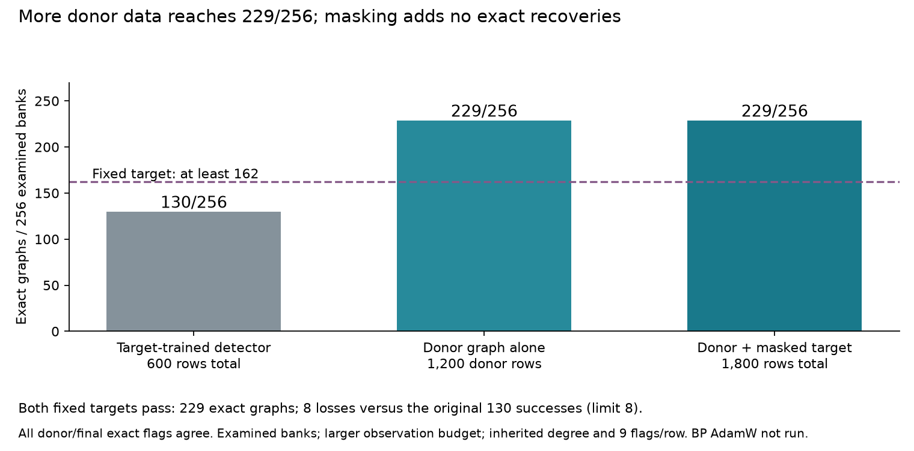

# H4ba: more donor observations recover 229/256 graphs; masking adds no exact recoveries

A disjoint **1,200-row donor** followed by masking the original 600-row target recovers **229/256** exact graphs, with **107 gains and eight losses** versus the original target-trained detector. Both frozen targets pass: at least 162 exact recoveries and at most eight regressions. **The donor graph alone also recovers 229/256, with identical exact/nonexact flags on every bank.** This study does not demonstrate any exact-recovery benefit from the masking/refitting stage beyond retaining the donor graph.

| Method | Exact / 256 | Observation scope |
|---|---:|---|
| BP AdamW | Not run | Outside structural inference comparison |
| Original target counts | 129 | 600 target rows; inherited paired control |
| Target-trained detector | 130 | Same 600 target rows; inherited paired control |
| Disjoint 600-row donor then masked target | 122 | 1,200 total stored observations; prior-audited H4az reference |
| Disjoint 1,200-row donor graph alone | **229** | 1,200 donor rows; audited diagnostic control |
| Disjoint 1,200-row donor then masked target | **229** | 1,800 total stored observations; H4ba primary |



All 256 examined banks remain in the result: 229 exact and 27 integral nonexact outputs, with no fractional or unresolved donor/final outputs. Exact counts by family are cycle 63/64, cycle-square 62/64, cycle-cube 55/64 and nine cliques 49/64, for both the donor and final graphs. Identical exact flags do not assert that every nonexact graph has identical edges.

## Fixed intervention

The [proposal](larger-donor-proposal.json) fixes target rows 0..599 and donor rows 600..1799 in each previously generated 2,400-row bank. This adds 600 stored donor observations relative to H4ay/H4az and uses 1,800 observations in total. There are no new source draws or noisy-label acquisitions, but the comparison with a 600-row detector has a larger observation budget. These examined-data results do not establish fresh-cohort generalization or isolate a causal masking mechanism.

Production sees noisy labels and the degree previously inferred from the original target rows. It fits raw donor equality counts, seals all 256 donor outputs, uses their literal certified primals to flag nine target cells per row, and fits the censored target counts. All final outputs are sealed before graph truth, actual corruption masks or donor exactness enter diagnostics. The supplied nine flags per row and inherited degree rule remain assumptions. No smoothing, new degree search, threshold tuning or fractional snapping is introduced.

The [synthetic gate](larger-donor-preflight.json) independently checks the 1,200-row donor boundaries, target-only masking, exact counts, full 2,400-row noise stream, certificates, unresolved-donor skips and global phase seals. It uses compact uint8 source fixtures and binds the earlier eight-integer-format repair gate. The [seed audit](larger-donor-seed-audit.json) expands actual ancestor solver seeds through H4ay, whose H4az audit repair used no new seeds. The [frozen protocol](larger-donor.json) hash is `3d07018c05f7c16e82198bb3f7aabb9ab5638062ebdf970f4ba008d0dc26ae5b`.

The H4ay run remains technically incomplete, and its separate H4az audit repair remains unchanged. H4ba is a new prospective experiment with fresh solver seeds and its own complete execution. [Original donor failure and repair](REPORT-disjoint-donor.md).

## Outcomes, accounting and replay

| Separate endpoint | Observed bound | Decision |
|---|---:|---|
| Exact recovery ≥162/256 | [229,229] | Supported |
| Regressions among 130 original detector successes ≤8 | [8,8] | Supported, at the boundary |

Mask diagnostics retain 589,614 actual corruption locations, 792,786 false positives and 792,786 missed corruptions. These are diagnostics, not production labels. All 512 donor/final LPs are independently certified, together with 1,024 inherited original/detector/random/full-mask certificates. The audit rejects 4,608 proof mutations and independently reconstructs donor costs, target scores, masks, exposures and full original noise provenance after the final seal.

The complete charged execution takes **8.998964316 wall seconds / 63.373625 aggregate CPU seconds**, below the frozen 120-wall/600-CPU limits. A live external sample records all eight final-fit workers making CPU progress after 256 donors complete; persistent counters reach 512 LPs and 256 audited banks. No GPU work is eligible in this exact LP/audit pipeline. Gates and public replay are separate from the charged study.

```bash
OPENBLAS_NUM_THREADS=1 OMP_NUM_THREADS=1 MKL_NUM_THREADS=1 \
  upstream/.venv/bin/python research/20261114/foureyes/audit_larger_donor.py
```

The [public summary](../../../results/research/foureyes/larger_donor/summary.json) retains all outcomes, paired changes, proof/source bindings and endpoint bounds. Public replay verifies observed rows, counts, masks, exact proofs, inherited controls, both global seals and runtime. It reports missing raw-source archives explicitly; without them, original clean-source/noise provenance is inherited from the charged complete audit. Full original-noise replay requires those separately retained archives. Graph recovery here is not puzzle-solving accuracy.
