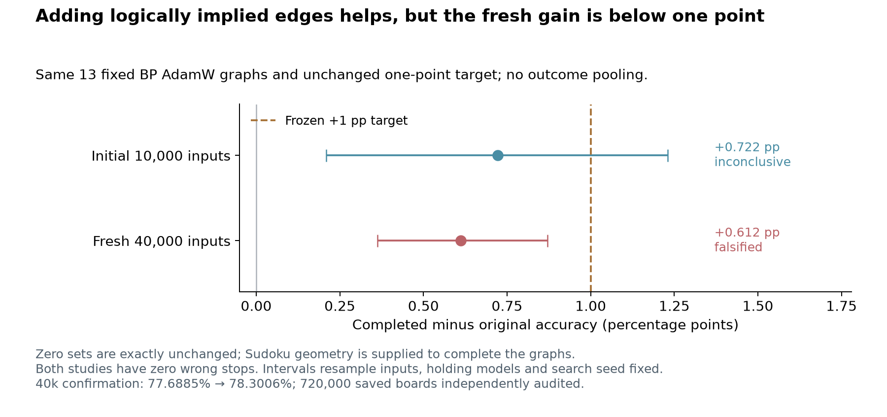

# A larger fresh cohort bounds the logical-completion gain below one point

**The unchanged ≥1-point target is falsified on a fresh 40,000-puzzle confirmation.** Adding logically implied constraints raises accuracy from **77.688462% to 78.300577%**, a gain of **0.612115 percentage points**, with paired input-cluster 95% interval **[0.362500, 0.870394]**. The gain is positive but smaller than the frozen target. Both arms have zero wrong stops.



The preceding [10,000-input experiment](REPORT-logical-completion.md) remains inconclusive for its one-point target: +0.721538 points, interval [0.209981, 1.230019]. Its results motivated this single larger confirmation, whose cohort and analysis were frozen before new inference. No outcomes are pooled and the earlier result is not retrospectively replaced.

Both experiments use the same 13 historical BP AdamW models, selected because their transformed supports are sound despite missing true Sudoku edges. The original support is compared with its union with the supplied 810-edge peer graph. [Exact counting certificates](LOGICAL_SOUNDNESS.md) show that this intervention leaves the set of zero-energy boards unchanged, including any original false exclusions. Its nonzero energies and search trajectories can differ. Geometry is explicitly supplied; this is not an optimizer comparison or a new training-bank replication.

The fresh cohort is official `full-all[340000,380000)`. All settings remain unchanged: unit weights, zero bias and stopping threshold, four chains, 262,144 moves per chain, seed 0, focus threshold 0.45, temperatures 0.4→0.31, annealing period 524,288, and checks every 4,096 moves. Every unique graph passes eight native/capture/sparse parity checks on 16 inputs. Intervals use 5,000 paired input-cluster resamples, RNG 20261115666, averaging all 13 fixed models within each input. They condition on those models and one search seed and do not establish a population-level training effect.

All **26 logical cells map to 18 unique searches**, avoiding eight duplicate searches. The four-worker queue completes in **86.343 seconds**, below the 300-second/20-GPU-minute budget. A live check showed all four GPUs at 100%, with completed jobs and move counters advancing. The independent audit verifies **720,000 saved boards**, clues, Sudoku validity, stopped-board energy, integer fields and energies, and saved-state/output correspondence. No new fitting occurs.

The public-only verifier first checks the preceding study's exact support derivations, then confirms all inherited mappings and recomputes this fresh interval from compact outcome bits. Sixteen bootstrap draws are also checked by literal two-dimensional resampling.

```sh
uv run --with numpy python research/20261114/foureyes/verify_logical_completion_confirm.py
```

[Frozen protocol](logical_completion_confirm.json) · [Preparation, bounded launch and audit](logical_completion_confirm.py) · [Public verifier](verify_logical_completion_confirm.py) · [Summary, all audit hashes and execution receipt](../../../results/research/foureyes/logical_completion_confirm/summary.json)
