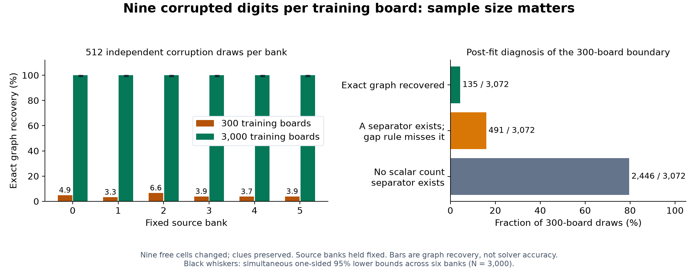

# Independent corruption replication: 3,000 boards tolerate nine changed digits

The frozen largest-count-gap estimator recovered the exact Sudoku constraint graph in **512/512 independent corruption draws for each of six fixed 3,000-board source banks**. The minimum simultaneous one-sided lower confidence bound is **99.0693%**, supporting the prespecified ≥99% recovery target for every bank. With only the first 300 boards of each bank, it recovered **135/3,072 graphs (4.3945%)**.



This study varies corruption, **not the six underlying source banks**. Each draw changes exactly nine distinct originally free cells per board to independently selected other digits. That is 11.11% of all 81 cell labels; original clues remain unchanged. These are complete solution labels with corruption, not incomplete inputs to the solver.

## Frozen experiment

[Protocol](noise_replication.json), SHA-256 `563d14e55be6c923ecd3415082dd15ffd07ba4d1ed94c5fabe718383008d59f3`, was frozen before generation. [Producer](noise_replication.py) creates 512 new draws per bank, with the N300 condition nested within N3000. The estimator uses only equality counts: sort distinct counts, take the first largest adjacent gap, and retain counts at or below its floored midpoint. No peer graph, geometry, or privileged clean labels enter that rule.

| Fixed source bank | N300 exact / 512 | N300 some scalar separator exists | N3000 exact / 512 |
|---|---:|---:|---:|
| 0 | 25 | 106 | 512 |
| 1 | 17 | 101 | 512 |
| 2 | 34 | 107 | 512 |
| 3 | 20 | 83 | 512 |
| 4 | 19 | 97 | 512 |
| 5 | 20 | 132 | 512 |

No optimizer is involved in this construction-only comparison. Earlier [matched PL and count controls](REPORT-raw-transform.md) cover optimization; these rows are data conditions of one estimator.

The primary uses separate one-sided exact Clopper–Pearson bounds at α=0.05/6, with Bonferroni simultaneous coverage of at least 95% for the six lower bounds. All lower bounds must reach 99% for support. An upper bound below 99% in any bank would falsify the joint hypothesis; otherwise it would be inconclusive. The six upper bounds form a separate one-sided family, not a combined two-sided 95% interval. [Direct binomial-tail inversion](audit_noise_replication.py) and independent SciPy beta quantiles agree within 9.6×10⁻¹⁶.

## Why the 300-board condition fails

A privileged post-fit diagnostic asks whether *any* scalar count threshold could recover the true graph. It exists in only 626/3,072 N300 draws. The frozen gap rule selects it in 135; in the other 491 it selects a different gap. In 2,446 draws, true-peer and nonpeer counts overlap, so no scalar count threshold can recover the exact graph. This distinguishes insufficient separation from failure of the chosen gap heuristic. It does not train or repair a model using target geometry.

The N3000 selected thresholds span 180–204. All exact models have the same previously audited binary energy. Rerunning identical solver inputs would duplicate existing outputs, so this replication measures graph recovery only. The [preceding heavier-noise study](REPORT-noise-boundary.md) independently audited inference, including its failing N300 condition.

## Conditional probability analysis

An [independent rational-arithmetic review](../ripper/NOISE_PAIR_BOUND_REVIEW.md) derives the probability that each pair becomes equal under the specified corruption. Independent rows make a pair's count Poisson-binomial. Jensen's inequality for its moment-generating function gives a binomial-form Chernoff KL bound; it is **not** an assertion that an exact binomial CDF dominates every tail.

Using only each clean bank, its free-cell masks and the noise law, the [diagnostic script](noise_conditional_bands.py) chooses the smallest L whose summed true-edge upper tails at L+1 are ≤0.005, and the largest U whose summed nonpeer lower tails at U are ≤0.005. For N3000 these bands are [125, 231–234], with separation-failure union bounds between 0.00758 and 0.00856. Every archived N3000 draw satisfies the separation event and places its chosen threshold inside its bank's band.

These are privileged diagnostic bands. The estimator neither uses nor is constrained to them. The deterministic bound covers the event on which *every threshold in a fixed nonempty band* is correct; it does not itself bound the adaptive gap rule, whose threshold could leave the band. Observed membership does not convert the bound into a conditional error guarantee. For N300, L=24 and U=6 give an empty band and therefore no usable threshold guarantee.

## Audit, scope and reproduction

[Public summary](../../../results/research/foureyes/noise_replication/summary.json), [per-bank data](../../../results/research/foureyes/noise_replication/per_bank.csv), [all 6,144 fits](../../../results/research/foureyes/noise_replication/per_draw.csv), [statistical cross-check](../../../results/research/foureyes/noise_replication/statistics-verification.json), and [conditional bands](../../../results/research/foureyes/noise_replication/conditional_bands.csv) are included. Raw corruption archives remain local and hash-referenced.

The producer uses GPU one-hot dot products with TF32 disabled. The independent six-process CPU audit reconstructs **all 9,216,000 noisy rows and 82,944,000 changed cells**, checks unchanged clues and distinct replacement locations, and recomputes every pair count by direct digit equality. All 6,144 model count arrays and thresholds match. This bounded parallel audit took 14.46 seconds on Foureyes; it is an audit runtime, not a training-speed comparison.

```sh
# Raw source and producer archives are required for the full audit.
OPENBLAS_NUM_THREADS=1 upstream/.venv/bin/python research/20261114/foureyes/audit_noise_replication.py
upstream/.venv/bin/python research/20261114/foureyes/noise_conditional_bands.py
# Figure uses public data only.
uv run --no-project --with matplotlib --with numpy python scripts/plot_noise_replication.py
```

These results are conditional on six fixed training banks and the declared independent corruption law. They do not establish robustness to adversarial changes, corrupted clues, shared systematic label transformations, or unseen source distributions. The noise law and estimator were selected in earlier research; this prospective replication uses new corruption streams.
