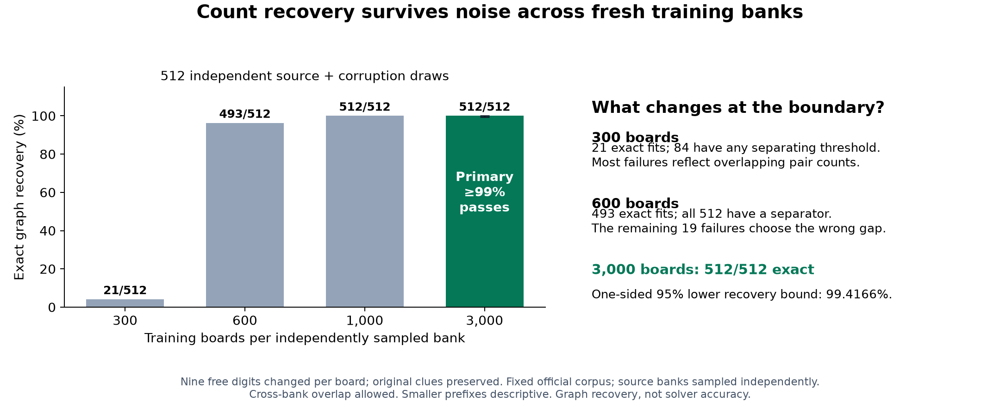

# Fresh source banks confirm noisy-label graph recovery

The unchanged count-gap estimator recovered the exact Sudoku peer graph in **512/512 independent source-bank and corruption draws** at N3000. Its one-sided exact 95% lower recovery bound is **99.416604%**, supporting the frozen ≥99% target. This extends the earlier [six-fixed-bank corruption replication](REPORT-noise-replication.md) by varying the source bank itself.



Every training row has exactly nine distinct originally free digits replaced independently by one of the other eight digits. Original clues stay clean. This changes 11.11% of all cell labels; it does not mean every digit is corrupt. The estimator sees only equality counts, retains counts at or below the floored midpoint of the first largest gap between distinct counts, and uses no geometry or graph oracle.

## Frozen primary and descriptive prefixes

[Protocol](noise_source_replication.json) SHA-256 `b5f37c1dc975f6df7ccdf422ec386f15f73dd0a011f728ad6f89e6ef2ca13b01` predates all new source draws and outcomes. The N3000 primary requires the one-sided exact 95% lower bound to reach 99%; an upper bound below 99% would falsify it. Smaller training sizes are nested prefixes and descriptive.

| Training boards | Exact graphs / 512 | Recovery | Any scalar separator exists | Role |
|---|---:|---:|---:|---|
| 300 | 21 | 4.1016% | 84 | Descriptive |
| 600 | 493 | 96.2891% | 512 | Descriptive |
| 1,000 | 512 | 100% | 512 | Descriptive |
| 3,000 | 512 | 100% | 512 | Frozen primary: supported |

This is a construction-only comparison of data conditions for one count estimator. No optimizer was run; [matched optimizer controls](REPORT-raw-transform.md) are a separate study. The N1000 success does not replace the prespecified N3000 primary.

At N300, 428 banks have overlapping true-peer/nonpeer counts and cannot be fixed by any scalar count threshold. Another 63 admit an exact threshold but the largest-gap rule misses it. At N600, **all 19 failures are threshold-selection failures**: the counts admit a separator, but the unconstrained largest-gap rule picks a different gap. The post-fit graph oracle supplies this diagnosis only and never repairs a model. This boundary motivates a prospective test of a restricted gap selector; it does not establish that such a repair works.

## Independent source sampling

Each bank independently selects 3,000 distinct rows without replacement from a fixed eligible pool of **3,785,228** official training rows. The **46,766** rows previously used by the fixed-bank and clue-acquisition studies are excluded via frozen manifests. Sampling uses a separate declared RNG stream per bank; corruption has its own separate stream.

Cross-bank overlap is allowed. Across 1,536,000 source-row occurrences there are **1,263,280 unique rows**. These are 512 independent draws from the fixed eligible corpus, not 512 globally disjoint banks. Overlap between independent samples does not invalidate independent sampling conditional on that corpus. The experiment still does not vary the corpus or noise mechanism.

## Audit and runtime scope

The [independent audit](audit_noise_source_replication.py) replays every source-bank sample, rereads all 1,263,280 selected rows directly from the CSV using separate parsing code, checks givens against answers, and verifies every selected solution's Sudoku constraints. It checks all **1,536,000 corrupted rows and 13,824,000 changed cells**, then rebuilds all **2,048 count arrays** by direct CPU digit comparisons. All counts, thresholds, hashes, changed-cell identities and unchanged clues match.

The GPU producer instead counts with one-hot FP32 dot products, TF32 disabled, with exact integer sums below 2²⁴; it checks one bank per shard against CPU comparisons before finishing. All 32 shards completed on Foureyes with no failures. Input preparation took 47.20 seconds, dominated by CSV parsing and validation. The independent source/count audit took 21.70 seconds, using eight processes for the count stage. Small GPU jobs finish in seconds; these measurements are not a hardware training-speed comparison, and no redundant search runs were added to keep devices occupied.

The [statistical cross-check](../../../results/research/foureyes/noise_source_replication/statistics-verification.json) compares direct binomial-tail inversion with SciPy beta quantiles; all eight one-sided endpoints agree within 1.9×10⁻¹⁵. Lower and upper bounds are separately one-sided 95%; they are not a joint two-sided 95% interval.

[Public summary and provenance](../../../results/research/foureyes/noise_source_replication/summary.json) · [Recovery curve](../../../results/research/foureyes/noise_source_replication/recovery.csv) · [Every bank and prefix](../../../results/research/foureyes/noise_source_replication/per_bank.csv) · [Producer](noise_source_replication.py) · [Independent auditor](audit_noise_source_replication.py) · [Statistics verification](verify_noise_source_statistics.py) · [Public-data renderer](../../../scripts/plot_noise_source_replication.py)

```sh
# Requires local source data and raw producer archives.
OPENBLAS_NUM_THREADS=1 upstream/.venv/bin/python research/20261114/foureyes/audit_noise_source_replication.py
uv run --no-project --with scipy python research/20261114/foureyes/verify_noise_source_statistics.py
# Public checkout alone suffices for this figure.
uv run --no-project --with matplotlib --with numpy python scripts/plot_noise_source_replication.py
```

Identical recovered graphs imply the same binary energy already audited in earlier solver studies. This experiment measures **graph recovery, not new solver accuracy**. The fixed count-gap rule and corruption mechanism were selected during earlier research; this is a prospective test with fresh source and noise streams. It provides no adversarial-noise, corrupt-clue, or external-distribution guarantee.
