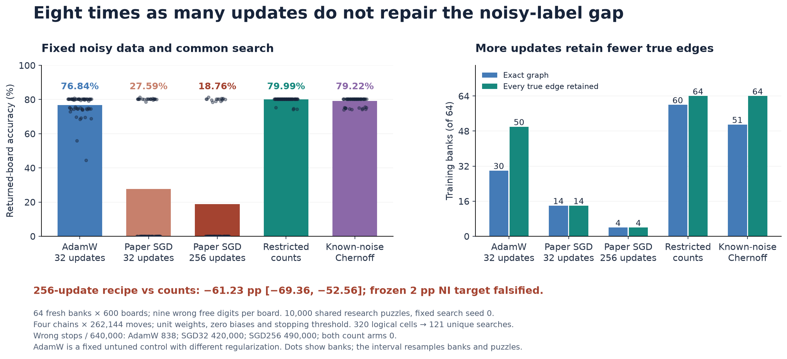

# Eight times as many updates do not repair the noisy-label transformation

**The frozen 2-point noninferiority hypothesis is falsified.** On 64 fresh 600-board training banks with nine corrupted free digits per board, the paper's proximal-SGD recipe with 256 updates followed by the unchanged graph transform solves **18.758125%**, versus **79.990938%** for restricted count thresholding. The paired difference is **−61.232813 percentage points**, with a two-sided 95% interval **[−69.362418, −52.557496]**. The long-trained transformed models produce **490,000 wrong certified stops** across 640,000 logical model–puzzle evaluations.

| Method | Updates | Accuracy | Wrong certified stops / 640,000 | Exact graphs / 64 | All true edges retained / 64 |
|---|---:|---:|---:|---:|---:|
| BP AdamW, fixed conventional control + transform | 32 | 76.840313% | 838 | 30 | 50 |
| Paper proximal SGD + transform | 32 | 27.593281% | 420,000 | 14 | 14 |
| Paper proximal SGD + transform | 256 | 18.758125% | 490,000 | 4 | 4 |
| Restricted count gap | — | 79.990938% | 0 | 60 | 64 |
| Known-noise Chernoff counts | — | 79.222188% | 0 | 51 | 64 |

The prespecified secondary 256-minus-32 update comparison is **−8.835156 points**, with descriptive two-sided 95% interval **[−16.481168, −1.296652]**. It concerns this fixed training and graph-selection pipeline, not every likelihood optimizer, regularizer or threshold. The AdamW arm is untuned and uses a different learning rate and regularization; this is not an optimizer-superiority benchmark. Its 838 wrong stops also show why zero errors in the earlier 32-bank study did not establish a general guarantee.

The primary comparison was fixed after [H4r](REPORT-noisy-pl.md), before any new fit. Both SGD arms start at zero and receive the same noisy bank. The long arm changes the update count and corresponding cosine period from 32 to 256; initial learning rate 540, momentum 0.5 and proximal coefficient 0.003/9 stay fixed. Short runs receive the first 32 of the long arm's digit-relabeling draws. AdamW retains H4r's 32-update, learning-rate 0.01, weight-decay 0.01 control. Count construction receives the same observed labels and masks; only Chernoff receives the correct noise law.

Every likelihood fit uses the same direct float64 digit-orbit projection, nonnegative coefficients, first largest positive-coefficient gap, strict midpoint retention and unit-weight graph as H4r. Inference is common to all arms: unit=1, bias=0, stopping threshold=0, focus offset=0, four chains, 262,144 moves per chain, temperatures 0.4→0.31, focus threshold 0.45, annealing period 524,288 and checks every 4,096 moves. These are normalized transformed-support comparisons, not the paper's original energy and training-derived calibration.

The 64 source/noise draws are independent conditional on the official corpus, sampled without replacement within each bank; cross-bank and prior-study overlap is allowed. The reserved cohort is `full-all[260000,270000)`, with 10,000 shared puzzles and fixed search seed 0. It is a new follow-up slice of the reused official corpus. All **320 logical bank–arm cells** map to **121 distinct support/settings searches**; repeated models retain their bank weights. The independent audit checked **1,210,000 returned boards**, integer fields/energies, exact stopping predicates, clue preservation, all Sudoku constraints and source/output identities. Uncertainty uses 5,000 paired two-way bank/puzzle bootstrap draws, RNG 20261115444, and excludes search-seed variation.

The 192 likelihood fits, count construction and process startup took **6.630 seconds** of four-worker queue wall time. The 121 searches took **82.559 seconds**. The completed receipts establish execution and forward progress; these different workloads are not a fitted-optimizer-versus-count speed comparison.

## A failed small-fixture numerical gate was preserved

Before fresh fitting, the original 256-update gate on 32 prior clean boards failed its CPU/GPU coefficient-separation requirement: maximum coefficient drift was 0.036492. Both float32 runs selected the same two edges. No fresh fit or target search ran under that failed gate. The [original protocol and gate](noisy_pl_long_prelaunch_v1/), [failure receipt](../../../results/research/foureyes/noisy_pl_long/gate-failure.json) and all 64 still-pending fit jobs were preserved at that point.

A separately recorded, source-only [precision diagnosis](long_precision.json) compared native-equivalent float32 and float64 trajectories on paired clean/noisy 32- and 600-board fixtures from one previously audited bank. Every copied float32 GPU trajectory matched the original training function bit-for-bit. On the clean 32-board fixture, float32 and float64 selected supports differed by **805 edges**: float32 retained two, float64 retained 807. CPU/GPU float64 coefficients agreed within 6.08e-9. The noisy 32-board fixture also amplified rounding differences, although its selected support stayed the same.

On both 600-board fixtures, all four CPU/GPU and float32/float64 variants selected identical supports. Maximum GPU float32-versus-float64 coefficient errors were **3.79e-7 clean** and **2.56e-7 noisy**. This localizes the observed failure to those small fixtures; it is not a universal numerical-stability proof or an explanation of all training dynamics. It also shows that agreement between two float32 backends alone can miss precision sensitivity.

Before fresh fitting, the gate was explicitly amended to the planned N600 sample size on **four additional prior noisy banks, 1–4**, which had not received long fits. The scientific fits, source draws, transformation, inference settings, hypothesis and budgets were unchanged. All four prospective checks required identical CPU32/GPU32/GPU64 selected supports and coefficient discrepancy below one quarter of the minimum threshold distance. All passed; the largest discrepancy was **2.75e-7**. Only then did the 192 fresh fits launch. The [final protocol](noisy_pl_long.json), SHA-256 `9d53b8e65e676f443d5b78766d98a5e0212fc350b9dc0380742e3a9218274862`, records the amendment and its adaptive history. The original N32 failure remains a separate result.

[Fit/prepare runner](noisy_pl_long.py) · [matched-size gate](gate_long_matched.py) · [precision diagnostic](diagnose_long_precision.py) · [precision measurements](../../../results/research/foureyes/long_precision/) · [mapping](map_noisy_pl_long.py) · [search](noisy_pl_long_search.py) · [source audit](audit_noisy_pl_long_source.py) · [saved-board audit](audit_noisy_pl_long.py) · [summary](../../../results/research/foureyes/noisy_pl_long/summary.json) · [per-bank results](../../../results/research/foureyes/noisy_pl_long/per_bank.csv) · [graph diagnostics](../../../results/research/foureyes/noisy_pl_long/graph_diagnostics.csv) · [secondary contrast](../../../results/research/foureyes/noisy_pl_long/secondary.json) · [public-only statistical verifier](verify_noisy_pl_long_statistics.py)

A separate [exact objective diagnostic](UNIFORM_PL_ORIGIN.md) analyzes the uniformly digit-averaged loss at zero and distinguishes the nominal proximal coefficient from the implemented momentum update's constant-step stationary equation. It adds no target search and does not claim that the finite training trajectories minimize either objective.

[A later exact graph diagnosis](LOGICAL_SOUNDNESS.md) classifies every model as zero-stop sound or supplies an invalid zero-conflict witness. Missing true edges alone do not establish unsoundness.
