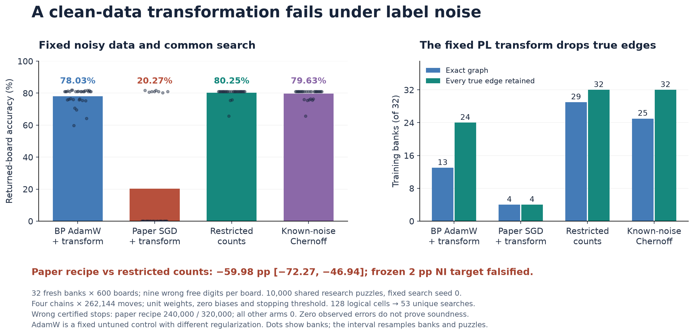

# A clean-data PL transformation fails under label noise

**The frozen 2-point noninferiority hypothesis is falsified.** With nine wrong free-cell labels in each of 600 training boards, the paper's 32-update likelihood recipe followed by the previously fixed graph transformation solves **20.266875%**, versus **80.247500%** for restricted count thresholding. The paired difference is **−59.980625 percentage points**, with a two-sided 95% interval of **[−72.270422, −46.943727]**. The transformed paper fits also produce **240,000 wrong certified stops** across 320,000 logical model–puzzle evaluations.

| Method | Accuracy | Wrong certified stops | Exact graphs / 32 | Models retaining every true edge / 32 |
|---|---:|---:|---:|---:|
| BP AdamW, fixed conventional control, then graph transform | 78.034063% | 0 | 13 | 24 |
| Paper proximal SGD, then graph transform | 20.266875% | 240,000 | 4 | 4 |
| Restricted count gap | 80.247500% | 0 | 29 | 32 |
| Known-noise Chernoff counts | 79.626250% | 0 | 25 | 32 |

Only the paper-recipe versus restricted-count contrast is primary. AdamW and Chernoff comparisons are descriptive. AdamW is a fixed, untuned control, not an optimizer-superiority test: its learning rate and regularization differ from the original recipe. Its selected graphs miss nine true edges in total, despite zero observed wrong stops; this supplies no general stopping guarantee.

Each arm sees the same 32 independently sampled training banks. Within each bank, 600 distinct official training rows are sampled without replacement. Exactly nine distinct free cells per row receive independently uniform alternative digits; clues stay unchanged. Banks may overlap one another and previous studies. The estimators do not receive Sudoku geometry. The Chernoff arm additionally receives the correct corruption law and original free-cell masks, with the previously proved 1% true-edge-deletion bound under that law.

Both likelihood fits start at zero, use full-batch pseudolikelihood on free cells, 32 cosine-scheduled updates, and exactly the same per-board digit relabelings. The paper arm uses initial learning rate 540, momentum 0.5 and proximal L1 weight 0.003/9. Ordinary BP AdamW uses learning rate 0.01, weight decay 0.01, betas (0.9, 0.999) and epsilon 1e-8. These settings were fixed before fresh fitting.

The graph transformation computes the digit-orbit coefficient as diagonal mean minus off-diagonal mean in float64, clamps negative values to zero, finds the first largest adjacent gap among positive coefficients, and retains coefficients strictly above its midpoint. Every retained edge then receives weight one; all biases are zero. There is no tuning against graph truth. Direct float64 averaging avoids redundant float32 averaging in the earlier wrapper.

All four arms use **literal unit=1, bias=0, stopping threshold=0 and focus offset=0**. This removes the possible confound from calibrating stopping and focus on corrupted training boards. It also makes this a comparison of transformed supports, rather than the paper's raw learned energy or its native training-derived calibration. Search uses four chains, 262,144 moves per chain, temperature 0.4→0.31, focus threshold 0.45, annealing period 524,288, checks every 4,096 moves and no restarts.

The reserved evaluation cohort is `full-all[240000,250000)`, with one shared search seed, 0. These 10,000 puzzles belong to the official corpus already used in the reproduction; they are not an external dataset. All 128 logical bank–arm cells reduce to **53 distinct supports and searches**. Identical supports, settings, seed and inputs were executed once, with explicit mappings preserving each bank's statistical weight. The audit checked **530,000 saved returned boards**. Confidence intervals resample 32 bank indices and 10,000 shared puzzle indices, paired across arms, for 5,000 draws with RNG 20261115333. They exclude variation across search seeds.

The structural failure is substantial: transformed paper fits discard **19,415 true edges** in aggregate and add none; AdamW discards nine and adds 19. Restricted counts add five extra edges and Chernoff adds nine, with no missing true edges in either count arm. Under this nonnegative integer energy, a support containing every true edge guarantees that a zero-energy certified stop with preserved clues is a valid Sudoku board. That argument does not cover incomplete supports or capped best-board returns.

Independent validation reread all selected original CSV rows, replayed source and corruption draws, checked every equality count, reconstructed both likelihood transformations directly in NumPy, and checked Chernoff threshold minimality from separately reconstructed rowwise means. Every unique search passed eight native/captured/sparse state comparisons. The final audit reconstructed integer local fields and energies, stopping predicates, returned-board selection, clues, all Sudoku constraints and output hashes.

The 64 likelihood fits completed in **5.148 seconds** of four-worker queue wall time, including process startup and count construction. The 53 searches took **42.342 seconds** of queue wall time. These are different workloads, not an optimizer-versus-count timing benchmark. Live checks observed all four RTX PRO 6000 Blackwell Max-Q GPUs at 91–100% utilization with advancing move counters. Source audit took 5.438 seconds; the saved-board/statistical audit took 3.651 seconds, reusing the hash-checked source audit. The [preflight and execution amendments](NOISY_PL_AMENDMENTS.md) retain a failed parameter-level numerical gate and an artifact-path initialization error.

Exploratory diagnostics after the frozen searches found that simply keeping every positive coefficient preserves all true edges but adds many extras: 25,547 for the paper fits and 23,618 for AdamW, across the 32 banks. Standard global two-means thresholding also fails exact recovery in every bank: it misses 2,881 true edges for paper fits and adds 1,236 extras for AdamW. These source-only diagnoses were chosen after the primary study; no solver result is claimed for either alternative.

[Frozen protocol](noisy_pl.json) · [source preparation and fits](noisy_pl.py) · [implementation gate](gate_noisy_pl.py) · [deduplication](map_noisy_pl.py) · [search execution wrapper](execute_noisy_pl_search.py) · [source audit](audit_noisy_pl_source.py) · [saved-board audit](audit_noisy_pl.py) · [public summary](../../../results/research/foureyes/noisy_pl/summary.json) · [per-bank results](../../../results/research/foureyes/noisy_pl/per_bank.csv)

The [compact outcome bits](../../../results/research/foureyes/noisy_pl/audited-outcome-bits.npz) expose only validity and stopping flags. The [public-only statistical verifier](verify_noisy_pl_statistics.py) reconstructs all four aggregate scores and the exact primary bootstrap interval, and checks 16 resamples by literal indexing. [Export provenance](../../../results/research/foureyes/noisy_pl/outcome-export.json) · [graph diagnostics](../../../results/research/foureyes/noisy_pl/graph_diagnostics.csv) · [source-only gate](../../../results/research/foureyes/noisy_pl/gate.json) · [post hoc positive-support diagnosis](../../../results/research/foureyes/noisy_pl/exploratory-positive-support.json) · [post hoc two-means diagnosis](../../../results/research/foureyes/noisy_pl/exploratory-two-means.json)
