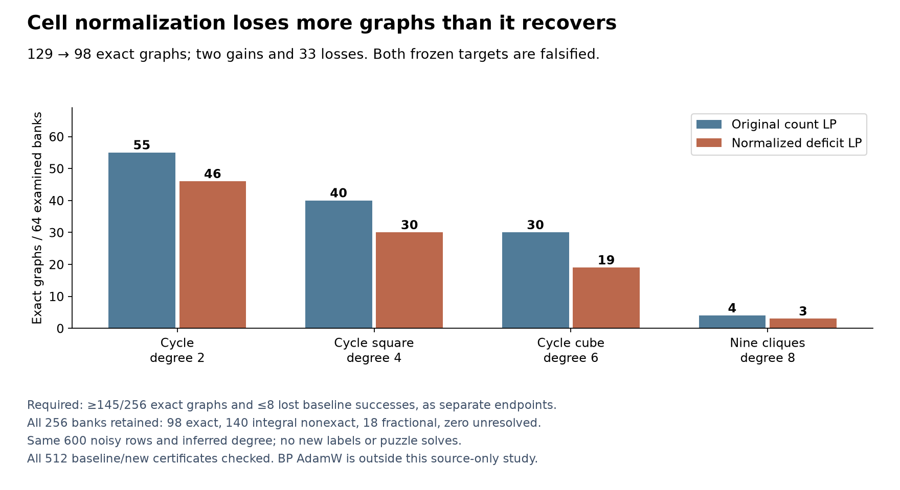

# H4ar: per-cell deficit normalization reduces graph recovery

**Exact graph recovery falls from 129/256 to 98/256, with two gains and 33 losses.** Both separate frozen targets are falsified: at least 145 exact graphs and no more than eight lost baseline successes. All banks are resolved; no omitted or uncertified cases can change either decision.



| Estimator | Cycle /64 | Square /64 | Cube /64 | Nine cliques /64 | Total /256 |
|---|---:|---:|---:|---:|---:|
| BP AdamW | Outside this count/LP intervention; not rerun | — | — | — | — |
| Original 600-row count LP | 55 | 40 | 30 | 4 | 129 |
| Normalized deficit LP | 46 | 30 | 19 | 3 | 98 |

| Family | New recoveries | Lost recoveries | Final fractional failures |
|---|---:|---:|---:|
| Cycle | 0 | 9 | 0 |
| Cycle square | 1 | 11 | 1 |
| Cycle cube | 0 | 11 | 11 |
| Nine cliques | 1 | 2 | 6 |

The intervention uses all 256 examined 600-row banks from [H4an](REPORT-prefix-budget.md). The original inferred degree is held fixed, without supplying a new true degree, family identity, graph geometry or corruption metadata. Every estimator sees the same noisy counts. The [bootstrap intervention](REPORT-bootstrap-consensus.md) previously reached 108/256 on these banks; that is descriptive context with its own failed endpoints, not a new primary comparator. No new source observations, labels, corruption draws, bootstrap samples or puzzle-solving results are added.

The motivation is a heuristic attenuation model. Under independent symmetric corruption, deviations of pair equality probability from `1/9` are scaled by a product of cell factors. The actual experiment selects exactly nine corrupted cells per row and is dependent, so that model is not its exact likelihood. We estimate a per-cell scale from observed counts and test whether dividing by the product of scales improves recovery. These scales are not identified corruption probabilities or calibrated reliabilities.

For equality count `c_ij` among `N=600` rows and the fixed inferred degree `d`, each cell's scale `S_i` is the sum of its `d` largest positive deficits `max(N - 9*c_ij, 0)`, with a lower bound of `d`. Self-pairs are excluded. The new integer cost is

```text
round_half_even(1,000,000 * d² * (9*c_ij - N) / (S_i * S_j))
```

All arithmetic before rounding is exact, including signed numerators and tie handling. Negative costs remain. Every numerator, denominator, scale and final cost is published. The estimator fits one common-degree LP per bank. It uses no true graph or noise identity when constructing scores. Top-degree deficits can select wrong edges and sample extremes, and their neighbors' corruption remains entangled in the scale; this test does not isolate which approximation caused the failure.

All 256 new LPs receive exact primal/dual certificates. There are **98 exact, 140 integral nonexact and 18 fractional outputs**, with **zero unresolved**. Fractional outputs are valid LP optima and resolved graph-recovery failures. The independent auditor reconstructs every score using rational `Fraction` arithmetic, reconstructs the true graph from its sealed vertex order, rechecks every original baseline certificate, and verifies all paired classifications. All **512 baseline/new certificates** pass; **1,536 mutated certificates** are rejected. Original count provenance is inherited from H4an's complete audit and bound by hashes; it is not claimed as newly sampled or independently recollected.

Synthetic preflight covers signed half-even ties, exact arithmetic beyond binary64's consecutive-integer range, self-pair exclusion, all-zero deficit clamping, vertex-permutation equivariance, a negative-cost HiGHS proof, and a `4,800,000,000` cost that requires more than int32. Resolved and unresolved fixtures exercise both separate endpoint boundaries. The seed audit checks the 256 new solver seeds against explicit integer seed fields in the snapshotted frozen protocols; it does not expand every historical formula or claim independence of finite PRNG streams.

The complete run takes **1.168 wall seconds / 6.496 aggregate CPU seconds**, including source hashes, score construction, LPs, per-bank independent audits and export, within the 90-wall/300-CPU limits. Eight single-threaded workers handle independent banks. Live samples record 116 LPs and 110 audits at 0.467 seconds, then all 256 completed before export. One intermediate CPU estimate dips during process reaping; the final aggregate total uses completed-child resource accounting. No GPU work is required. Synthetic score construction takes 1.55 ms for the producer and 2.48 ms for the independent rational implementation on an unrelated 81-cell fixture; those figures do not measure whole-study speedup.

```sh
OPENBLAS_NUM_THREADS=1 OMP_NUM_THREADS=1 python research/20261114/foureyes/audit_normalized_deficit.py
python scripts/plot_normalized_deficit.py
```

[Frozen protocol](normalized-deficit.json) · [Prospective design](normalized-deficit-proposal.json) · [Preflight](normalized-deficit-preflight.json) · [Seed registry](normalized-deficit-seed-audit.json) · [Producer](normalized_deficit.py) · [Independent verifier](audit_normalized_deficit.py) · [All scores and proofs](../../../results/research/foureyes/normalized_deficit/) · [Summary](../../../results/research/foureyes/normalized_deficit/summary.json) · [Live runtime record](../../../results/research/foureyes/normalized_deficit/runtime.json)
