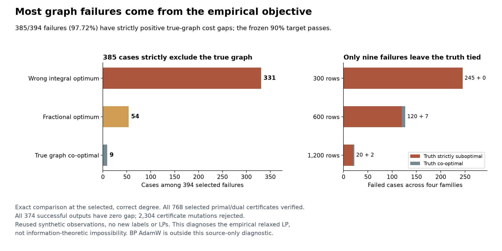

# H4ao: most graph failures are objective errors, not ties

**The true graph has strictly higher empirical LP cost in 385/394 selected failures (97.72%).** This supports the frozen target of at least 355/394 (90%). Only nine failed selections leave the true graph co-optimal. All 374 successful cases have zero cost gap.



The diagnosis uses all 768 cases from the [reduced-data study](REPORT-prefix-budget.md), with its 394 failures fixed before computing any gaps. It adds no observations, labels, fits, optimizations or puzzle-solving evidence. The endpoint is conditional on these examined failures, not a population estimate. BP AdamW is outside this deterministic LP diagnosis and was not rerun.

| Selected failure | Cases | What is established |
|---|---:|---|
| Integral wrong graph with lower cost than truth | 331 | A different feasible graph strictly beats the truth. |
| Fractional optimum with lower cost than truth | 54 | The relaxed optimum excludes truth; this alone does not establish a better integral graph. |
| Integral wrong graph tied with truth | 9 | Truth lies on the optimal face, alongside the selected wrong graph. |

Changing only the LP tie-breaking rule cannot recover truth in the first 385 cases. Adding integrality alone cannot fix the 331 cases with a strictly better integral graph. These statements concern this fixed objective and feasible set; they do not establish that the observations lack information sufficient for another estimator.

For each case, we verify that truth is feasible at the selected degree and compare twice its integer equality-count cost with the certified optimum:

`gap_twice = 2 * sum(cost on true edges) - certified_optimum_twice`

A positive gap excludes the true graph from the optimal face. A zero gap establishes co-optimality; it does not imply uniqueness. Negative gaps are a hard correctness failure. No inference procedure receives the true graph: truth is used only in this retrospective diagnosis.

| Family | Rows | Selected failures | Truth strictly suboptimal | Truth co-optimal |
|---|---:|---:|---:|---:|
| Cycle | 300 | 54 | 54 | 0 |
| Cycle | 600 | 9 | 8 | 1 |
| Cycle | 1,200 | 0 | 0 | 0 |
| Cycle square | 300 | 63 | 63 | 0 |
| Cycle square | 600 | 24 | 21 | 3 |
| Cycle square | 1,200 | 2 | 1 | 1 |
| Cycle cube | 300 | 64 | 64 | 0 |
| Cycle cube | 600 | 34 | 33 | 1 |
| Cycle cube | 1,200 | 4 | 4 | 0 |
| Nine cliques | 300 | 64 | 64 | 0 |
| Nine cliques | 600 | 60 | 58 | 2 |
| Nine cliques | 1,200 | 16 | 15 | 1 |

All cases are retained, including the zero-failure cycle/1,200-row group and all 54 fractional selections. Three previously observed nonmonotonic recoveries also remain in the parent study.

The producer pins every parent archive and receipt, rechecks all 768 selected primal/dual certificates, verifies truth feasibility and calculates gaps with Python integers. The separate auditor reconstructs every graph from its vertex permutation, checks primal feasibility, dual feasibility and exact objective equality using another implementation, and rejects 2,304 altered certificates. The parent study's complete source-regeneration and count audits are inherited through pinned public artifacts; this study does not repeat that full generation within its budget. Public replay requires no raw private archive or LP solver.

The scientific phase takes **2.016 wall / 2.015 CPU seconds**, including hashes, archive loading, proofs, aggregation and initial exports, within the frozen 90-wall/60-CPU limits. The independent replay takes 1.918 seconds; another agent's independent replay also passes in 1.908 seconds. Reading only the selected-degree witness from each archive avoids decompressing the forty unneeded degree witnesses. No GPU work is eligible for this exact-integer diagnosis.

```sh
OPENBLAS_NUM_THREADS=1 OMP_NUM_THREADS=1 python research/20261114/foureyes/audit_objective_gap.py
python scripts/plot_objective_gap.py
```

[Frozen protocol](objective-gap.json) · [Prospective proposal](objective-gap-proposal.json) · [Toy gates](objective-gap-preflight.json) · [Producer](objective_gap.py) · [Independent verifier](audit_objective_gap.py) · [Every exact gap](../../../results/research/foureyes/objective_gap/rows.json) · [Summary](../../../results/research/foureyes/objective_gap/summary.json) · [Figure provenance](../../../assets/figures/objective-gap-provenance.json)
