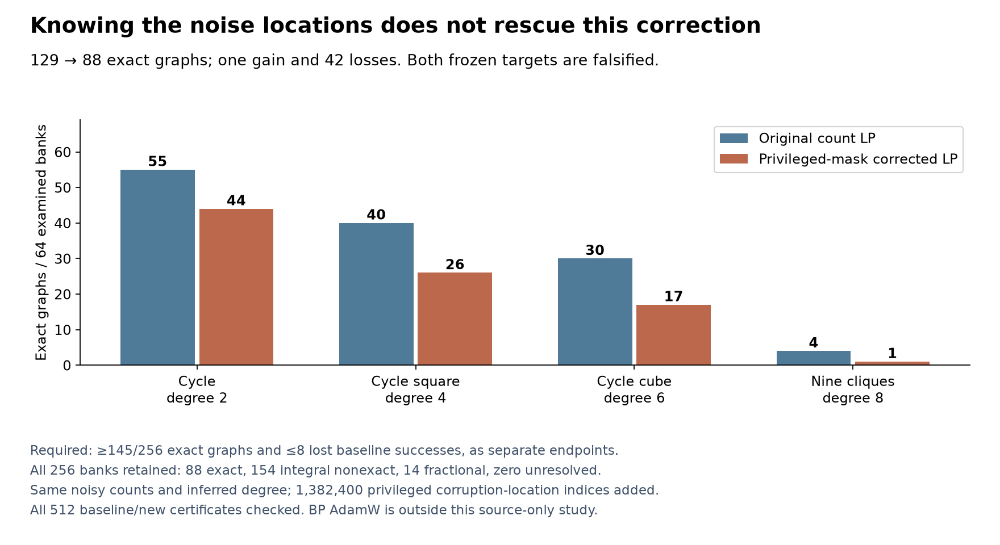

# H4as: supplied noise locations do not rescue the attenuation correction

**Exact graph recovery falls from 129/256 to 88/256 despite supplying the actual corruption locations.** There is one gain and 42 lost baseline successes. Both separately frozen targets fail: at least 145 exact graphs and at most eight lost successes. Every bank is resolved.



| Estimator | Cycle /64 | Square /64 | Cube /64 | Nine cliques /64 | Total /256 |
|---|---:|---:|---:|---:|---:|
| BP AdamW | Outside this source intervention; not rerun | — | — | — | — |
| Original 600-row count LP | 55 | 40 | 30 | 4 | 129 |
| Attenuation-corrected LP with privileged masks | 44 | 26 | 17 | 1 | 88 |

| Family | New recoveries | Lost recoveries | Fractional failures |
|---|---:|---:|---:|
| Cycle | 0 | 11 | 2 |
| Cycle square | 0 | 14 | 0 |
| Cycle cube | 0 | 13 | 4 |
| Nine cliques | 1 | 4 | 8 |

This is an intervention on all 256 examined [H4an](REPORT-prefix-budget.md) banks, preserving their 600 noisy observations and original inferred degrees. The scorer additionally receives **1,382,400 archived corruption-location indices**, defining 12,441,600 Boolean mask entries. Those locations are privileged supervision, not ordinary observations or free label queries. The scorer receives equality counts and masks only; it has no clean digits, actual noise offsets, true graph, true degree or geometry. There are no fresh source draws, observed labels, noise draws or puzzle solves.

The earlier [observable per-cell normalization](REPORT-normalized-deficit.md) recovered 98/256. H4as asks whether replacing its heuristic cell scales with an exact conditional channel correction helps. This fixed correction fails even with masks. That does not establish an oracle-optimal bound or show that corruption locations cannot help another estimator.

For cell-corruption indicator `m_ri`, write `b_ri = 1 - 9*m_ri/8`. Independent uniform nonzero digit offsets give the exact identity

```text
E[9*I(Y_ri = Y_rj) - 1 | clean digits, corruption masks]
  = b_ri*b_rj * (9*I(X_ri = X_rj) - 1).
```

Conditioning on the masks allows their selection to be dependent, as it is when exactly nine cells are corrupted per row. The independence needed here is between the subsequent digit-offset channels. For a true exclusion edge, the clean values always differ. With `N = 600` and noisy equality count `c_ij`, the estimator uses

```text
W_ij = sum_r (8 - 9*m_ri)*(8 - 9*m_rj)
cost_ij = round_half_even(64,000,000 * (9*c_ij - N) / W_ij).
```

When `W_ij > 0`, the unrounded true-edge cost has conditional expectation −1,000,000; rounding changes that expectation by at most 0.5. This is a mean statement, not a variance bound or recovery guarantee. A bank with any nonpositive denominator would remain unresolved and skip its LP, with no clamping or pair deletion. All observed denominators are positive, spanning 6,063–38,184; integer costs span −2,356,504–2,628,337. One common-degree LP is fitted per bank with exact signed costs and no graph rounding or outcome-based tuning.

The results contain **88 exact graphs, 154 integral nonexact optima, 14 fractional optima and zero unresolved banks**. All 256 new LPs have exact scale-two primal/dual certificates. The auditor also rechecks all 256 baseline certificates and rejects three mutations per valid proof: **512 certificates and 1,536 rejected mutations**. Certified fractional optima are resolved graph-recovery failures.

Source and archive hashes were frozen before any study-mask read, corrected score or new LP. The independent mask auditor regenerates the original full 2,400-row RNG selection stream and stable exponential-race ordering before taking the 600-row prefix; it never regenerates a shorter stream in its place. It binds each source mapping to the original H4an protocol. Scores are independently reconstructed with Boolean intersections and exact rational rounding using

```text
W_ij = 64*N - 72*(corrupted_count_i + corrupted_count_j)
       + 81*joint_corruption_count_ij.
```

This differs from the producer's int64 channel matrix product. All supplied masks, numerators, attenuation denominators, costs and proofs are public. Original noisy-count provenance remains inherited from H4an's complete audit and hash-bound inputs. The portable checker regenerates masks and checks scores/proofs even without the raw archives; it explicitly reports unavailable archives and does not claim to repeat raw count generation.

The synthetic preflight enumerates 324 conditional channel cases and 6,561 offset outcomes, checks signed half-even arithmetic and int16/int32 overflow boundaries, full-stream mask replay, nonpositive whole-bank handling, large signed-cost LP proofs, and resolved/unresolved endpoint boundaries. Ripper independently reviewed the source and repeated the preflight in an isolated copy. Its suggested explicit parent-job equality check was added before the final gate and freeze. On an unrelated 81-cell/600-row fixture, replacing literal pair loops with the expanded Boolean audit reduced median score-check time from **148.08 ms to 3.12 ms (47.40×)**. This is an audit microbenchmark, not a whole-study speedup.

The complete scientific run, including input hash checks, mask extraction, LP fits, independent bank audits and export, takes **2.233 wall seconds / 14.735 aggregate CPU seconds** with eight single-threaded workers, inside the frozen 90-wall/300-CPU limits. Live samples record eight active workers with 24 LPs/16 audits at 0.471 seconds and 56 LPs/48 audits at 0.673 seconds. GPUs are unused by this CPU LP workload. Separate full root and Ripper replays pass in 1.383 and 1.370 seconds. Seed checks cover explicit integer seed fields in snapshotted protocols; they do not establish PRNG independence or expand every historical formula.

```sh
OPENBLAS_NUM_THREADS=1 OMP_NUM_THREADS=1 python research/20261114/foureyes/audit_oracle_attenuation.py
python scripts/plot_oracle_attenuation.py
```

Protocol SHA-256: `1278b221a9777046ec04c634fe02c52dd975d98dd1c35e8bfaff5ac1e2f28d30`.

[Frozen protocol](oracle-attenuation.json) · [Prospective design](oracle-attenuation-proposal.json) · [Preflight](oracle-attenuation-preflight.json) · [Seed registry](oracle-attenuation-seed-audit.json) · [Score implementations](oracle_attenuation_math.py) · [Producer](oracle_attenuation.py) · [Independent verifier](audit_oracle_attenuation.py) · [All masks, costs and proofs](../../../results/research/foureyes/oracle_attenuation/) · [Summary](../../../results/research/foureyes/oracle_attenuation/summary.json) · [Runtime](../../../results/research/foureyes/oracle_attenuation/runtime.json)
