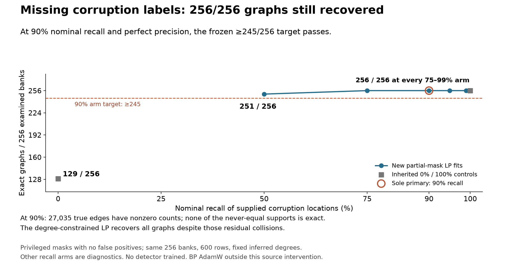

# H4au: partial corruption masks retain complete graph recovery

**Revealing 90% of the actual corruption locations still recovers 256/256 examined graphs.** The sole prospective target, at least 245 exact graphs at 90% nominal recall, passes. Precision is artificially perfect: every revealed location is truly corrupted. No practical detector is trained or evaluated.



| Method or nominal mask recall | Exact /256 | Cycle /64 | Square /64 | Cube /64 | Nine cliques /64 | New fits |
|---|---:|---:|---:|---:|---:|---:|
| BP AdamW | Outside this source intervention | — | — | — | — | Not rerun |
| 0%, original noisy counts | 129 | 55 | 40 | 30 | 4 | Inherited |
| 50% | 251 | 64 | 62 | 62 | 63 | 256 |
| 75% | 256 | 64 | 64 | 64 | 64 | 256 |
| **90%, sole primary** | **256** | **64** | **64** | **64** | **64** | **256** |
| 95% | 256 | 64 | 64 | 64 | 64 | 256 |
| 99% | 256 | 64 | 64 | 64 | 64 | 256 |
| 100%, complete supplied masks | 256 | 64 | 64 | 64 | 64 | Inherited |

All 1,280 new outputs are retained. There are no fractional or unresolved outputs. The five failures at 50% are integral nonexact graphs: banks 86, 133, 225, 242 and 243. Bank 133 loses a baseline success; 123 banks gain one. At each higher tested recall, 127 banks gain a recovery and none lose one. The 50%, 75%, 95% and 99% arms are prespecified diagnostics; their observations do not establish a population recall threshold.

The inputs are the same 256 [H4at](REPORT-corruption-censor.md) synthetic-family banks, their 600 noisy rows, and their original inferred degrees. There are no new source observations, labels, corruption draws or puzzle solves. The scorer receives noisy values and the partial Boolean mask. Clean digits, actual offsets, full masks and true graph geometry do not enter scoring. Full locations are used by a separate, explicitly privileged thinning step.

For each bank, PCG64 with `SeedSequence([2120131601, bank_index])` produces 5,400 unsigned 64-bit draws, one for each existing corruption location in the exported row/index order. A nominal recall of integer percent `p` reveals a location exactly when its draw is below `floor(p × 2^64 / 100)`. The probability under the uniform integer model differs downward from the nominal rate by less than `2^-64`. The same draws couple all five arms, yielding nested masks. There is no resampling to obtain a desired recall or recovery outcome.

The realized numbers of revealed locations are 691,143; 1,037,437; 1,244,265; 1,313,188; and 1,368,598 out of 1,382,400, respectively. These are supervision counts, not newly acquired noisy-label queries. The masks supply no false positive locations. Their precision and their omission mechanism need not resemble a learned detector.

Each pair retains a row only when neither cell is revealed as corrupted. Its LP cost is the raw number of retained equal-digit observations, with no smoothing, exposure normalization or imputation. Zero-exposure pairs would keep cost zero; none occur. Minimum pair exposures are 314, 222, 170, 151 and 139 across the five arms. The original inferred degree remains fixed and an exact scale-two primal/dual certificate is required; graph rounding is forbidden.

Unlike complete censoring, partial masks leave true-edge collisions. At 90% recall, **27,035 true edges have positive equality counts**, all 256 optimal objectives are positive, and **none of the never-equal supports matches the true graph**. Nevertheless, every degree-constrained LP returns truth. All five 50% failures strictly exclude truth under their corresponding objective. These prespecified post-fit diagnostics distinguish the fitted graph from the raw zero-count support; they add no new efficacy endpoint or uniqueness proof.

The sole decision uses the complete 256-bank denominator: support if the number of exact graphs is at least 245; falsify if exact plus unresolved is below 245; otherwise report inconclusive. The observed interval is `[256, 256]`. No lower-recall arm can substitute for this primary.

The charged auditor independently reconstructs the raw draws in row-sized calls, builds masks through scalar integer/index loops, and recomputes every retained count by separately selecting rows for each pair. It replays the inherited H4at observation/mask checks and both baseline certificates once per bank. All **1,280 new and 512 inherited certificates** pass; all **5,376 mutated proofs** are rejected. True graphs are reconstructed from pinned permutations only after fitting. Public inputs suffice for this replay; original clean-source generation remains inherited from the earlier complete audits.

Independent pre-freeze review caught a proposed solver-seed range overlapping 56 actual H4at seeds. Before any study mask, score or LP was generated, the proposal moved to seeds `2120131702..2120132981`; the audit now explicitly expands the entire H4at seed range. The initial proposal and gate remain in the local review archive. This was a correction to the unused-seed claim, not evidence of repeated corruption draws. The corrected gate covers exact threshold boundaries including 0%/100%, nesting, precision, row/batch draw parity, index permutation, malformed inputs, positive true-edge costs from missed corruption, zero exposures, proof mutations and every primary decision boundary. Ripper independently replays the synthetic gate and reviews the source before freeze.

On an unrelated 600×81 fixture, vectorized mask construction takes 0.488 ms versus 1.772 ms for the independent scalar method. This measures one preparation operation. The complete study takes **7.544 wall seconds / 56.549 aggregate CPU seconds**, including hashes, all fits, all audits and export, within its 180-wall/900-CPU limits. Eight workers advance from 350 LPs/64 audited banks at 1.892 seconds to 640/121 at 3.530 seconds and 959/184 at 5.188 seconds. The manual external snapshot arrives after completion; active progress comes from the retained in-run monitor. No GPU implementation is required. Separate root and Ripper public replays pass, the latter in 4.998 seconds.

```sh
OPENBLAS_NUM_THREADS=1 OMP_NUM_THREADS=1 python research/20261114/foureyes/audit_partial_mask_recall.py
python scripts/plot_partial_mask_recall.py
```

Protocol SHA-256: `9d32bf80dff3e3142afa93037ffb718ea180c1d2fbf9d08711ea726c3050b195`.

[Frozen protocol](partial-mask-recall.json) · [Prospective design](partial-mask-recall-proposal.json) · [Preflight](partial-mask-recall-preflight.json) · [Seed audit](partial-mask-recall-seed-audit.json) · [Mask construction](partial_mask_math.py) · [Runner](partial_mask_recall.py) · [Independent auditor](audit_partial_mask_recall.py) · [All draws, masks and certificates](../../../results/research/foureyes/partial_mask_recall/) · [Summary](../../../results/research/foureyes/partial_mask_recall/summary.json) · [Runtime](../../../results/research/foureyes/partial_mask_recall/runtime.json)
