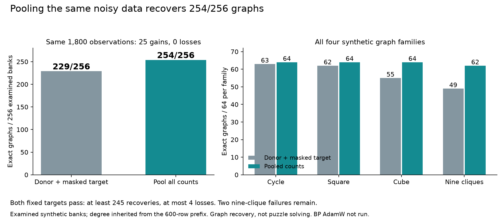

# H4bb: pooling the same observations recovers 254/256 graphs

Pooling all **1,800 noisy rows** into one equality-count fit recovers **254/256** exact graphs, compared with **229/256** for a 1,200-row donor followed by masking the 600-row target. It gains **25 graphs and loses none** on the same examined banks and observation union. Both frozen endpoints pass separately: at least 245 recoveries and at most four regressions.

| Method | Exact / 256 | Observation scope |
|---|---:|---|
| BP AdamW | Not run | Outside this structural inference comparison |
| Donor graph alone | 229 | 1,200 donor rows; inherited diagnostic control |
| Donor then masked target | 229 | 1,800 rows total; inherited paired control |
| Pooled raw equality counts | **254** | **The same 1,800 rows**, one new LP per bank |



This removes the observation-budget advantage in the preceding donor comparison. It supports using all available noisy counts in this cohort. It does not establish fresh-cohort generalization, equal training compute, or puzzle-solving accuracy. All methods use the degree previously inferred from the original 600-row target. The donor-only control has fewer observations; it is shown to make the absence of an exact-recovery gain from masking on these H4ba banks explicit.

## Fixed comparison

The [proposal](pooled-donor-proposal.json) fixes the exact H4ba target rows 0..599 and donor rows 600..1799. Production concatenates their noisy labels, constructs literal raw pair-equality counts and solves one unchanged degree-constrained LP per bank. No actual corruption locations, clean labels or graph truth enter the fit. All 256 fit attempts are globally sealed before diagnostics inspect truth. There is no reselected degree, cost weighting, fractional snapping, smoothing or threshold tuning.

The four synthetic families are randomly relabeled 81-node cycles, cycle squares, cycle cubes and nine disjoint nine-cliques, with 64 banks each. Each noisy row has exactly nine corruptions, concentrated toward 18 hot cells with weight 32. These banks were generated and examined in earlier studies. H4bb acquires no new labels or source draws, and its frozen hypothesis is an intervention on that existing cohort. [Original source studies](REPORT-varying-degree.md) · [Cycle powers](REPORT-cycle-power.md) · [600-row degree selection](REPORT-prefix-budget.md).

The [preflight](pooled-donor-preflight.json) checks the literal 1,800-row union and independent counts, global seal ordering, proof/input mutations, missing and fractional outcomes, and both endpoint boundaries. The [seed audit](pooled-donor-seed-audit.json) checks the declared solver-seed lineage. The [frozen protocol](pooled-donor.json) SHA-256 is `b03a6c0703b1e5241458a0972acc854da0b3a926fe7ff6a3d2fc4f0e42b89d2b`.

## All outcomes and costs

| Separate endpoint | Observed bound | Decision |
|---|---:|---|
| Exact recovery ≥245/256 | [254,254] | Supported |
| Regressions among 229 H4ba successes ≤4 | [0,0] | Supported |

All banks remain in the result: 254 exact, two integral nonexact, zero fractional and zero unresolved. Exact counts by family are **64/64 cycles, 64/64 squares, 64/64 cubes and 62/64 nine-clique graphs**. The two failures are banks 35 and 227. They miss/add three and two edges respectively; truth has strictly higher objective, with twice-objective gaps 8 and 32. Their failure is not an uncertified solve or a numerical tie.

The charged audit checks all **256 new and 1,536 inherited certificates**, rejects **5,376 proof mutations**, replays H4ba's donor/mask/censor derivations, and reconstructs the complete original 2,400-row noise stream before comparing the selected 1,800-row union. [H4ba outcomes and masking limitation](REPORT-larger-donor.md). The original H4ay technical failure and separate H4az repair remain unchanged. [Failure and repair history](REPORT-disjoint-donor.md).

The complete run takes **8.642092785 wall seconds / 60.721042 aggregate CPU seconds**, below the frozen 120-wall/600-CPU limits with eight workers. All 16 fit/audit worker commands exit zero. Forty-two internal monitor samples retain live worker PIDs, CPU progress and counters ending at 256 LPs and 256 audited banks. External process snapshots missed the active phases, so they are not evidence of live utilization. This LP/certificate pipeline has no eligible GPU work; gates and publication replays are timed separately.

## Replay

```bash
OPENBLAS_NUM_THREADS=1 OMP_NUM_THREADS=1 MKL_NUM_THREADS=1 \
  upstream/.venv/bin/python research/20261114/foureyes/audit_pooled_donor.py
```

The [public summary](../../../results/research/foureyes/pooled_donor/summary.json) binds every bank, certificate, endpoint and paired change. Public-only replay checks the observed union, exact counts, proofs, inherited derivations, global seal and runtime, while explicitly reporting unavailable raw source archives. It inherits original clean-source/noise provenance from the complete charged audit when those raw archives are absent. A separate isolated public-only replay passes in 6.282 seconds; a full-raw replay passes in 6.936850 seconds. Neither is part of the charged study runtime.
