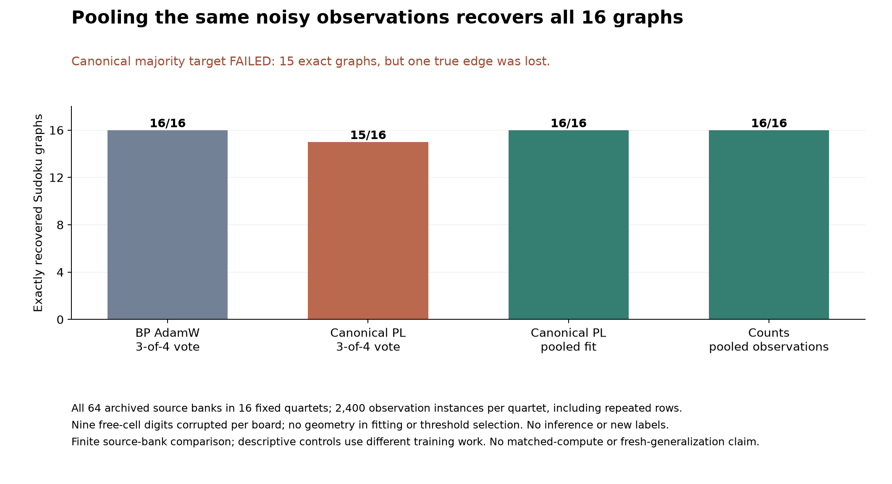

# H4ac: pooling recovers the graph; canonical majority misses one edge

**The frozen majority-vote hypothesis is falsified.** A three-of-four vote over the canonical strong supports recovers 15 of 16 exact Sudoku graphs but drops one true edge. The target required both at least 15 exact graphs and zero missing true edges. BP AdamW votes and both pooled controls recover all 16 graphs.

| Method | Exact graphs | Groups retaining every true edge | Missing true edges | Extra edges |
|---|---:|---:|---:|---:|
| BP AdamW, three-of-four archived supports | 16/16 | 16/16 | 0 | 0 |
| Canonical PL, three-of-four strong supports | 15/16 | 15/16 | 1 | 0 |
| Canonical PL, one pooled fit | 16/16 | 16/16 | 0 | 0 |
| Restricted-gap counts, pooled observations | 16/16 | 16/16 | 0 | 0 |

All 64 H4y training banks are partitioned in order into 16 disjoint quartets, with no selection or replacement. Each arm receives the same 2,400 noisy board observations per quartet. Repeated appearances of a source row are retained; this is a comparison at fixed observation count, not fixed distinct-label count. Each original bank has 600 boards with nine free digits per board changed uniformly to different digits; given clues remain correct.

The pooled canonical fit uses the unchanged FP64 recipe: raw penalty 1/30000, 256 proximal-gradient updates, initial step 540 and the same backtracking. Its strong support retains positive coefficients at least one quarter of the median positive coefficient. Each canonical vote uses that identical rule on the separately fitted bank. Restricted counts choose the first largest adjacent distinct-count gap whose upper endpoint is at or below the median, then retain counts at or below its floored midpoint. Neither threshold receives Sudoku geometry. Geometry is used only to audit recovered graphs.

The two separately fitted estimators and the count procedure have different training work and regularization. Their comparison is descriptive; no matched-compute or optimizer superiority claim follows. These are fixed, previously examined source banks, not fresh independent replication or a population guarantee. Losing an individual true edge does not itself prove an unsound certificate. This study measures graph recovery and does not run inference or claim any search accuracy.

Before fitting, all four GPUs pass independent NumPy-versus-Torch loss/gradient checks on their 2,400-row group at zero and two archived coefficient vectors, each below 1e-12 error. The raw auditor reconstructs every concatenation without deduplication, every vote and threshold, all 256 updates in every finite history, monotonic objectives, and final independent NumPy loss, gradient and KKT residual. All 16 fits complete; none is filtered.

The four-worker numerical gate takes **3.929 seconds** and the fit phase **5.560 seconds**, including worker startup and monitoring. Charging all four workers for both phases gives a **0.633 GPU-minute upper envelope**, below the frozen 15-minute ceiling. Live samples show all four GPUs at 97% while completed groups advance through 0, 4, 8, 12 and 16. CPU source/outcome audit cost is outside that GPU-phase envelope and was not separately timed. No new source rows, puzzle inputs or inference runs are consumed.

The public verifier rebuilds votes, thresholds, all graph counts and the decision from tracked arrays, and recomputes the KKT residual from the stored independently calculated gradient. Reconstructing gradients from noisy boards, fitting histories and original row provenance requires the excluded local raw archive; the public check does not claim to replay those steps.

[Frozen protocol](pooled_source_study.json) · [Runner](pooled_source_study.py) · [Independent raw auditor](audit_pooled_source_study.py) · [Public verifier](verify_pooled_source_public.py) · [Models and measurements](../../../results/research/foureyes/pooled_source_study/) · [Figure renderer](../../../scripts/plot_pooled_source.py) · [Original bank study](REPORT-canonical-confirm.md)
