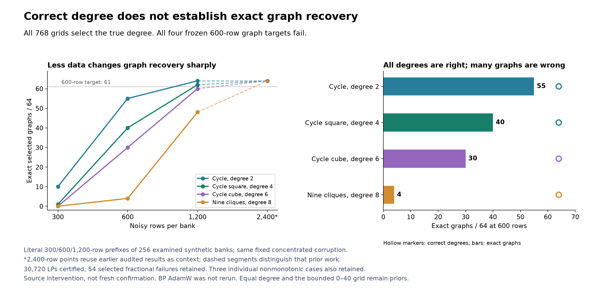

# H4an: correct degree survives a data reduction; exact graphs do not

**All 768 degree grids select the true degree, but all four frozen 600-row graph-recovery targets fail.** This tests literal prefixes of 256 already examined synthetic banks. It introduces no fresh draws, labels, model fits or puzzle-solving results.



| Graph family | Degree | 300 rows: exact / 64 | 600 rows: exact / 64 | 1,200 rows: exact / 64 | Earlier 2,400 rows: exact / 64 |
|---|---:|---:|---:|---:|---:|
| Cycle | 2 | 10 | 55 | 64 | 64 |
| Cycle square | 4 | 1 | 40 | 62 | 64 |
| Cycle cube | 6 | 0 | 30 | 60 | 64 |
| Nine disjoint cliques | 8 | 0 | 4 | 48 | 64 |

The four separate primary targets require at least 61/64 exact graphs at 600 rows. Each is falsified, with no unresolved cases. The 300- and 1,200-row results are descriptive. The 2,400-row points are context from [H4al](REPORT-varying-degree.md) and [H4am](REPORT-cycle-power.md), whose LP solver seed differs from this study; dashed plot segments distinguish those earlier results. These are four specified distributions, not arbitrary regular graphs or a population confidence claim.

| Estimator | 600-row cycle | Square | Cube | Cliques |
|---|---:|---:|---:|---:|
| BP AdamW | Outside this count/LP intervention; not rerun | — | — | — |
| Restricted count gap | 0/64 | 0/64 | 0/64 | 0/64 |
| Raw regularity | 0/64 | 0/64 | 0/64 | 0/64 |
| Centered regularity | 0/64 | 0/64 | 0/64 | 0/64 |
| Exact LP degree curvature | 55/64 | 40/64 | 30/64 | 4/64 |

Every prefix preserves its parent's vertex permutation, uniform proper-coloring stream and concentrated corruption: eighteen hot cells weighted 32, with exactly nine digits changed per row. Inference receives raw equality counts for all 3,240 pairs. It minimizes cost separately at degrees zero through forty, then selects the largest exact second difference over degrees one through thirty-nine, breaking ties toward the smaller degree. The true graph and family do not enter inference. Equal degree and the bounded grid remain supplied priors.

The experiment retains **374 exact graphs, 340 integral nonexact outputs and 54 selected fractional outputs**. A selected fractional or nonexact optimum counts as failure. This does not establish that the true graph is absent from the optimal face: the certificates prove optimality, not uniqueness. It also does not establish information-theoretic impossibility.

Three individual reversals remain in the public data: square bank 23 is exact at 600 rows but not 1,200; cycle bank 35 is exact at 300 but not 600; cube bank 40 is exact at 600 but not 1,200. Aggregate improvement with more data is not monotonicity for each realized bank.

All **30,720 positive-degree LP certificates**, 768 analytic degree-zero witnesses and exact selections passed independent auditing; **92,160 certificate mutations** were rejected. The grid contains 20,922 intermediate fractional optima. A separate count implementation checks every prefix. Public verification regenerates all synthetic observations from the frozen parent seeds and checks the public generation manifests, counts, primal/dual proofs, controls and decisions. A second agent independently replayed this verification successfully.

The eight-worker scientific phase, including counts, LPs, independent auditing and export, took **42.125 wall seconds / 327.881 aggregate CPU seconds**, within its 180-wall/900-CPU limits. The monitor retained 194 samples: at 20.984 seconds, 743 grids and 29,760 positive degrees were complete; the final sample has all 768 grids and no active workers. Grouping jobs by source bank avoids repeated archive loading. GPU work is zero because this intervention consists of CPU linear programs. Later public verification took 109.726 wall / 109.583 CPU seconds; the independent replay took 109.425 wall / 109.421 CPU seconds.

```sh
OPENBLAS_NUM_THREADS=1 OMP_NUM_THREADS=1 python research/20261114/foureyes/audit_prefix_budget.py
python scripts/plot_prefix_budget.py
```

[Frozen protocol](prefix_budget.json) · [Prospective proposal](prefix-budget-proposal.json) · [Preflight](prefix-budget-preflight.json) · [Producer](prefix_budget.py) · [Public auditor](audit_prefix_budget.py) · [All certificates and decisions](../../../results/research/foureyes/prefix_budget/degree/) · [Figure provenance](../../../assets/figures/prefix-budget-provenance.json)
