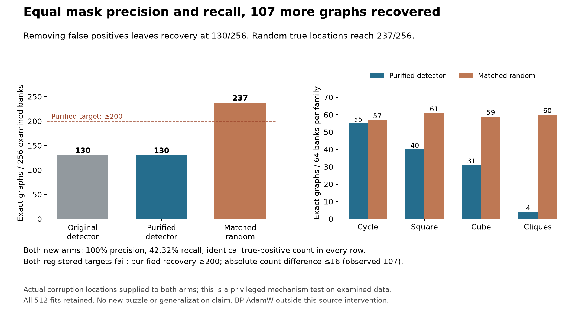

# H4aw: perfect precision leaves the detector at 130/256

Removing every false positive from the H4av detector leaves exact graph recovery at **130/256**. Selecting the same number of actual corruptions randomly in each row instead recovers **237/256**. Both new masks have **100% precision and 42.3176% recall**, with identical true-positive counts in every row. Both registered targets are **falsified**: purified recovery is below 200, and the absolute recovery-count difference is 107 rather than at most 16.

| Method | Exact graphs | Integral nonexact | Fractional | Unresolved |
|---|---:|---:|---:|---:|
| BP AdamW | Outside this structural intervention; not run | — | — | — |
| H4av observable detector, inherited | 130/256 | 122 | 4 | 0 |
| Purified detector, privileged | 130/256 | 122 | 4 | 0 |
| Matched-recall random true locations, privileged | 237/256 | 19 | 0 | 0 |



These are all 256 examined 600-row synthetic-family banks, with unchanged noisy observations and original inferred degrees. **Actual corruption locations are supplied to both new arms.** This tests a specific mechanism after observing H4av, not a practical detector or fresh generalization. No new sources, digit labels, noise, model training or puzzles are acquired.

## Frozen interventions and decisions

The [proposal](purified-detector-proposal.json), [seed audit](purified-detector-seed-audit.json) and independently replayed [synthetic gate](purified-detector-preflight.json) precede [protocol](purified-detector.json) SHA256 `2ddcf81e4c24f9598adcb304f79d3ca9b8eaa6f376a35318cf484b16d9247ff2`.

The purified mask is exactly the intersection of the frozen detector mask and the actual corruption mask. It keeps every original true positive and removes every false positive. For each row, the matched random arm samples exactly the purified mask's number of locations uniformly without replacement from the nine actual corruptions. True indices are sorted first; PCG64 `2120300000 + bank` calls `choice` on every row, including counts zero and nine. The sampler retains every row and uses no outcomes.

Both arms discard pair observations touching a flag, keep raw retained equality counts, and fit the unchanged original common degree. No exposure normalization, smoothing or imputation is used. Solver seeds are `2120331702 + 2*bank + arm`. The seed audit checks explicit historical fields and expands actual H4at/H4au/H4av solver seeds plus all H4av mask seeds; it does not establish independent streams or exhaust undocumented formulas.

| Separate registered target | Observed interval | Decision |
|---|---:|---|
| Purified exact count at least 200/256 | [130, 130] | Falsified |
| Absolute difference from matched random at most 16 | Signed difference [-107, -107] | Falsified |

Unresolved outputs would widen the count/difference intervals. A location-sensitivity pass would require the entire signed interval to lie within [-16,16]; failure requires it to lie wholly outside. This is a finite-cohort count criterion, not a population equivalence test. No output is unresolved here; all four purified fractional optima are retained as failures.

## What changes and what does not

Both arms flag **584,998 true corruptions** and miss 797,402, with no false positives. The observed rowwise counts range from zero to eight. They have identical precision, aggregate recall and rowwise recall, but different per-cell frequencies and pair exposures. Removing false positives also re-exposes clean observations, so the intervention does not isolate an abstract precision-only effect.

The purified arm has no gained or lost exact graph relative to H4av's detector. Relative to original noisy counts, it retains the one gain at bank 118 and zero losses. Its four fractional failures remain banks 15, 46, 122 and 238. Equality of recovery flags does not assert identical LP optimizers.

Matched random masks gain **107** exact graphs and lose none versus the detector; versus original counts, they gain 108 and lose none. The 19 retained failures are banks 0, 2, 4, 10, 47, 48, 54, 63, 66, 96, 112, 123, 140, 163, 193, 225, 228, 229 and 242. All are integral nonexact.

| Family, 64 banks each | BP AdamW | Purified | Matched random |
|---|---|---:|---:|
| Cycle | Not run | 55 | 57 |
| Cycle square | Not run | 40 | 61 |
| Cycle cube | Not run | 31 | 59 |
| Nine-clique union | Not run | 4 | 60 |

Pair exposures range from 170 to 600 under purification and 265 to 600 under matched random masks. Neither arm has a zero-exposure pair, and none of its raw never-equal supports is exact. All 126 purified failures strictly exclude truth from the optimum; the random arm has sixteen strict exclusions and three cooptimal failures. Every bank's location counts, exposure ranges, support errors, exact objective gaps and outcome are in the [complete public summary](../../../results/research/foureyes/purified_detector/summary.json).

## Sealing, audit and runtime

A trusted preparation stage reads actual corruption locations and frozen detector masks, then seals all **512 prepared masks before any new fit**. Fit workers decode only noisy observations, prepared masks and inherited degrees. A second global seal binds all **512 fits before graph geometry and outcomes are joined**. [Mask seal](../../../results/research/foureyes/purified_detector/mask-seal.json) · [Fit seal](../../../results/research/foureyes/purified_detector/fit-seal.json)

The independent audit reconstructs masks through literal cell iteration and set membership, verifies rowwise counts and zero false positives, independently recomputes pair counts, and rechecks exact primal/dual proofs. It replays **512 new and 1,024 inherited certificates**, rejecting **4,608 altered proofs** in total. The inherited checks include original counts, complete known masks, H4av detector and H4av random fits. Graph edges are never snapped or rounded into integrality.

Synthetic tests cover every row count zero through nine and the fixed RNG consumption law, malformed inputs, no-false-positive and rowwise-count identities, digit-label invariance, zero/full masking, exact certificates, both endpoint boundaries and unresolved intervals. Lifecycle tests reject missing masks, early fitting/auditing, repeated seals, fits predating the mask seal and mutations of either sealed stage. An isolated independent replay matched all non-timing gate fields before freeze.

The unrelated 600×81 mask fixture took median **3.007 ms** for the producer and **8.359 ms** for the independent scalar reconstruction. This is a local implementation measurement, not complete-study acceleration. The scientific run used eight workers per phase and completed in **7.748989 wall seconds / 52.732864 aggregate CPU seconds**, within the 120-wall/600-CPU limits. At 6.426 seconds an external process check observed all eight audit workers at approximately 100% CPU, 512 completed fits and 216 audited banks. All 256 audits subsequently completed. GPUs were idle because these exact LP/audit operations are CPU workloads. [Counters and final resource receipt](../../../results/research/foureyes/purified_detector/runtime.json)

Run the public-data-only verifier from the repository root:

```sh
OPENBLAS_NUM_THREADS=1 OMP_NUM_THREADS=1 MKL_NUM_THREADS=1 \
  artifacts/degree-lp-venv/bin/python research/20261114/foureyes/audit_purified_detector.py
```

The interpreter path is local environment setup; the verifier needs public sources/results rather than raw artifacts. See the [rerun guide](../../../docs/RERUN_GUIDE.md). Every prepared mask, score, proof, receipt and outcome is retained in the [public package](../../../results/research/foureyes/purified_detector/).

The outcome rejects both proposed finite-cohort hypotheses. It shows that these matched precision/recall statistics do not determine graph recovery: the choice of detected locations matters strongly under this fitted detector and noise law. It does not identify a single cause of that location dependence or establish that any observable detector can achieve the privileged random control's result.
