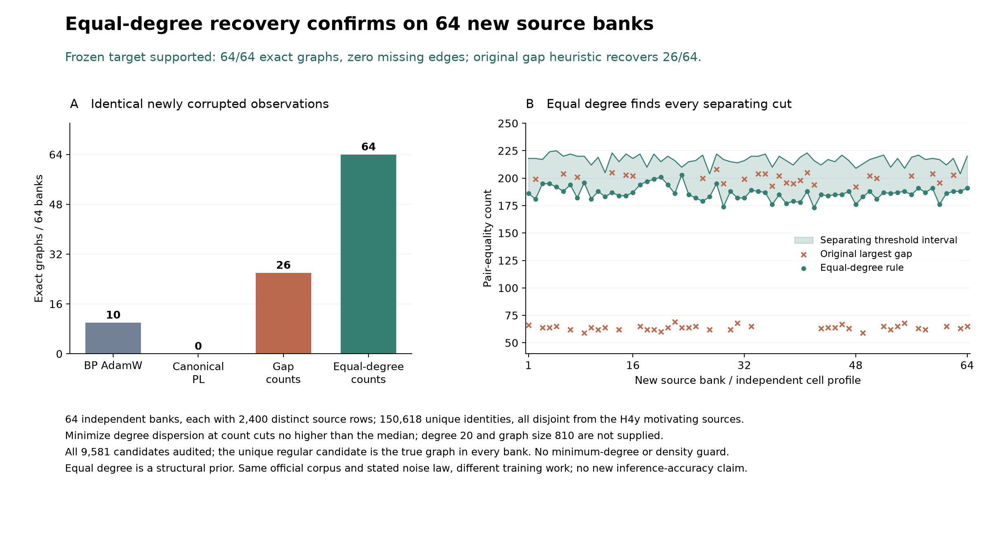

# H4af: equal-degree threshold recovery confirms on 64 new source banks

**The frozen target is supported: 64/64 exact Sudoku graphs, with zero missing or extra edges.** The unchanged restricted-gap heuristic recovers 26/64 on the identical observations. The new banks exclude every source identity from H4y, which supplied the clean observations used to develop the equal-degree rule.

| Estimator | Exact graphs / 64 | Missing true edge-bank pairs | Extra edge-bank pairs |
|---|---:|---:|---:|
| BP AdamW, 32 updates | 10 | 125 | 45 |
| Canonical PL, 256 updates, strong support | 0 | 1,957 | 0 |
| Original restricted-gap counts | 26 | 12,252 | 0 |
| Equal-degree threshold counts | **64** | **0** | **0** |

All 256 graph arms are eligible. Different training objectives and update budgets remain explicit; the comparison establishes no optimizer-superiority or matched-compute claim. No puzzle inference is run.

## What was fixed before the new observations

The [H4ae selector](REPORT-regularity-gap.md) is unchanged. Every distinct count at or below the median defines a nonempty graph retaining pairs whose equality counts are no larger than that cut. Choose the graph minimizing exact degree dispersion, `81 * sum(degree²) - sum(degree)²`, breaking ties by fewer edges and then lower cut. The selector receives **equal degree as a structural prior**, but no degree value, edge count or row/column/box geometry. There is no minimum-degree or density guard.

Each of 64 independently seeded banks contains **2,400 distinct source rows**, sampled without replacement within that bank. Cross-bank overlap is allowed and retained. A separately seeded eighteen-cell hot set has corruption weight eight, versus one elsewhere. Exponential races select exactly nine free cells per board, and nonzero digit offsets change their labels. Clues remain unchanged. All four estimators receive the same corrupted observations for each bank. New seeds, source exclusions, recipes, budgets and the conjunctive target—**at least 61 exact graphs and zero missing edges across all 64 banks**—are frozen before source draws. This is a finite decision, not a prespecified population-confidence statement.

The source design changes from H4ae's repeated four-bank quartets to 2,400 distinct rows per bank. This difference is explicit; the result confirms the fixed selector on the new design rather than isolating only the effect of source identities.

## Source provenance and complete candidate audit

The official training corpus contains 3,831,994 rows. The frozen exclusion union contains **84,999 identities**, including all **38,233 unique H4y identities** and four declared preceding Ripper source manifests. The eligible pool has **3,746,995 rows**. This exclusion scope does not establish globally untouched identities across every other repository experiment.

All 64 identity arrays are sealed before selected labels or corruption draws are materialized. The 153,600 appearances contain **150,618 distinct source identities** and **2,982 repeated cross-bank appearances**. Within-bank repeats and overlap with the declared exclusions are both zero. An independent auditor rebuilds the exclusion union, replays every seeded draw, and directly parses every selected answer and clue mask from the original CSV. It also verifies all complete Sudoku boards, each heatmap, random clock, digit offset and exactly-nine-free-cell corruption.

All **9,581 candidate thresholds** are retained and independently reconstructed. Every bank's unique minimum-dispersion candidate has dispersion zero and is the exact 810-edge, degree-twenty peer graph. Those values are outputs, not inputs. Selected cuts range from **173 to 203**. All count matrices remain strictly separable: the minimum nonpeer count exceeds the maximum true-edge count by **7–43**. The original gap selector fails on 38 banks despite this separability. No sparse regular tie occurs; the frozen rule would still choose the sparser graph in such a tie.

This strengthens the earlier fixed-source result under the stated concentrated-noise model. It does not establish robustness to arbitrary corruptions, nonregular constraints, other source distributions or noise so strong that no scalar threshold separates the edge classes. Exact graph recovery is assessed separately from puzzle-solving performance.

## Verification and runtime

The synthetic gate checks new source-draw uniqueness/exclusions, retained cross-bank overlap, corruption parity, inherited selector parity and correct worker bindings. Actual numerical gates compare canonical and unrestricted PL calculations against independent NumPy references on all four GPUs before fitting. The raw outcome audit checks all 64 stored fits, canonical update histories and final objective/gradient/KKT calculations, BP transforms, counts, all threshold candidates and all 256 graphs. Finite-update results are not claimed to be converged optima.

| Phase | Wall seconds | CPU seconds |
|---|---:|---:|
| Input preparation | 7.383346 | Not separately recorded |
| Independent source and original-CSV audit | 7.641453 | 7.640285 process CPU |
| Four-GPU numerical gate | 4.273863 | 11.408927 aggregate CPU |
| Four-GPU fitting | 13.117010 | 48.475181 aggregate CPU |
| Threshold selection | 0.154564 | Not separately recorded |
| Independent full outcome audit | 10.599319 | 10.590323 process CPU |

These are separately recorded phase costs; they exclude protocol preparation, synthetic preflight and publication. The gate-plus-fit four-GPU upper envelope is **1.159392 GPU-minutes**, below the fifteen-minute ceiling. Live samples show all four GPUs reaching 97% utilization and completed-job counts advancing to 64. Four persistent workers process independent banks; no duplicate fits or solver jobs are launched. Source arrays are loaded once per bank. Threshold selection takes about 0.155 seconds for all 64 banks; the fixed learned controls dominate the measured fit phase.

The public export contains every graph, coefficient/count diagnostic and candidate threshold, plus selected source identities and frozen exclusion arrays. The portable verifier replays the seeded draws, disjointness, overlap counts, all 9,581 candidates and all 256 graph scores. Proving the exclusion union from its original manifests and replaying CSV labels, raw corruptions and optimizer checkpoints still require the local archive; hashes do not replace those inputs.

[Frozen protocol](regularity_fresh.json) · [Independent raw audit](audit_regularity_fresh.py) · [Portable checker](verify_regularity_fresh_public.py) · [All results](../../../results/research/foureyes/regularity_fresh/summary.json) · [Every threshold](../../../results/research/foureyes/regularity_fresh/selection-records.json) · [Source provenance](../../../results/research/foureyes/regularity_fresh/source-provenance.json)
