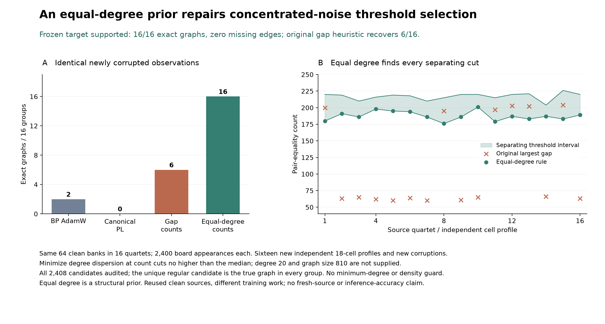

# H4ae: an equal-degree prior repairs concentrated-noise threshold selection

**The frozen target is supported: 16/16 exact Sudoku graphs, with zero missing or extra edges.** The original restricted-gap heuristic recovers 6/16 on the identical observations. The new selector receives an equal-degree prior, but neither the correct degree 20 nor the graph size 810. It learns no weights and runs no puzzle solver.

| Estimator | Exact graphs / 16 | Missing true edge-group pairs | Extra edge-group pairs |
|---|---:|---:|---:|
| BP AdamW, 32 updates | 2 | 32 | 17 |
| Canonical PL, 256 updates, strong support | 0 | 524 | 0 |
| Original restricted-gap counts | 6 | 3,220 | 0 |
| Equal-degree threshold counts | **16** | **0** | **0** |

All 64 graph arms are eligible. The learned controls use their fixed preceding recipes and different training work; this is not an optimizer-superiority or matched-compute comparison.

## Frozen intervention

H4ad showed that concentrating nine changed free digits toward eighteen cells could make the largest-gap heuristic select a threshold too low, even though an exact separating threshold existed. H4ae freezes an alternative selector before generating new cell profiles or corruptions. It uses the same 64 clean H4y banks, grouped into sixteen ordered quartets with 2,400 board appearances each, including repeated source rows. Each quartet receives its own independently seeded set of eighteen hot cells. Corruption weights are eight on that set and one elsewhere. Stable exponential races select exactly nine free cells per board; independent nonzero digit offsets change them, and clues remain unchanged.

All four estimators see exactly the same new observations. There is no new uniform-noise arm. This is a new randomization on previously examined clean sources, not fresh-source confirmation. No source row, query, or solver input is newly acquired.

For every distinct observed pair-equality count at or below the median count, keep all edges whose counts are no greater than that cut. Among these nonempty graphs, minimize the exact integer degree dispersion

\[
81\sum_i d_i^2-\left(\sum_i d_i\right)^2
=\sum_{i<j}(d_i-d_j)^2.
\]

Break ties by fewer retained edges, then lower cut. The selector receives no row, column or box geometry, degree value, or edge count. **Equal degree is supplied structural knowledge.** No minimum-density or minimum-degree guard is used. A synthetic 81-cycle/complete-graph tie verifies that the rule will choose the sparse degree-two cycle; such a real outcome would remain a failure if it missed true constraints.

The prespecified primary is at least fifteen exact graphs **and zero missing true edges across all sixteen groups**. All groups remain in the outcome. Numerical or resource failures would leave the study incomplete rather than become excluded cases.

## What the complete threshold audit shows

All **2,408 candidate thresholds** are retained and independently reconstructed. Every group has exactly one minimum-dispersion candidate, with dispersion zero, degree twenty at every cell and 810 edges. These are observed outputs, not selector inputs. Each selected graph is exactly the Sudoku peer graph.

Every new count matrix admits a separating scalar threshold. Its margin, minimum nonpeer count minus maximum true-edge count, ranges from **17 to 43**. The selected cuts range from 176 to 201. The original largest-gap rule chooses the exact graph in six groups and loses true edges in ten. This distinguishes a threshold-selection failure from an inability to separate the classes using equality counts on these observations.

The result does not prove robustness to all noise laws or all regular graphs. A sparse regular candidate can defeat the tie rule; if no scalar threshold separates true and false pairs, no threshold selector can recover the exact graph. Neither case occurs in these sixteen groups. No inference accuracy or new global-certificate search is measured.

## Validation and costs

Before freezing, thirty random/constant synthetic cases and the sparse-cycle tie agree among the producer, an independent literal auditor, and a pairwise-dispersion reference. Two corruption fixtures and wrapper bindings also pass. The source audit independently regenerates every heatmap, random clock and digit offset, reconstructs every clean bank, and checks every changed/free-cell condition. The numerical gate compares canonical loss/gradient at three vectors per GPU and unrestricted raw PL on seventeen rows against independent NumPy calculations.

The full outcome audit checks all sixteen stored fits, their 256-update canonical histories, final losses/gradients/KKT residuals, fixed BP transforms, raw counts, every candidate threshold, all ties and all 64 logical graphs. Stored finite-update gradients do not establish optimizer convergence. The portable checker reconstructs all public thresholds, degree statistics, support decisions, diagnostics and graph scores; replaying raw corruptions, checkpoints and objective histories requires the local archive.

Preparation takes **1.760045 wall seconds**. The four-GPU numerical gate takes **3.949630 wall / 11.541085 aggregate CPU seconds**, followed by **6.687121 wall / 22.044471 aggregate CPU seconds** for fitting. Threshold selection takes **0.046048 wall seconds**. The gate-plus-fit four-GPU upper envelope is **0.709117 GPU-minutes**, below the fifteen-minute ceiling. Live fit samples reach 97% utilization on all four GPUs and show completed-job counts advancing through 1, 5, 9, 13 and 16. Source and outcome audits are separate and have no combined runtime claim.

The bottleneck at this scale is GPU process initialization and the unchanged learned controls. The count selector itself takes under one twentieth of a second. Source arrays are loaded once per fit and independent group jobs share four persistent workers; no duplicate fits were launched to fill devices.

[Frozen protocol](regularity_gap.json) · [Selector](regularity_gap.py) · [Synthetic gate](regularity-gap-preflight.json) · [Independent raw audit](audit_regularity_gap.py) · [Portable public checker](verify_regularity_public.py) · [Summary and all graph outcomes](../../../results/research/foureyes/regularity_gap/summary.json) · [Every threshold candidate](../../../results/research/foureyes/regularity_gap/selection-records.json)
