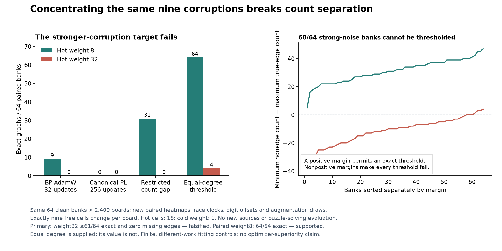

# H4ag: stronger concentrated corruption defeats equal-degree thresholds

**The frozen weight-32 target is falsified: 4/64 exact graphs, with 36,413 missing and eleven extra edge-bank pairs. The paired weight-8 control passes with 64/64 exact graphs and no missing or extra edges.** This isolates a failure under the declared corruption-intensity intervention on these reused sources; it is not a fresh-source or population confidence claim.

Every bank contains the same 2,400 distinct clean source rows used in H4af. Each receives a new independently seeded set of eighteen hot cells. Both arms share race clocks, nonzero digit offsets and augmentation seeds. Exactly nine free cells change per board; clues remain intact. The race assigns hot cells weight eight or thirty-two and all other cells weight one. Increasing this propensity changes where errors occur while holding the number of changed digits fixed. The 64 banks contain 153,600 appearances and 150,618 unique source IDs inherited from H4af; no source identities, labels or puzzle-solving inputs are newly acquired.

| Estimator | Weight 8 exact / 64 | Missing / extra | Weight 32 exact / 64 | Missing / extra |
|---|---:|---:|---:|---:|
| BP AdamW, 32 updates | 9 | 140 / 37 | 0 | 20248 / 0 |
| Canonical PL, 256 updates | 0 | 2029 / 0 | 0 | 8121 / 0 |
| Restricted count-gap threshold | 31 | 10249 / 0 | 0 | 20551 / 0 |
| Equal-degree threshold | 64 | 0 / 0 | 4 | 36413 / 11 |

Both endpoint rules require at least 61/64 exact graphs **and zero missing true edges across all banks**. All 128 jobs and all 512 estimator outputs remain included. Different fitting objectives and update counts are descriptive controls; this is not a matched-compute optimizer comparison or an optimum claim.

The equal-degree rule is unchanged. It considers every distinct equality-count cut at or below the median, minimizes the exact dispersion `81 * sum(degree²) − sum(degree)²`, and breaks ties by fewer edges then lower cut. It receives equal degree, without degree twenty, cardinality 810, geometry or a minimum-density guard.

The failure has a concrete boundary. All 64 weight-eight banks admit a separating count threshold; margins range from +5 to +47. Only four weight-thirty-two banks admit one; margins range from −39 to +4. Thus sixty strong-noise banks cannot be recovered by **any** scalar threshold on their observed equality counts. All four separable banks are recovered, with no wrong selection despite separability. In forty-five strong-noise banks the unnormalized dispersion rule chooses fewer than ten edges; all selected graph sizes, including these sparse failures, are retained. Selected strong-noise graphs range from one to 813 edges. No post-hoc density guard or threshold change is applied.

This distinguishes two facts: overlapping counts make exact threshold recovery impossible in sixty observed banks, while the dispersion objective often selects an especially sparse failure. The first does not establish that all graph estimators must fail, or that overlap would persist with infinitely many observations. A supplied per-cell degree constraint is a prospective follow-up, not a result of this experiment.

The protocol and all scientific source hashes were frozen before drawing the new corruptions. A separate corruption helper explicitly handles both weights; the inherited weight-eight-only helper is not used for weight thirty-two. Twelve synthetic literal-race cases include exact ties, unit clocks and the smallest positive floating-point clocks. The independent source audit reconstructs all paired arrays, every chosen corruption cell and changed digit, and verifies that stronger hot weights never reduce the number of hot selections under shared clocks. The prior H4af CSV audit supplies the clean-source evidence; this study performs bitwise replay of those audited sources, not a new CSV parse.

The raw outcome audit independently reconstructs counts, BP transforms, canonical objectives/gradients/KKT residuals, and all 18,843 threshold candidates and tie breaks. Four GPUs each pass raw and canonical loss/gradient gates for both conditions. All four reach 97% sampled utilization and the queue advances to 128/128 complete with no failed jobs.

| Phase | Wall seconds | Aggregate CPU seconds |
|---|---:|---:|
| Paired data preparation | 13.754690 | Not separately recorded |
| Independent source/corruption audit | 5.011772 | 5.011056 |
| Four-GPU correctness gate | 4.704539 | 14.668269 |
| All 128 BP/canonical fits | 21.384123 | 82.584508 |
| Threshold selection | 0.305853 | Not separately recorded |
| Independent outcome audit | 18.859979 | 18.848010 |

The gate-plus-fit four-GPU allocation envelope is 1.739244 GPU-minutes, below the frozen fifteen-minute ceiling; it is not a kernel-active GPU-time measurement. Preparation and audits remain CPU costs. Packaging and the portable verification below are separate.

Run `upstream/.venv/bin/python research/20261114/foureyes/verify_regularity_intensity_public.py`. It replays all 512 exported graph results, every candidate threshold, paired per-cell counts, margins and endpoint decisions using only public data. Exact race clocks, masks, raw clean/corrupted boards, checkpoints and objective histories require the separately retained local archive.

[Frozen protocol](regularity_intensity.json) · [Study runner](regularity_intensity_study.py) · [Independent raw audit](audit_regularity_intensity.py) · [Portable verifier](verify_regularity_intensity_public.py) · [Full results](../../../results/research/foureyes/regularity_intensity/) · [Earlier fresh-source confirmation](REPORT-regularity-fresh.md)
