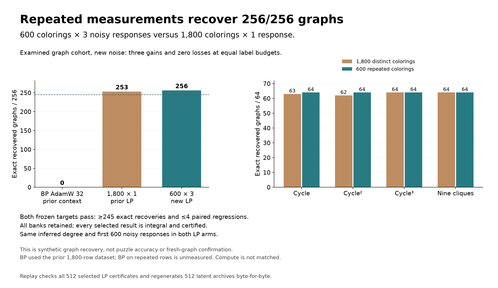

# Repeated noisy measurements recover 256/256 examined graphs

Three independently corrupted responses to each of 600 underlying colorings recover **256/256 exact graphs**, versus **253/256** from 1,800 distinct colorings observed once. Both methods use 1,800 noisy board responses per bank. The repeated-response arm gains banks **105, 168 and 197**, with **zero paired losses**. Both separately frozen targets pass: at least 245 exact recoveries and at most four regressions.



This is an intervention on the **examined H4bc graph/source cohort with new noise**, not a fresh-graph confirmation. The prior 253/256 baseline is reused unchanged. The result does not establish that repeated measurements outperform source diversity in general, or that the three-case difference reflects a population advantage.

## Complete comparison

| Method | Cycle /64 | Cycle² /64 | Cycle³ /64 | Nine cliques /64 | Exact /256 |
|---|---:|---:|---:|---:|---:|
| BP AdamW, prior 32-update distinct-row control | 0 | 0 | 0 | 0 | 0 |
| Prior LP, 1,800 distinct colorings × one response | 63 | 62 | 64 | 64 | 253 |
| New LP, 600 colorings × three responses | **64** | **64** | **64** | **64** | **256** |

BP is previously measured context on the distinct-row dataset; **BP on the repeated-row dataset is unmeasured**. This comparison does not match optimizer compute or establish convergence. Every new selected LP result is integral and exact; no result is unresolved. The two LP arms use the identical degree previously inferred from their shared first 600 noisy responses. Neither fit receives the true graph, an oracle-supplied degree, heatmap or realized corruption positions.

The graph families are an 81-node cycle, its second and third powers, and nine disjoint nine-cliques, each with 64 independently relabeled banks. Every noisy row changes exactly nine cells under the inherited sampler: 18 fixed hot cells receive weight 32. The new responses are independent conditional on the fixed clean row and hot-cell map. That differs from the [correlated-repeat official-source study](../ripper/REPORT-correlated-repeat.md); its law, source distribution and inference method are not interchangeable with this experiment.

## Observation and proof accounting

Each new arm reuses the original first 600 noisy rows, then adds two independently seeded 600-row responses to those same underlying colorings. All original and repeated raw streams are independently reconstructed. Global source and fit seals precede outcome joins. Every bank contains 600 unique underlying colorings and 1,800 distinct noisy response rows; the baseline contains 1,800 unique clean and noisy rows. No coincident repeat-response rows are discarded.

| Quantity | All 256 banks |
|---|---:|
| New clean rows | 0 |
| Newly acquired noisy cell responses | 24,883,200 |
| Each standalone arm's noisy cell responses | 37,324,800 |
| Physical union, including the earlier baseline | 62,208,000 |
| New LP fits | 256 |
| New BP fits | 0 |
| Selected LP certificates checked, both arms | 512 |
| Rejected proof mutations | 1,536 |

The selected certificates prove optimality, not uniqueness. All 256 new truth-objective gaps are zero. Original baseline gaps and the three prior failures remain in the [parent report](REPORT-fresh-pooled-donor.md). Post-fit corruption overlaps are retained per bank; they never enter fitting or select observations.

## Reproduction and runtime

- [Prospective design](repeat-versus-diversity-proposal.json), [synthetic gate](repeat-diversity-preflight.json), and [seed audit](repeat-diversity-seed-audit.json).
- [Frozen protocol](repeat-versus-diversity.json): `8227724e8472ffe82f039a9eb3bce3c25db83c4879d46f3b598b657c720b6ec9`.
- [Every outcome](../../../results/research/foureyes/repeat_diversity/summary.json), [runtime and progress samples](../../../results/research/foureyes/repeat_diversity/runtime.json), and [public file manifest](../../../results/research/foureyes/repeat_diversity_public_manifest.json).
- [Unchanged scientific auditor](audit_repeat_diversity.py) and [portable verifier](verify_repeat_diversity_public.py).

The single run completed in **12.057208 wall seconds / 71.937621 aggregate CPU seconds**, below its frozen 120-wall/600-CPU limits. All 24 worker processes exited successfully. At 10.395 seconds, counters showed 256 sources, 256 fits and 224 completed bank audits; all 256 audits subsequently completed. Eight CPU workers run the exact source/LP/certificate pipeline. It has no eligible GPU stage.

```sh
OPENBLAS_NUM_THREADS=1 OMP_NUM_THREADS=1 MKL_NUM_THREADS=1 \
  python research/20261114/foureyes/verify_repeat_diversity_public.py
```

The public verifier requires NumPy and regenerates all 256 original raw archives and all 256 new repeat-noise archives **byte-for-byte in temporary directories**. It replays the frozen independent provenance/count/proof auditor and both endpoints without solving LPs, retraining BP or acquiring new observations. Historical audit timestamps are used only to compare receipts. The bootstrap replay took 7.321670 seconds. An [independent review](../../../results/research/foureyes/repeat_diversity/independent-review/h4be-independent-final-review.json) replayed the public audit in 7.307962 seconds and separately reconstructed all 512 count vectors, truth graphs and integer certificates without importing study helpers. Its receipt binds the pre-editorial package snapshot; the final manifest also includes these review receipts. The original fitting environment used NumPy 2.3.4 and HiGHS 1.12.0; verification needs neither HiGHS nor a GPU.

The previously published H4bc audit failure and H4bd correction remain unchanged. This new H4be run completed without that failure. Fresh confirmation of the repeated-measurement result was not run before the user requested that research stop.
