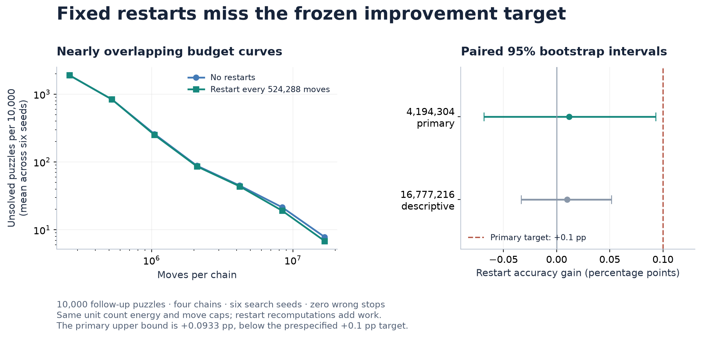

# Fixed restarts do not meet the accuracy-gain target

Restarting active Sudoku chains every 524,288 moves **failed the frozen +0.1 percentage-point improvement target** at 4,194,304 moves per chain. The observed gain was +0.0117 points, with a paired two-sided 95% bootstrap interval of [−0.0684, +0.0933]. This falsifies the stated effect-size hypothesis under the prespecified decision rule; it does not establish that every restart schedule is ineffective.

| Method | Accuracy at 4,194,304 moves | Accuracy at 16,777,216 moves | Wrong stops |
|---|---:|---:|---:|
| BP AdamW | Outside this inference-only comparison | No matched local result | — |
| Count energy, no restarts | 99.5500% | 99.9217% | 0 |
| Same energy, restart every 524,288 moves | 99.5617% | 99.9317% | 0 |

The final column of accuracy is a prespecified **descriptive secondary endpoint**, with gain +0.0100 points and interval [−0.0333, +0.0517]. At the primary endpoint, 140 input–seed cases improved and 133 regressed. At the secondary endpoint, 40 improved and 34 regressed. The joint all-six-seed success statistics in the public export are descriptive; this experiment did not preregister an absolute 99% joint-success claim.

Both arms used the same 10,000 official puzzles at `full-all[70000,80000)`, six search seeds, four chains, unit count weights, zero unary costs, focused Gibbs search, temperatures 0.4→0.31, cyclic annealing period 524,288, and checks every 4,096 moves. The restart arm uses the pinned upstream randomization branch, preserves clues and completed puzzles, and retains earlier best boards. No restart-period tuning was performed. The count graph and its augmented training provenance are described in the [budget report](REPORT-budget.md).

The first restart occurs after the board capture at 524,288 moves. Both arms' saved boards, stopping indicators and move counts are exactly equal through that boundary for every seed. Each production run first passed eight native-general/captured-general/captured-sparse parity checks; the restart preflight forced eight restarts using an impossible stopping threshold. An independent auditor recomputed all integer fields and energies, validated **840,000 saved boards**, checked official input identities and hashes, and verified preservation of earlier stopped boards. There were no wrong stops.

Uncertainty uses 5,000 paired two-way bootstrap draws over six seed labels and 10,000 shared puzzles, with RNG seed 20261114. Repeated seeds are not new unique test inputs or independent learned models. Equal move caps are not equal compute: restarts require extra field recomputations. The follow-up slice was new to these research interventions but belongs to the corpus evaluated in the original reproduction.

[Frozen protocol](restart.json) · [runner](restart.py) · [capture implementation](restart_capture.py) · [independent auditor](audit_restart.py) · [public summary and hashes](../../../results/research/foureyes/restart/summary.json) · [per-seed results](../../../results/research/foureyes/restart/per_seed.csv)
