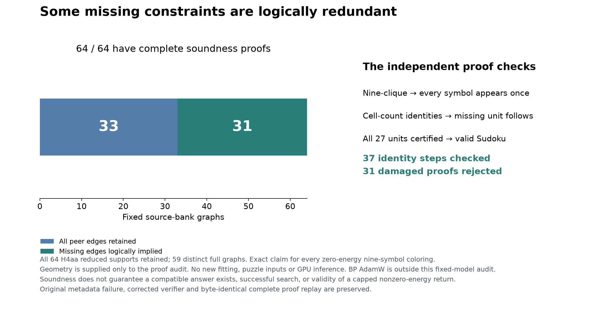

# H4ab: all 64 reduced Sudoku graphs are globally sound

**The frozen all-64 hypothesis is supported by exact, independently replayed proofs.** Every zero-energy coloring over nine symbols of each H4aa strong-only graph is an ordinary valid Sudoku board. This is a statement about all colorings of these fixed graphs, stronger than observing no invalid solver returns.

| Audit category | Graphs |
|---|---:|
| BP AdamW: outside this fixed canonical-PL graph audit; not refitted | — |
| All true peer edges retained; direct unit proofs | 33/64 |
| Some true peer edges absent; remaining constraints imply all units | 31/64 |
| Globally sound, complete independent proof | **64/64** |
| Explicitly unsound / unresolved | **0 / 0** |

All 64 supports are unchanged from the preceding deletion study. The producer reconstructs them from the published FP64 coefficients using the fixed median-positive-coefficient/4 threshold, checks the original weight hashes, and deduplicates only identical complete supports. There are 59 distinct supports. No source examples, test inputs, fit, inference setting or graph is changed or selected.

The proof starts with nine-cliques: nine mutually constrained cells must contain all nine symbols. Digit-count identities then transfer this property between partitions of the same cells. If the certified units on one side cover the same cell multiset as the certified units plus one missing unit on the other, subtraction proves that the missing unit also contains every symbol exactly once. Repeating this induction certifies all 27 rows, columns and boxes.

The independent verifier reconstructs units and edges from coordinates, checks every clique, and replays each identity using integer cell multiplicities. Across the 64 bank mappings, it checks **37 count-identity steps** and rejects **31 deliberately damaged proofs**. These counts include repeated bank mappings. Geometry is supplied to the proof audit; it was not used to fit or prune the models. All proofs finish in closure, so the frozen bounded counterexample search is never needed. If a proof had remained incomplete, that case would have stayed unresolved unless an explicit invalid zero-energy board was found.

The claim is about certificate soundness, not certificate existence for every puzzle or search success. The prior H4aa experiment still has 84.75% canonical-target compatibility and 72.38% exact-match accuracy at its fixed search cap; extra exclusions can rule out valid answers. A capped return is not automatically covered by a zero-energy proof.

## Preserved verifier correction and timing scope

The original producer completed its proof files, and the verifier checked them, but summary construction failed when `sha(__file__)` passed a string to a helper expecting a `Path`. The separate corrected verifier changes only that helper to normalize its argument with `Path(p)`. The frozen protocol, producer and original verifier remain unchanged. A complete isolated replay with the unchanged producer and corrected verifier yields **byte-identical supports, certificates and outcome summary**.

The first failed attempt did not emit its internal timing receipt. An initial metadata note inferred a CPU bound from the tool wrapper's clock; that inference is explicitly withdrawn, and complete CPU accounting for that attempt is unavailable. The separate complete replay records **0.166601 aggregate CPU seconds / 0.200864 wall seconds**, including process startup, imports and the parent monitor, within its 180 CPU-second / 240 wall-second ceilings. Those are replay costs, not total development costs or a speed claim. There is no GPU work or solver rerun.

[Frozen protocol](strong_support_soundness.json) · [Producer](strong_support_soundness.py) · [Original verifier](verify_strong_support_soundness.py) · [Corrected public verifier](verify_strong_support_soundness_corrected.py) · [Correction and timing clarification](strong-soundness-audit-correction.json) · [Initial superseded metadata](strong-soundness-audit-correction-initial.json) · [Exact code diff](strong-soundness-audit-correction.diff) · [Complete replay](replay_strong_support_soundness.py) · [Public proofs and supports](../../../results/research/foureyes/strong_support_soundness/) · [Original inference experiment](REPORT-strong-support-study.md)
