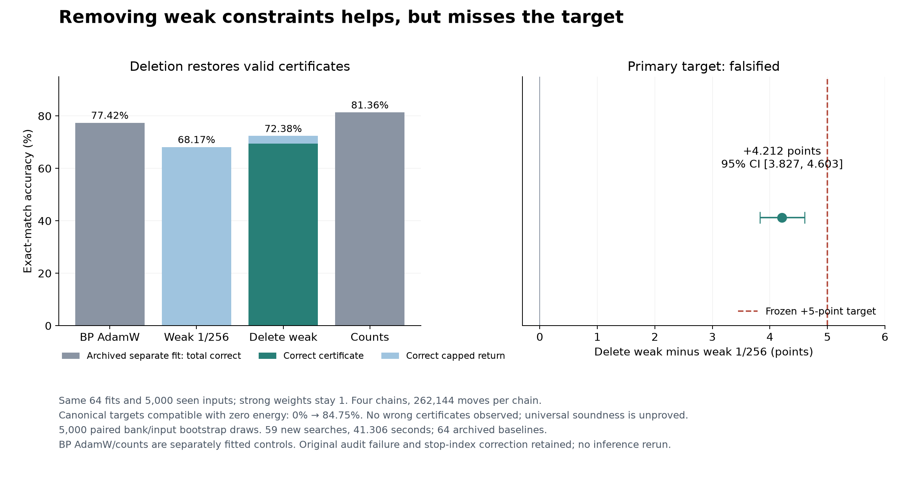

# H4aa: deleting weak constraints restores certificates, below the gain target

**The frozen ≥5-point gain target is falsified.** Removing weak edges raises exact-match accuracy from 68.1663% to **72.3781%**, a **4.2119-point** gain with paired 95% interval **[3.8266, 4.6035]**. Unlike positive reweighting, deletion changes the zero set and restores many valid certificates. This uses all 64 H4y fits and the same already-seen 5,000 puzzles; it is a post-hoc mechanism study.

| Method | Exact-match accuracy (%) | Correct certified (%) | Correct capped (%) | Invalid certificates |
|---|---:|---:|---:|---:|
| BP AdamW, inherited separately fitted H4y control | 77.4172 | See H4y | See H4y | See H4y |
| Weak weight 1/256, archived H4z | 68.1663 | 0 | 68.1663 | 0 |
| Delete weak edges, retain strong unit weights | 72.3781 | 69.5072 | 2.8709 | 0 |
| Restricted counts, inherited separately fitted H4y control | 81.3600 | See H4y | See H4y | See H4y |

The median-positive-coefficient/4 split, source models and all inference settings are fixed from H4z. Only the low-coefficient edges change from positive weight 1/256 to zero; strong weights stay one. No geometry, target label, structural score or bank selection enters this intervention. BP AdamW and counts use separately fitted supports and are inherited descriptive controls.

Canonical-target zero-energy compatibility rises from **0% to 84.7547%**. Conflicts between fixed clues fall from **72.4116% to 1.5503%** of bank/input pairs. Deletion therefore changes feasibility as well as trajectories. The experiment does not separate those two effects. Each retained strong graph has 808–816 edges; 31/64 omit at least one true edge, and 47/64 retain at least one false exclusion. **Zero observed invalid certificates is not a universal soundness proof** for these reduced supports.

There are 222,423 correct certified returns and 9,187 correct capped returns across the 320,000 logical bank/input evaluations in the deletion arm. Identical full supports share searches, leaving 59 new trajectories and 202,083 unique certified returns. All are valid and match the official answer; no noncanonical valid answer was observed. The auditor checks all 615,000 returned boards from these 59 new and 64 archived searches, including fixed clues, integer energy, independent Sudoku validity, models, receipts and output hashes.

The frozen comparison uses rows [410000,415000), four chains, seed zero, 262,144 moves per chain, temperature 0.4→0.31, focus threshold 0.45 and stopping tolerance 0.001. The primary is a conjunction of a ≥5-point gain and zero invalid certificates. Its paired two-way interval resamples 64 banks and 5,000 shared inputs, using 5,000 draws with seed 20261116041. It does not treat all bank/input cells as independent observations. The new four-worker search phase takes **41.306 seconds**, within the frozen 180-second / 12 GPU-minute envelope; its actual elapsed allocation envelope is 2.754 GPU-minutes. No new source or test rows were consumed.

## Preserved audit correction

The original frozen auditor stopped before producing a summary because it incorrectly required certified move indices to be multiples of 4,096. The kernel records the first successful **individual move**; 4,096 is the host collection/refresh interval. Of 202,083 unique certified stops, 202,032 occur between those boundaries. The corrected auditor requires an integer move in [1,262144], still requires every capped return to report 262,144, and preserves all board, energy, validity and decision checks.

The original auditor and protocol remain unchanged. A separate corrected auditor, exact two-change diff and pre-audit hashes preserve the correction. The second change only binds the already completed source audit to the original auditor's hash. All 295 new-job files are unchanged, and no search was rerun. An independent agent checked the exact text/AST difference, kernel semantics, all stop indices and hashes. H4z had no certified stops, so the corresponding check there was vacuous and its results are unaffected.

[Frozen protocol](strong_support_study.json) · [Original auditor](audit_strong_support_study.py) · [Corrected auditor](audit_strong_support_study_corrected.py) · [Correction receipt](strong-support-audit-correction.json) · [Exact diff](strong-support-audit-correction.diff) · [Public verifier](verify_strong_support_study.py) · [Summary and packed outcomes](../../../results/research/foureyes/strong_support_study/) · [H4y controls](REPORT-canonical-confirm.md)
